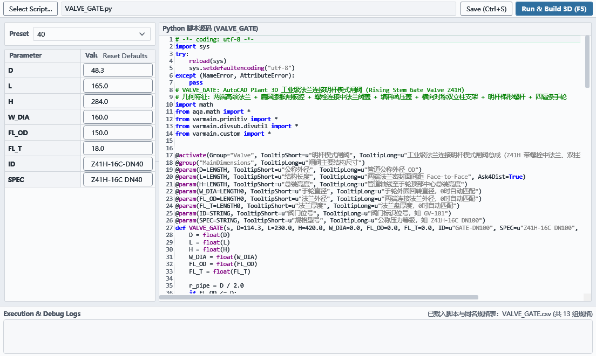
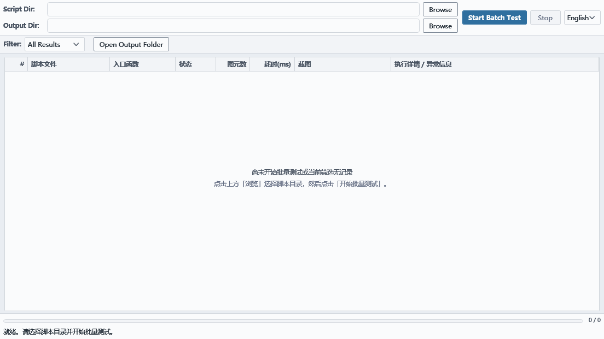
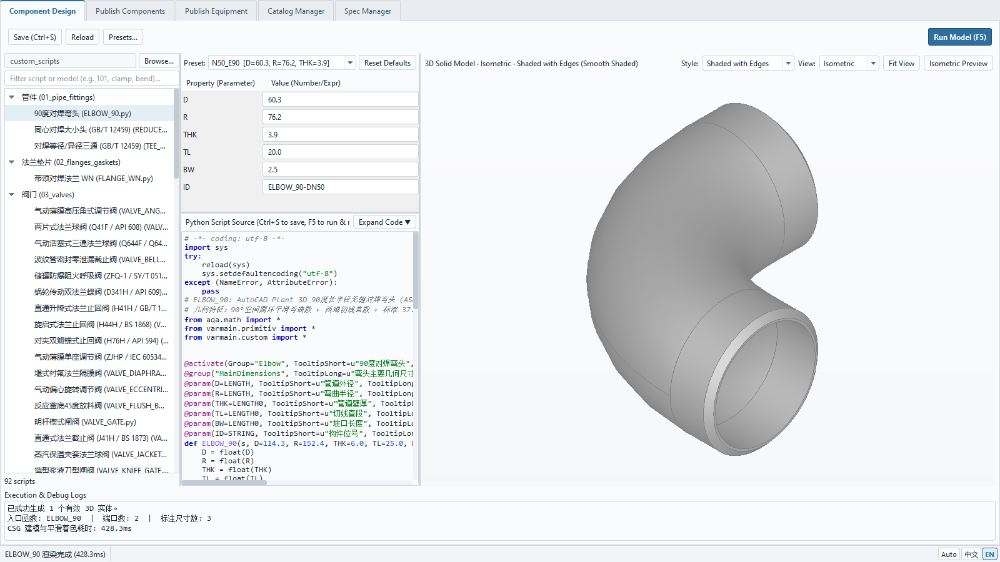
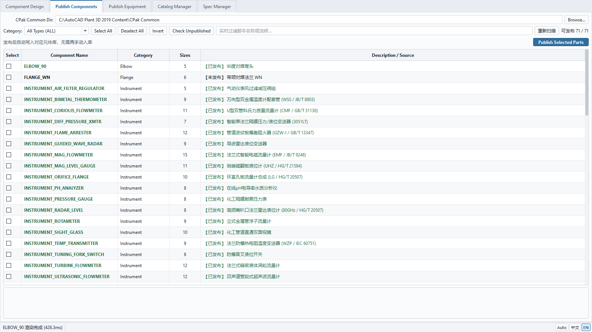
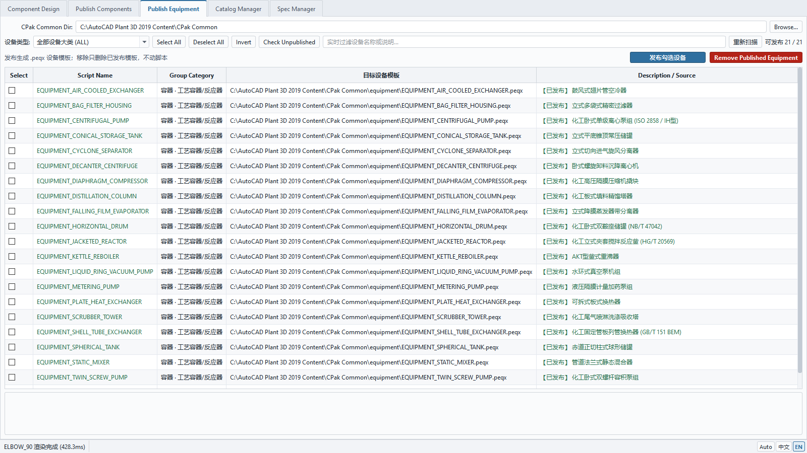
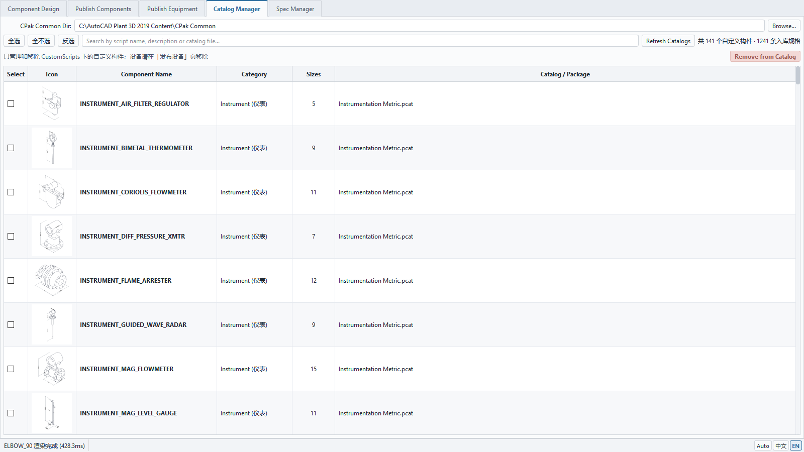

<p align="center">
  
</p>

<h1 align="center">P3dPyPad</h1>

<p align="center">Parametric component design, hot-reload debugging, PyOCC offline simulation, and WebAssembly 3D workbench for AutoCAD Plant 3D 2019-2026.</p>

<p align="center">
  <a href="./README.md">English</a> | <a href="./README.zh-CN.md">简体中文</a>
</p>

<p align="center">
  <a href="./LICENSE"></a>    <a href="https://zly258.github.io/P3dPyPad/"></a>
</p>

P3dPyPad is an engineering toolkit for AutoCAD Plant 3D parametric Python component development. It brings together an in-process AutoCAD Plant 3D C#/WPF plugin, a standalone Python 3 + OpenCASCADE (PyOCC) desktop workbench, a zero-dependency WebAssembly 3D browser studio, and a curated library of 494 parametric component scripts.

## Highlights

| Highlight | Why it matters |
|---|---|
| Zero-restart hot reload in Plant 3D (`PYPAD`) | Uses an in-memory proxy (`DEV_PROXY.py`) and `PnP3dACPAdapter.arx` so pressing `F5` regenerates 3D solids in the active viewport without restarting AutoCAD. |
| Automated batch testing (`PYBATCH` / `PYBATCH_RUN`) | Recursively validates directories of `.py` scripts, captures isometric previews, and surfaces Python stack traces for unattended CI and regression checks. |
| Standalone PyOCC offline workbench (`plant3d_occ/`) | Aligns Plant 3D geometric primitives on Python 3 + OpenCASCADE (`pythonocc-core`) and PySide6, enabling offline modeling, 45-degree architectural-tick dimensioning, and `.acat`/`.pcat`/`.peqx`/SQLite publishing without launching AutoCAD. |
| WebAssembly 3D studio (`web/`) | Runs OpenCASCADE WASM (`occt.js`) and Three.js in any modern browser with zero Node.js runtime dependencies, orthographic CAD controls, bilingual UI, and dual-mode isometric PNG export. |
| 494 parametric component scripts (`pyscripts/`) | Covers custom fittings, flanges, valves, instruments, equipment, system defaults, and pipe supports (CD/ZD 2010 and HG/T 21629) with co-located `.csv` specification discovery. |
| Dual-target .NET plugin support | Multi-targets `net472` (AutoCAD Plant 3D 2019-2024) and `net8.0-windows` (AutoCAD Plant 3D 2025-2026) in a single `P3dPyPad.bundle` autoloader package. |

## Architecture

P3dPyPad separates shared parametric script assets from three execution frontends that consume the same `pyscripts/` catalog:

```text
┌──────────────────────────────────────────────────────────────────────────────┐
│                 Shared Assets & Agent Skills (pyscripts/ , skills/)          │
│  ┌───────────────────────────────────┐   ┌────────────────────────────────┐  │
│  │ 494 Parametric Scripts            │   │ plant3d-python-cad-generator   │  │
│  │ custom_scripts / supports /       │   │ Dual-end Python 2.7 / 3.x      │  │
│  │ system_defaults + co-located CSV  │   │ modeling rules & templates     │  │
│  └─────────────────┬─────────────────┘   └───────────────┬────────────────┘  │
└────────────────────┼─────────────────────────────────────┼───────────────────┘
                     │                                     │
        ┌────────────┴──────────────────┬──────────────────┴────────────┐
        │                               │                               │
        ▼                               ▼                               ▼
┌───────────────────────────┐  ┌────────────────────────────┐  ┌──────────────────────────┐
│ AutoCAD Plant 3D Plugin   │  │ PyOCC Desktop Workbench    │  │ WebAssembly 3D Studio    │
│ src/P3dPyPad/ (C# / WPF)  │  │ plant3d_occ/ (Python/Qt)   │  │ web/ (Node.js / WASM)    │
├───────────────────────────┤  ├────────────────────────────┤  ├──────────────────────────┤
│ Ribbon: PYPAD, PYBATCH,   │  │ 3-Column PySide6 Studio    │  │ Zero-dep server.js &     │
│ PYLANG, PYABOUT           │  │ (Tree + Props + 3D View)   │  │ sync_pyscripts.js mirror │
│             │             │  │             │              │  │            │             │
│             ▼             │  │             ▼              │  │            ▼             │
│ DEV_PROXY.py ──▶          │  │ 1:1 Primitives & CSG       │  │ transpiler.js ──▶        │
│ PnP3dACPAdapter.arx       │  │ (pythonocc-core B-Rep)     │  │ occt.js (WASM) + Three.js│
│             │             │  │             │              │  │            │             │
│             ▼             │  │             ▼              │  │            ▼             │
│ Single Pad & Batch Runner │  │ Offscreen Render & Catalog │  │ Clean & Annotated PNG    │
│ (AvalonEdit + CSV)        │  │ (.acat/.pcat/.peqx/SQLite) │  │ Export + GitHub Pages    │
└───────────────────────────┘  └────────────────────────────┘  └──────────────────────────┘
```

## Usage Example

### Single Component Script Pad (`PYPAD`)

Open a component script inside AutoCAD Plant 3D, edit parameters or Python code with AvalonEdit syntax highlighting, auto-load co-located `.csv` specification tables (such as `VALVE_GATE.csv`), and press `F5` to redraw the 3D solid immediately.



### Automated Batch Test Runner (`PYBATCH`)

Scan a directory recursively to execute scripts in batch, generate isometric previews, and inspect full Python tracebacks on any failed component.



### PyOCC Standalone Workbench & Offscreen Preview

Inspect and edit component geometry offline in the 3-column PySide6 workbench, then render shaded-with-edges previews and isometric dimension drawings using `plant3d_occ/catalog/preview.py`.




### Catalog, Equipment & SQLite Spec Publishing

Publish validated scripts directly into `.acat`/`.pcat` catalogs, `.peqx` equipment templates, and CPak Common SQLite databases.

| Publish Component | Publish Equipment | Catalog Manager |
|---|---|---|
|  |  |  |

## Open-Source Script Library (494 Scripts)

P3dPyPad open-sources **572** parametric component scripts (with **412** co-located `.csv` specification tables) under [`pyscripts/`](./pyscripts/). See the [Chemical Industry 170-Script Library README](./pyscripts/custom_scripts/README.md) (bilingual EN/ZH-CN), the [Plant 3D 2026 Ready-to-Use Bundle Guide](./docs/%E4%BD%BF%E7%94%A8%E8%AF%B4%E6%98%8E(AutoCAD%20Plant%203D%202026).md), and the [Online 3D Workbench & Report](https://zly258.github.io/P3dPyPad/) for catalog details and direct usage.


| Library | Directory | Scripts | CSV Specs | Coverage | Full List / Guide |
|---|---|---:|---:|---|---|
| Chemical Industry Custom Components | `pyscripts/custom_scripts/` | 170 | 170 | Flanges & blinds (22), pipe fittings & olets (28), valves (27), instruments (22), supports (19), equipment (29), specialty items (23) — 1,876 spec rows | [Custom Scripts README (EN/ZH)](./pyscripts/custom_scripts/README.md) |
| Power Industry Pipe Supports (CD/ZD 2010) | `pyscripts/supports/cd_zd2010/` | 83 | 83 | Vol.1-Vol.8: pipe clamps, integral attachments, connectors, variable/constant springs, dynamic loads, structural frames | [View all 83](./docs/SCRIPTS.md#2-power-industry-pipe-supports---cdzd-2010-83-scripts) |
| Chemical Industry Pipe Supports (HG/T 21629) | `pyscripts/supports/hgt_21629/` | 159 | 159 | Series A-Y: hangers, springs, embedments, guides, trunnions, pipe shoes, cold/hot insulated supports, dampers, U-bolts | [View all 159](./docs/SCRIPTS.md#3-chemical-industry-pipe-supports---hgt-21629-159-scripts) |
| AutoCAD Plant 3D System Defaults | `pyscripts/system_defaults/` | 160 | 0 | Supports (49), fittings (36), flanges/gaskets/blinds (15), pipes/nozzles/olets (10), valves/actuators (33), instruments (9), equipment/pumps (8) | [View all 160](./docs/SCRIPTS.md#4-autocad-plant-3d-system-defaults-160-scripts) |
| **Total** | **`pyscripts/`** | **572** | **412** | Verified with PyOCC 3D solid rendering and Plant 3D catalog inspection | [Custom Scripts README](./pyscripts/custom_scripts/README.md) |

## Quick Install

Clone the repository first:

```bash
git clone https://github.com/zly258/P3dPyPad.git
cd P3dPyPad
```

Choose the environment you need:

### 1. WebAssembly 3D Studio (Browser / Node.js)

No npm packages are required (`web/server.js` uses built-in Node.js modules only). Prerequisites: Node.js 18+.

- Online demo (no local install): [https://zly258.github.io/P3dPyPad/](https://zly258.github.io/P3dPyPad/)

### 2. PyOCC Offline Desktop Workbench (Python 3)

Prerequisites: Python 3.10+ with Conda recommended for native OpenCASCADE bindings.

```bash
conda install -c conda-forge pythonocc-core
pip install -r requirements.txt
```

Core Python dependencies in [requirements.txt](./requirements.txt): `pythonocc-core>=7.7.0`, `PySide6>=6.5.0`, `matplotlib>=3.7.0`, and `Pillow>=9.5.0`.

### 3. AutoCAD Plant 3D Plugin (Windows / .NET)

Prerequisites: Windows x64, AutoCAD Plant 3D 2019-2026, and .NET SDK (supporting `net472` and/or `net8.0-windows`).

```powershell
dotnet build P3dPyPad.sln -c Release
```

Building `src/P3dPyPad/P3dPyPad.csproj` automatically deploys `P3dPyPad.bundle` to `C:\Program Files\Autodesk\ApplicationPlugins\P3dPyPad.bundle` (set `-p:SkipBundleDeploy=true` to skip automatic deployment).

To build Windows installers with Inno Setup:

```powershell
# Standalone AutoCAD plugin installer
pwsh -File installer/Publish-PluginExe.ps1

# Standalone PyOCC workbench (portable ZIP + installer EXE)
pwsh -File installer/Publish-OccExe.ps1

# All release packages
pwsh -File installer/Publish-Release.ps1
```

## Quick Start

### Launch the WebAssembly 3D Studio

Start the local server from the repository root:

```bash
npm start
```

Open `http://127.0.0.1:3000/` in a modern browser. Select any component from the 494-script catalog (or filter by keyword), adjust `@param` values or Python code, and press `F5` to render the 3D B-Rep solid.

### Launch the PyOCC Desktop Workbench

```bash
# Open the full pyscripts/ catalog tree
python plant3d_occ/main.py

# Or open a specific component script directly
python plant3d_occ/main.py pyscripts/custom_scripts/03_valves/VALVE_GATE_GBT12221.py
```

### Run inside AutoCAD Plant 3D

After deploying `P3dPyPad.bundle` and launching AutoCAD Plant 3D:

1. Type `PYPAD` on the AutoCAD command line (or use the P3dPyPad Ribbon tab).
2. Load a script such as `pyscripts/custom_scripts/03_valves/VALVE_GATE_GBT12221.py`.
3. Press `F5` to generate or hot-reload the 3D component solid in the active drawing.

## Commands

### AutoCAD Plant 3D Commands

| Command | Purpose |
|---|---|
| `PYPAD` | Open the single-component script editor and hot-reload pad. |
| `PYBATCH` | Open the interactive batch test runner for recursive script verification. |
| `PYBATCH_RUN` | Run unattended batch verification from the command line or LISP. |
| `PYLANG` | Toggle plugin UI language between Chinese and English. |
| `PYABOUT` | Display plugin version and environment information. |

### CLI, Web & Test Commands

| Command | Purpose |
|---|---|
| `npm start` | Start the local WebAssembly 3D studio server on port `3000` (auto-increments if occupied). |
| `npm run sync --prefix web` | Sync `pyscripts/` into `web/public/pyscripts/` and rebuild `pyscripts_manifest.json`. |
| `python plant3d_occ/main.py [SCRIPT_OR_DIR]` | Launch the PyOCC desktop workbench on the root catalog or a target path. |
| `python plant3d_occ/main.py --render-preview <SCRIPT> --output-dir <DIR>` | Render offscreen isometric preview images via CLI. |
| `python -m unittest discover -s tests -p "test_*.py"` | Run the Python unit and compatibility test suite. |
| `python tests/test_all_supports.py` | Validate single-connected B-Rep topology across pipe support scripts. |

## Configuration and Integrations

### Build & Runtime Environment Variables

| Variable | Scope | Description |
|---|---|---|
| `CAD_LIB_2019` | MSBuild (`Directory.Build.props`) | Override AutoCAD 2019-2024 managed DLL directory (`accoremgd`, `acdbmgd`, `acmgd`, `AdWindows`). |
| `CAD_LIB_2026` | MSBuild (`Directory.Build.props`) | Override AutoCAD 2025-2026 (.NET 8.0) managed DLL directory. |
| `PLANT3D_LIB_2019` | MSBuild (`Directory.Build.props`) | Override Plant 3D library directory (`PLNT3D`). |
| `PORT` | Web studio (`web/server.js`) | Override default local HTTP port (`3000`). |

### Dual-End Script Compatibility Rules

To keep parametric scripts compatible across both AutoCAD Plant 3D (Python 2.7) and PyOCC (Python 3.x):

1. Declare UTF-8 encoding within the first 7 lines of each script:

```python
# -*- coding: utf-8 -*-
#coding=utf-8
import sys
try:
    reload(sys)
    sys.setdefaultencoding('utf-8')
except (NameError, AttributeError):
    pass
```

2. Call `setLinearDimension` with exactly 3 positional arguments `(code, start_point, end_point)` and no keyword arguments:

```python
s.setLinearDimension("L", (0.0, 0.0, -r_flange), (L, 0.0, -r_flange))
```

### GitHub Pages CI/CD

Pushes to `main` touching `web/**` or `.github/workflows/pages.yml` automatically deploy the `web/` directory to GitHub Pages via [.github/workflows/pages.yml](./.github/workflows/pages.yml).

## Documentation

| Topic | What it covers | Link |
|---|---|---|
| Open-source 494-script catalog | Complete illustrated index of all 494 parametric scripts with category contact sheets and CSV specs | [Open SCRIPTS.md](./docs/SCRIPTS.md) |
| Parametric script authoring skill | Dual-end Python 2.7/3.x Plant 3D modeling rules, API references, and script templates | [Open SKILL.md](./skills/plant3d-python-cad-generator/SKILL.md) |
| C# plugin build configuration | Multi-target .NET build paths, `CAD_LIB_*` overrides, and output layout | [Open Directory.Build.props](./Directory.Build.props) |
| AutoCAD Autoloader manifest | Bundle registration for AutoCAD Plant 3D 2019-2026 | [Open PackageContents.xml](./installer/PackageContents.xml) |
| WPF view rendering utility | Headless/offscreen WPF view verification helper for plugin UI | [Open wpf_render README](./tools/wpf_render/README.md) |
| GitHub Pages deployment workflow | Static site CI/CD configuration for the WebAssembly 3D studio | [Open pages.yml](./.github/workflows/pages.yml) |

## Contributing

Issues and Pull Requests are welcome. Before submitting changes:

1. Run the regression suite: `python -m unittest discover -s tests -p "test_*.py"`.
2. If you add or modify scripts in `pyscripts/`, run `npm run sync --prefix web` to update the web catalog mirror and manifest.
3. Follow the Python 2.7 / 3.x compatibility rules above so scripts work in both AutoCAD Plant 3D and PyOCC.

## Community & Support

- GitHub Issues & Pull Requests: [https://github.com/zly258/P3dPyPad/issues](https://github.com/zly258/P3dPyPad/issues)
- Live Web Demo: [https://zly258.github.io/P3dPyPad/](https://zly258.github.io/P3dPyPad/)
- Author: [zly258](https://github.com/zly258)
- Sponsor: [Afdian](https://ifdian.net/order/create?user_id=3db8e630e6dc11f1b37452540025c377)

## License

This project is licensed under the [GNU General Public License v3.0 (GPL-3.0)](./LICENSE).
