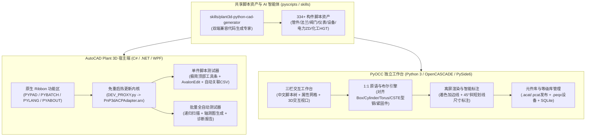
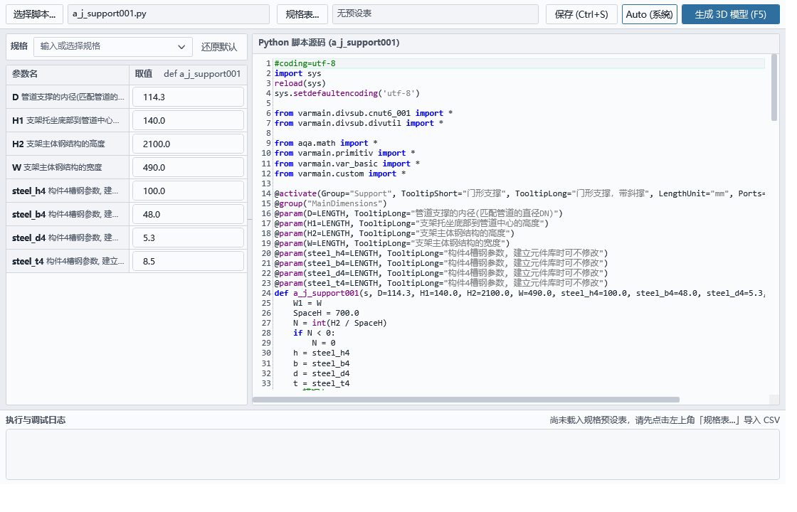
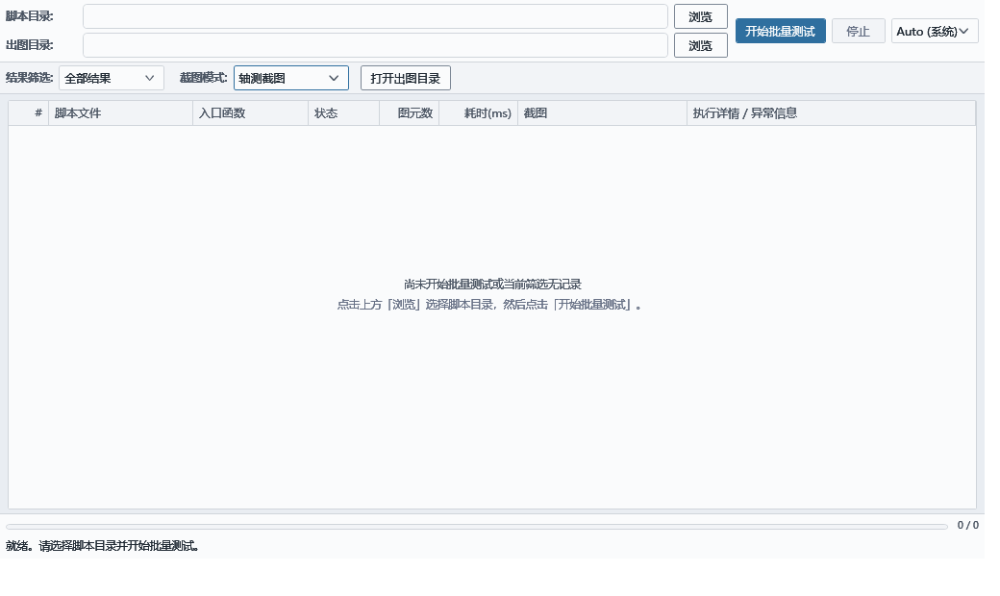
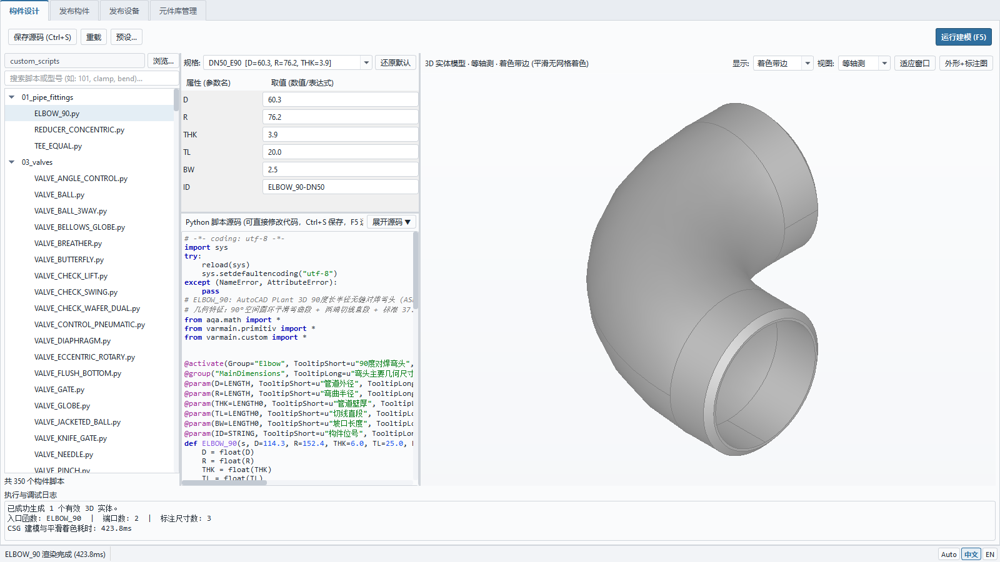
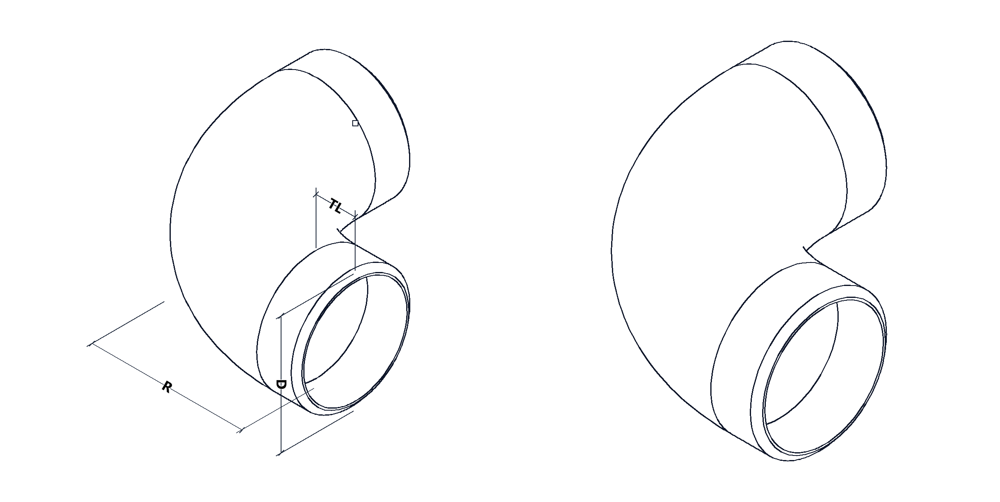
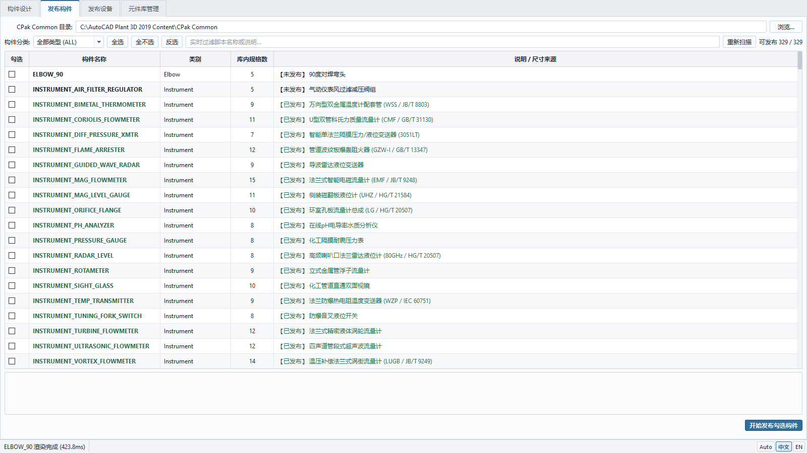
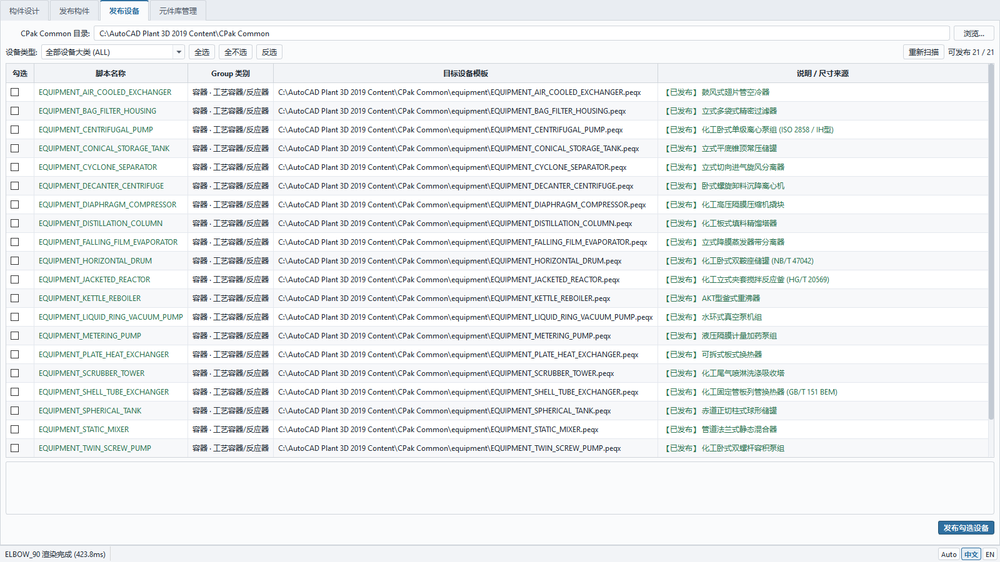
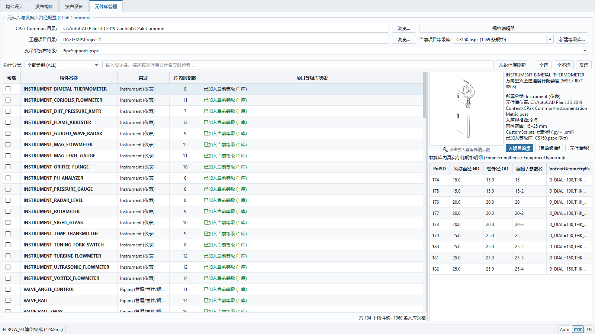

# AutoCAD Plant 3D 参数化构件设计与测试工具箱 (P3dPyPad)

<p align="center">
  
</p>

<p align="center">
  <a href="README.md"><b>简体中文</b></a> | <a href="README_EN.md"><b>English</b></a>
</p>

<p align="center">
  <a href="LICENSE"></a>
  <a href="https://zly258.github.io/P3dPyPad/"></a>
  
  
  
  
  
  <a href="https://github.com/zly258"></a>
  <a href="https://ifdian.net/order/create?user_id=3db8e630e6dc11f1b37452540025c377"></a>
</p>

一套专为 **AutoCAD Plant 3D (2019 ~ 2026)** 深度定制的高性能、工程级**参数化构件设计、实时热更新调试、全自动批量测试、PyOCC 桌面离线仿真与 WebAssembly 在线三维建模工作台**。

本项目依托 **Google Gemini 4** 全程辅助架构设计与自动化测试驱动开发完成。全项目集成了 **490+ 个工业级参数化构件脚本资产**，并已开源发布。欢迎各位管道工程设计师、CAD 二次开发工程师交流与共建！

---

## 🌟 核心亮点概览

- ⚡ **毫秒级热更新（免重启 CAD）**：彻底摆脱传统修改脚本需反复重启 AutoCAD 的痛点，基于动态内存代理与 `PnP3dACPAdapter.arx` 适配器，按 `F5` 键毫秒级在图面生成并替换 3D 实体。
- 📐 **PyOCC 1:1 脱机几何拓扑对齐**：完整逆向并对齐 Plant 3D 原生几何原语（Box, Cylinder, Cone, Torus, CSTE_* 型钢等），无需启动庞大的 CAD 即可在 Python 3 + OpenCASCADE 独立端进行 100% 精确的实体建模仿真。
- 🌐 **WebAssembly 离线三维仿真与预览工作台 (`web/`)**：基于 OpenCASCADE 8.0.1 WASM (`occt.js` / `libcascade`) 与 Three.js 构建的纯前端/Node.js 紧凑型 CAD 工作台。支持在线直接粘贴或修改构件 Python 源码、毫秒级生成 3D 拓扑实体、多视角观察与导出工程级双模 PNG 轴测高清预览图。
- ☀️ **100% 纯浅色工程界面规范**：严格遵循 `/wpf-ui-style` 工业浅色工程主题（Crisp Engineering Light Theme），彻底告别深色暗黑风格；底色纯净舒适，对比度锐利，模型轮廓采用高对比度深碳墨线，边界特征一目了然。
- 📐 **对齐 PyOCC 的双模轴测出图与纯净视口**：三维交互视口保持极致纯净，不悬浮杂乱标注；点击「生成预览图」基于 `plant3d_occ` 算法同时渲染两套高清出图——**① 标准纯实体轴测图**（无标注）与 **② 轴测工程尺寸图**（带 45° 建筑斜短划线 Architectural Tick、外伸见证线与参数防遮挡字母 Sprite），弹窗支持选项卡即时切换与单张/批量下载。
- ⏳ **全流程平滑 Loading 反馈**：从 WASM 内核初始化、构件脚本载入、B-Rep 实体建模到双模预览图渲染，全流程配备优雅的加载遮罩与动态提示，杜绝界面假死。
- 🖥️ **正交相机与专业 CAD 交互**：采用真实工程 1:1 投影的纯正交相机（OrthographicCamera），消除透视透视畸变；OrbitControls 禁用惯性阻尼（停手即止，精准 CAD 工业手感）；视口零网格、零悬浮杂乱面板，底部配备可展开/折叠的多行实时运行日志控制台（带时间戳与状态标签）。
- 🔤 **统一 Google Fonts 谷歌字体**：全界面 UI、代码编辑器与尺寸标注文字统一切换至 Google Fonts（`Roboto`、`Noto Sans SC` 与等宽 `Roboto Mono`），字形清晰锐利。
- 📚 **全库 490+ 构件资产动态选型与即时搜索**：完整索引 `pyscripts/` 全库 494 个工业级构件脚本（管道管件、法兰垫片、阀门、仪表、电力支吊架 CD/ZD、化工支吊架 HG/T、设备等），支持分类树状下拉选择与毫秒级关键字即时检索过滤。
- 🎨 **极简纯文本设计**：对齐工业桌面软件规范，严格零图标、零 emoji、无冗余花哨修饰，纯文本紧凑分段按钮与参数面板。
- 🔗 **GitHub Pages 在线直达**：部署地址即开即用：[https://zly258.github.io/P3dPyPad/](https://zly258.github.io/P3dPyPad/)。
- 📦 **490+ AI 工业级脚本资产库**：涵盖管道管件、法兰、阀门、仪表、工艺设备及海量批量支吊架（CD/ZD 2010 电力标准、HG/T 21629 化工管架），100% 通过几何连续性与单连通拓扑校验。
- 📊 **规格表同目录自动识别**：脚本测试时自动关联同目录下同名 `.csv` 规格预设表，下拉框即时过滤选型，无需手动指定繁琐路径。
- 🏷️ **智能 3D 轴测尺寸标注**：PyOCC 独立端内置离屏自动标注算法，支持真实参数握点读取、共线链式分组、基线防重叠与国际标准的 45° 建筑斜短划线（Architectural Tick）尺寸标注。
- 🔄 **发布与库管理全链路闭环**：一键生成 `.acat/.pcat` 元件库、注册设备模板包（`.peqx`），直连 SQLite 等级库（`.pspc`）穿透式增删管理，杜绝多余垃圾数据残留。
- 🚀 **极简打包与即装即用**：自带自动化 InnoSetup 安装程序（体积仅 1.85 MB），一键安装至系统插件目录，启动 CAD 自动加载，零侵入无残留。
- ☁️ **GitHub Pages 自动化 CI/CD 部署**：内置 `.github/workflows/pages.yml`，推送到 GitHub 即自动构建并部署为无服务依赖的静态站点，实现随处可用的云端与离线三维构件建模。

---

## 🏗️ 双端协同架构体系

本项目采用**双端分工协同**的解耦设计架构：



---

## 🖥️ 核心功能展示与深度解析

### 1. 单件构件脚本测试器 (`PYPAD`)

**功能定位**：面向参数化构件开发者的快速调试测试器。
- **单行极简工具条**：界面整洁紧凑，顶部集成「重新加载」、「保存 (Ctrl+S)」、「执行 (F5)」、「清空日志」及「退出」；
- **同名 CSV 自动识别**：脚本加载时，自动探测并加载同目录下同名 `.csv` 规格数据表（如 `VALVE_GATE.csv`），无需多余配置；
- **AvalonEdit 实时高亮**：专业 Python 语法高亮与行号显示，支持快捷键即时存盘；
- **F5 毫秒级重绘**：通过 `PnP3dACPAdapter.arx` 适配器驱动脚本建模，图面瞬时生成或替换 3D 构件实体。



---

### 2. 构件全自动批量测试器 (`PYBATCH`)

**功能定位**：对几十至上百个构件脚本进行全自动批量仿真验证与质量巡检。
- **全目录递归扫描**：一键遍历指定目录下的所有 `.py` 脚本；
- **自动轴测图出图**：每个构件自动生成标准轴测着色图，保存至指定测试输出目录；
- **深度故障排查**：双击列表行即调用系统图像查看器预览，右键可查看并复制完整的 Python 异常堆栈日志；
- **无人值守自动化**：提供 `PYBATCH_RUN` 命令行与 LISP 入口，可由自动化脚本及 AI Agent 直接调度。



---

### 3. PyOCC 独立离线构件设计工作台

**功能定位**：脱离 AutoCAD 运行的纯 Python 3 离线工作台，基于 OpenCASCADE C++ 几何拓扑内核构建。
- **三栏工业布局**：
  - **左栏**：中文目录树，自动提取脚本顶部中文注释，显示格式为 `中文名称 (文件名.py)`，支持即时关键字过滤；
  - **中栏**：参数动态解析网格 + 可折叠 Python 代码编辑器；
  - **右栏**：`SafeQtViewer3d` 交互式 3D 视口，集成 8 大标准工程视角与 4 种显示样式（着色、边线、线框、隐藏线）；
- **免 CAD 环境依赖**：无需安装庞大的 AutoCAD 即可快速进行构件外形验证与尺寸微调。



---

### 4. 智能 3D 轴测尺寸标注与离屏渲染

**功能定位**：由 `plant3d_occ/catalog/preview.py` 驱动的高精度出图引擎。
- **着色 + 边线渲染**：纯白底色、灰色着色面与黑色拓扑轮廓线，与 Plant 3D 原生视口风格完美匹配；
- **45° 建筑斜短划线标注**：尺寸线端点统一采用 45° 斜短划线（Architectural Tick），摒弃传统箭头带来的视线混淆；
- **智能分层与避让**：自动提取真实参数握点，实现链式尺寸共线合并与基线分级展开。

| 纯 3D 外形着色 + 边线图 | 外形 + 轴测真实尺寸斜线标注图 |
|:---:|:---:|
|  | *(自动读取参数动态渲染)* |

---

### 5. 发布中心与数据库管理闭环

- **发布构件**：直接写入 `.acat/.pcat` SQLite 元件库，自动生成 `<Script>.xml`、`variants.map` 等关联元数据；
- **发布设备**：显式指定设备大类与子类（PartType / PartSubType），一键生成 `.peqx` 模板包；
- **等级库管理**：穿透式检索 CPak Common 数据库，直观查看规格明细（PnPID、ND、OD、几何参数定义），支持按实际成员资格安全删除，无残留垃圾项。

| 发布构件 | 发布设备 | 元件库管理 |
|:---:|:---:|:---:|
|  |  |  |

---

## 📂 项目工程目录

```text
P3dPyPad/
├── .github/workflows/               # GitHub Actions 自动化 CI/CD 工作流
│   └── pages.yml                    # GitHub Pages 静态网站自动化构建与部署脚本
├── installer/                       # 安装程序打包与自动部署
│   ├── output/                      # 发布产物目录
│   │   └── P3dPyPad-Setup-v1.0.0.exe# [重要] 插件独立安装程序 (约 1.85 MB)
│   ├── PackageContents.xml          # AutoCAD Autoloader 自动加载清单
│   ├── P3dPyPad.iss                 # InnoSetup 打包脚本工程
│   └── Publish-PluginExe.ps1        # PowerShell 自动化打包脚本
├── plant3d_occ/                     # PyOCC 独立离线构件设计工作台 (Python 3 + PySide6)
│   ├── core/                        # 会话、拓扑实体与几何数学库
│   ├── gui/                         # PySide6 界面组件与样式系统
│   ├── primitives/                  # 1:1 对齐 Plant 3D 的原生及扩展体素库
│   ├── renderer/                    # 着色边线渲染与智能斜线标注引擎
│   ├── catalog/                     # 元件库发布与 SQLite 管理引擎
│   └── main.py                      # 独立端主程序启动入口
├── pyscripts/                       # 490+ AI 工业级构件脚本资产
│   ├── custom_scripts/              # 管件/法兰/阀门/仪表/支吊架/设备典范脚本
│   ├── supports/                    # 批量支吊架标准库 (CD/ZD 2010 电力、HG/T 21629 化工)
│   └── system_defaults/             # 从原厂 variants.zip 逆向的纯净脚本
├── skills/                          # AI 智能体生成技能 (Agentic Prompt & Rules)
├── src/P3dPyPad/                    # AutoCAD C# 进程内插件源码
│   ├── App/                         # 插件入口与 Ribbon 构建
│   ├── Core/                        # 脚本解析器、热更新运行器与双语切换
│   └── Views/                       # 单件测试器、批量测试器与关于窗口
├── tests/                           # 单元测试与拓扑回归测试套件 (100% 通过)
├── web/                             # WebAssembly 离线三维仿真与预览工作台 (Node.js / occt.js)
│   ├── public/                      # 离线 WASM、Three.js 核心库与构件资产镜像
│   │   ├── libs/                    # occt.js (OpenCASCADE 8.0.1 WASM)、Three.js 模块
│   │   ├── pyscripts/               # 490+ 构件脚本离线全量镜像
│   │   └── pyscripts_manifest.json  # 构件资产分类与关键字索引清单
│   ├── src/                         # 前端业务逻辑源码
│   │   ├── app.js                   # 视口控制、状态管理与事件绑定 (纯文本 Material Design)
│   │   ├── kernel.js                # OpenCASCADE WASM 几何建模与 B-Rep 网格剖分适配层
│   │   ├── transpiler.js            # Python 原语翻译器与动态 @param 参数沙箱
│   │   ├── presets.js               # 经典构件预设回退库
│   │   └── style.css                # 极简 Material Design 样式表 (严禁任何图标)
│   ├── index.html                   # 离线仿真工作台主页面
│   ├── server.js                    # 零外部依赖原生 Node.js 本地开发与静态服务器
│   ├── sync_pyscripts.js            # pyscripts 全库资产同步与索引生成器
│   └── package.json                 # Web 工作台 Node.js 项目配置
├── package.json                     # 根目录便捷运行脚本 (npm start / npm run dev)
├── LICENSE                          # GNU GPL v3 开源许可证
├── README.md                        # 项目官方中文文档
└── README_EN.md                     # 项目官方英文文档 (English)
```

---

## 🚀 三种安装发布模式

本项目提供 **三种不同形态的发布包**，满足不同场景的使用需求：

| 发布包类型 | 产物文件名 | 体积 | 包含内容与适用场景 |
|:---|:---|:---:|:---|
| **1. 插件独立安装包**<br>*(推荐仅用 CAD 者)* | [`P3dPyPad-Plugin-Setup-v1.0.0.exe`](installer/output/P3dPyPad-Plugin-Setup-v1.0.0.exe)<br>*(别名 P3dPyPad-Setup-v1.0.0.exe)* | **1.85 MB** | • 仅安装 AutoCAD Plant 3D 进程内插件<br>• 自动部署至 `ApplicationPlugins\P3dPyPad.bundle`<br>• 注入单件热更新外壳 `DEV_PROXY.py`<br>• 启动 CAD 自动自加载，极速轻量 |
| **2. PyOCC 独立工作台**<br>*(推荐脱机设计者)* | `Plant3dOcc-Setup-v1.0.0.exe`<br>`Plant3dOcc-v1.0.0-Portable-x64.zip` | **155 MB**<br>*(解压 728 MB)* | • 包含完整 OpenCASCADE C++ 几何内核 + Python 3 运行时<br>• 提供独立桌面快捷方式安装包与纯绿色解压即用 zip<br>• 适合脱离 AutoCAD 离线造型、出图标注与元件库管理 |
| **3. 双端全功能二合一包**<br>*(推荐完整环境者)* | `P3dPyPad-AllInOne-Setup-v1.0.0.exe` | **155.2 MB** | • **二合一完整安装程序**：同时包含 CAD 插件与 PyOCC 桌面工作台<br>• 安装向导支持组件勾选自定义安装，一步搞定双端协同环境 |

### 快速上手命令：
```powershell
# 仅打包 AutoCAD 插件独立安装包 (1.85 MB)
pwsh -File installer/Publish-PluginExe.ps1

# 仅打包 PyOCC 独立工作台 (绿色版 ZIP + 安装包 EXE)
pwsh -File installer/Publish-OccExe.ps1

# 一键打包全部三种类型发布包
pwsh -File installer/Publish-Release.ps1
```

### 3. 运行 PyOCC 离线设计工作台 (Python 桌面端)
在具备 Python 3.10+、PySide6 及 PythonOCC-Core 的环境中运行：
```bash
# 启动离线工作台
python plant3d_occ/main.py

# 或直接打开指定构件脚本
python plant3d_occ/main.py pyscripts/custom_scripts/03_valves/VALVE_GATE.py
```

### 4. 运行 Web 离线仿真与三维预览工作台 (Node.js / 浏览器端)
基于 Node.js 驱动的本地离线工作台，集成 490+ 构件脚本全库与 OpenCASCADE WASM 内核：

- 🌐 **GitHub Pages 在线直达**: [https://zly258.github.io/P3dPyPad/](https://zly258.github.io/P3dPyPad/)（无需安装任何环境，随处打开浏览器即可体验）
- 💻 **本地运行方式**：
```bash
# 方式一：直接在根目录一键启动
npm start

# 方式二：进入 web 目录启动
cd web
npm start    # 或 node server.js

# 浏览器访问：http://localhost:3000
```
> **核心操作特性**：
> - **☀️ 100% 浅色工程界面**：全界面切换至纯浅色 CAD 工程主题，模型特征轮廓线晶莹锐利，零视觉疲劳。
> - **🔍 脚本即时选型与搜索**：在下拉菜单直接选择 490+ 工业构件，或在搜索框输入中文关键字（如“弯头”、“球阀”、“CD01”）秒级过滤。
> - **⚡ 实时代码编辑与执行 (F5)**：修改左侧 Python 源码或右侧尺寸参数，点击「运行 (F5)」毫秒级重绘 3D 实体，全流程带 Loading 状态指示。
> - **📐 双模轴测出图 (对齐 PyOCC)**：视口内不悬浮杂乱标注；点击「生成预览图」一键生成「标准轴测图」与「轴测尺寸图」两套高清 PNG 图像，支持选项卡无缝切换与一键批量打包下载。
> - **☁️ GitHub Pages 自动化流水线**：内置 `.github/workflows/pages.yml`，推送到 GitHub 即自动构建并部署为纯静态站点。

### 5. 运行全量回归测试
```bash
# 运行完整单元测试套件
python -m unittest discover -s tests -p "test_*.py"

# 运行支吊架全量实体拓扑缝合校验 (确保单一实体无缝连通)
python tests/test_all_supports.py
```

---

## 📜 构件脚本开发防乱码与编写规范

为了确保脚本在 **Plant 3D 原生环境 (Python 2.7)** 与 **PyOCC 离线端 (Python 3.x)** 双向平滑运行，请遵循以下规范：

### 1. 编码头声明
每个构件脚本必须置于前 7 行内声明：
```python
# -*- coding: utf-8 -*-
#coding=utf-8
import sys
try:
    reload(sys)
    sys.setdefaultencoding('utf-8')
except (NameError, AttributeError):
    pass
```

### 2. 尺寸标注函数规则
`setLinearDimension` 严格使用 3 个位置参数（代号, 起点坐标, 终点坐标），禁止使用任何关键字参数：
```python
# 正确写法：严格 3 个位置参数
s.setLinearDimension("L", (0.0, 0.0, -r_flange), (L, 0.0, -r_flange))
```

---

## 🤝 开源协议与交流共建

- **开源协议**：本项目基于 [GNU GPL v3 (GPL-3.0)](LICENSE) 开源协议发布，允许免费使用、学习与修改；任何基于本项目的二次开发或分发衍生作品须同样以 GPL v3 协议开源。
- **打赏支持**：如果本项目对你的工作与学习有帮助，欢迎通过 [爱发电 (Afdian)](https://ifdian.net/order/create?user_id=3db8e630e6dc11f1b37452540025c377) 赞助支持作者持续维护！
- **作者与主页**：[zly258 (zhangly1403)](https://github.com/zly258)
- **致谢**：感谢 Google DeepMind Gemini 4 在全流程开发、几何算法实现与代码重构中提供的强劲辅助。
- 欢迎提交 Issue 与 Pull Request，共同推动工厂设计三维参数化构件生态的标准化与现代化！
