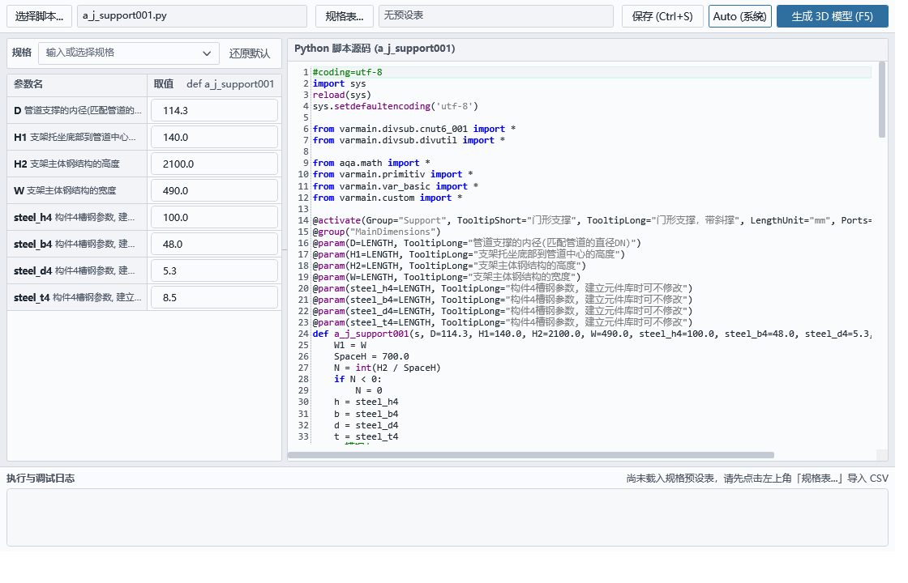
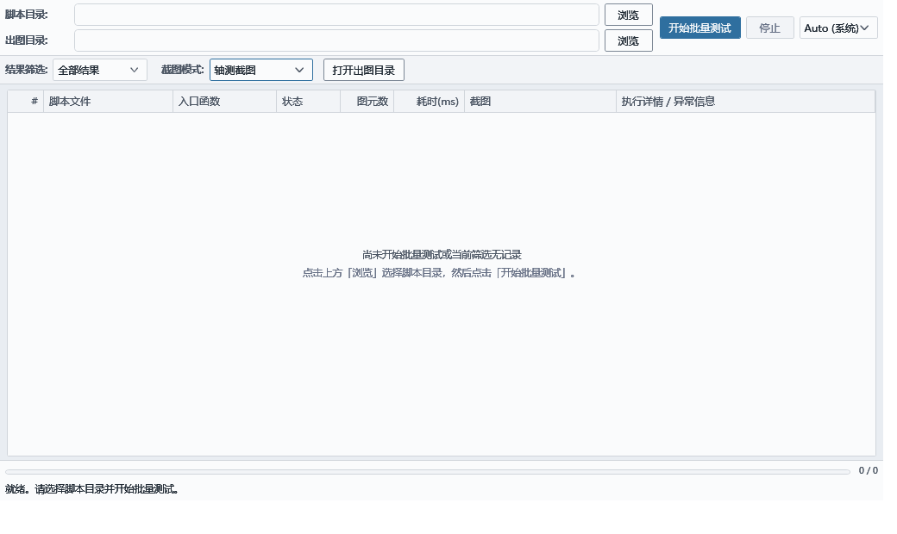
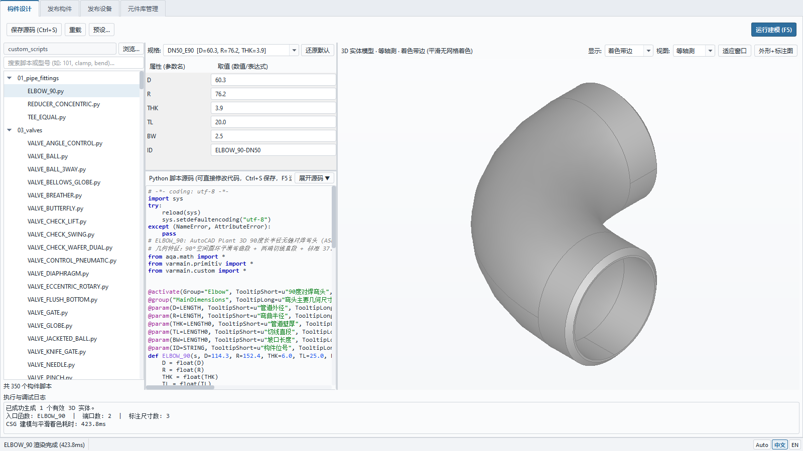
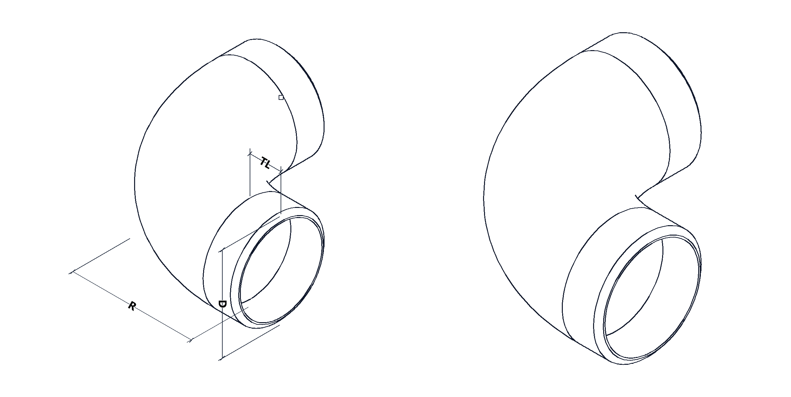
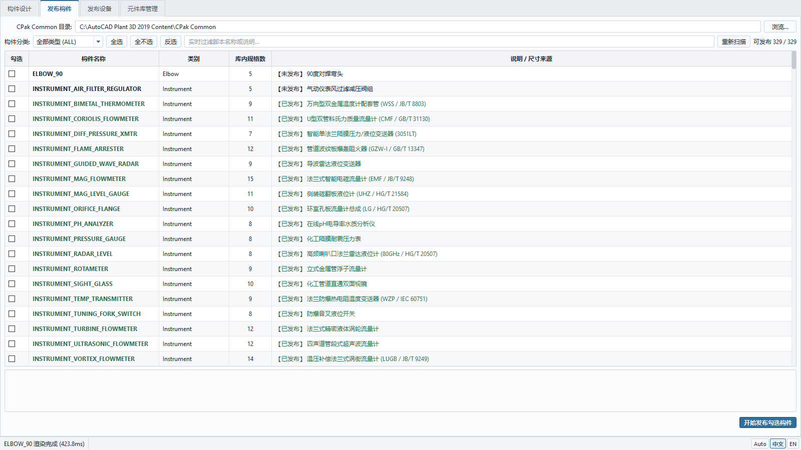
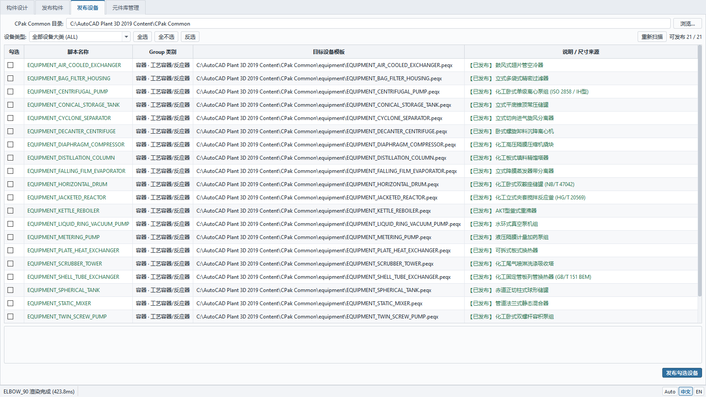
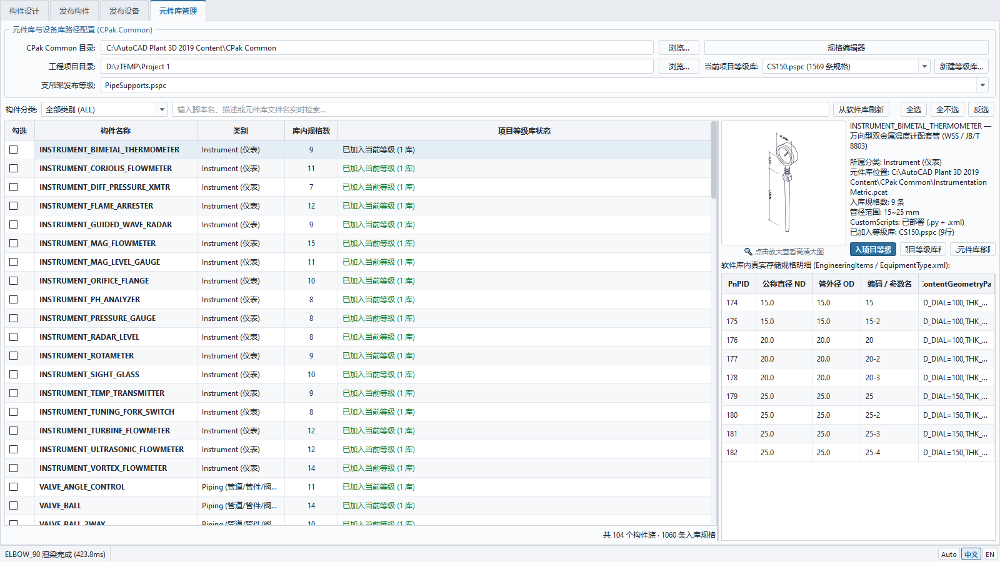
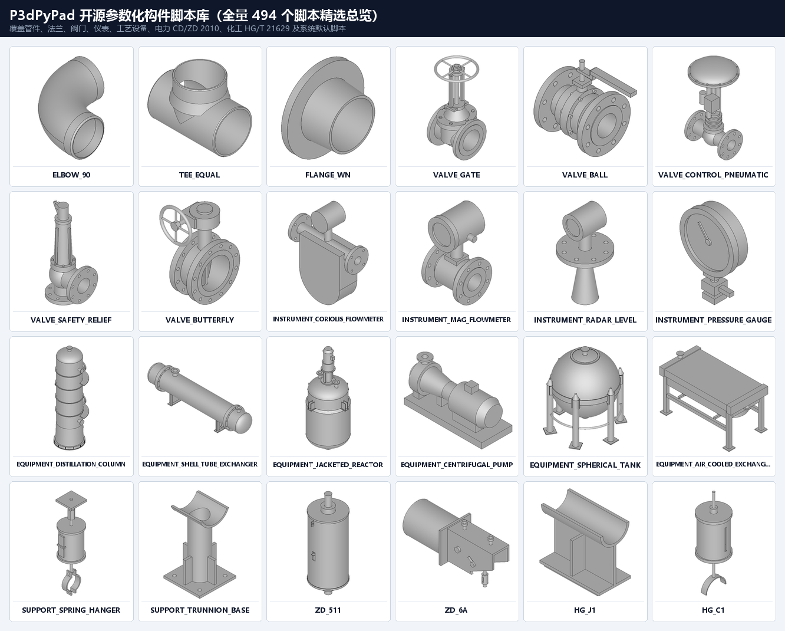

<p align="center">
  
</p>

<h1 align="center">P3dPyPad</h1>

<p align="center">面向 AutoCAD Plant 3D 2019-2026 的参数化构件设计、热更新调试、PyOCC 离线仿真与 WebAssembly 三维工作台。</p>

<p align="center">
  <a href="./README.md">English</a> | <a href="./README.zh-CN.md">简体中文</a>
</p>

<p align="center">
  <a href="./LICENSE"></a>    <a href="https://zly258.github.io/P3dPyPad/"></a>
</p>

P3dPyPad 是一套面向 AutoCAD Plant 3D 参数化 Python 构件开发的工程工具集，整合了 AutoCAD Plant 3D 进程内 C#/WPF 插件、基于 Python 3 与 OpenCASCADE (PyOCC) 的独立桌面工作台、零第三方依赖的 WebAssembly 浏览器三维仿真端，以及 494 个工业参数化构件脚本资产库。

## 核心亮点

| 特性 | 解决的问题与技术依据 |
|---|---|
| 免重启热更新 (`PYPAD`) | 通过动态内存代理 (`DEV_PROXY.py`) 与 `PnP3dACPAdapter.arx` 适配器，按 `F5` 即可在当前 CAD 视口重绘并替换三维实体，无需反复重启 AutoCAD。 |
| 批量自动验证 (`PYBATCH` / `PYBATCH_RUN`) | 递归扫描目录下的 `.py` 脚本，批量生成轴测预览图并输出完整 Python 异常堆栈，支持命令行与 LISP 无人值守集成。 |
| PyOCC 独立离线工作台 (`plant3d_occ/`) | 基于 Python 3 + OpenCASCADE (`pythonocc-core`) 与 PySide6 对齐 Plant 3D 原生几何原语，支持脱离 AutoCAD 建模、45 度建筑斜短划线轴测标注，以及 `.acat`/`.pcat`/`.peqx`/SQLite 发布管理。 |
| WebAssembly 离线三维工作台 (`web/`) | 基于 OpenCASCADE WASM (`occt.js`) 与 Three.js，使用零外部依赖的 Node.js 静态服务器，提供正交相机交互、中英双语界面以及纯实体/带标注双模 PNG 轴测出图。 |
| 494 个参数化构件脚本 (`pyscripts/`) | 覆盖管道管件、法兰、阀门、仪表、工艺设备、系统默认脚本及支吊架标准库（电力 CD/ZD 2010、化工 HG/T 21629），支持同目录 `.csv` 规格表自动发现。 |
| 双框架插件多版本兼容 | 单一项目同时面向 `net472`（AutoCAD Plant 3D 2019-2024）与 `net8.0-windows`（AutoCAD Plant 3D 2025-2026）编译，通过 `P3dPyPad.bundle` 自动加载。 |

## 架构概览

项目将共享的参数化构件脚本与三套运行前端解耦，三端统一消费 `pyscripts/` 资产目录：

```text
┌──────────────────────────────────────────────────────────────────────────────┐
│                 Shared Assets & Agent Skills (pyscripts/ , skills/)          │
│  ┌───────────────────────────────────┐   ┌────────────────────────────────┐  │
│  │ 494 Parametric Scripts            │   │ plant3d-python-cad-generator   │  │
│  │ custom_scripts / supports /       │   │ Dual-end Python 2.7 / 3.x      │  │
│  │ system_defaults + co-located CSV  │   │ modeling rules & templates     │  │
│  └─────────────────┬─────────────────┘   └───────────────┬────────────────┘  │
└────────────────────┼─────────────────────────────────────┼───────────────────┘
                     │                                     │
        ┌────────────┴──────────────────┬──────────────────┴────────────┐
        │                               │                               │
        ▼                               ▼                               ▼
┌───────────────────────────┐  ┌────────────────────────────┐  ┌──────────────────────────┐
│ AutoCAD Plant 3D Plugin   │  │ PyOCC Desktop Workbench    │  │ WebAssembly 3D Studio    │
│ src/P3dPyPad/ (C# / WPF)  │  │ plant3d_occ/ (Python/Qt)   │  │ web/ (Node.js / WASM)    │
├───────────────────────────┤  ├────────────────────────────┤  ├──────────────────────────┤
│ Ribbon: PYPAD, PYBATCH,   │  │ 3-Column PySide6 Studio    │  │ Zero-dep server.js &     │
│ PYLANG, PYABOUT           │  │ (Tree + Props + 3D View)   │  │ sync_pyscripts.js mirror │
│             │             │  │             │              │  │            │             │
│             ▼             │  │             ▼              │  │            ▼             │
│ DEV_PROXY.py ──▶          │  │ 1:1 Primitives & CSG       │  │ transpiler.js ──▶        │
│ PnP3dACPAdapter.arx       │  │ (pythonocc-core B-Rep)     │  │ occt.js (WASM) + Three.js│
│             │             │  │             │              │  │            │             │
│             ▼             │  │             ▼              │  │            ▼             │
│ Single Pad & Batch Runner │  │ Offscreen Render & Catalog │  │ Clean & Annotated PNG    │
│ (AvalonEdit + CSV)        │  │ (.acat/.pcat/.peqx/SQLite) │  │ Export + GitHub Pages    │
└───────────────────────────┘  └────────────────────────────┘  └──────────────────────────┘
```

## 使用示例

### 单件构件脚本测试器 (`PYPAD`)

在 AutoCAD Plant 3D 中加载构件脚本，使用 AvalonEdit 编辑器实时修改代码或参数，自动关联同目录 `.csv` 规格表（如 `VALVE_GATE.csv`），按 `F5` 在图面即时生成或替换三维实体。



### 构件全自动批量测试器 (`PYBATCH`)

递归扫描目标目录下的全部构件脚本，批量执行建模并保存轴测预览图，支持双击看图及右键查看完整 Python 异常堆栈。



### PyOCC 独立离线工作台与离屏出图

脱离 AutoCAD 在三栏 PySide6 界面中浏览构件目录树、调整参数并实时预览三维模型，通过 `plant3d_occ/catalog/preview.py` 输出着色加边线图与轴测尺寸标注图。





### 元件库、设备模板与 SQLite 等级库管理

直接将校验通过的脚本发布至 `.acat`/`.pcat` 元件库与 `.peqx` 设备模板，并对 CPak Common SQLite 数据库进行规格检索与安全删除。

| 发布构件 | 发布设备 | 元件库管理 |
|---|---|---|
|  |  |  |

## 开源构件脚本库（494 个脚本）

P3dPyPad 在 [`pyscripts/`](./pyscripts/) 目录下共开源 **494** 个参数化构件脚本（附带 **313** 份同目录 `.csv` 规格参数表）。查看 [开源参数化构件脚本全量目录（带全部分类预览图）](./docs/SCRIPTS.zh-CN.md) 获取全部 494 个脚本的分类合集大图、文件链接、规格表与说明。



| 脚本库 | 目录路径 | 脚本数 | CSV 规格表 | 覆盖内容 | 全量图文清单 |
|---|---|---:|---:|---|---|
| 通用工程自定义构件库 | `pyscripts/custom_scripts/` | 92 | 71 | 管道管件（3）、法兰（1）、工业阀门（25）、过程仪表（19）、通用支吊架（23）、化工工艺设备（21） | [查看全部 92 个](./docs/SCRIPTS.zh-CN.md#1-通用工程自定义构件库92-个脚本) |
| 电力行业支吊架标准库 (CD/ZD 2010) | `pyscripts/supports/cd_zd2010/` | 83 | 83 | 第 1~8 册：非整体/整体管部、中间连接件、根部结构、可变/恒力弹簧、动力荷载与辅助型钢 | [查看全部 83 个](./docs/SCRIPTS.zh-CN.md#2-电力行业支吊架标准库-cdzd-201083-个脚本) |
| 化工行业支吊架标准库 (HG/T 21629) | `pyscripts/supports/hgt_21629/` | 159 | 159 | A~Y 全系列：刚性吊架、弹簧、预埋件、导向、耳轴、管鞋、保冷/高温支架、阻尼器、U 型螺栓等 | [查看全部 159 个](./docs/SCRIPTS.zh-CN.md#3-化工行业支吊架标准库-hgt-21629159-个脚本) |
| AutoCAD Plant 3D 系统默认脚本 | `pyscripts/system_defaults/` | 160 | 0 | 支吊架（49）、管件（36）、法兰垫片盲板（15）、直管管嘴支管台（10）、阀门执行机构（33）、仪表（9）、设备泵（8） | [查看全部 160 个](./docs/SCRIPTS.zh-CN.md#4-autocad-plant-3d-system-defaults-系统默认脚本160-个脚本) |
| **合计** | **`pyscripts/`** | **494** | **313** | 全部 494 个脚本均已通过 PyOCC 离屏三维实体渲染验证 | [打开全量图文目录](./docs/SCRIPTS.zh-CN.md) |

## 快速安装

首先克隆仓库：

```bash
git clone https://github.com/zly258/P3dPyPad.git
cd P3dPyPad
```

按需选择对应的运行环境：

### 1. WebAssembly 三维工作台（浏览器 / Node.js）

无需安装任何第三方 npm 包（`web/server.js` 仅依赖 Node.js 内置模块）。环境要求：Node.js 18+。

- 在线体验（免本地部署）：[https://zly258.github.io/P3dPyPad/](https://zly258.github.io/P3dPyPad/)

### 2. PyOCC 离线桌面工作台（Python 3）

环境要求：Python 3.10+，推荐使用 Conda 安装原生 OpenCASCADE 绑定。

```bash
conda install -c conda-forge pythonocc-core
pip install -r requirements.txt
```

[requirements.txt](./requirements.txt) 中的核心依赖为 `pythonocc-core>=7.7.0`、`PySide6>=6.5.0`、`matplotlib>=3.7.0` 与 `Pillow>=9.5.0`。

### 3. AutoCAD Plant 3D 插件（Windows / .NET）

环境要求：Windows x64、AutoCAD Plant 3D 2019-2026 以及支持 `net472` / `net8.0-windows` 的 .NET SDK。

```powershell
dotnet build P3dPyPad.sln -c Release
```

编译 `src/P3dPyPad/P3dPyPad.csproj` 后会自动部署 `P3dPyPad.bundle` 至 `C:\Program Files\Autodesk\ApplicationPlugins\P3dPyPad.bundle`（如需跳过自动部署，可追加 `-p:SkipBundleDeploy=true`）。

如需通过 Inno Setup 构建 Windows 安装包：

```powershell
# 打包 AutoCAD 插件独立安装包
pwsh -File installer/Publish-PluginExe.ps1

# 打包 PyOCC 独立工作台（绿色版 ZIP + 安装程序 EXE）
pwsh -File installer/Publish-OccExe.ps1

# 一键打包全部发布包
pwsh -File installer/Publish-Release.ps1
```

## 快速开始

### 启动 WebAssembly 三维工作台

在仓库根目录执行：

```bash
npm start
```

在浏览器打开 `http://127.0.0.1:3000/`，从 494 个构件脚本中选择任意构件（或通过关键字搜索过滤），修改 `@param` 参数或 Python 代码后按 `F5` 即可渲染三维 B-Rep 实体。

### 启动 PyOCC 离线桌面工作台

```bash
# 打开完整的 pyscripts/ 构件目录树
python plant3d_occ/main.py

# 或直接打开指定构件脚本
python plant3d_occ/main.py pyscripts/custom_scripts/03_valves/VALVE_GATE.py
```

### 在 AutoCAD Plant 3D 中运行

部署 `P3dPyPad.bundle` 并启动 AutoCAD Plant 3D 后：

1. 在命令行输入 `PYPAD`（或点击 P3dPyPad Ribbon 面板按钮）。
2. 加载脚本（例如 `pyscripts/custom_scripts/03_valves/VALVE_GATE.py`）。
3. 按 `F5` 在当前图纸中即时生成或热更新三维构件实体。

## 命令参考

### AutoCAD Plant 3D 命令

| 命令 | 用途 |
|---|---|
| `PYPAD` | 打开单件构件脚本编辑器与热更新调试窗口。 |
| `PYBATCH` | 打开交互式批量测试器，递归校验目录下全部脚本。 |
| `PYBATCH_RUN` | 命令行与 LISP 无人值守批量测试入口。 |
| `PYLANG` | 切换插件界面语言（中文 / 英文）。 |
| `PYABOUT` | 查看插件版本与运行环境信息。 |

### 命令行、Web 与测试命令

| 命令 | 用途 |
|---|---|
| `npm start` | 启动本地 WebAssembly 三维工作台服务器（默认端口 `3000`，被占用时自动顺延）。 |
| `npm run sync --prefix web` | 将 `pyscripts/` 同步至 `web/public/pyscripts/` 并重建 `pyscripts_manifest.json`。 |
| `python plant3d_occ/main.py [SCRIPT_OR_DIR]` | 启动 PyOCC 桌面工作台并定位到默认目录或指定路径。 |
| `python plant3d_occ/main.py --render-preview <SCRIPT> --output-dir <DIR>` | 通过 CLI 离屏渲染轴测预览图。 |
| `python -m unittest discover -s tests -p "test_*.py"` | 运行 Python 单元测试与沙箱兼容性回归套件。 |
| `python tests/test_all_supports.py` | 校验全量支吊架脚本的单连通 B-Rep 几何拓扑。 |

## 配置与脚本规范

### 构建与运行环境变量

| 变量名 | 作用域 | 说明 |
|---|---|---|
| `CAD_LIB_2019` | MSBuild (`Directory.Build.props`) | 指定 AutoCAD 2019-2024 托管库目录（`accoremgd`、`acdbmgd`、`acmgd`、`AdWindows`）。 |
| `CAD_LIB_2026` | MSBuild (`Directory.Build.props`) | 指定 AutoCAD 2025-2026 (.NET 8.0) 托管库目录。 |
| `PLANT3D_LIB_2019` | MSBuild (`Directory.Build.props`) | 指定 Plant 3D 库目录（`PLNT3D`）。 |
| `PORT` | Web 工作台 (`web/server.js`) | 覆盖默认本地 HTTP 监听端口（默认 `3000`）。 |

### 双端脚本兼容规范

为保证脚本同时在 AutoCAD Plant 3D (Python 2.7) 与 PyOCC (Python 3.x) 中稳定运行，请遵守以下约定：

1. 在每个脚本前 7 行声明 UTF-8 编码头：

```python
# -*- coding: utf-8 -*-
#coding=utf-8
import sys
try:
    reload(sys)
    sys.setdefaultencoding('utf-8')
except (NameError, AttributeError):
    pass
```

2. `setLinearDimension` 严格传入 3 个位置参数 `(code, start_point, end_point)`，禁止使用关键字参数：

```python
s.setLinearDimension("L", (0.0, 0.0, -r_flange), (L, 0.0, -r_flange))
```

### GitHub Pages 自动部署

当推送到 `main` 分支并涉及 `web/**` 或 `.github/workflows/pages.yml` 变更时，[.github/workflows/pages.yml](./.github/workflows/pages.yml) 会自动将 `web/` 目录发布至 GitHub Pages。

## 相关文档与目录

| 主题 | 内容说明 | 链接 |
|---|---|---|
| 开源 494 个脚本全量目录 | 全部 494 个参数化构件脚本的分类合集大图、文件索引与 CSV 规格表清单 | [查看 SCRIPTS.zh-CN.md](./docs/SCRIPTS.zh-CN.md) |
| 参数化脚本生成技能 | 双端 Python 2.7/3.x 建模规则、API 参考与脚本模板 | [查看 SKILL.md](./skills/plant3d-python-cad-generator/SKILL.md) |
| C# 插件构建配置 | 多目标 .NET 编译路径、`CAD_LIB_*` 变量覆盖与输出目录定义 | [查看 Directory.Build.props](./Directory.Build.props) |
| AutoCAD 自动加载清单 | AutoCAD Plant 3D 2019-2026 Bundle 注册配置 | [查看 PackageContents.xml](./installer/PackageContents.xml) |
| WPF 视图离屏渲染工具 | 插件 WPF 界面检查与渲染辅助工具说明 | [查看 wpf_render README](./tools/wpf_render/README.md) |
| GitHub Pages 工作流 | WebAssembly 三维工作台静态站点 CI/CD 配置 | [查看 pages.yml](./.github/workflows/pages.yml) |

## 参与贡献

欢迎提交 Issue 与 Pull Request。提交前请完成以下检查：

1. 运行回归测试：`python -m unittest discover -s tests -p "test_*.py"`。
2. 如新增或修改了 `pyscripts/` 中的构件脚本，请运行 `npm run sync --prefix web` 同步 Web 端镜像与索引清单。
3. 遵循上述 Python 2.7 / 3.x 双端兼容规范，确保脚本在 AutoCAD Plant 3D 与 PyOCC 环境下均能正常执行。

## 社区与支持

- GitHub Issues 与 Pull Requests：[https://github.com/zly258/P3dPyPad/issues](https://github.com/zly258/P3dPyPad/issues)
- 在线演示：[https://zly258.github.io/P3dPyPad/](https://zly258.github.io/P3dPyPad/)
- 作者：[zly258](https://github.com/zly258)
- 赞助支持：[爱发电 (Afdian)](https://ifdian.net/order/create?user_id=3db8e630e6dc11f1b37452540025c377)

## 许可证

本项目基于 [GNU General Public License v3.0 (GPL-3.0)](./LICENSE) 开源发布。
