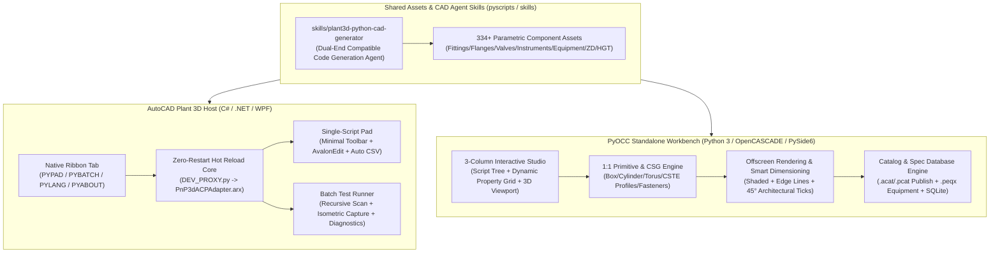
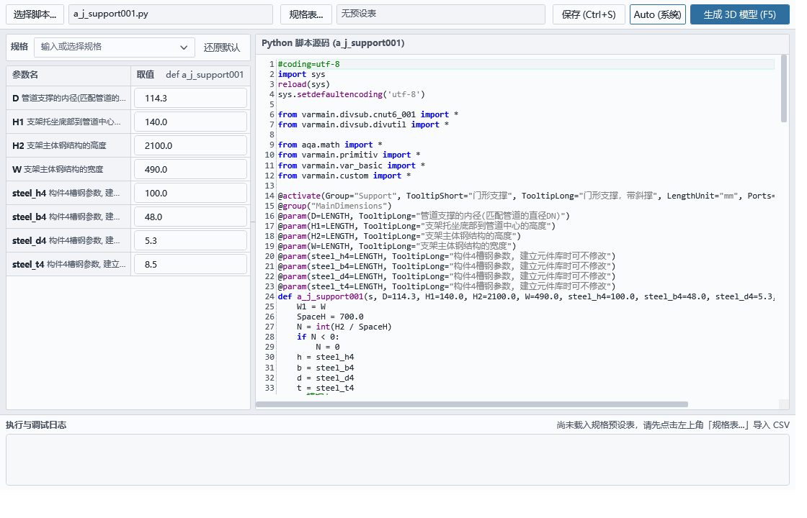
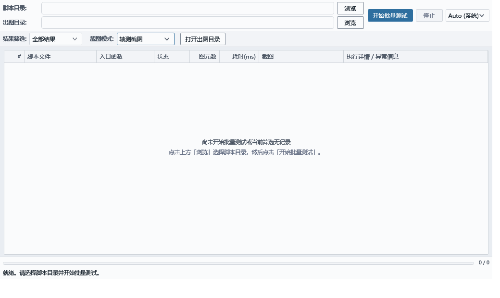
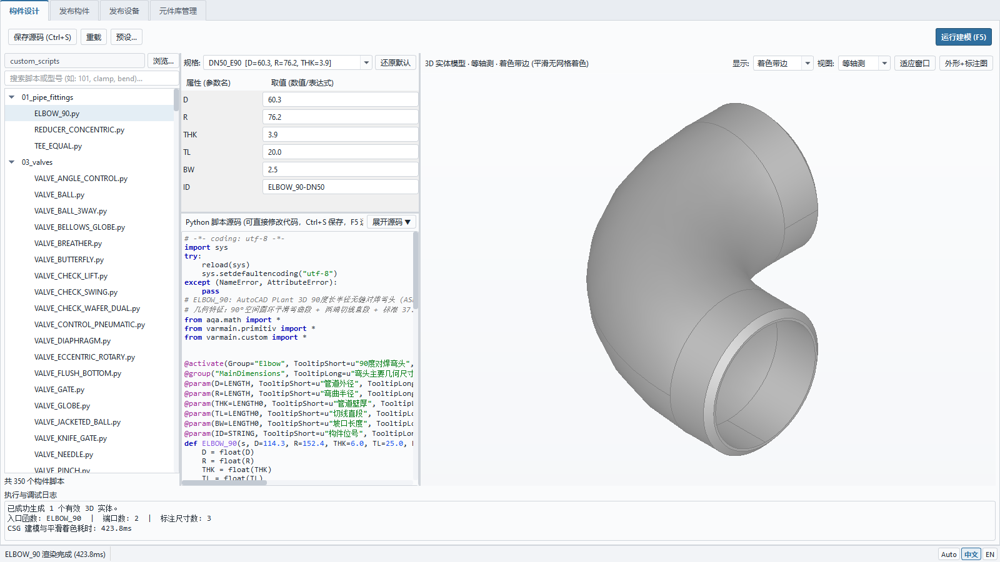
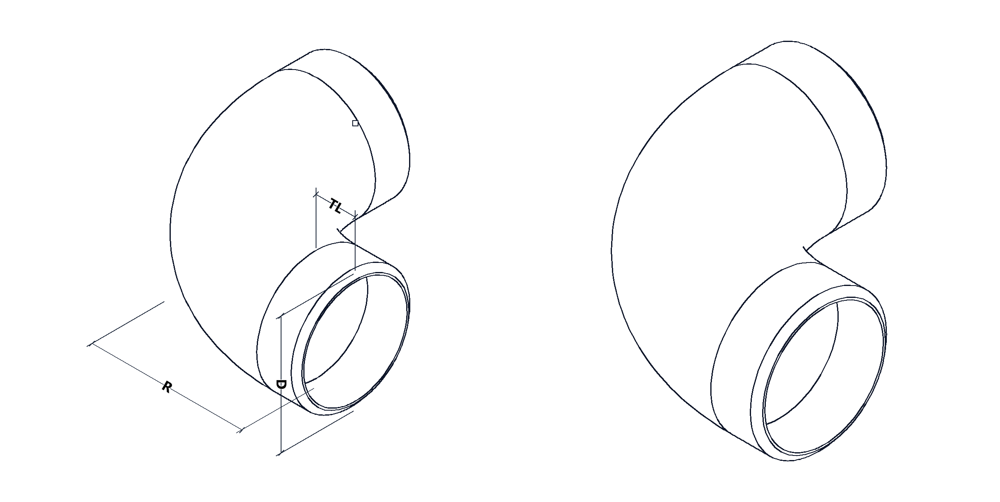
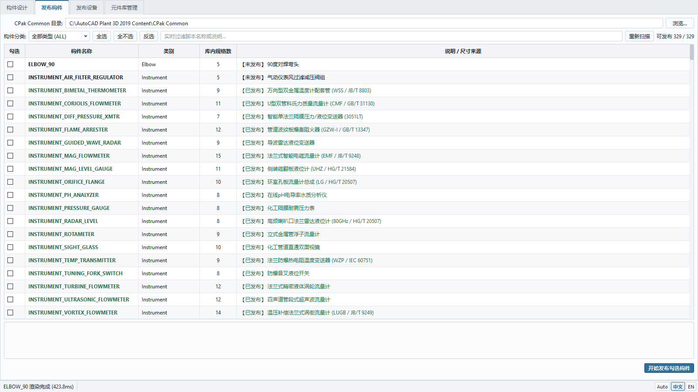
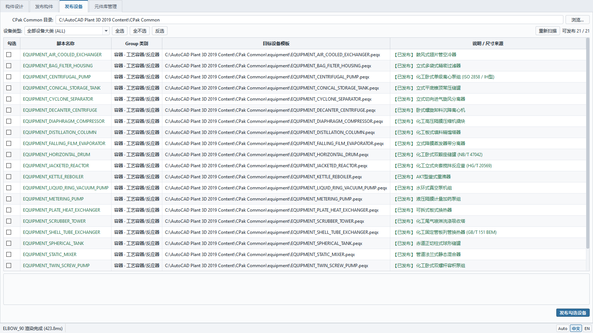
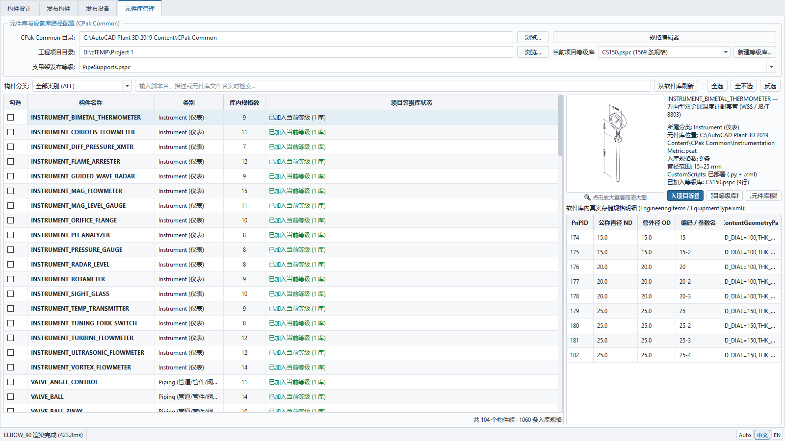

# AutoCAD Plant 3D Parametric Component Design & Testing Toolkit (P3dPyPad)

<p align="center">
  
</p>

<p align="center">
  <a href="README.md"><b>简体中文</b></a> | <a href="README_EN.md"><b>English</b></a>
</p>

<p align="center">
  <a href="LICENSE"></a>
  
  
  
  <a href="https://github.com/zly258"></a>
</p>

A high-performance, engineering-grade toolkit for **AutoCAD Plant 3D (2019 ~ 2026)**, integrating **parametric component design, real-time hot reload debugging, automated batch verification, and a standalone PyOCC offline simulation workbench**.

Architected and developed with end-to-end assistance from **Google Gemini 4** under test-driven development (TDD). Integrates **334+ industrial-grade parametric component scripts** and released as open source under the MIT License. Contributions and discussions from piping designers and CAD developers worldwide are warmly welcome!

---

## 🌟 Key Highlights

- ⚡ **Millisecond Hot Reload (Zero CAD Restart)**: Eliminates the tedious need to restart AutoCAD Plant 3D after every script edit. Powered by in-memory dynamic proxies and the `PnP3dACPAdapter.arx` adapter, press `F5` to instantly regenerate and replace 3D solids in the active CAD viewport.
- 📐 **PyOCC 1:1 Offline Geometric Topology Alignment**: Complete reverse engineering and alignment with native Plant 3D primitives (Box, Cylinder, Cone, Torus, CSTE_* structural profiles, fasteners, etc.). Perform 100% accurate solid modeling in a standalone Python 3 + OpenCASCADE environment without launching CAD.
- 📦 **334+ AI Industrial Script Asset Library**: Covers piping components, flanges, valves, instruments, process equipment, and comprehensive pipe supports/hangers (National Power Standard CD/ZD 2010, Chemical Industry Standard HG/T 21629), 100% verified with B-Rep single-connected topology.
- 📊 **Automatic Co-Located CSV Spec Discovery**: Automatically pairs scripts with co-located `.csv` specification tables (e.g., `VALVE_GATE.csv`). Dropdown selector enables instant multi-size filtering without tedious manual path configuration.
- 🏷️ **Smart 3D Isometric Dimensioning**: The PyOCC workbench features an automated offscreen dimensioning engine with 45° architectural ticks (eliminating arrow direction ambiguity), collinear chain dimension grouping, and multi-tier baseline stacking.
- 🔄 **End-to-End Catalog & SQLite Lifecycle**: One-click generation of `.acat/.pcat` component catalogs, `.peqx` equipment templates, and direct SQLite `.pspc` spec management with safe member deletion and zero orphaned data.
- 🚀 **Streamlined Packaging & Out-of-the-Box Setup**: Automated InnoSetup installers (~1.85 MB for plugin, ~155 MB for full workbench) deploying directly to the system add-in directory for clean, zero-pollution loading.

---

## 🏗️ Dual-End Collaborative Architecture

The toolkit adopts a decoupled **dual-end collaborative architecture**:



---

## 🖥️ Core Modules & Capabilities

### 1. Single Component Script Pad (`PYPAD`)

**Role**: Rapid interactive debugging for parametric component developers.
- **Minimalist Single-Row Toolbar**: Compact and distraction-free with Reload, Save (`Ctrl+S`), Execute (`F5`), Clear Log, and Close buttons;
- **Co-Located CSV Discovery**: Automatically detects and loads matching `.csv` spec files in the same directory (e.g., `VALVE_GATE.csv`);
- **AvalonEdit Syntax Highlighting**: Professional Python syntax coloring, line numbers, and instant shortcut saving;
- **Sub-Second F5 Redraw**: Direct invocation via `PnP3dACPAdapter.arx` instantly updates the 3D entity on the drawing canvas.



---

### 2. Automated Batch Test Runner (`PYBATCH`)

**Role**: Automated batch simulation and quality inspection across dozens or hundreds of scripts.
- **Recursive Directory Scan**: Traverses all `.py` component scripts in any selected directory with one click;
- **Automatic Isometric Capture**: Generates standardized isometric shaded images for every component to a designated output folder;
- **In-Depth Diagnostics**: Double-click list items to preview screenshots in the system image viewer; right-click to inspect and copy full Python stack traces;
- **Unattended CLI & LISP Entry**: Accessible via `PYBATCH_RUN` command line and LISP interfaces for continuous integration and AI Agent orchestration.



---

### 3. PyOCC Standalone Offline Workbench

**Role**: Standalone Python 3 environment running independently of AutoCAD, powered by the OpenCASCADE C++ B-Rep kernel.
- **3-Column Industrial UI**:
  - **Left**: Hierarchical script catalog with real-time keyword filtering;
  - **Center**: Dynamic property grid for live parameter manipulation + collapsible Python code editor;
  - **Right**: `SafeQtViewer3d` interactive 3D viewport featuring 8 standard engineering view angles and 4 display styles (Shaded, Shaded with Edges, Wireframe, Hidden Line);
- **Zero AutoCAD Dependency**: Test component geometry and adjust dimensions on any computer without needing an AutoCAD license.



---

### 4. Smart 3D Isometric Dimensioning & Offscreen Rendering

**Role**: High-precision drafting engine driven by `plant3d_occ/catalog/preview.py`.
- **Shaded + Edge Lines**: Pure white background with grey shaded faces and crisp black silhouette outlines matching Plant 3D's native aesthetic;
- **45° Architectural Ticks**: Replaces conventional arrows with 45° ticks to eliminate visual ambiguity in isometric views;
- **Intelligent Stacking & Avoidance**: Extracts parametric boundary grips, automatically clusters collinear dimensions, and creates multi-tier baselines.

| 3D Shaded + Edge Silhouette | 3D Isometric Dimensioned Drawing |
|:---:|:---:|
|  | *(Dynamically rendered from parameters)* |

---

### 5. Catalog Publishing & Database Management

- **Publish Components**: Directly writes to `.acat/.pcat` SQLite databases, generating `<Script>.xml` and `variants.map` metadata;
- **Publish Equipment**: Explicitly specifies PartType / PartSubType to package `.peqx` templates with one click;
- **Spec Database Management**: Inspects CPak Common SQLite databases to view PnPID, ND, OD, and geometric parameters, supporting safe membership-based deletion without orphaned entries.

| Publish Component | Publish Equipment | Catalog Manager |
|:---:|:---:|:---:|
|  |  |  |

---

## 📂 Repository Directory Structure

```text
P3dPyPad/
├── installer/                       # Installer packaging & automated deployment
│   ├── output/                      # Release artifact directory
│   │   └── P3dPyPad-Setup-v1.0.0.exe# Standalone plugin setup (~1.85 MB)
│   ├── PackageContents.xml          # AutoCAD Autoloader manifest
│   ├── P3dPyPad.iss                 # InnoSetup project script
│   └── Publish-PluginExe.ps1        # PowerShell automated build script
├── plant3d_occ/                     # PyOCC standalone offline workbench
│   ├── core/                        # Session, topological entity & geometry math
│   ├── gui/                         # PySide6 UI components & theme system
│   ├── primitives/                  # 1:1 aligned native & extended primitives
│   ├── renderer/                    # Shaded edge renderer & 45° tick dimensioning
│   ├── catalog/                     # Catalog publisher & SQLite database engine
│   └── main.py                      # Standalone application entry point
├── pyscripts/                       # 334+ AI industrial component scripts
│   ├── custom_scripts/              # 92 curated fittings/flanges/valves/instruments/equipment
│   ├── supports/                    # Standard pipe support libraries (CD/ZD 2010, HG/T 21629)
│   └── system_defaults/             # 160 clean scripts distilled from original variants.zip
├── skills/                          # AI Agent modeling skill (plant3d-python-cad-generator)
├── src/P3dPyPad/                    # AutoCAD in-process C# plugin source
│   ├── App/                         # Plugin entry & Ribbon builder
│   ├── Core/                        # Script parser, hot-reload runner & i18n
│   └── Views/                       # Script pad, batch tester & about dialogs
├── tests/                           # Unit tests & topological regression suites
├── LICENSE                          # MIT License
├── README.md                        # Official documentation (Chinese)
└── README_EN.md                     # Official documentation (English)
```

---

## 🚀 Three Packaging & Deployment Options

This project offers **three deployment packages** tailored to diverse workflow requirements:

| Package Type | Asset Filename | Size | Included Contents & Use Case |
|:---|:---|:---:|:---|
| **1. Standalone Plugin Setup**<br>*(For CAD-Only Users)* | [`P3dPyPad-Plugin-Setup-v1.0.0.exe`](installer/output/P3dPyPad-Plugin-Setup-v1.0.0.exe) | **1.85 MB** | • Installs in-process AutoCAD Plant 3D plugin only<br>• Deploys to `ApplicationPlugins\P3dPyPad.bundle`<br>• Injects `DEV_PROXY.py` singleton hot-reload shell<br>• Auto-loads on CAD launch, ultra-lightweight |
| **2. Standalone PyOCC Workbench**<br>*(For Offline Modelers)* | `Plant3dOcc-Setup-v1.0.0.exe`<br>`Plant3dOcc-v1.0.0-Portable-x64.zip` | **155 MB**<br>*(Unpacked: 728 MB)* | • Bundles complete OpenCASCADE C++ kernel + Python 3 runtime<br>• Available as desktop setup or portable zero-install zip<br>• Designed for offline 3D modeling, 45° dimensioning, and catalog authoring |
| **3. All-In-One Dual Setup**<br>*(Recommended for Full Environment)* | `P3dPyPad-AllInOne-Setup-v1.0.0.exe` | **155.2 MB** | • **All-in-one unified installer**: sets up both the CAD plugin and PyOCC desktop workbench<br>• Supports custom component selection in the setup wizard |

### Quick Build Commands:
```powershell
# Build standalone AutoCAD plugin installer (1.85 MB)
pwsh -File installer/Publish-PluginExe.ps1

# Build standalone PyOCC workbench (portable ZIP + setup EXE)
pwsh -File installer/Publish-OccExe.ps1

# Build all three release packages at once
pwsh -File installer/Publish-Release.ps1
```

### Running the PyOCC Offline Workbench:
In an environment with Python 3.10+, PySide6, and PythonOCC-Core:
```bash
# Launch the offline workbench
python plant3d_occ/main.py

# Or directly open a specific component script
python plant3d_occ/main.py pyscripts/custom_scripts/03_valves/VALVE_GATE.py
```

### Running Regression Tests:
```bash
# Run unit test suite
python -m unittest discover -s tests -p "test_*.py"

# Run full topological stitching validation across all pipe supports
python tests/test_all_supports.py
```

---

## 📜 Script Development & Compatibility Rules

To guarantee flawless execution across both **Plant 3D native environment (Python 2.7)** and **PyOCC offline environment (Python 3.x)**, adhere to the following rules:

### 1. UTF-8 Encoding Declaration
Every script must declare encoding within the first 7 lines:
```python
# -*- coding: utf-8 -*-
#coding=utf-8
import sys
try:
    reload(sys)
    sys.setdefaultencoding('utf-8')
except (NameError, AttributeError):
    pass
```

### 2. Dimensioning Function Signature
`setLinearDimension` strictly takes 3 positional arguments (code, start_point, end_point). Keyword arguments are prohibited:
```python
# Correct signature: exactly 3 positional arguments
s.setLinearDimension("L", (0.0, 0.0, -r_flange), (L, 0.0, -r_flange))
```

---

## 🤝 Open Source License & Community

- **License**: Released under the [MIT License](LICENSE), permitting free commercial use, modification, and distribution.
- **Author & GitHub**: [zly258 (zhangly1403)](https://github.com/zly258)
- **Acknowledgments**: Gratefully acknowledging Google DeepMind Gemini 4 for its pivotal role throughout architecture design, geometric algorithms, and code generation.
- Issues and Pull Requests are warmly encouraged as we work together to advance and standardize the plant design parametric modeling ecosystem!
