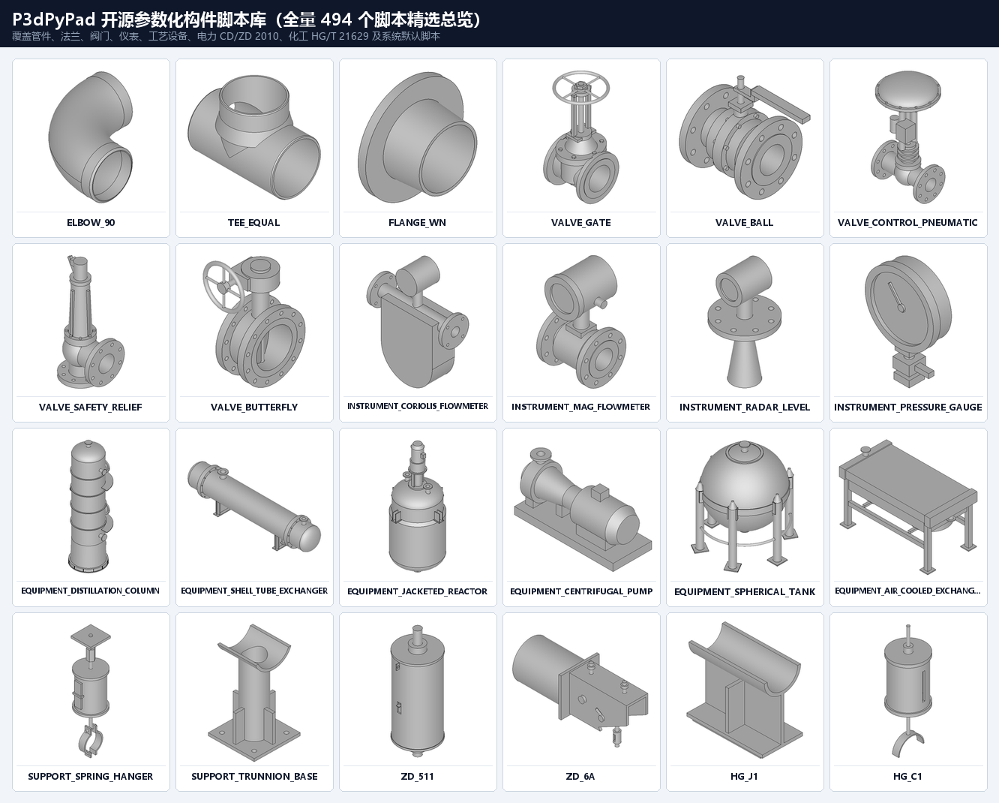
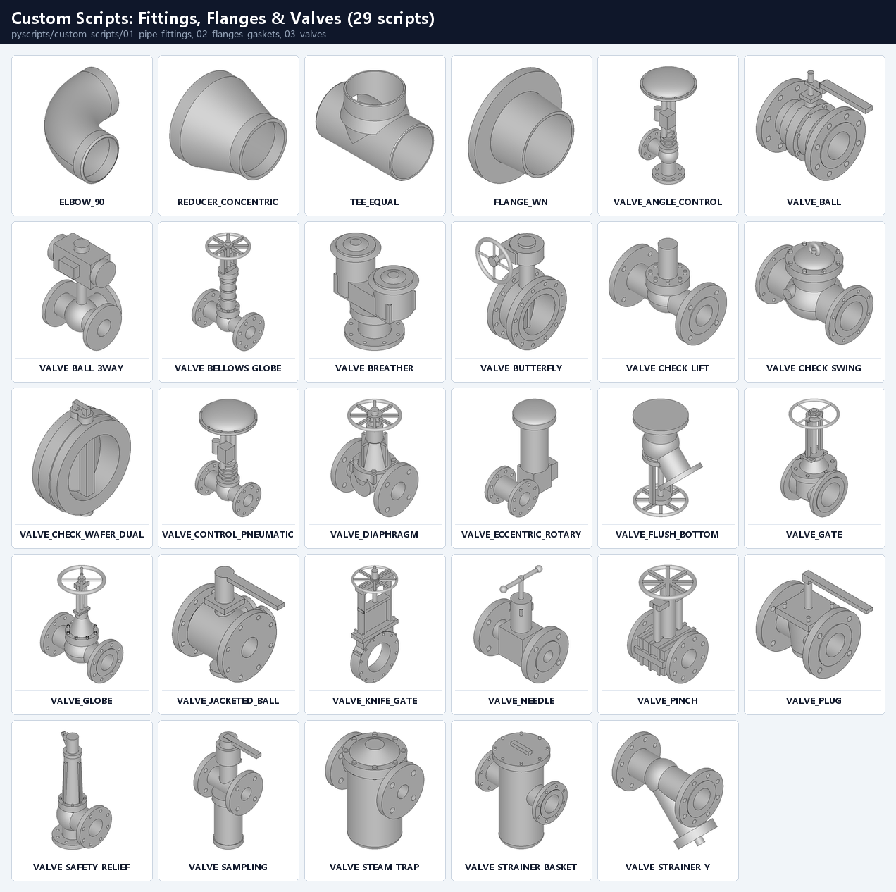
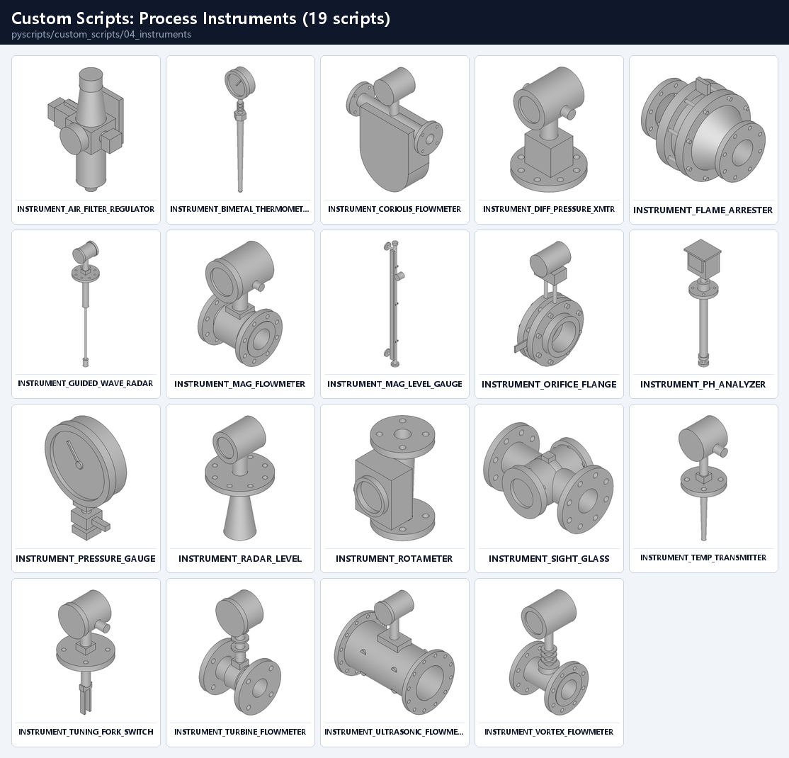
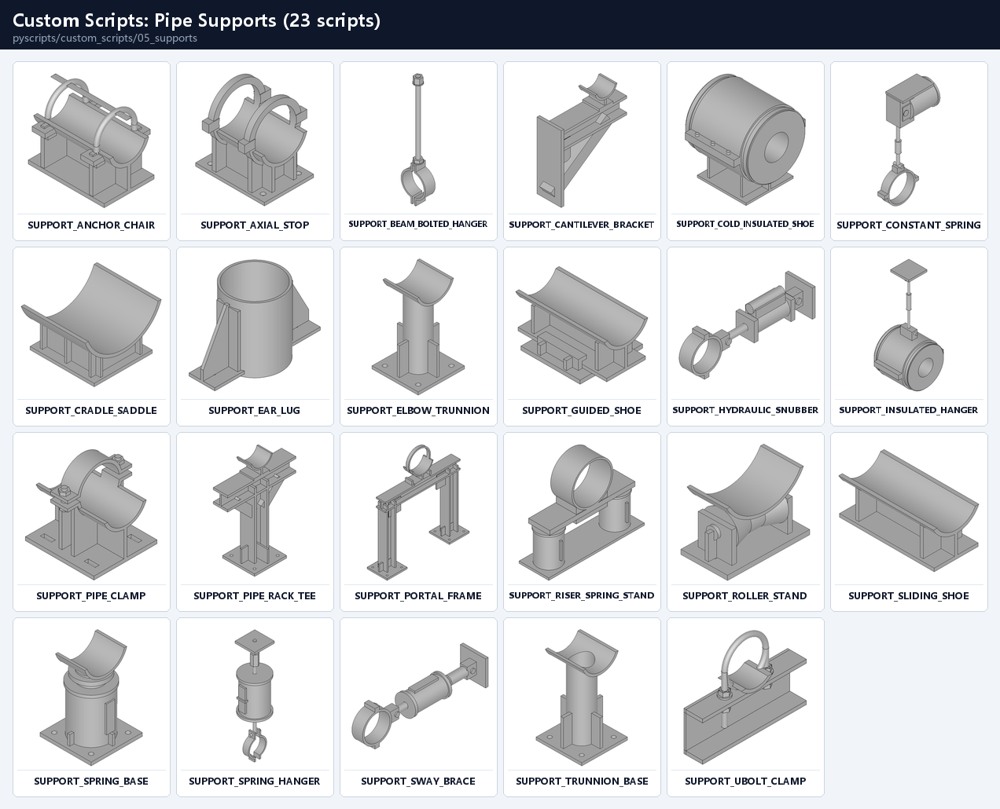
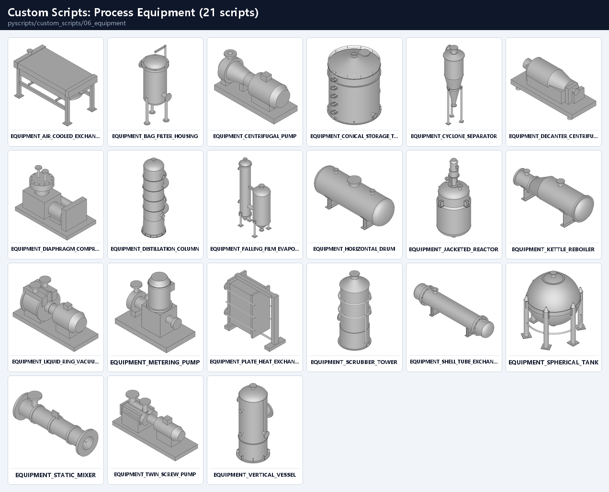
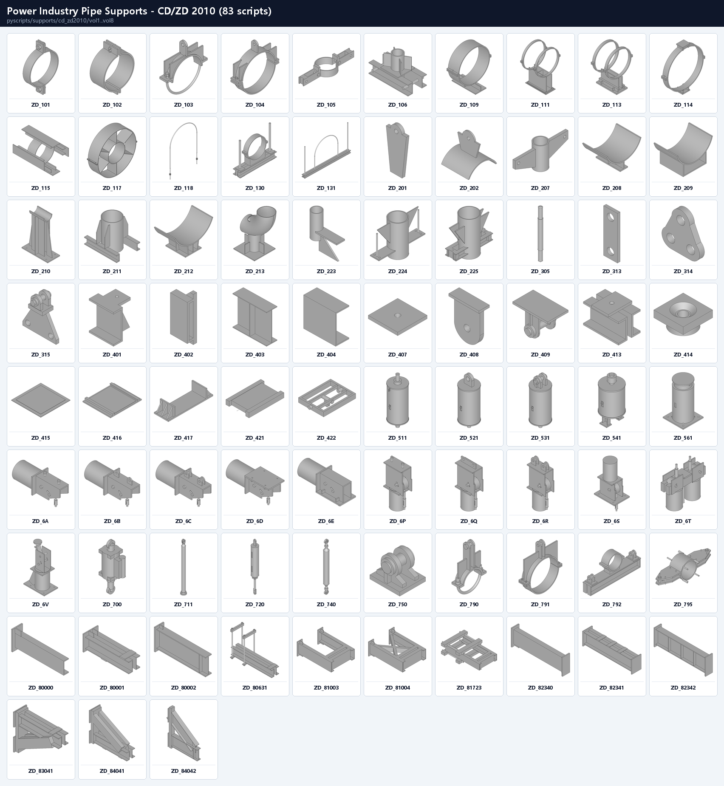
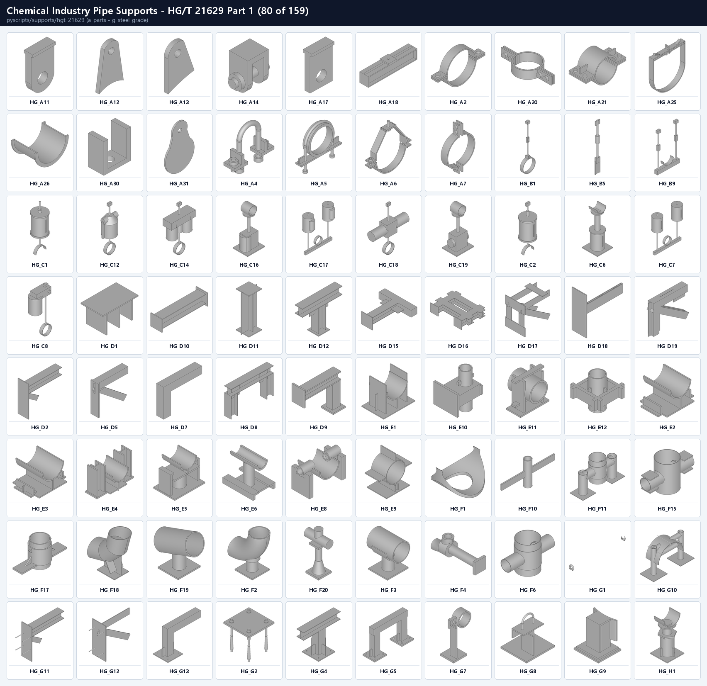
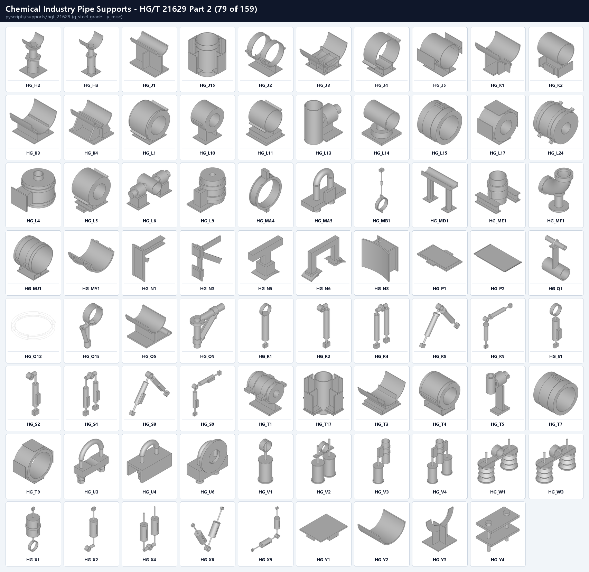
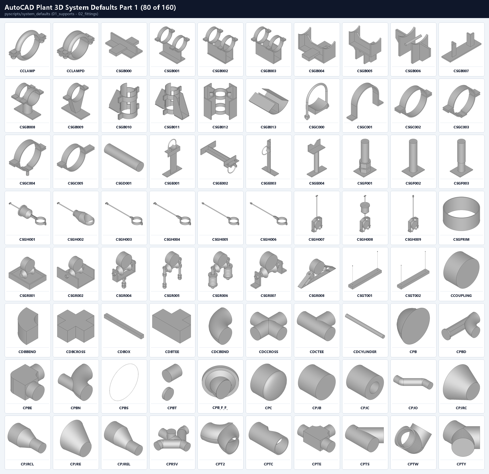
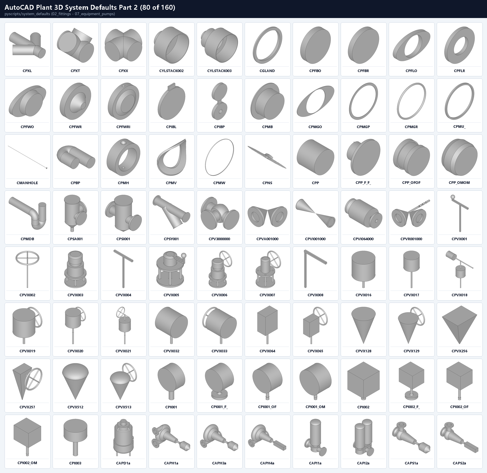

# 开源参数化构件脚本全量目录（494 个脚本）

[English](./SCRIPTS.md) | [简体中文](./SCRIPTS.zh-CN.md) | [返回 README](../README.zh-CN.md)

P3dPyPad 在 [`pyscripts/`](../pyscripts/) 目录下共开源 **494** 个 AutoCAD Plant 3D 参数化 Python 构件脚本（附带 **313** 份同目录 `.csv` 规格参数表）。全部脚本均已通过 PyOCC 离屏三维建模验证，可在 AutoCAD Plant 3D 插件（Python 2.7）、PyOCC 离线桌面工作台（Python 3 + OpenCASCADE）以及 WebAssembly 浏览器三维工作台中直接运行。

## 脚本库分类汇总

| 脚本库 | 目录路径 | 脚本数量 | 规格表 CSV 数量 | 快速跳转 |
|---|---|---:|---:|---|
| 通用工程自定义构件库 | `pyscripts/custom_scripts/` | 92 | 71 | [1. 通用工程自定义构件库](#1-通用工程自定义构件库92-个脚本) |
| 电力行业支吊架标准库 (CD/ZD 2010) | `pyscripts/supports/cd_zd2010/` | 83 | 83 | [2. 电力行业支吊架标准库 CD/ZD 2010](#2-电力行业支吊架标准库-cdzd-201083-个脚本) |
| 化工行业支吊架标准库 (HG/T 21629) | `pyscripts/supports/hgt_21629/` | 159 | 159 | [3. 化工行业支吊架标准库 HG/T 21629](#3-化工行业支吊架标准库-hgt-21629159-个脚本) |
| AutoCAD Plant 3D 系统默认脚本 | `pyscripts/system_defaults/` | 160 | 0 | [4. AutoCAD Plant 3D 系统默认脚本](#4-autocad-plant-3d-system-defaults-系统默认脚本160-个脚本) |
| **合计** | **`pyscripts/`** | **494** | **313** | 下方按分类展示全部 494 个脚本合集预览图与明细 |

## 1. 通用工程自定义构件库（92 个脚本）

目录：`pyscripts/custom_scripts/`

### 01 管道管件 (`01_pipe_fittings`, 3)

| 序号 | 脚本名称 | 构件分组 | 规格表 CSV | 说明 |
|---|---|---|---|---|
| 1 | [`ELBOW_90`](../pyscripts/custom_scripts/01_pipe_fittings/ELBOW_90.py) | `Elbow` | [`ELBOW_90.csv`](../pyscripts/custom_scripts/01_pipe_fittings/ELBOW_90.csv) (5 组规格) | 90度长半径无缝对焊弯头（带标准对焊坡口与全贯通内流道） |
| 2 | [`REDUCER_CONCENTRIC`](../pyscripts/custom_scripts/01_pipe_fittings/REDUCER_CONCENTRIC.py) | `Reducer` | [`REDUCER_CONCENTRIC.csv`](../pyscripts/custom_scripts/01_pipe_fittings/REDUCER_CONCENTRIC.csv) (5 组规格) | 化工标准 GB/T 12459 同心对焊异径管 (Concentric Reducer)，带两端直管段、锥形过渡段与中空内腔 |
| 3 | [`TEE_EQUAL`](../pyscripts/custom_scripts/01_pipe_fittings/TEE_EQUAL.py) | `Tee` | [`TEE_EQUAL.csv`](../pyscripts/custom_scripts/01_pipe_fittings/TEE_EQUAL.csv) (6 组规格) | 化工标准 GB/T 12459 / ASME B16.9 锻制对焊三通，带三端坡口、拔制过渡圆领与T形贯通内腔 |

### 02 法兰与垫片 (`02_flanges_gaskets`, 1)

| 序号 | 脚本名称 | 构件分组 | 规格表 CSV | 说明 |
|---|---|---|---|---|
| 1 | [`FLANGE_WN`](../pyscripts/custom_scripts/02_flanges_gaskets/FLANGE_WN.py) | `Flange` | [`FLANGE_WN.csv`](../pyscripts/custom_scripts/02_flanges_gaskets/FLANGE_WN.csv) (6 组规格) | 带颈对焊法兰（WN/RF，突面密封，锥形高颈过渡，全贯通内孔） |

### 03 工业阀门 (`03_valves`, 25)

| 序号 | 脚本名称 | 构件分组 | 规格表 CSV | 说明 |
|---|---|---|---|---|
| 1 | [`VALVE_ANGLE_CONTROL`](../pyscripts/custom_scripts/03_valves/VALVE_ANGLE_CONTROL.py) | `Valve` | [`VALVE_ANGLE_CONTROL.csv`](../pyscripts/custom_scripts/03_valves/VALVE_ANGLE_CONTROL.csv) (11 组规格) | 化工高压差防空化/防冲刷閃蒸工段 90° 气动薄膜高压角式调节阀 (ZJHQ / IEC 60534，含锻造球形角式阀体、上阀盖散热片、双柱开窗支架、行程刻度尺、12螺栓气动薄膜头与电气阀门定位器) |
| 2 | [`VALVE_BALL`](../pyscripts/custom_scripts/03_valves/VALVE_BALL.py) | `Valve` | [`VALVE_BALL.csv`](../pyscripts/custom_scripts/03_valves/VALVE_BALL.csv) (14 组规格) | 化工标准 GB/T 12237 / API 608 两片式分体连接法兰球阀 (Split-Body Flanged Ball Valve)，带球形阀腔、中体连接法兰、ISO 5211支架平台与折弯扳手手柄 |
| 3 | [`VALVE_BALL_3WAY`](../pyscripts/custom_scripts/03_valves/VALVE_BALL_3WAY.py) | `Valve` | [`VALVE_BALL_3WAY.csv`](../pyscripts/custom_scripts/03_valves/VALVE_BALL_3WAY.csv) (10 组规格) | 化工标准 GB/T 12237 气动双缸齿轮齿条执行机构T形/L形三通法兰球阀 (Pneumatic Actuated 3-Way Flanged Ball Valve)，含三向法兰球体腔、ISO支架、双作用气动活塞缸与顶部开度指示球 |
| 4 | [`VALVE_BELLOWS_GLOBE`](../pyscripts/custom_scripts/03_valves/VALVE_BELLOWS_GLOBE.py) | `Valve` | [`VALVE_BELLOWS_GLOBE.csv`](../pyscripts/custom_scripts/03_valves/VALVE_BELLOWS_GLOBE.csv) (13 组规格) | 化工剧毒/易燃/导热油管线用金属波纹管双层密封法兰截止阀 (WJ41H / HG/T 4086，含球形Z型流道阀体、加高波纹管密封圆筒中腔、双法兰螺栓连接盘、副填料函、防转支架与手轮) |
| 5 | [`VALVE_BREATHER`](../pyscripts/custom_scripts/03_valves/VALVE_BREATHER.py) | `Valve` | [`VALVE_BREATHER.csv`](../pyscripts/custom_scripts/03_valves/VALVE_BREATHER.csv) (9 组规格) | 化工行业标准 SY/T 0511.1 / HG/T 20570 储罐顶装全天候防爆阻火呼吸阀 (Tank Flame-Arresting Breather Valve)，含罐顶安装法兰、波纹阻火芯盘腔及左右正负压双腔防雨帽 |
| 6 | [`VALVE_BUTTERFLY`](../pyscripts/custom_scripts/03_valves/VALVE_BUTTERFLY.py) | `Valve` | [`VALVE_BUTTERFLY.csv`](../pyscripts/custom_scripts/03_valves/VALVE_BUTTERFLY.csv) (12 组规格) | 化工标准 GB/T 12238 / API 609 蜗轮蜗杆传动双法兰/凸耳式蝶阀 (Gear-Operated Butterfly Valve)，带薄型阀体、微开蝶板、加长保温颈、蜗轮减速箱与侧向手轮 |
| 7 | [`VALVE_CHECK_LIFT`](../pyscripts/custom_scripts/03_valves/VALVE_CHECK_LIFT.py) | `Valve` | [`VALVE_CHECK_LIFT.csv`](../pyscripts/custom_scripts/03_valves/VALVE_CHECK_LIFT.csv) (13 组规格) | 化工标准 GB/T 12235 直通升降式钢制法兰止回阀 (Lift Check Valve)，带球形流道阀体、螺栓连接平顶阀盖与中心活塞导向筒帽 |
| 8 | [`VALVE_CHECK_SWING`](../pyscripts/custom_scripts/03_valves/VALVE_CHECK_SWING.py) | `Valve` | [`VALVE_CHECK_SWING.csv`](../pyscripts/custom_scripts/03_valves/VALVE_CHECK_SWING.csv) (12 组规格) | 化工标准 GB/T 12236 / BS 1868 旋启式钢制法兰止回阀 (Swing Check Valve)，带偏心鼓形阀腔、两侧摇杆销轴凸台、螺栓连接顶盖与中心环形吊耳 |
| 9 | [`VALVE_CHECK_WAFER_DUAL`](../pyscripts/custom_scripts/03_valves/VALVE_CHECK_WAFER_DUAL.py) | `Valve` | [`VALVE_CHECK_WAFER_DUAL.csv`](../pyscripts/custom_scripts/03_valves/VALVE_CHECK_WAFER_DUAL.csv) (12 组规格) | 化工标准 GB/T 12236 / API 594 对夹式双瓣旋启蝶形止回阀 (Wafer Dual-Plate Check Valve)，含紧凑圆筒对夹阀体、中心定位销轴与止回限位轴、内部双半圆阀瓣及顶部吊环耳 |
| 10 | [`VALVE_CONTROL_PNEUMATIC`](../pyscripts/custom_scripts/03_valves/VALVE_CONTROL_PNEUMATIC.py) | `Valve` | [`VALVE_CONTROL_PNEUMATIC.csv`](../pyscripts/custom_scripts/03_valves/VALVE_CONTROL_PNEUMATIC.csv) (12 组规格) | 化工过程控制气动薄膜直通单座/套筒调节阀 (ZJHP / IEC 60534，含球形制御阀体、上阀盖散热鳍片、双立柱支架、智能电气阀门定位器、空气过滤减压阀与12螺栓气动薄膜执行机构) |
| 11 | [`VALVE_DIAPHRAGM`](../pyscripts/custom_scripts/03_valves/VALVE_DIAPHRAGM.py) | `Valve` | [`VALVE_DIAPHRAGM.csv`](../pyscripts/custom_scripts/03_valves/VALVE_DIAPHRAGM.csv) (13 组规格) | 化工强酸强碱及腐蚀性介质用堰式衬氟隔膜阀 (G41F46 / BS 5156，含鱼腹式弧形隔膜堰腔、四螺栓方形压盖法兰、阶梯式阀盖、行程指示环与手轮) |
| 12 | [`VALVE_ECCENTRIC_ROTARY`](../pyscripts/custom_scripts/03_valves/VALVE_ECCENTRIC_ROTARY.py) | `Valve` | [`VALVE_ECCENTRIC_ROTARY.csv`](../pyscripts/custom_scripts/03_valves/VALVE_ECCENTRIC_ROTARY.csv) (11 组规格) | 化工高粘度/含颗粒介质大可调比气动偏心旋转调节阀 (凸轮挠曲阀 ZSLV / IEC 60534，含法兰连接阀体、长颈侧伸旋转阀杆轴套、曲柄连杆转换箱、立式弹簧气缸/薄膜执行机构与数字定位器) |
| 13 | [`VALVE_FLUSH_BOTTOM`](../pyscripts/custom_scripts/03_valves/VALVE_FLUSH_BOTTOM.py) | `Valve` | [`VALVE_FLUSH_BOTTOM.csv`](../pyscripts/custom_scripts/03_valves/VALVE_FLUSH_BOTTOM.csv) (8 组规格) | 化工反应釜与结晶罐底无死角排料用 45° 斜Y型上展式/下展式法兰放料阀 (FL41H / HG5-89，含加大上法兰接釜底凸台、45°斜向出料法兰支管、柱塞阀瓣、开窗支架与下部操作手轮) |
| 14 | [`VALVE_GATE`](../pyscripts/custom_scripts/03_valves/VALVE_GATE.py) | `Valve` | [`VALVE_GATE.csv`](../pyscripts/custom_scripts/03_valves/VALVE_GATE.csv) (13 组规格) | 工业级法兰连接明杆楔式闸阀总成（Z41H 带螺栓中法兰、双柱支架与手轮） |
| 15 | [`VALVE_GLOBE`](../pyscripts/custom_scripts/03_valves/VALVE_GLOBE.py) | `Valve` | [`VALVE_GLOBE.csv`](../pyscripts/custom_scripts/03_valves/VALVE_GLOBE.csv) (14 组规格) | 化工标准 GB/T 12235 / BS 1873 直通式球形阀体法兰截止阀 (Globe Valve)，带典型球肚阀腔、中法兰螺栓圈、填料函、双臂支架与手轮 |
| 16 | [`VALVE_JACKETED_BALL`](../pyscripts/custom_scripts/03_valves/VALVE_JACKETED_BALL.py) | `Valve` | [`VALVE_JACKETED_BALL.csv`](../pyscripts/custom_scripts/03_valves/VALVE_JACKETED_BALL.csv) (9 组规格) | 化工硫磺/沥青/高凝点聚合物管线用外包全夹套保温法兰球阀 (BQ41F，含外包大直径圆柱焊接蒸汽夹套筒、缩径加大连接法兰、底部进汽排凝伴热法兰管嘴、防吹出阀杆平台与长扳手) |
| 17 | [`VALVE_KNIFE_GATE`](../pyscripts/custom_scripts/03_valves/VALVE_KNIFE_GATE.py) | `Valve` | [`VALVE_KNIFE_GATE.csv`](../pyscripts/custom_scripts/03_valves/VALVE_KNIFE_GATE.csv) (12 组规格) | 化工矿浆/结晶母液/高固含渣浆管线用对夹式明杆刀型闸阀 (PZ73H / JB/T 8691，含U型薄体阀腔、侧向加强筋、矩形填料压盖、双侧扁钢支架、升降薄刀闸板与手轮) |
| 18 | [`VALVE_NEEDLE`](../pyscripts/custom_scripts/03_valves/VALVE_NEEDLE.py) | `Valve` | [`VALVE_NEEDLE.csv`](../pyscripts/custom_scripts/03_valves/VALVE_NEEDLE.csv) (7 组规格) | 化工行业标准 JB/T 7747 高压锻钢法兰连接针型截止阀/仪表取样阀 (Forged Steel Flanged Needle Valve)，带锻造方体阀腔、六角锁紧填料螺母、细长阀杆与T字形横杆手柄 |
| 19 | [`VALVE_PINCH`](../pyscripts/custom_scripts/03_valves/VALVE_PINCH.py) | `Valve` | [`VALVE_PINCH.csv`](../pyscripts/custom_scripts/03_valves/VALVE_PINCH.csv) (11 组规格) | 化工脱硫石膏浆液/矿浆/固液两相流全通径无阻流夹管阀 (J41X，含上下对开带散热加强筋铸造全封闭外壳、橡胶内衬管法兰、侧向椭圆观察视窗、双导柱挤压横梁与顶部手轮) |
| 20 | [`VALVE_PLUG`](../pyscripts/custom_scripts/03_valves/VALVE_PLUG.py) | `Valve` | [`VALVE_PLUG.csv`](../pyscripts/custom_scripts/03_valves/VALVE_PLUG.csv) (13 组规格) | 化工标准 GB/T 22130 / API 599 法兰连接倒锥形旋塞阀 (Lubricated / Sleeved Plug Valve)，带倒锥形塞体腔、四螺栓三角压盖、防吹出阀杆与折弯手柄 |
| 21 | [`VALVE_SAFETY_RELIEF`](../pyscripts/custom_scripts/03_valves/VALVE_SAFETY_RELIEF.py) | `Valve` | [`VALVE_SAFETY_RELIEF.csv`](../pyscripts/custom_scripts/03_valves/VALVE_SAFETY_RELIEF.csv) (10 组规格) | 化工压力容器与管道超压泄放保护用带扳手弹簧全启式安全阀 (A42Y / API 526，含下进侧出扩径角式阀体、8螺栓中腔连接法兰、带四向散热筋高耸弹簧罩筒、顶盖及手动起跳试验扳手) |
| 22 | [`VALVE_SAMPLING`](../pyscripts/custom_scripts/03_valves/VALVE_SAMPLING.py) | `Valve` | [`VALVE_SAMPLING.csv`](../pyscripts/custom_scripts/03_valves/VALVE_SAMPLING.csv) (8 组规格) | 化工挥发性有机物(VOCs)/有毒介质管道密闭在线取样器总成 (符合 ISO 15848，含法兰直通取样管段、顶部弹簧复位取样旋塞阀与安全手柄、下部不锈钢取样瓶防爆保护套筒与观察视窗) |
| 23 | [`VALVE_STEAM_TRAP`](../pyscripts/custom_scripts/03_valves/VALVE_STEAM_TRAP.py) | `Valve` | [`VALVE_STEAM_TRAP.csv`](../pyscripts/custom_scripts/03_valves/VALVE_STEAM_TRAP.csv) (9 组规格) | 化工伴热与换热器凝结水回收用机械型浮球/倒吊桶式法兰蒸汽疏水阀 (FT43H / GB/T 22654，含水平同轴法兰进出口、下部大容量储水浮球罐、多螺栓法兰顶盖与底部排污丝堵) |
| 24 | [`VALVE_STRAINER_BASKET`](../pyscripts/custom_scripts/03_valves/VALVE_STRAINER_BASKET.py) | `Valve` | [`VALVE_STRAINER_BASKET.csv`](../pyscripts/custom_scripts/03_valves/VALVE_STRAINER_BASKET.csv) (12 组规格) | 化工行业标准 HG/T 21637 直通高低接管提篮式（蓝式）管道过滤器 (Simplex Basket Strainer)，含立式大口径滤筒、椭圆封底、快开螺栓盲板顶盖、提手弓架与底部排污口 |
| 25 | [`VALVE_STRAINER_Y`](../pyscripts/custom_scripts/03_valves/VALVE_STRAINER_Y.py) | `Valve` | [`VALVE_STRAINER_Y.csv`](../pyscripts/custom_scripts/03_valves/VALVE_STRAINER_Y.csv) (14 组规格) | 化工行业标准 HG/T 21637 Y型法兰管道过滤器 (Y-Pattern Flanged Strainer)，含水平直通阀体、45度斜向下排污滤网腔、盲板法兰端盖与排污螺塞 |

### 04 过程仪表 (`04_instruments`, 19)

| 序号 | 脚本名称 | 构件分组 | 规格表 CSV | 说明 |
|---|---|---|---|---|
| 1 | [`INSTRUMENT_AIR_FILTER_REGULATOR`](../pyscripts/custom_scripts/04_instruments/INSTRUMENT_AIR_FILTER_REGULATOR.py) | `Instrument` | [`INSTRUMENT_AIR_FILTER_REGULATOR.csv`](../pyscripts/custom_scripts/04_instruments/INSTRUMENT_AIR_FILTER_REGULATOR.csv) (5 组规格) | 化工现场气动阀门/仪表供气支路双联空气过滤减压阀组站 (AFR-Set，符合 HG/T 20510，含进出气螺纹/法兰接头、入口球阀、带排污杯空气过滤减压器、顶部调压旋钮、压力表与安装背板) |
| 2 | [`INSTRUMENT_BIMETAL_THERMOMETER`](../pyscripts/custom_scripts/04_instruments/INSTRUMENT_BIMETAL_THERMOMETER.py) | `Instrument` | [`INSTRUMENT_BIMETAL_THERMOMETER.csv`](../pyscripts/custom_scripts/04_instruments/INSTRUMENT_BIMETAL_THERMOMETER.csv) (9 组规格) | 化工行业标准 JB/T 8803 / HG/T 20507 万向型工业双金属温度计配锥形保护套管总成 (Bimetallic Thermometer with Stepped Thermowell)，含下部锥形热电偶套管、六角安装头、不锈钢波纹万向节与大表盘 |
| 3 | [`INSTRUMENT_CORIOLIS_FLOWMETER`](../pyscripts/custom_scripts/04_instruments/INSTRUMENT_CORIOLIS_FLOWMETER.py) | `Instrument` | [`INSTRUMENT_CORIOLIS_FLOWMETER.csv`](../pyscripts/custom_scripts/04_instruments/INSTRUMENT_CORIOLIS_FLOWMETER.csv) (11 组规格) | 化工标准 GB/T 31130 科里奥利力U型双弯管质量流量计 (Coriolis Mass Flowmeter)，含两端法兰分流歧管、下部标志性圆底不锈钢U型振动管密封防护箱壳与顶部智能变送表头 |
| 4 | [`INSTRUMENT_DIFF_PRESSURE_XMTR`](../pyscripts/custom_scripts/04_instruments/INSTRUMENT_DIFF_PRESSURE_XMTR.py) | `Instrument` | [`INSTRUMENT_DIFF_PRESSURE_XMTR.csv`](../pyscripts/custom_scripts/04_instruments/INSTRUMENT_DIFF_PRESSURE_XMTR.csv) (7 组规格) | 化工标准 HG/T 20507 智能单法兰平膜片隔膜密封差压/液位变送器 (Flanged Diaphragm-Seal Pressure/Level Transmitter)，含底部安装法兰、共面传感器膜盒室与顶部双端盖防爆电子表头 |
| 5 | [`INSTRUMENT_FLAME_ARRESTER`](../pyscripts/custom_scripts/04_instruments/INSTRUMENT_FLAME_ARRESTER.py) | `Instrument` | [`INSTRUMENT_FLAME_ARRESTER.csv`](../pyscripts/custom_scripts/04_instruments/INSTRUMENT_FLAME_ARRESTER.csv) (12 组规格) | 化工安全标准 GB/T 13347 / HG/T 20570 管道爆轰型波纹板法兰阻火器 (In-Line Deflagration/Detonation Flame Arrester)，含两端连接法兰、对称渐扩圆锥壳、中部大直径双法兰夹持波纹阻火芯盘与环周长拉杆螺柱 |
| 6 | [`INSTRUMENT_GUIDED_WAVE_RADAR`](../pyscripts/custom_scripts/04_instruments/INSTRUMENT_GUIDED_WAVE_RADAR.py) | `Instrument` | [`INSTRUMENT_GUIDED_WAVE_RADAR.csv`](../pyscripts/custom_scripts/04_instruments/INSTRUMENT_GUIDED_WAVE_RADAR.csv) (9 组规格) | 化工高压反应釜/界面测量与卧罐旁通管用导波雷达液位变送器 (GWR / HG/T 20507，含过程连接法兰、高温高频密封隔离脖颈、双腔智能雷达表头与下部同轴/单杆导波探头及配重锤) |
| 7 | [`INSTRUMENT_MAG_FLOWMETER`](../pyscripts/custom_scripts/04_instruments/INSTRUMENT_MAG_FLOWMETER.py) | `Instrument` | [`INSTRUMENT_MAG_FLOWMETER.csv`](../pyscripts/custom_scripts/04_instruments/INSTRUMENT_MAG_FLOWMETER.csv) (15 组规格) | 化工标准 JB/T 9248 / HG/T 20507 一体化法兰式智能电磁流量计 (Flanged Electromagnetic Flowmeter)，含PTFE内衬测量直管、两端连接法兰、中部励磁线圈金属外壳、连接立柱与双腔防爆转换器表头 |
| 8 | [`INSTRUMENT_MAG_LEVEL_GAUGE`](../pyscripts/custom_scripts/04_instruments/INSTRUMENT_MAG_LEVEL_GAUGE.py) | `Instrument` | [`INSTRUMENT_MAG_LEVEL_GAUGE.csv`](../pyscripts/custom_scripts/04_instruments/INSTRUMENT_MAG_LEVEL_GAUGE.csv) (11 组规格) | 化工行业标准 HG/T 21584 侧装式磁性浮子（磁翻板）液位计 (Side-Mounted Magnetic Level Gauge)，含立式不锈钢浮子室主导管、顶底排污排气法兰、侧向双过程连接法兰与前侧红白翻柱指示标尺槽 |
| 9 | [`INSTRUMENT_ORIFICE_FLANGE`](../pyscripts/custom_scripts/04_instruments/INSTRUMENT_ORIFICE_FLANGE.py) | `Instrument` | [`INSTRUMENT_ORIFICE_FLANGE.csv`](../pyscripts/custom_scripts/04_instruments/INSTRUMENT_ORIFICE_FLANGE.csv) (10 组规格) | 化工行业标准 ISO 5167 / HG/T 20507 一体化环室标准孔板流量计配三阀组与智能差压变送器总成 (Orifice Plate Flowmeter with 3-Valve Manifold & DP Transmitter)，含对焊取压孔板法兰、节流孔板铭牌柄、双导压立管、三阀组与顶部差压变送器 |
| 10 | [`INSTRUMENT_PH_ANALYZER`](../pyscripts/custom_scripts/04_instruments/INSTRUMENT_PH_ANALYZER.py) | `Instrument` | [`INSTRUMENT_PH_ANALYZER.csv`](../pyscripts/custom_scripts/04_instruments/INSTRUMENT_PH_ANALYZER.csv) (8 组规格) | 化工酸碱中和池/循环水/反应釜沉入式在线 pH/ORP/电导率分析电极护套与智能变送器总成 (符合 HG/T 20507，含安装法兰、顶部方形数字分析仪、冲洗接线腔、浸入护管与底部电极防撞保护笼) |
| 11 | [`INSTRUMENT_PRESSURE_GAUGE`](../pyscripts/custom_scripts/04_instruments/INSTRUMENT_PRESSURE_GAUGE.py) | `Instrument` | [`INSTRUMENT_PRESSURE_GAUGE.csv`](../pyscripts/custom_scripts/04_instruments/INSTRUMENT_PRESSURE_GAUGE.csv) (8 组规格) | 化工工艺管线径向直接安装耐震压力表总成 (Y-100BF / HG/T 20507，含下部过程连接螺纹接头、六角隔膜连接座、针型截止考克阀与手柄、散热缓冲颈、阶梯压盖表圈、凹入玻璃度盘与倾斜指针) |
| 12 | [`INSTRUMENT_RADAR_LEVEL`](../pyscripts/custom_scripts/04_instruments/INSTRUMENT_RADAR_LEVEL.py) | `Instrument` | [`INSTRUMENT_RADAR_LEVEL.csv`](../pyscripts/custom_scripts/04_instruments/INSTRUMENT_RADAR_LEVEL.csv) (8 组规格) | 化工行业标准 HG/T 20507 罐顶法兰安装非接触式喇叭口天线雷达液位计 (Flanged Horn-Antenna Radar Level Transmitter)，含罐顶连接法兰、向下伸入罐内的不锈钢锥形喇叭口天线与上部双腔隔爆电子表头 |
| 13 | [`INSTRUMENT_ROTAMETER`](../pyscripts/custom_scripts/04_instruments/INSTRUMENT_ROTAMETER.py) | `Instrument` | [`INSTRUMENT_ROTAMETER.csv`](../pyscripts/custom_scripts/04_instruments/INSTRUMENT_ROTAMETER.csv) (9 组规格) | 化工小流量及氮封吹扫管线立式金属管浮子/转子流量计 (LZ 系列，符合 JB/T 6844，含下进上出立式锥形测量管、上下连接法兰与前向磁耦合指针式转换器方圆表箱) |
| 14 | [`INSTRUMENT_SIGHT_GLASS`](../pyscripts/custom_scripts/04_instruments/INSTRUMENT_SIGHT_GLASS.py) | `Instrument` | [`INSTRUMENT_SIGHT_GLASS.csv`](../pyscripts/custom_scripts/04_instruments/INSTRUMENT_SIGHT_GLASS.csv) (10 组规格) | 化工凝结水/溶剂/观察管线用直通法兰式双面透光玻璃视镜 (SG-I / HG/T 21575，含十字球形观察腔、两端连接法兰、前后双面6螺栓压盖钢化硼硅玻璃视窗与顶部排气丝堵) |
| 15 | [`INSTRUMENT_TEMP_TRANSMITTER`](../pyscripts/custom_scripts/04_instruments/INSTRUMENT_TEMP_TRANSMITTER.py) | `Instrument` | [`INSTRUMENT_TEMP_TRANSMITTER.csv`](../pyscripts/custom_scripts/04_instruments/INSTRUMENT_TEMP_TRANSMITTER.csv) (9 组规格) | 化工标准 IEC 60751 / HG/T 20507 法兰安装锥形保护套管防爆一体化热电阻/热电偶温度变送器 (Flanged Explosion-Proof Temperature Transmitter with Thermowell)，含过程安装法兰、下部锥形套管、上部散热延长颈与隔爆铝合金接线表头 |
| 16 | [`INSTRUMENT_TUNING_FORK_SWITCH`](../pyscripts/custom_scripts/04_instruments/INSTRUMENT_TUNING_FORK_SWITCH.py) | `Instrument` | [`INSTRUMENT_TUNING_FORK_SWITCH.csv`](../pyscripts/custom_scripts/04_instruments/INSTRUMENT_TUNING_FORK_SWITCH.csv) (8 组规格) | 化工储罐与缓冲罐高/低液位联锁报警用防爆音叉液位开关 (LSH/LSL，符合 HG/T 21584，含过程安装法兰、六角隔热延长颈、斜置双腔防爆铝壳体与下部双平行不锈钢音叉谐振叉体) |
| 17 | [`INSTRUMENT_TURBINE_FLOWMETER`](../pyscripts/custom_scripts/04_instruments/INSTRUMENT_TURBINE_FLOWMETER.py) | `Instrument` | [`INSTRUMENT_TURBINE_FLOWMETER.csv`](../pyscripts/custom_scripts/04_instruments/INSTRUMENT_TURBINE_FLOWMETER.csv) (12 组规格) | 化工洁净有机溶剂/轻烃/纯水计量用法兰式液体涡轮流量计 (LWGY / JB/T 9246，含不锈钢缩腰传感器壳体、两端连接法兰、内部导流器与涡轮叶轮、带散热片磁电感应接管颈与防爆积算仪) |
| 18 | [`INSTRUMENT_ULTRASONIC_FLOWMETER`](../pyscripts/custom_scripts/04_instruments/INSTRUMENT_ULTRASONIC_FLOWMETER.py) | `Instrument` | [`INSTRUMENT_ULTRASONIC_FLOWMETER.csv`](../pyscripts/custom_scripts/04_instruments/INSTRUMENT_ULTRASONIC_FLOWMETER.csv) (12 组规格) | 化工贸易计量与大口径工艺管线四声道管段式超声波流量计 (USF / GB/T 34041，含厚壁精加工测量管段、两端高颈法兰、4对45°斜插式超声波换能器探头护套、顶部接线盒与双腔转换器表头) |
| 19 | [`INSTRUMENT_VORTEX_FLOWMETER`](../pyscripts/custom_scripts/04_instruments/INSTRUMENT_VORTEX_FLOWMETER.py) | `Instrument` | [`INSTRUMENT_VORTEX_FLOWMETER.csv`](../pyscripts/custom_scripts/04_instruments/INSTRUMENT_VORTEX_FLOWMETER.csv) (14 组规格) | 化工标准 JB/T 9249 一体化温压补偿法兰式涡街流量计 (Flanged Vortex Shedding Flowmeter)，含带旋涡发生体三角柱的法兰测量管、细长高温散热隔离立柱与顶部防爆变送表头 |

### 05 通用自定义支吊架 (`05_supports`, 23)

| 序号 | 脚本名称 | 构件分组 | 规格表 CSV | 说明 |
|---|---|---|---|---|
| 1 | [`SUPPORT_ANCHOR_CHAIR`](../pyscripts/custom_scripts/05_supports/SUPPORT_ANCHOR_CHAIR.py) | `Support` | [`SUPPORT_ANCHOR_CHAIR.csv`](../pyscripts/custom_scripts/05_supports/SUPPORT_ANCHOR_CHAIR.csv) (12 组规格) | 化工工艺管线固定点用双U型螺栓加劲肋管座 (X1/X2 型，符合 HG/T 21629，含弧形承重鞍座、纵向主腹板、前后两道加宽U型螺栓横担挑翼、双U型圆钢卡箍与双螺母及四孔底板) |
| 2 | [`SUPPORT_AXIAL_STOP`](../pyscripts/custom_scripts/05_supports/SUPPORT_AXIAL_STOP.py) | `Support` | [`SUPPORT_AXIAL_STOP.csv`](../pyscripts/custom_scripts/05_supports/SUPPORT_AXIAL_STOP.csv) (11 组规格) | 化工热力补偿管段双向轴向止推限位固定管托 (K1 型，符合 HG/T 21629，含双环带耳抱箍止推板、H型双腹板管托、四向止推斜肋板与底部十字抗剪键) |
| 3 | [`SUPPORT_BEAM_BOLTED_HANGER`](../pyscripts/custom_scripts/05_supports/SUPPORT_BEAM_BOLTED_HANGER.py) | `Support` | [`SUPPORT_BEAM_BOLTED_HANGER.csv`](../pyscripts/custom_scripts/05_supports/SUPPORT_BEAM_BOLTED_HANGER.csv) (15 组规格) | 标准梁夹螺栓吊杆分瓣管夹吊架总成 (Beam Bolted Hanger) |
| 4 | [`SUPPORT_CANTILEVER_BRACKET`](../pyscripts/custom_scripts/05_supports/SUPPORT_CANTILEVER_BRACKET.py) | `Support` | [`SUPPORT_CANTILEVER_BRACKET.csv`](../pyscripts/custom_scripts/05_supports/SUPPORT_CANTILEVER_BRACKET.csv) (12 组规格) | 化工框架柱或墙面生根三角斜撑重型悬臂管道托架 (D4 型，符合 HG/T 21629，含竖直立柱贴板、水平型钢挑梁、45° 斜撑杆与管道鞍式卡座) |
| 5 | [`SUPPORT_COLD_INSULATED_SHOE`](../pyscripts/custom_scripts/05_supports/SUPPORT_COLD_INSULATED_SHOE.py) | `Support` | [`SUPPORT_COLD_INSULATED_SHOE.csv`](../pyscripts/custom_scripts/05_supports/SUPPORT_COLD_INSULATED_SHOE.csv) (13 组规格) | 化工液化烃/乙烯/LNG低温管线高密度聚异氰脲酸酯(PIR/HDPU)隔冷管托 (符合 HG/T 21629，含全圆保冷瓦块、防潮密封止水环、上下对夹外护钢箍、螺栓耳座与底座滑板) |
| 6 | [`SUPPORT_CONSTANT_SPRING`](../pyscripts/custom_scripts/05_supports/SUPPORT_CONSTANT_SPRING.py) | `Support` | [`SUPPORT_CONSTANT_SPRING.csv`](../pyscripts/custom_scripts/05_supports/SUPPORT_CONSTANT_SPRING.csv) (11 组规格) | 化工高温蒸汽与临氢管线平卧式恒力弹簧支吊架 (符合 JB/T 8130.1 / HG/T 21629，含双耳管夹、松紧螺套吊杆、曲柄摇臂机构、卧式弹簧筒体与载荷位移刻度牌) |
| 7 | [`SUPPORT_CRADLE_SADDLE`](../pyscripts/custom_scripts/05_supports/SUPPORT_CRADLE_SADDLE.py) | `Support` | [`SUPPORT_CRADLE_SADDLE.csv`](../pyscripts/custom_scripts/05_supports/SUPPORT_CRADLE_SADDLE.csv) (9 组规格) | 化工大口径管道双腹板重型鞍式滑动管托 (J3/J4 型，符合 HG/T 21629，含 120° 弧形承重鞍板、双纵腹板、横向加劲肋与底部 PTFE 聚四氟乙烯滑板) |
| 8 | [`SUPPORT_EAR_LUG`](../pyscripts/custom_scripts/05_supports/SUPPORT_EAR_LUG.py) | `Support` | [`SUPPORT_EAR_LUG.csv`](../pyscripts/custom_scripts/05_supports/SUPPORT_EAR_LUG.csv) (12 组规格) | 化工行业标准 HG/T 21629-2021 F6/F7 立管焊接耳式支座 (Vertical Pipe Welded Ear Support)，含立管抱瓦补强圈、对称双侧梯形立筋腹板、侧向加劲肋与带地脚孔承重底板 |
| 9 | [`SUPPORT_ELBOW_TRUNNION`](../pyscripts/custom_scripts/05_supports/SUPPORT_ELBOW_TRUNNION.py) | `Support` | [`SUPPORT_ELBOW_TRUNNION.csv`](../pyscripts/custom_scripts/05_supports/SUPPORT_ELBOW_TRUNNION.csv) (11 组规格) | 化工泵进出口及弯头底部竖直耳轴管墩支座 (F2 型，符合 HG/T 21629，含管道补强垫板鞍座、厚壁无缝耳轴立管、四向梯形加劲肋板与四孔地脚锚固底板) |
| 10 | [`SUPPORT_GUIDED_SHOE`](../pyscripts/custom_scripts/05_supports/SUPPORT_GUIDED_SHOE.py) | `Support` | [`SUPPORT_GUIDED_SHOE.csv`](../pyscripts/custom_scripts/05_supports/SUPPORT_GUIDED_SHOE.csv) (15 组规格) | 化工管廊热膨胀管段轴向导向、横向限位防倾覆管托 (XD 型，符合 HG/T 21629，含弧形承重鞍座、T型腹板与横肋、底部PTFE滑板及两侧外包重型L型导向防掀翻卡轨底座) |
| 11 | [`SUPPORT_HYDRAULIC_SNUBBER`](../pyscripts/custom_scripts/05_supports/SUPPORT_HYDRAULIC_SNUBBER.py) | `Support` | [`SUPPORT_HYDRAULIC_SNUBBER.csv`](../pyscripts/custom_scripts/05_supports/SUPPORT_HYDRAULIC_SNUBBER.csv) (11 组规格) | 化工往复压缩机/安全阀泄放动载管道液压阻尼器减振总成 (符合 HG/T 21629，含重型防振管抱箍、关节轴承销耳、伸缩活塞杆、主液压缸筒、储油补偿副缸与尾部梁生根支座) |
| 12 | [`SUPPORT_INSULATED_HANGER`](../pyscripts/custom_scripts/05_supports/SUPPORT_INSULATED_HANGER.py) | `Support` | [`SUPPORT_INSULATED_HANGER.csv`](../pyscripts/custom_scripts/05_supports/SUPPORT_INSULATED_HANGER.csv) (12 组规格) | 化工低温乙烯/液氨/冷媒架空管线用高密度PIR隔冷吊架 (LH1 型，符合 HG/T 21629，含全圆高密度保冷瓦壳、防潮止水端环、外包上下对夹钢抱箍、顶部双耳吊板、花兰松紧螺套吊杆与生根顶板) |
| 13 | [`SUPPORT_PIPE_CLAMP`](../pyscripts/custom_scripts/05_supports/SUPPORT_PIPE_CLAMP.py) | `Support` | [`SUPPORT_PIPE_CLAMP.csv`](../pyscripts/custom_scripts/05_supports/SUPPORT_PIPE_CLAMP.csv) (13 组规格) | 标准管道管卡焊接滑动管托总成（HG/T 21629 带双耳紧固螺栓、加劲肋与底座） |
| 14 | [`SUPPORT_PIPE_RACK_TEE`](../pyscripts/custom_scripts/05_supports/SUPPORT_PIPE_RACK_TEE.py) | `Support` | [`SUPPORT_PIPE_RACK_TEE.csv`](../pyscripts/custom_scripts/05_supports/SUPPORT_PIPE_RACK_TEE.csv) (11 组规格) | 化工厂区沿地面敷设管廊用 H 型钢单立柱 T 型支撑管架 (G1/G2 型，符合 HG/T 21629，含中央H型钢立柱、对称双侧斜撑、水平H型钢挑臂横梁、四向柱脚加劲肋、四孔地脚底板与管道承重鞍托) |
| 15 | [`SUPPORT_PORTAL_FRAME`](../pyscripts/custom_scripts/05_supports/SUPPORT_PORTAL_FRAME.py) | `Support` | [`SUPPORT_PORTAL_FRAME.csv`](../pyscripts/custom_scripts/05_supports/SUPPORT_PORTAL_FRAME.csv) (12 组规格) | 化工装置地面生根 H 型钢双立柱门型管架 (G4 型，符合 HG/T 21629，含横梁顶面管道承重鞍托与U型卡箍、H型钢门型横梁、两侧H型钢立柱、节点斜撑角板与双四孔带肋柱脚底板) |
| 16 | [`SUPPORT_RISER_SPRING_STAND`](../pyscripts/custom_scripts/05_supports/SUPPORT_RISER_SPRING_STAND.py) | `Support` | [`SUPPORT_RISER_SPRING_STAND.csv`](../pyscripts/custom_scripts/05_supports/SUPPORT_RISER_SPRING_STAND.csv) (10 组规格) | 化工重型热力主管与塔器下引管用对称双可变弹簧座架 (VS-R / HG/T 21629，含重型管道抱箍横梁、两侧对称双可变弹簧缸筒、载荷刻度牌、升降承载柱塞与公用长底板) |
| 17 | [`SUPPORT_ROLLER_STAND`](../pyscripts/custom_scripts/05_supports/SUPPORT_ROLLER_STAND.py) | `Support` | [`SUPPORT_ROLLER_STAND.csv`](../pyscripts/custom_scripts/05_supports/SUPPORT_ROLLER_STAND.csv) (11 组规格) | 化工长距离热力及工艺管廊低摩擦单滚轮支座 (Y3 型，符合 HG/T 21629，含凹弧铸钢托辊、承重主轴销、双侧立板轴承座、斜撑肋板与地脚底板) |
| 18 | [`SUPPORT_SLIDING_SHOE`](../pyscripts/custom_scripts/05_supports/SUPPORT_SLIDING_SHOE.py) | `Support` | [`SUPPORT_SLIDING_SHOE.csv`](../pyscripts/custom_scripts/05_supports/SUPPORT_SLIDING_SHOE.csv) (15 组规格) | 化工行业标准 HG/T 21629-2021 J1 焊接式滑动管托 (Welded Saddle Pipe Shoe)，含底板、纵向立板、前后横向加劲肋板与120度弧形承重鞍板 |
| 19 | [`SUPPORT_SPRING_BASE`](../pyscripts/custom_scripts/05_supports/SUPPORT_SPRING_BASE.py) | `Support` | [`SUPPORT_SPRING_BASE.csv`](../pyscripts/custom_scripts/05_supports/SUPPORT_SPRING_BASE.csv) (11 组规格) | 化工管道底部支撑用座式可变弹簧支座 (VS-F 型，符合 NB/T 47039 / HG/T 21629，含弧形管托鞍板、承载柱塞顶板、带刻度窗弹簧外壳筒体与四孔地脚底板) |
| 20 | [`SUPPORT_SPRING_HANGER`](../pyscripts/custom_scripts/05_supports/SUPPORT_SPRING_HANGER.py) | `Support` | [`SUPPORT_SPRING_HANGER.csv`](../pyscripts/custom_scripts/05_supports/SUPPORT_SPRING_HANGER.csv) (13 组规格) | 化工行业标准 HG/T 21629-2021 / NB/T 47039 串联可变弹簧支吊架 (Variable Spring Hanger)，含双耳管夹、下拉杆、可变弹簧钢筒(带载荷位移刻度牌)、花篮调节螺母与顶部生根吊耳 |
| 21 | [`SUPPORT_SWAY_BRACE`](../pyscripts/custom_scripts/05_supports/SUPPORT_SWAY_BRACE.py) | `Support` | [`SUPPORT_SWAY_BRACE.csv`](../pyscripts/custom_scripts/05_supports/SUPPORT_SWAY_BRACE.csv) (11 组规格) | 化工两相流与压缩机振动管道控制低频晃动用双向预紧弹簧减振拉撑杆 (Z1 型，符合 HG/T 21629，含双螺栓防振管夹、前铰接销耳、双向预紧弹簧圆筒罐、刻度视窗、花兰调节螺套与生根耳座) |
| 22 | [`SUPPORT_TRUNNION_BASE`](../pyscripts/custom_scripts/05_supports/SUPPORT_TRUNNION_BASE.py) | `Support` | [`SUPPORT_TRUNNION_BASE.csv`](../pyscripts/custom_scripts/05_supports/SUPPORT_TRUNNION_BASE.csv) (11 组规格) | 化工行业标准 HG/T 21629-2021 F1/J9 管道耳轴柱脚支承架 (Pipe Trunnion Base Support)，含鞍形补强板、竖向耳轴支承圆管、十字四块柱脚三角形加劲肋板与四孔地脚底板 |
| 23 | [`SUPPORT_UBOLT_CLAMP`](../pyscripts/custom_scripts/05_supports/SUPPORT_UBOLT_CLAMP.py) | `Support` | [`SUPPORT_UBOLT_CLAMP.csv`](../pyscripts/custom_scripts/05_supports/SUPPORT_UBOLT_CLAMP.csv) (15 组规格) | 化工行业标准 HG/T 21629-2021 A1/A2 带弧形衬板与承重槽钢横梁的U形螺栓管架 (U-Bolt Pipe Clamp with Pad & Beam)，含圆钢U形螺栓、弧形护管衬板、槽钢横梁及梁顶梁底四颗六角锁紧螺母 |

### 06 化工工艺设备 (`06_equipment`, 21)

| 序号 | 脚本名称 | 构件分组 | 规格表 CSV | 说明 |
|---|---|---|---|---|
| 1 | [`EQUIPMENT_AIR_COOLED_EXCHANGER`](../pyscripts/custom_scripts/06_equipment/EQUIPMENT_AIR_COOLED_EXCHANGER.py) | `Equipment` | - | 石化与化工塔顶冷凝/馏分冷却用水平鼓风式翅片管空冷式热交换器 (ACHE，符合 GB/T 15386 / GB/T 28712.6 / API 661，含水平翅片管束框架、两端丝堵管箱与进出口法兰、下部混风箱、双轴流风机风筒与叶轮及四立柱钢架) |
| 2 | [`EQUIPMENT_BAG_FILTER_HOUSING`](../pyscripts/custom_scripts/06_equipment/EQUIPMENT_BAG_FILTER_HOUSING.py) | `Equipment` | - | 化工液相精密过滤用立式快开多袋式过滤器 (符合 HG/T 21637，含圆筒滤筒、快开环首螺栓法兰顶盖、旋臂吊杆机构、顶排气压力表口、三脚圆管支腿与高低错位进出料法兰口) |
| 3 | [`EQUIPMENT_CENTRIFUGAL_PUMP`](../pyscripts/custom_scripts/06_equipment/EQUIPMENT_CENTRIFUGAL_PUMP.py) | `Equipment` | - | 化工行业标准 ISO 2858 / GB/T 5662 IH型单级单吸悬臂式化工离心泵组 (Horizontal End-Suction Chemical Centrifugal Pump)，含共用型钢底座、蜗壳泵体、轴向吸入法兰口、顶部中心垂直吐出法兰口、轴承悬架体、联轴器护罩与防爆电机 |
| 4 | [`EQUIPMENT_CONICAL_STORAGE_TANK`](../pyscripts/custom_scripts/06_equipment/EQUIPMENT_CONICAL_STORAGE_TANK.py) | `Equipment` | - | 化工罐区立式圆筒形平底固定锥顶常压储罐 (符合 GB 50341 / API 650 / HG/T 21502，含边缘环形底板、带抗风圈罐壁筒体、罐顶环形安全栏杆、侧向护笼爬梯、消防泡沫室鹅颈管、自支承锥顶与下部进出料口) |
| 5 | [`EQUIPMENT_CYCLONE_SEPARATOR`](../pyscripts/custom_scripts/06_equipment/EQUIPMENT_CYCLONE_SEPARATOR.py) | `Equipment` | - | 化工催化/干燥/煤气工段气固切向进气旋风分离器 (含上部捕集圆筒、长锥体分离段、切向蜗壳进气口、顶部中心升气管净气出口、底部卸灰锥口与三腿支承架) |
| 6 | [`EQUIPMENT_DECANTER_CENTRIFUGE`](../pyscripts/custom_scripts/06_equipment/EQUIPMENT_DECANTER_CENTRIFUGE.py) | `Equipment` | - | 化工结晶母液/PVC树脂/催化剂固液分离用卧式螺旋卸料沉降离心机 (LW 系列，符合 JB/T 502，含减振机座大底盘、柱锥形不锈钢翻盖机壳、前后主轴承座、行星差速器、轴向进料管、底部固相排渣口与液相澄清出口及副电机) |
| 7 | [`EQUIPMENT_DIAPHRAGM_COMPRESSOR`](../pyscripts/custom_scripts/06_equipment/EQUIPMENT_DIAPHRAGM_COMPRESSOR.py) | `Equipment` | - | 化工高纯氢气/特种气体/剧毒气体零泄漏增压用卧式曲轴箱-立式大圆盘膜头隔膜压缩机撬块 (符合 GB/T 20322 / API 618，含重型槽钢底座、曲轴箱机身、多螺栓大直径圆盘隔膜气缸头、级间冷却器、皮带飞轮护罩与防爆电机) |
| 8 | [`EQUIPMENT_DISTILLATION_COLUMN`](../pyscripts/custom_scripts/06_equipment/EQUIPMENT_DISTILLATION_COLUMN.py) | `Equipment` | - | 化工装置立式裙座支承精馏塔/吸收塔设备 (符合 NB/T 47041 / HG/T 20592，含喇叭形裙座与检查人孔、双层环形操作平台与护栏、上下椭圆形封头、分段塔盘加强圈、双人孔与进出料口) |
| 9 | [`EQUIPMENT_FALLING_FILM_EVAPORATOR`](../pyscripts/custom_scripts/06_equipment/EQUIPMENT_FALLING_FILM_EVAPORATOR.py) | `Equipment` | - | 化工热敏性物料浓缩用立式长管降膜蒸发器与旁置气液分离室成套设备 (符合 HG/T 3188，含细长列管加热室、顶部布膜分布器封头、下部气液切向连通斜管、旁置大直径气液分离器、耳式支座与落地支腿) |
| 10 | [`EQUIPMENT_HORIZONTAL_DRUM`](../pyscripts/custom_scripts/06_equipment/EQUIPMENT_HORIZONTAL_DRUM.py) | `Equipment` | - | 化工行业标准 NB/T 47042 / JB/T 4712.1 卧式双鞍座压力容器/回流罐 (Horizontal Saddle-Supported Drum)，含圆筒体、左右2:1标准椭圆封头、双鞍式支座(带弧形垫板与加劲肋)、顶部人孔及进出料法兰管口 |
| 11 | [`EQUIPMENT_JACKETED_REACTOR`](../pyscripts/custom_scripts/06_equipment/EQUIPMENT_JACKETED_REACTOR.py) | `Equipment` | - | 化工行业标准 HG/T 20569 / JB/T 4712.3 立式夹套搅拌反应釜 (Agitated Jacketed Reactor)，含内筒与上下椭圆封头、外导热夹套筒体与锥形封口环、4座耳式支座、顶部双立柱机架、行星减速机、立式防爆电机及进出料管口 |
| 12 | [`EQUIPMENT_KETTLE_REBOILER`](../pyscripts/custom_scripts/06_equipment/EQUIPMENT_KETTLE_REBOILER.py) | `Equipment` | - | 化工精馏塔底 AKT 型釜式重沸器 (符合 GB/T 151 / TEMA AKT 标准，含前端管箱与对夹大法兰、管束圆筒段、偏心扩径锥壳、大直径气液分离釜式壳体、不等高双鞍座与管壳程4管口) |
| 13 | [`EQUIPMENT_LIQUID_RING_VACUUM_PUMP`](../pyscripts/custom_scripts/06_equipment/EQUIPMENT_LIQUID_RING_VACUUM_PUMP.py) | `Equipment` | - | 化工减压精馏/真空抽滤用 2BV/2BE 型双级水环式真空泵机组 (符合 JB/T 7255，含公用型钢底座、圆筒工作腔泵体、前后分配器锥盖、顶部鹅颈吸排气集管弯头、联轴器护罩与电机) |
| 14 | [`EQUIPMENT_METERING_PUMP`](../pyscripts/custom_scripts/06_equipment/EQUIPMENT_METERING_PUMP.py) | `Equipment` | - | 化工酸碱/阻垢剂/催化剂定量加注用液压隔膜计量泵撬块 (符合 GB/T 7782 / API 675，含底座撬块、蜗轮曲柄箱、冲程千分尺调节手轮、立式防爆电机、圆盘隔膜泵头、上下单向阀组与出口脉动阻尼器) |
| 15 | [`EQUIPMENT_PLATE_HEAT_EXCHANGER`](../pyscripts/custom_scripts/06_equipment/EQUIPMENT_PLATE_HEAT_EXCHANGER.py) | `Equipment` | - | 化工紧凑型可拆式板式换热器 (PHE，符合 NB/T 47004 / ISO 15547，含前固定压紧板与四法兰接管口、人字波纹换热板片束、后活动压紧板、上下导杆横梁、后支柱与两侧夹紧长螺柱) |
| 16 | [`EQUIPMENT_SCRUBBER_TOWER`](../pyscripts/custom_scripts/06_equipment/EQUIPMENT_SCRUBBER_TOWER.py) | `Equipment` | - | 化工酸雾/VOCs/尾气净化用立式平底填料喷淋洗涤塔 (符合 HG/T 20592，含加粗底部贮液釜段、大口径进气方形/圆形风管口、双层外环喷淋分配母管、双层透光观察视镜窗、锥形过渡顶与高空净气排放口) |
| 17 | [`EQUIPMENT_SHELL_TUBE_EXCHANGER`](../pyscripts/custom_scripts/06_equipment/EQUIPMENT_SHELL_TUBE_EXCHANGER.py) | `Equipment` | - | 化工行业标准 GB/T 151 BEM型固定管板式列管热交换器 (Shell-and-Tube Heat Exchanger)，含壳程圆筒、前后管板设备大法兰与紧固螺柱、前后端管箱与椭圆封头、双鞍式支座及管程/壳程4个法兰接管嘴 |
| 18 | [`EQUIPMENT_SPHERICAL_TANK`](../pyscripts/custom_scripts/06_equipment/EQUIPMENT_SPHERICAL_TANK.py) | `Equipment` | - | 化工液化石油气/丙烯/液氨高压球形储罐 (符合 GB/T 12337 / NB/T 47041，含球壳本体、6根赤道正切圆管支柱与柱脚底板、柱间抗震拉杆环梁、顶部气相安全阀管口与底部液相进出口) |
| 19 | [`EQUIPMENT_STATIC_MIXER`](../pyscripts/custom_scripts/06_equipment/EQUIPMENT_STATIC_MIXER.py) | `Equipment` | - | 化工酸碱中和/药剂在线混合用 SK/Kenics 型法兰式静态混合器 (符合 HG/T 20570，含加厚混合管体、两端高颈对焊法兰、外部强化箍环、药剂加注副法兰口与内部正反交替螺旋混合叶片) |
| 20 | [`EQUIPMENT_TWIN_SCREW_PUMP`](../pyscripts/custom_scripts/06_equipment/EQUIPMENT_TWIN_SCREW_PUMP.py) | `Equipment` | - | 化工高粘度聚合物/重油/沥青输送用卧式双螺杆容积泵机组 (符合 API 676，含公用型钢底座、双缸8字形保温夹套泵体、同步齿轮箱、内置安全回流阀、联轴器护罩与防爆驱动电机) |
| 21 | [`EQUIPMENT_VERTICAL_VESSEL`](../pyscripts/custom_scripts/06_equipment/EQUIPMENT_VERTICAL_VESSEL.py) | `Equipment` | - | 化工装置立式裙座支承气液分离罐/回流罐/缓冲容器 (符合 NB/T 47041，含带地脚螺栓座的圆筒裙座、裙座检查孔、上下椭球封头、侧向带旋臂吊杆人孔、液位计上下法兰口与工艺进出料口) |

## 2. 电力行业支吊架标准库 CD/ZD 2010（83 个脚本）

目录：`pyscripts/supports/cd_zd2010/`（全部 83 个脚本均配套同目录 `.csv` 规格表）。

### 第1册 非整体式管部 (`vol1_non_integral_pipes`, 15)

| 序号 | 脚本名称 | 构件分组 | 规格表 CSV | 说明 |
|---|---|---|---|---|
| 1 | [`ZD_101`](../pyscripts/supports/cd_zd2010/vol1_non_integral_pipes/ZD_101.py) | `Support` | [`ZD_101.csv`](../pyscripts/supports/cd_zd2010/vol1_non_integral_pipes/ZD_101.csv) (54 组规格) | CD-ZD2010 101 双孔管夹（水平管无保温双孔抱箍） |
| 2 | [`ZD_102`](../pyscripts/supports/cd_zd2010/vol1_non_integral_pipes/ZD_102.py) | `Support` | [`ZD_102.csv`](../pyscripts/supports/cd_zd2010/vol1_non_integral_pipes/ZD_102.csv) (164 组规格) | CD-ZD2010 102 三孔管夹（水平管三孔承重抱箍） |
| 3 | [`ZD_103`](../pyscripts/supports/cd_zd2010/vol1_non_integral_pipes/ZD_103.py) | `Support` | [`ZD_103.csv`](../pyscripts/supports/cd_zd2010/vol1_non_integral_pipes/ZD_103.csv) (11 组规格) | CD-ZD2010 103 C形螺杆管夹 |
| 4 | [`ZD_104`](../pyscripts/supports/cd_zd2010/vol1_non_integral_pipes/ZD_104.py) | `Support` | [`ZD_104.csv`](../pyscripts/supports/cd_zd2010/vol1_non_integral_pipes/ZD_104.csv) (108 组规格) | CD-ZD2010 104 C形钢带管夹 |
| 5 | [`ZD_105`](../pyscripts/supports/cd_zd2010/vol1_non_integral_pipes/ZD_105.py) | `Support` | [`ZD_105.csv`](../pyscripts/supports/cd_zd2010/vol1_non_integral_pipes/ZD_105.csv) (121 组规格) | CD-ZD2010 105 立管管夹（垂直管承重抱箍） |
| 6 | [`ZD_106`](../pyscripts/supports/cd_zd2010/vol1_non_integral_pipes/ZD_106.py) | `Support` | [`ZD_106.csv`](../pyscripts/supports/cd_zd2010/vol1_non_integral_pipes/ZD_106.csv) (83 组规格) | CD-ZD2010 106 立管管担 |
| 7 | [`ZD_109`](../pyscripts/supports/cd_zd2010/vol1_non_integral_pipes/ZD_109.py) | `Support` | [`ZD_109.csv`](../pyscripts/supports/cd_zd2010/vol1_non_integral_pipes/ZD_109.csv) (276 组规格) | CD-ZD2010 109 夹式管座 |
| 8 | [`ZD_111`](../pyscripts/supports/cd_zd2010/vol1_non_integral_pipes/ZD_111.py) | `Support` | [`ZD_111.csv`](../pyscripts/supports/cd_zd2010/vol1_non_integral_pipes/ZD_111.csv) (288 组规格) | CD-ZD2010 111 夹式滑动支座 |
| 9 | [`ZD_113`](../pyscripts/supports/cd_zd2010/vol1_non_integral_pipes/ZD_113.py) | `Support` | [`ZD_113.csv`](../pyscripts/supports/cd_zd2010/vol1_non_integral_pipes/ZD_113.csv) (161 组规格) | CD-ZD2010 113 夹式导向支座 |
| 10 | [`ZD_114`](../pyscripts/supports/cd_zd2010/vol1_non_integral_pipes/ZD_114.py) | `Support` | [`ZD_114.csv`](../pyscripts/supports/cd_zd2010/vol1_non_integral_pipes/ZD_114.csv) (358 组规格) | CD-ZD2010 114 单径向限位支座 |
| 11 | [`ZD_115`](../pyscripts/supports/cd_zd2010/vol1_non_integral_pipes/ZD_115.py) | `Support` | [`ZD_115.csv`](../pyscripts/supports/cd_zd2010/vol1_non_integral_pipes/ZD_115.csv) (166 组规格) | CD-ZD2010 115 双径向限位支座 |
| 12 | [`ZD_117`](../pyscripts/supports/cd_zd2010/vol1_non_integral_pipes/ZD_117.py) | `Support` | [`ZD_117.csv`](../pyscripts/supports/cd_zd2010/vol1_non_integral_pipes/ZD_117.csv) (43 组规格) | CD-ZD2010 117 导向支架套筒 |
| 13 | [`ZD_118`](../pyscripts/supports/cd_zd2010/vol1_non_integral_pipes/ZD_118.py) | `Support` | [`ZD_118.csv`](../pyscripts/supports/cd_zd2010/vol1_non_integral_pipes/ZD_118.csv) (100 组规格) | CD-ZD2010 118/119 U形圆钢螺栓管卡（配双螺母与垫圈） |
| 14 | [`ZD_130`](../pyscripts/supports/cd_zd2010/vol1_non_integral_pipes/ZD_130.py) | `Support` | [`ZD_130.csv`](../pyscripts/supports/cd_zd2010/vol1_non_integral_pipes/ZD_130.csv) (143 组规格) | CD-ZD2010 130 管夹横担 |
| 15 | [`ZD_131`](../pyscripts/supports/cd_zd2010/vol1_non_integral_pipes/ZD_131.py) | `Support` | [`ZD_131.csv`](../pyscripts/supports/cd_zd2010/vol1_non_integral_pipes/ZD_131.csv) (26 组规格) | CD-ZD2010 131 管卡横担 |

### 第2册 整体式管部 (`vol2_integral_pipes`, 12)

| 序号 | 脚本名称 | 构件分组 | 规格表 CSV | 说明 |
|---|---|---|---|---|
| 1 | [`ZD_201`](../pyscripts/supports/cd_zd2010/vol2_integral_pipes/ZD_201.py) | `Support` | [`ZD_201.csv`](../pyscripts/supports/cd_zd2010/vol2_integral_pipes/ZD_201.csv) (17 组规格) | CD-ZD2010 201 焊接吊板 |
| 2 | [`ZD_202`](../pyscripts/supports/cd_zd2010/vol2_integral_pipes/ZD_202.py) | `Support` | [`ZD_202.csv`](../pyscripts/supports/cd_zd2010/vol2_integral_pipes/ZD_202.csv) (17 组规格) | CD-ZD2010 202 加强焊接吊板（带弧形马鞍补强垫板） |
| 3 | [`ZD_207`](../pyscripts/supports/cd_zd2010/vol2_integral_pipes/ZD_207.py) | `Support` | [`ZD_207.csv`](../pyscripts/supports/cd_zd2010/vol2_integral_pipes/ZD_207.csv) (15 组规格) | CD-ZD2010 207 立管焊接吊板 |
| 4 | [`ZD_208`](../pyscripts/supports/cd_zd2010/vol2_integral_pipes/ZD_208.py) | `Support` | [`ZD_208.csv`](../pyscripts/supports/cd_zd2010/vol2_integral_pipes/ZD_208.csv) (81 组规格) | CD-ZD2010 208 焊接管座 |
| 5 | [`ZD_209`](../pyscripts/supports/cd_zd2010/vol2_integral_pipes/ZD_209.py) | `Support` | [`ZD_209.csv`](../pyscripts/supports/cd_zd2010/vol2_integral_pipes/ZD_209.csv) (54 组规格) | CD-ZD2010 209 加强焊接管座（U形双腹板箱式管座） |
| 6 | [`ZD_210`](../pyscripts/supports/cd_zd2010/vol2_integral_pipes/ZD_210.py) | `Support` | [`ZD_210.csv`](../pyscripts/supports/cd_zd2010/vol2_integral_pipes/ZD_210.csv) (111 组规格) | CD-ZD2010 210 焊接固定支座 |
| 7 | [`ZD_211`](../pyscripts/supports/cd_zd2010/vol2_integral_pipes/ZD_211.py) | `Support` | [`ZD_211.csv`](../pyscripts/supports/cd_zd2010/vol2_integral_pipes/ZD_211.csv) (22 组规格) | CD-ZD2010 211 垂直管道支架翼板 |
| 8 | [`ZD_212`](../pyscripts/supports/cd_zd2010/vol2_integral_pipes/ZD_212.py) | `Support` | [`ZD_212.csv`](../pyscripts/supports/cd_zd2010/vol2_integral_pipes/ZD_212.csv) (18 组规格) | CD-ZD2010 212 循环水管道支座 |
| 9 | [`ZD_213`](../pyscripts/supports/cd_zd2010/vol2_integral_pipes/ZD_213.py) | `Support` | [`ZD_213.csv`](../pyscripts/supports/cd_zd2010/vol2_integral_pipes/ZD_213.csv) (41 组规格) | CD-ZD2010 213/216 弯头支座（90°弯头+竖直圆管支腿+底板加劲肋） |
| 10 | [`ZD_223`](../pyscripts/supports/cd_zd2010/vol2_integral_pipes/ZD_223.py) | `Support` | [`ZD_223.csv`](../pyscripts/supports/cd_zd2010/vol2_integral_pipes/ZD_223.csv) (11 组规格) | CD-ZD2010 223 立管焊接支座 |
| 11 | [`ZD_224`](../pyscripts/supports/cd_zd2010/vol2_integral_pipes/ZD_224.py) | `Support` | [`ZD_224.csv`](../pyscripts/supports/cd_zd2010/vol2_integral_pipes/ZD_224.csv) (30 组规格) | CD-ZD2010 224 立管焊接吊（支）座 |
| 12 | [`ZD_225`](../pyscripts/supports/cd_zd2010/vol2_integral_pipes/ZD_225.py) | `Support` | [`ZD_225.csv`](../pyscripts/supports/cd_zd2010/vol2_integral_pipes/ZD_225.csv) (89 组规格) | CD-ZD2010 225 加强立管焊接吊（支）座 |

### 第3册 中间连接件 (`vol3_intermediate_connectors`, 4)

| 序号 | 脚本名称 | 构件分组 | 规格表 CSV | 说明 |
|---|---|---|---|---|
| 1 | [`ZD_305`](../pyscripts/supports/cd_zd2010/vol3_intermediate_connectors/ZD_305.py) | `Support` | [`ZD_305.csv`](../pyscripts/supports/cd_zd2010/vol3_intermediate_connectors/ZD_305.csv) (56 组规格) | CD-ZD2010 305~308 螺纹拉杆 |
| 2 | [`ZD_313`](../pyscripts/supports/cd_zd2010/vol3_intermediate_connectors/ZD_313.py) | `Support` | [`ZD_313.csv`](../pyscripts/supports/cd_zd2010/vol3_intermediate_connectors/ZD_313.csv) (15 组规格) | CD-ZD2010 313 双孔连接板 |
| 3 | [`ZD_314`](../pyscripts/supports/cd_zd2010/vol3_intermediate_connectors/ZD_314.py) | `Support` | [`ZD_314.csv`](../pyscripts/supports/cd_zd2010/vol3_intermediate_connectors/ZD_314.csv) (24 组规格) | CD-ZD2010 314 三孔连接板（圆角三角形三孔板） |
| 4 | [`ZD_315`](../pyscripts/supports/cd_zd2010/vol3_intermediate_connectors/ZD_315.py) | `Support` | [`ZD_315.csv`](../pyscripts/supports/cd_zd2010/vol3_intermediate_connectors/ZD_315.csv) (15 组规格) | CD-ZD2010 315 恒吊用三孔连接板（顶部U形双耳夹板+销轴） |

### 第4册 根部结构连接件 (`vol4_structural_connectors`, 14)

| 序号 | 脚本名称 | 构件分组 | 规格表 CSV | 说明 |
|---|---|---|---|---|
| 1 | [`ZD_401`](../pyscripts/supports/cd_zd2010/vol4_structural_connectors/ZD_401.py) | `Support` | [`ZD_401.csv`](../pyscripts/supports/cd_zd2010/vol4_structural_connectors/ZD_401.csv) (16 组规格) | CD-ZD2010 401 单槽钢吊杆座 |
| 2 | [`ZD_402`](../pyscripts/supports/cd_zd2010/vol4_structural_connectors/ZD_402.py) | `Support` | [`ZD_402.csv`](../pyscripts/supports/cd_zd2010/vol4_structural_connectors/ZD_402.csv) (9 组规格) | CD-ZD2010 402 焊缝加强板 |
| 3 | [`ZD_403`](../pyscripts/supports/cd_zd2010/vol4_structural_connectors/ZD_403.py) | `Support` | [`ZD_403.csv`](../pyscripts/supports/cd_zd2010/vol4_structural_connectors/ZD_403.csv) (40 组规格) | CD-ZD2010 403/405 H型钢及工字钢补强板 |
| 4 | [`ZD_404`](../pyscripts/supports/cd_zd2010/vol4_structural_connectors/ZD_404.py) | `Support` | [`ZD_404.csv`](../pyscripts/supports/cd_zd2010/vol4_structural_connectors/ZD_404.csv) (14 组规格) | CD-ZD2010 404 槽钢补强板 |
| 5 | [`ZD_407`](../pyscripts/supports/cd_zd2010/vol4_structural_connectors/ZD_407.py) | `Support` | [`ZD_407.csv`](../pyscripts/supports/cd_zd2010/vol4_structural_connectors/ZD_407.csv) (22 组规格) | CD-ZD2010 407 单孔垫板 |
| 6 | [`ZD_408`](../pyscripts/supports/cd_zd2010/vol4_structural_connectors/ZD_408.py) | `Support` | [`ZD_408.csv`](../pyscripts/supports/cd_zd2010/vol4_structural_connectors/ZD_408.csv) (17 组规格) | CD-ZD2010 408 单耳吊板 |
| 7 | [`ZD_409`](../pyscripts/supports/cd_zd2010/vol4_structural_connectors/ZD_409.py) | `Support` | [`ZD_409.csv`](../pyscripts/supports/cd_zd2010/vol4_structural_connectors/ZD_409.csv) (17 组规格) | CD-ZD2010 409 双耳吊板 |
| 8 | [`ZD_413`](../pyscripts/supports/cd_zd2010/vol4_structural_connectors/ZD_413.py) | `Support` | [`ZD_413.csv`](../pyscripts/supports/cd_zd2010/vol4_structural_connectors/ZD_413.csv) (9 组规格) | CD-ZD2010 413 槽钢加强板（双槽钢顶跨接加强板） |
| 9 | [`ZD_414`](../pyscripts/supports/cd_zd2010/vol4_structural_connectors/ZD_414.py) | `Support` | [`ZD_414.csv`](../pyscripts/supports/cd_zd2010/vol4_structural_connectors/ZD_414.csv) (15 组规格) | CD-ZD2010 414 自调平座（方形顶板+圆柱凸台球铰座） |
| 10 | [`ZD_415`](../pyscripts/supports/cd_zd2010/vol4_structural_connectors/ZD_415.py) | `Support` | [`ZD_415.csv`](../pyscripts/supports/cd_zd2010/vol4_structural_connectors/ZD_415.csv) (22 组规格) | CD-ZD2010 415 滑动底板 |
| 11 | [`ZD_416`](../pyscripts/supports/cd_zd2010/vol4_structural_connectors/ZD_416.py) | `Support` | [`ZD_416.csv`](../pyscripts/supports/cd_zd2010/vol4_structural_connectors/ZD_416.csv) (24 组规格) | CD-ZD2010 416 导向底板（Ⅰ型） |
| 12 | [`ZD_417`](../pyscripts/supports/cd_zd2010/vol4_structural_connectors/ZD_417.py) | `Support` | [`ZD_417.csv`](../pyscripts/supports/cd_zd2010/vol4_structural_connectors/ZD_417.csv) (18 组规格) | CD-ZD2010 417 导向底板（Ⅱ型，带外侧三角形加劲肋） |
| 13 | [`ZD_421`](../pyscripts/supports/cd_zd2010/vol4_structural_connectors/ZD_421.py) | `Support` | [`ZD_421.csv`](../pyscripts/supports/cd_zd2010/vol4_structural_connectors/ZD_421.csv) (60 组规格) | CD-ZD2010 421 单向滚动轴承吊板 |
| 14 | [`ZD_422`](../pyscripts/supports/cd_zd2010/vol4_structural_connectors/ZD_422.py) | `Support` | [`ZD_422.csv`](../pyscripts/supports/cd_zd2010/vol4_structural_connectors/ZD_422.csv) (88 组规格) | CD-ZD2010 422 双向滚动轴承吊板 |

### 第5册 可变弹簧支吊架 (`vol5_variable_springs`, 5)

| 序号 | 脚本名称 | 构件分组 | 规格表 CSV | 说明 |
|---|---|---|---|---|
| 1 | [`ZD_511`](../pyscripts/supports/cd_zd2010/vol5_variable_springs/ZD_511.py) | `Support` | [`ZD_511.csv`](../pyscripts/supports/cd_zd2010/vol5_variable_springs/ZD_511.csv) (41 组规格) | CD-ZD2010 511 吊杆连接变力弹簧组件 |
| 2 | [`ZD_521`](../pyscripts/supports/cd_zd2010/vol5_variable_springs/ZD_521.py) | `Support` | [`ZD_521.csv`](../pyscripts/supports/cd_zd2010/vol5_variable_springs/ZD_521.csv) (41 组规格) | CD-ZD2010 521 单吊板连接变力弹簧组件 |
| 3 | [`ZD_531`](../pyscripts/supports/cd_zd2010/vol5_variable_springs/ZD_531.py) | `Support` | [`ZD_531.csv`](../pyscripts/supports/cd_zd2010/vol5_variable_springs/ZD_531.csv) (41 组规格) | CD-ZD2010 531 双吊板连接变力弹簧组件 |
| 4 | [`ZD_541`](../pyscripts/supports/cd_zd2010/vol5_variable_springs/ZD_541.py) | `Support` | [`ZD_541.csv`](../pyscripts/supports/cd_zd2010/vol5_variable_springs/ZD_541.csv) (41 组规格) | CD-ZD2010 541 吊杆调节支撑式变力弹簧组件 |
| 5 | [`ZD_561`](../pyscripts/supports/cd_zd2010/vol5_variable_springs/ZD_561.py) | `Support` | [`ZD_561.csv`](../pyscripts/supports/cd_zd2010/vol5_variable_springs/ZD_561.csv) (41 组规格) | CD-ZD2010 561 支架式变力弹簧组件 |

### 第6册 恒力弹簧支吊架 (`vol6_constant_springs`, 11)

| 序号 | 脚本名称 | 构件分组 | 规格表 CSV | 说明 |
|---|---|---|---|---|
| 1 | [`ZD_6A`](../pyscripts/supports/cd_zd2010/vol6_constant_springs/ZD_6A.py) | `Support` | [`ZD_6A.csv`](../pyscripts/supports/cd_zd2010/vol6_constant_springs/ZD_6A.csv) (12 组规格) | CD-ZD2010 6A 平卧双拉杆连接恒力弹簧组件 |
| 2 | [`ZD_6B`](../pyscripts/supports/cd_zd2010/vol6_constant_springs/ZD_6B.py) | `Support` | [`ZD_6B.csv`](../pyscripts/supports/cd_zd2010/vol6_constant_springs/ZD_6B.csv) (12 组规格) | CD-ZD2010 6B 平卧单吊板连接恒力弹簧组件 |
| 3 | [`ZD_6C`](../pyscripts/supports/cd_zd2010/vol6_constant_springs/ZD_6C.py) | `Support` | [`ZD_6C.csv`](../pyscripts/supports/cd_zd2010/vol6_constant_springs/ZD_6C.csv) (12 组规格) | CD-ZD2010 6C 平卧双吊板连接恒力弹簧组件 |
| 4 | [`ZD_6D`](../pyscripts/supports/cd_zd2010/vol6_constant_springs/ZD_6D.py) | `Support` | [`ZD_6D.csv`](../pyscripts/supports/cd_zd2010/vol6_constant_springs/ZD_6D.csv) (12 组规格) | CD-ZD2010 6D 平卧顶面连接恒力弹簧组件 |
| 5 | [`ZD_6E`](../pyscripts/supports/cd_zd2010/vol6_constant_springs/ZD_6E.py) | `Support` | [`ZD_6E.csv`](../pyscripts/supports/cd_zd2010/vol6_constant_springs/ZD_6E.csv) (12 组规格) | CD-ZD2010 6E 平卧底座连接恒力弹簧组件 |
| 6 | [`ZD_6P`](../pyscripts/supports/cd_zd2010/vol6_constant_springs/ZD_6P.py) | `Support` | [`ZD_6P.csv`](../pyscripts/supports/cd_zd2010/vol6_constant_springs/ZD_6P.csv) (10 组规格) | CD-ZD2010 6P 直立双拉杆连接恒力弹簧组件 |
| 7 | [`ZD_6Q`](../pyscripts/supports/cd_zd2010/vol6_constant_springs/ZD_6Q.py) | `Support` | [`ZD_6Q.csv`](../pyscripts/supports/cd_zd2010/vol6_constant_springs/ZD_6Q.csv) (10 组规格) | CD-ZD2010 6Q 直立单吊板连接恒力弹簧组件 |
| 8 | [`ZD_6R`](../pyscripts/supports/cd_zd2010/vol6_constant_springs/ZD_6R.py) | `Support` | [`ZD_6R.csv`](../pyscripts/supports/cd_zd2010/vol6_constant_springs/ZD_6R.csv) (10 组规格) | CD-ZD2010 6R 直立双吊板连接恒力弹簧组件 |
| 9 | [`ZD_6S`](../pyscripts/supports/cd_zd2010/vol6_constant_springs/ZD_6S.py) | `Support` | [`ZD_6S.csv`](../pyscripts/supports/cd_zd2010/vol6_constant_springs/ZD_6S.csv) (11 组规格) | CD-ZD2010 6S 直立底座连接恒力弹簧组件 |
| 10 | [`ZD_6T`](../pyscripts/supports/cd_zd2010/vol6_constant_springs/ZD_6T.py) | `Support` | [`ZD_6T.csv`](../pyscripts/supports/cd_zd2010/vol6_constant_springs/ZD_6T.csv) (11 组规格) | CD-ZD2010 6T 直立并联连接恒力弹簧组件 |
| 11 | [`ZD_6V`](../pyscripts/supports/cd_zd2010/vol6_constant_springs/ZD_6V.py) | `Support` | [`ZD_6V.csv`](../pyscripts/supports/cd_zd2010/vol6_constant_springs/ZD_6V.csv) (11 组规格) | CD-ZD2010 6V 下支式恒力弹簧组件（顶撑式恒吊） |

### 第7册 动力荷载与阻尼支吊架 (`vol7_dynamic_load`, 9)

| 序号 | 脚本名称 | 构件分组 | 规格表 CSV | 说明 |
|---|---|---|---|---|
| 1 | [`ZD_700`](../pyscripts/supports/cd_zd2010/vol7_dynamic_load/ZD_700.py) | `Support` | [`ZD_700.csv`](../pyscripts/supports/cd_zd2010/vol7_dynamic_load/ZD_700.csv) (15 组规格) | CD-ZD2010 700~702 液压阻尼器 |
| 2 | [`ZD_711`](../pyscripts/supports/cd_zd2010/vol7_dynamic_load/ZD_711.py) | `Support` | [`ZD_711.csv`](../pyscripts/supports/cd_zd2010/vol7_dynamic_load/ZD_711.csv) (10 组规格) | CD-ZD2010 711 液压阻尼器辅助加长件 |
| 3 | [`ZD_720`](../pyscripts/supports/cd_zd2010/vol7_dynamic_load/ZD_720.py) | `Support` | [`ZD_720.csv`](../pyscripts/supports/cd_zd2010/vol7_dynamic_load/ZD_720.csv) (12 组规格) | CD-ZD2010 720~721 弹簧减振器 |
| 4 | [`ZD_740`](../pyscripts/supports/cd_zd2010/vol7_dynamic_load/ZD_740.py) | `Support` | [`ZD_740.csv`](../pyscripts/supports/cd_zd2010/vol7_dynamic_load/ZD_740.csv) (10 组规格) | CD-ZD2010 740 拉撑杆（刚性防晃撑杆） |
| 5 | [`ZD_750`](../pyscripts/supports/cd_zd2010/vol7_dynamic_load/ZD_750.py) | `Support` | [`ZD_750.csv`](../pyscripts/supports/cd_zd2010/vol7_dynamic_load/ZD_750.csv) (7 组规格) | CD-ZD2010 750 销座（动载铰接座） |
| 6 | [`ZD_790`](../pyscripts/supports/cd_zd2010/vol7_dynamic_load/ZD_790.py) | `Support` | [`ZD_790.csv`](../pyscripts/supports/cd_zd2010/vol7_dynamic_load/ZD_790.csv) (12 组规格) | CD-ZD2010 790 C形螺杆动载管夹 |
| 7 | [`ZD_791`](../pyscripts/supports/cd_zd2010/vol7_dynamic_load/ZD_791.py) | `Support` | [`ZD_791.csv`](../pyscripts/supports/cd_zd2010/vol7_dynamic_load/ZD_791.csv) (12 组规格) | CD-ZD2010 791 C形钢带动载管夹 |
| 8 | [`ZD_792`](../pyscripts/supports/cd_zd2010/vol7_dynamic_load/ZD_792.py) | `Support` | [`ZD_792.csv`](../pyscripts/supports/cd_zd2010/vol7_dynamic_load/ZD_792.csv) (10 组规格) | CD-ZD2010 792 横担式动载管夹 |
| 9 | [`ZD_795`](../pyscripts/supports/cd_zd2010/vol7_dynamic_load/ZD_795.py) | `Support` | [`ZD_795.csv`](../pyscripts/supports/cd_zd2010/vol7_dynamic_load/ZD_795.csv) (10 组规格) | CD-ZD2010 795 轴向动载管夹（防轴向水击冲击） |

### 第8册 辅助型钢与支架结构 (`vol8_structural_steel`, 13)

| 序号 | 脚本名称 | 构件分组 | 规格表 CSV | 说明 |
|---|---|---|---|---|
| 1 | [`ZD_80000`](../pyscripts/supports/cd_zd2010/vol8_structural_steel/ZD_80000.py) | `Support` | [`ZD_80000.csv`](../pyscripts/supports/cd_zd2010/vol8_structural_steel/ZD_80000.csv) (393 组规格) | CD-ZD2010 80000 混凝土梁端悬臂梁（单槽钢） |
| 2 | [`ZD_80001`](../pyscripts/supports/cd_zd2010/vol8_structural_steel/ZD_80001.py) | `Support` | [`ZD_80001.csv`](../pyscripts/supports/cd_zd2010/vol8_structural_steel/ZD_80001.csv) (451 组规格) | CD-ZD2010 80001 混凝土梁端悬臂梁（双槽钢） |
| 3 | [`ZD_80002`](../pyscripts/supports/cd_zd2010/vol8_structural_steel/ZD_80002.py) | `Support` | [`ZD_80002.csv`](../pyscripts/supports/cd_zd2010/vol8_structural_steel/ZD_80002.csv) (649 组规格) | CD-ZD2010 80002 混凝土梁端悬臂梁（工字钢） |
| 4 | [`ZD_80631`](../pyscripts/supports/cd_zd2010/vol8_structural_steel/ZD_80631.py) | `Support` | [`ZD_80631.csv`](../pyscripts/supports/cd_zd2010/vol8_structural_steel/ZD_80631.csv) (91 组规格) | CD-ZD2010 80631 包箍梁底悬臂吊（双槽钢） |
| 5 | [`ZD_81003`](../pyscripts/supports/cd_zd2010/vol8_structural_steel/ZD_81003.py) | `Support` | [`ZD_81003.csv`](../pyscripts/supports/cd_zd2010/vol8_structural_steel/ZD_81003.csv) (113 组规格) | CD-ZD2010 81003 混凝土梁端悬臂支架（无斜撑） |
| 6 | [`ZD_81004`](../pyscripts/supports/cd_zd2010/vol8_structural_steel/ZD_81004.py) | `Support` | [`ZD_81004.csv`](../pyscripts/supports/cd_zd2010/vol8_structural_steel/ZD_81004.csv) (113 组规格) | CD-ZD2010 81004 混凝土梁端悬臂支架（带斜撑） |
| 7 | [`ZD_81723`](../pyscripts/supports/cd_zd2010/vol8_structural_steel/ZD_81723.py) | `Support` | [`ZD_81723.csv`](../pyscripts/supports/cd_zd2010/vol8_structural_steel/ZD_81723.csv) (57 组规格) | CD-ZD2010 81723 包箍柱侧悬臂支架（无斜撑） |
| 8 | [`ZD_82340`](../pyscripts/supports/cd_zd2010/vol8_structural_steel/ZD_82340.py) | `Support` | [`ZD_82340.csv`](../pyscripts/supports/cd_zd2010/vol8_structural_steel/ZD_82340.csv) (417 组规格) | CD-ZD2010 82340 双混凝土梁端—端简支梁（单槽钢） |
| 9 | [`ZD_82341`](../pyscripts/supports/cd_zd2010/vol8_structural_steel/ZD_82341.py) | `Support` | [`ZD_82341.csv`](../pyscripts/supports/cd_zd2010/vol8_structural_steel/ZD_82341.csv) (781 组规格) | CD-ZD2010 82341 双混凝土梁端—端简支梁（双槽钢） |
| 10 | [`ZD_82342`](../pyscripts/supports/cd_zd2010/vol8_structural_steel/ZD_82342.py) | `Support` | [`ZD_82342.csv`](../pyscripts/supports/cd_zd2010/vol8_structural_steel/ZD_82342.csv) (937 组规格) | CD-ZD2010 82342 双混凝土梁端—端简支梁（工字钢） |
| 11 | [`ZD_83041`](../pyscripts/supports/cd_zd2010/vol8_structural_steel/ZD_83041.py) | `Support` | [`ZD_83041.csv`](../pyscripts/supports/cd_zd2010/vol8_structural_steel/ZD_83041.csv) (211 组规格) | CD-ZD2010 83041 混凝土梁端—端正三角架（双槽钢） |
| 12 | [`ZD_84041`](../pyscripts/supports/cd_zd2010/vol8_structural_steel/ZD_84041.py) | `Support` | [`ZD_84041.csv`](../pyscripts/supports/cd_zd2010/vol8_structural_steel/ZD_84041.csv) (211 组规格) | CD-ZD2010 84041 混凝土梁端—端倒三角架（双槽钢） |
| 13 | [`ZD_84042`](../pyscripts/supports/cd_zd2010/vol8_structural_steel/ZD_84042.py) | `Support` | [`ZD_84042.csv`](../pyscripts/supports/cd_zd2010/vol8_structural_steel/ZD_84042.csv) (337 组规格) | CD-ZD2010 84042 混凝土梁端—端倒三角架（工字钢） |

## 3. 化工行业支吊架标准库 HG/T 21629（159 个脚本）

目录：`pyscripts/supports/hgt_21629/`（全部 159 个脚本均配套同目录 `.csv` 规格表）。

### A 类 零件与吊杆组件 (`a_parts`, 17)

| 序号 | 脚本名称 | 构件分组 | 规格表 CSV | 说明 |
|---|---|---|---|---|
| 1 | [`HG_A11`](../pyscripts/supports/hgt_21629/a_parts/HG_A11.py) | `Support` | [`HG_A11.csv`](../pyscripts/supports/hgt_21629/a_parts/HG_A11.csv) (16 组规格) | HG/T 21629-2021 A11 单孔吊板 图C.1-11 |
| 2 | [`HG_A12`](../pyscripts/supports/hgt_21629/a_parts/HG_A12.py) | `Support` | [`HG_A12.csv`](../pyscripts/supports/hgt_21629/a_parts/HG_A12.csv) (14 组规格) | HG/T 21629-2021 A12 直管用吊板 图C.1-12 |
| 3 | [`HG_A13`](../pyscripts/supports/hgt_21629/a_parts/HG_A13.py) | `Support` | [`HG_A13.csv`](../pyscripts/supports/hgt_21629/a_parts/HG_A13.csv) (14 组规格) | HG/T 21629-2021 A13 90°弯头用吊板 图C.1-13 |
| 4 | [`HG_A14`](../pyscripts/supports/hgt_21629/a_parts/HG_A14.py) | `Support` | [`HG_A14.csv`](../pyscripts/supports/hgt_21629/a_parts/HG_A14.csv) (16 组规格) | HG/T 21629-2021 A14 U形吊耳 图C.1-14 |
| 5 | [`HG_A17`](../pyscripts/supports/hgt_21629/a_parts/HG_A17.py) | `Support` | [`HG_A17.csv`](../pyscripts/supports/hgt_21629/a_parts/HG_A17.csv) (13 组规格) | HG/T 21629-2021 A17 单孔吊板 图C.1-17 |
| 6 | [`HG_A18`](../pyscripts/supports/hgt_21629/a_parts/HG_A18.py) | `Support` | [`HG_A18.csv`](../pyscripts/supports/hgt_21629/a_parts/HG_A18.csv) (13 组规格) | HG/T 21629-2021 A18 横担 图C.1-18 |
| 7 | [`HG_A2`](../pyscripts/supports/hgt_21629/a_parts/HG_A2.py) | `Support` | [`HG_A2.csv`](../pyscripts/supports/hgt_21629/a_parts/HG_A2.csv) (70 组规格) | HG/T 21629-2021 A2 标准型2螺栓管夹 图C.1-2 |
| 8 | [`HG_A20`](../pyscripts/supports/hgt_21629/a_parts/HG_A20.py) | `Support` | [`HG_A20.csv`](../pyscripts/supports/hgt_21629/a_parts/HG_A20.csv) (16 组规格) | HG/T 21629-2021 A20 不保温立管用3螺栓管夹 图C.1-20 |
| 9 | [`HG_A21`](../pyscripts/supports/hgt_21629/a_parts/HG_A21.py) | `Support` | [`HG_A21.csv`](../pyscripts/supports/hgt_21629/a_parts/HG_A21.csv) (46 组规格) | HG/T 21629-2021 A21 防振型4螺栓管夹 图C.1-21 |
| 10 | [`HG_A25`](../pyscripts/supports/hgt_21629/a_parts/HG_A25.py) | `Support` | [`HG_A25.csv`](../pyscripts/supports/hgt_21629/a_parts/HG_A25.csv) (40 组规格) | HG/T 21629-2021 A25 保冷管用重载型管夹 图C.1-25 |
| 11 | [`HG_A26`](../pyscripts/supports/hgt_21629/a_parts/HG_A26.py) | `Support` | [`HG_A26.csv`](../pyscripts/supports/hgt_21629/a_parts/HG_A26.csv) (26 组规格) | HG/T 21629-2021 A26 不锈钢隔离层 图C.1-26 |
| 12 | [`HG_A30`](../pyscripts/supports/hgt_21629/a_parts/HG_A30.py) | `Support` | [`HG_A30.csv`](../pyscripts/supports/hgt_21629/a_parts/HG_A30.csv) (7 组规格) | HG/T 21629-2021 A30 单孔U形吊耳 图C.1-30 |
| 13 | [`HG_A31`](../pyscripts/supports/hgt_21629/a_parts/HG_A31.py) | `Support` | [`HG_A31.csv`](../pyscripts/supports/hgt_21629/a_parts/HG_A31.csv) (18 组规格) | HG/T 21629-2021 A31 单孔长吊板 图C.1-31 |
| 14 | [`HG_A4`](../pyscripts/supports/hgt_21629/a_parts/HG_A4.py) | `Support` | [`HG_A4.csv`](../pyscripts/supports/hgt_21629/a_parts/HG_A4.csv) (6 组规格) | HG/T 21629-2021 A4 法兰用U形管夹（1/2~2） 图C.1-4 |
| 15 | [`HG_A5`](../pyscripts/supports/hgt_21629/a_parts/HG_A5.py) | `Support` | [`HG_A5.csv`](../pyscripts/supports/hgt_21629/a_parts/HG_A5.csv) (20 组规格) | HG/T 21629-2021 A5 减振用U形管夹 图C.1-5 |
| 16 | [`HG_A6`](../pyscripts/supports/hgt_21629/a_parts/HG_A6.py) | `Support` | [`HG_A6.csv`](../pyscripts/supports/hgt_21629/a_parts/HG_A6.csv) (24 组规格) | HG/T 21629-2021 A6 可调节的U形管夹 图C.1-6 |
| 17 | [`HG_A7`](../pyscripts/supports/hgt_21629/a_parts/HG_A7.py) | `Support` | [`HG_A7.csv`](../pyscripts/supports/hgt_21629/a_parts/HG_A7.csv) (120 组规格) | HG/T 21629-2021 A7 标准型3螺栓管夹 图C.1-7 |

### B 类 刚性吊架 (`b_rigid_hangers`, 3)

| 序号 | 脚本名称 | 构件分组 | 规格表 CSV | 说明 |
|---|---|---|---|---|
| 1 | [`HG_B1`](../pyscripts/supports/hgt_21629/b_rigid_hangers/HG_B1.py) | `Support` | [`HG_B1.csv`](../pyscripts/supports/hgt_21629/b_rigid_hangers/HG_B1.csv) (27 组规格) | HG/T 21629-2021 B1~B4 管夹式刚性吊架（1/2~36） 图C.2-1 |
| 2 | [`HG_B5`](../pyscripts/supports/hgt_21629/b_rigid_hangers/HG_B5.py) | `Support` | [`HG_B5.csv`](../pyscripts/supports/hgt_21629/b_rigid_hangers/HG_B5.csv) (19 组规格) | HG/T 21629-2021 B5~B8 吊杆式刚性吊架 图C.2-2 |
| 3 | [`HG_B9`](../pyscripts/supports/hgt_21629/b_rigid_hangers/HG_B9.py) | `Support` | [`HG_B9.csv`](../pyscripts/supports/hgt_21629/b_rigid_hangers/HG_B9.csv) (13 组规格) | HG/T 21629-2021 B9~B12 秋千式刚性吊架 图C.2-3 |

### C 类 弹簧支吊架 (`c_springs`, 11)

| 序号 | 脚本名称 | 构件分组 | 规格表 CSV | 说明 |
|---|---|---|---|---|
| 1 | [`HG_C1`](../pyscripts/supports/hgt_21629/c_springs/HG_C1.py) | `Support` | [`HG_C1.csv`](../pyscripts/supports/hgt_21629/c_springs/HG_C1.csv) (15 组规格) | HG/T 21629-2021 C1 上螺纹连接式可变弹簧吊架 图C.3-1 |
| 2 | [`HG_C12`](../pyscripts/supports/hgt_21629/c_springs/HG_C12.py) | `Support` | [`HG_C12.csv`](../pyscripts/supports/hgt_21629/c_springs/HG_C12.csv) (15 组规格) | HG/T 21629-2021 C12~C13 主辅弹簧式恒力吊架 图C.3-6 |
| 3 | [`HG_C14`](../pyscripts/supports/hgt_21629/c_springs/HG_C14.py) | `Support` | [`HG_C14.csv`](../pyscripts/supports/hgt_21629/c_springs/HG_C14.csv) (15 组规格) | HG/T 21629-2021 C14~C15 主辅弹簧式多簧并联恒力吊架 图C.3-7 |
| 4 | [`HG_C16`](../pyscripts/supports/hgt_21629/c_springs/HG_C16.py) | `Support` | [`HG_C16.csv`](../pyscripts/supports/hgt_21629/c_springs/HG_C16.csv) (15 组规格) | HG/T 21629-2021 C16 主辅弹簧式恒力支架 图C.3-8 |
| 5 | [`HG_C17`](../pyscripts/supports/hgt_21629/c_springs/HG_C17.py) | `Support` | [`HG_C17.csv`](../pyscripts/supports/hgt_21629/c_springs/HG_C17.csv) (15 组规格) | HG/T 21629-2021 C17 主辅弹簧式双簧并联恒力吊架 图C.3-9 |
| 6 | [`HG_C18`](../pyscripts/supports/hgt_21629/c_springs/HG_C18.py) | `Support` | [`HG_C18.csv`](../pyscripts/supports/hgt_21629/c_springs/HG_C18.csv) (15 组规格) | HG/T 21629-2021 C18 双簧对称式恒力吊架 图C.3-10 |
| 7 | [`HG_C19`](../pyscripts/supports/hgt_21629/c_springs/HG_C19.py) | `Support` | [`HG_C19.csv`](../pyscripts/supports/hgt_21629/c_springs/HG_C19.csv) (15 组规格) | HG/T 21629-2021 C19 双簧对称式恒力支架 图C.3-11 |
| 8 | [`HG_C2`](../pyscripts/supports/hgt_21629/c_springs/HG_C2.py) | `Support` | [`HG_C2.csv`](../pyscripts/supports/hgt_21629/c_springs/HG_C2.csv) (15 组规格) | HG/T 21629-2021 C2~C5 单吊耳/双吊耳/上调节/下调节式可变弹簧吊架 图C.3-2 |
| 9 | [`HG_C6`](../pyscripts/supports/hgt_21629/c_springs/HG_C6.py) | `Support` | [`HG_C6.csv`](../pyscripts/supports/hgt_21629/c_springs/HG_C6.csv) (15 组规格) | HG/T 21629-2021 C6 可变弹簧支架 图C.3-3 |
| 10 | [`HG_C7`](../pyscripts/supports/hgt_21629/c_springs/HG_C7.py) | `Support` | [`HG_C7.csv`](../pyscripts/supports/hgt_21629/c_springs/HG_C7.csv) (15 组规格) | HG/T 21629-2021 C7 秋千式可变弹簧吊架 图C.3-4 |
| 11 | [`HG_C8`](../pyscripts/supports/hgt_21629/c_springs/HG_C8.py) | `Support` | [`HG_C8.csv`](../pyscripts/supports/hgt_21629/c_springs/HG_C8.csv) (15 组规格) | HG/T 21629-2021 C8~C11 力矩平衡式恒力吊架 图C.3-5 |

### D 类 预埋件与钢结构连接件 (`d_steel_embed`, 14)

| 序号 | 脚本名称 | 构件分组 | 规格表 CSV | 说明 |
|---|---|---|---|---|
| 1 | [`HG_D1`](../pyscripts/supports/hgt_21629/d_steel_embed/HG_D1.py) | `Support` | [`HG_D1.csv`](../pyscripts/supports/hgt_21629/d_steel_embed/HG_D1.csv) (15 组规格) | HG/T 21629-2021 D1 筋板和垫板 图C.4-1 |
| 2 | [`HG_D10`](../pyscripts/supports/hgt_21629/d_steel_embed/HG_D10.py) | `Support` | [`HG_D10.csv`](../pyscripts/supports/hgt_21629/d_steel_embed/HG_D10.csv) (15 组规格) | HG/T 21629-2021 D10 辅助梁 图C.4-10 |
| 3 | [`HG_D11`](../pyscripts/supports/hgt_21629/d_steel_embed/HG_D11.py) | `Support` | [`HG_D11.csv`](../pyscripts/supports/hgt_21629/d_steel_embed/HG_D11.csv) (15 组规格) | HG/T 21629-2021 D11 辅助柱 图C.4-11 |
| 4 | [`HG_D12`](../pyscripts/supports/hgt_21629/d_steel_embed/HG_D12.py) | `Support` | [`HG_D12.csv`](../pyscripts/supports/hgt_21629/d_steel_embed/HG_D12.csv) (15 组规格) | HG/T 21629-2021 D12 T形/倒T形架 图C.4-12 |
| 5 | [`HG_D15`](../pyscripts/supports/hgt_21629/d_steel_embed/HG_D15.py) | `Support` | [`HG_D15.csv`](../pyscripts/supports/hgt_21629/d_steel_embed/HG_D15.csv) (15 组规格) | HG/T 21629-2021 D15 水平T形架 图C.4-15 |
| 6 | [`HG_D16`](../pyscripts/supports/hgt_21629/d_steel_embed/HG_D16.py) | `Support` | [`HG_D16.csv`](../pyscripts/supports/hgt_21629/d_steel_embed/HG_D16.csv) (15 组规格) | HG/T 21629-2021 D16 水平门形/井形架 图C.4-16 |
| 7 | [`HG_D17`](../pyscripts/supports/hgt_21629/d_steel_embed/HG_D17.py) | `Support` | [`HG_D17.csv`](../pyscripts/supports/hgt_21629/d_steel_embed/HG_D17.csv) (15 组规格) | HG/T 21629-2021 D17 并排双三角架 图C.4-17 |
| 8 | [`HG_D18`](../pyscripts/supports/hgt_21629/d_steel_embed/HG_D18.py) | `Support` | [`HG_D18.csv`](../pyscripts/supports/hgt_21629/d_steel_embed/HG_D18.csv) (15 组规格) | HG/T 21629-2021 D18 双角钢/槽钢悬臂架 图C.4-18 |
| 9 | [`HG_D19`](../pyscripts/supports/hgt_21629/d_steel_embed/HG_D19.py) | `Support` | [`HG_D19.csv`](../pyscripts/supports/hgt_21629/d_steel_embed/HG_D19.csv) (15 组规格) | HG/T 21629-2021 D19 双槽钢三角架 图C.4-19 |
| 10 | [`HG_D2`](../pyscripts/supports/hgt_21629/d_steel_embed/HG_D2.py) | `Support` | [`HG_D2.csv`](../pyscripts/supports/hgt_21629/d_steel_embed/HG_D2.csv) (45 组规格) | HG/T 21629-2021 D2 端焊悬臂架 图C.4-2 |
| 11 | [`HG_D5`](../pyscripts/supports/hgt_21629/d_steel_embed/HG_D5.py) | `Support` | [`HG_D5.csv`](../pyscripts/supports/hgt_21629/d_steel_embed/HG_D5.csv) (30 组规格) | HG/T 21629-2021 D5 端焊三角架 图C.4-5 |
| 12 | [`HG_D7`](../pyscripts/supports/hgt_21629/d_steel_embed/HG_D7.py) | `Support` | [`HG_D7.csv`](../pyscripts/supports/hgt_21629/d_steel_embed/HG_D7.csv) (15 组规格) | HG/T 21629-2021 D7 L形/倒L形架 图C.4-7 |
| 13 | [`HG_D8`](../pyscripts/supports/hgt_21629/d_steel_embed/HG_D8.py) | `Support` | [`HG_D8.csv`](../pyscripts/supports/hgt_21629/d_steel_embed/HG_D8.csv) (45 组规格) | HG/T 21629-2021 D8 门形/倒门形架（角钢和槽钢） 图C.4-8 |
| 14 | [`HG_D9`](../pyscripts/supports/hgt_21629/d_steel_embed/HG_D9.py) | `Support` | [`HG_D9.csv`](../pyscripts/supports/hgt_21629/d_steel_embed/HG_D9.csv) (30 组规格) | HG/T 21629-2021 D9 半门形/倒半门形架（角钢和槽钢） 图C.4-9 |

### E 类 导向支架 (`e_guides`, 11)

| 序号 | 脚本名称 | 构件分组 | 规格表 CSV | 说明 |
|---|---|---|---|---|
| 1 | [`HG_E1`](../pyscripts/supports/hgt_21629/e_guides/HG_E1.py) | `Support` | [`HG_E1.csv`](../pyscripts/supports/hgt_21629/e_guides/HG_E1.csv) (26 组规格) | HG/T 21629-2021 E1 不保温管的导向架（1/2~36) 图C.5-1 |
| 2 | [`HG_E10`](../pyscripts/supports/hgt_21629/e_guides/HG_E10.py) | `Support` | [`HG_E10.csv`](../pyscripts/supports/hgt_21629/e_guides/HG_E10.csv) (12 组规格) | HG/T 21629-2021 E10 保温/保冷立管的承重/导向架（1/2~6) 图C.5-10 |
| 3 | [`HG_E11`](../pyscripts/supports/hgt_21629/e_guides/HG_E11.py) | `Support` | [`HG_E11.csv`](../pyscripts/supports/hgt_21629/e_guides/HG_E11.csv) (15 组规格) | HG/T 21629-2021 E11 立管的两方向导向架 图C.5-11 |
| 4 | [`HG_E12`](../pyscripts/supports/hgt_21629/e_guides/HG_E12.py) | `Support` | [`HG_E12.csv`](../pyscripts/supports/hgt_21629/e_guides/HG_E12.csv) (15 组规格) | HG/T 21629-2021 E12 立管的四方向导向架 图C.5-12 |
| 5 | [`HG_E2`](../pyscripts/supports/hgt_21629/e_guides/HG_E2.py) | `Support` | [`HG_E2.csv`](../pyscripts/supports/hgt_21629/e_guides/HG_E2.csv) (15 组规格) | HG/T 21629-2021 E2 管托的导向架 图C.5-2 |
| 6 | [`HG_E3`](../pyscripts/supports/hgt_21629/e_guides/HG_E3.py) | `Support` | [`HG_E3.csv`](../pyscripts/supports/hgt_21629/e_guides/HG_E3.csv) (18 组规格) | HG/T 21629-2021 E3 管托的压扣型导向架 图C.5-3 |
| 7 | [`HG_E4`](../pyscripts/supports/hgt_21629/e_guides/HG_E4.py) | `Support` | [`HG_E4.csv`](../pyscripts/supports/hgt_21629/e_guides/HG_E4.csv) (15 组规格) | HG/T 21629-2021 E4 结构型导向/限位架 图C.5-4 |
| 8 | [`HG_E5`](../pyscripts/supports/hgt_21629/e_guides/HG_E5.py) | `Support` | [`HG_E5.csv`](../pyscripts/supports/hgt_21629/e_guides/HG_E5.csv) (15 组规格) | HG/T 21629-2021 E5 弹簧支架或可调支架的导向/限位架 图C.5-5 |
| 9 | [`HG_E6`](../pyscripts/supports/hgt_21629/e_guides/HG_E6.py) | `Support` | [`HG_E6.csv`](../pyscripts/supports/hgt_21629/e_guides/HG_E6.csv) (30 组规格) | HG/T 21629-2021 E6 竖管耳轴的导向/限位架 图C.5-6 |
| 10 | [`HG_E8`](../pyscripts/supports/hgt_21629/e_guides/HG_E8.py) | `Support` | [`HG_E8.csv`](../pyscripts/supports/hgt_21629/e_guides/HG_E8.csv) (15 组规格) | HG/T 21629-2021 E8 水平双耳轴的导向架 图C.5-8 |
| 11 | [`HG_E9`](../pyscripts/supports/hgt_21629/e_guides/HG_E9.py) | `Support` | [`HG_E9.csv`](../pyscripts/supports/hgt_21629/e_guides/HG_E9.csv) (10 组规格) | HG/T 21629-2021 E9 不保温管的管夹型导向架（6~24) 图C.5-9 |

### F 类 管托与耳轴支架 (`f_trunnions`, 12)

| 序号 | 脚本名称 | 构件分组 | 规格表 CSV | 说明 |
|---|---|---|---|---|
| 1 | [`HG_F1`](../pyscripts/supports/hgt_21629/f_trunnions/HG_F1.py) | `Support` | [`HG_F1.csv`](../pyscripts/supports/hgt_21629/f_trunnions/HG_F1.csv) (15 组规格) | HG/T 21629-2021 F1 耳轴的补强板 图C.6-1 |
| 2 | [`HG_F10`](../pyscripts/supports/hgt_21629/f_trunnions/HG_F10.py) | `Support` | [`HG_F10.csv`](../pyscripts/supports/hgt_21629/f_trunnions/HG_F10.csv) (6 组规格) | HG/T 21629-2021 F10 小管径立管的耳板（1/2～2) 图C.6-8 |
| 3 | [`HG_F11`](../pyscripts/supports/hgt_21629/f_trunnions/HG_F11.py) | `Support` | [`HG_F11.csv`](../pyscripts/supports/hgt_21629/f_trunnions/HG_F11.csv) (37 组规格) | HG/T 21629-2021 F11~F12 立管的L形耳轴 图C.6-9 |
| 4 | [`HG_F15`](../pyscripts/supports/hgt_21629/f_trunnions/HG_F15.py) | `Support` | [`HG_F15.csv`](../pyscripts/supports/hgt_21629/f_trunnions/HG_F15.csv) (15 组规格) | HG/T 21629-2021 F15~F16 16及以上立管用导向耳轴 图C.6-11 |
| 5 | [`HG_F17`](../pyscripts/supports/hgt_21629/f_trunnions/HG_F17.py) | `Support` | [`HG_F17.csv`](../pyscripts/supports/hgt_21629/f_trunnions/HG_F17.csv) (15 组规格) | HG/T 21629-2021 F17 立管用耳座 图C.6-12 |
| 6 | [`HG_F18`](../pyscripts/supports/hgt_21629/f_trunnions/HG_F18.py) | `Support` | [`HG_F18.csv`](../pyscripts/supports/hgt_21629/f_trunnions/HG_F18.csv) (24 组规格) | HG/T 21629-2021 F18 虾米弯支座 图C.6-13 |
| 7 | [`HG_F19`](../pyscripts/supports/hgt_21629/f_trunnions/HG_F19.py) | `Support` | [`HG_F19.csv`](../pyscripts/supports/hgt_21629/f_trunnions/HG_F19.csv) (17 组规格) | HG/T 21629-2021 F19 斜管的竖直耳轴 图C.6-14 |
| 8 | [`HG_F2`](../pyscripts/supports/hgt_21629/f_trunnions/HG_F2.py) | `Support` | [`HG_F2.csv`](../pyscripts/supports/hgt_21629/f_trunnions/HG_F2.csv) (17 组规格) | HG/T 21629-2021 F2 弯头的竖直耳轴 图C.6-2 |
| 9 | [`HG_F20`](../pyscripts/supports/hgt_21629/f_trunnions/HG_F20.py) | `Support` | [`HG_F20.csv`](../pyscripts/supports/hgt_21629/f_trunnions/HG_F20.csv) (6 组规格) | HG/T 21629-2021 F20 小管径三通和弯头用支架(1/2~2) 图C.6-15 |
| 10 | [`HG_F3`](../pyscripts/supports/hgt_21629/f_trunnions/HG_F3.py) | `Support` | [`HG_F3.csv`](../pyscripts/supports/hgt_21629/f_trunnions/HG_F3.csv) (17 组规格) | HG/T 21629-2021 F3 水平管的竖直耳轴 图C.6-3 |
| 11 | [`HG_F4`](../pyscripts/supports/hgt_21629/f_trunnions/HG_F4.py) | `Support` | [`HG_F4.csv`](../pyscripts/supports/hgt_21629/f_trunnions/HG_F4.csv) (38 组规格) | HG/T 21629-2021 F4 竖直弯头的水平耳轴 图C.6-4 |
| 12 | [`HG_F6`](../pyscripts/supports/hgt_21629/f_trunnions/HG_F6.py) | `Support` | [`HG_F6.csv`](../pyscripts/supports/hgt_21629/f_trunnions/HG_F6.csv) (36 组规格) | HG/T 21629-2021 F6~F7 立管的耳轴 图C.6-6 |

### G 类 型钢悬臂与门型支架 (`g_steel_grade`, 11)

| 序号 | 脚本名称 | 构件分组 | 规格表 CSV | 说明 |
|---|---|---|---|---|
| 1 | [`HG_G1`](../pyscripts/supports/hgt_21629/g_steel_grade/HG_G1.py) | `Support` | [`HG_G1.csv`](../pyscripts/supports/hgt_21629/g_steel_grade/HG_G1.csv) (15 组规格) | HG/T 21629-2021 G1 地面锚板 图C.7-1 |
| 2 | [`HG_G10`](../pyscripts/supports/hgt_21629/g_steel_grade/HG_G10.py) | `Support` | [`HG_G10.csv`](../pyscripts/supports/hgt_21629/g_steel_grade/HG_G10.csv) (15 组规格) | HG/T 21629-2021 G10 软管站用支架 图C.7-10 |
| 3 | [`HG_G11`](../pyscripts/supports/hgt_21629/g_steel_grade/HG_G11.py) | `Support` | [`HG_G11.csv`](../pyscripts/supports/hgt_21629/g_steel_grade/HG_G11.csv) (15 组规格) | HG/T 21629-2021 G11 混凝土上生根的悬臂架 图C.7-11 |
| 4 | [`HG_G12`](../pyscripts/supports/hgt_21629/g_steel_grade/HG_G12.py) | `Support` | [`HG_G12.csv`](../pyscripts/supports/hgt_21629/g_steel_grade/HG_G12.csv) (15 组规格) | HG/T 21629-2021 G12 混凝土上生根的三角架 图C.7-12 |
| 5 | [`HG_G13`](../pyscripts/supports/hgt_21629/g_steel_grade/HG_G13.py) | `Support` | [`HG_G13.csv`](../pyscripts/supports/hgt_21629/g_steel_grade/HG_G13.csv) (75 组规格) | HG/T 21629-2021 G13 混凝土上生根的L形/倒L形架 图C.7-13 |
| 6 | [`HG_G2`](../pyscripts/supports/hgt_21629/g_steel_grade/HG_G2.py) | `Support` | [`HG_G2.csv`](../pyscripts/supports/hgt_21629/g_steel_grade/HG_G2.csv) (30 组规格) | HG/T 21629-2021 G2 混凝土锚板（膨胀螺栓） 图C.7-2 |
| 7 | [`HG_G4`](../pyscripts/supports/hgt_21629/g_steel_grade/HG_G4.py) | `Support` | [`HG_G4.csv`](../pyscripts/supports/hgt_21629/g_steel_grade/HG_G4.csv) (15 组规格) | HG/T 21629-2021 G4 地面上生根的T形架 图C.7-4 |
| 8 | [`HG_G5`](../pyscripts/supports/hgt_21629/g_steel_grade/HG_G5.py) | `Support` | [`HG_G5.csv`](../pyscripts/supports/hgt_21629/g_steel_grade/HG_G5.csv) (30 组规格) | HG/T 21629-2021 G5 地面上生根的门形架 图C.7-5 |
| 9 | [`HG_G7`](../pyscripts/supports/hgt_21629/g_steel_grade/HG_G7.py) | `Support` | [`HG_G7.csv`](../pyscripts/supports/hgt_21629/g_steel_grade/HG_G7.csv) (12 组规格) | HG/T 21629-2021 G7 连接板型管道支腿（1/2~6) 图C.7-7 |
| 10 | [`HG_G8`](../pyscripts/supports/hgt_21629/g_steel_grade/HG_G8.py) | `Support` | [`HG_G8.csv`](../pyscripts/supports/hgt_21629/g_steel_grade/HG_G8.csv) (12 组规格) | HG/T 21629-2021 G8 U形螺栓/管卡型管道支腿(1/2~6) 图C.7-8 |
| 11 | [`HG_G9`](../pyscripts/supports/hgt_21629/g_steel_grade/HG_G9.py) | `Support` | [`HG_G9.csv`](../pyscripts/supports/hgt_21629/g_steel_grade/HG_G9.csv) (15 组规格) | HG/T 21629-2021 G9 罐的支腿（-20℃~300℃） 图C.7-9 |

### H 类 可调支架 (`h_adjustable`, 3)

| 序号 | 脚本名称 | 构件分组 | 规格表 CSV | 说明 |
|---|---|---|---|---|
| 1 | [`HG_H1`](../pyscripts/supports/hgt_21629/h_adjustable/HG_H1.py) | `Support` | [`HG_H1.csv`](../pyscripts/supports/hgt_21629/h_adjustable/HG_H1.csv) (16 组规格) | HG/T 21629-2021 H1 可调支架（2~24) 图C.8-1 |
| 2 | [`HG_H2`](../pyscripts/supports/hgt_21629/h_adjustable/HG_H2.py) | `Support` | [`HG_H2.csv`](../pyscripts/supports/hgt_21629/h_adjustable/HG_H2.csv) (15 组规格) | HG/T 21629-2021 H2 短可调支架（2～24) 图C.8-2 |
| 3 | [`HG_H3`](../pyscripts/supports/hgt_21629/h_adjustable/HG_H3.py) | `Support` | [`HG_H3.csv`](../pyscripts/supports/hgt_21629/h_adjustable/HG_H3.csv) (13 组规格) | HG/T 21629-2021 H3 大管用可调支架 图C.8-3 |

### J 类 管鞋与滑动管托 (`j_shoes`, 6)

| 序号 | 脚本名称 | 构件分组 | 规格表 CSV | 说明 |
|---|---|---|---|---|
| 1 | [`HG_J1`](../pyscripts/supports/hgt_21629/j_shoes/HG_J1.py) | `Support` | [`HG_J1.csv`](../pyscripts/supports/hgt_21629/j_shoes/HG_J1.csv) (30 组规格) | HG/T 21629-2021 J1 焊接式管托（1/2~24) 图C.9-1 |
| 2 | [`HG_J15`](../pyscripts/supports/hgt_21629/j_shoes/HG_J15.py) | `Support` | [`HG_J15.csv`](../pyscripts/supports/hgt_21629/j_shoes/HG_J15.csv) (13 组规格) | HG/T 21629-2021 J15~J16 8及以上立管用焊接式管托 图C.9-9 |
| 3 | [`HG_J2`](../pyscripts/supports/hgt_21629/j_shoes/HG_J2.py) | `Support` | [`HG_J2.csv`](../pyscripts/supports/hgt_21629/j_shoes/HG_J2.csv) (22 组规格) | HG/T 21629-2021 J2 管夹式管托（1/2~24) 图C.9-2 |
| 4 | [`HG_J3`](../pyscripts/supports/hgt_21629/j_shoes/HG_J3.py) | `Support` | [`HG_J3.csv`](../pyscripts/supports/hgt_21629/j_shoes/HG_J3.csv) (12 组规格) | HG/T 21629-2021 J3 大管焊接式管托（26~160） 图C.9-3 |
| 5 | [`HG_J4`](../pyscripts/supports/hgt_21629/j_shoes/HG_J4.py) | `Support` | [`HG_J4.csv`](../pyscripts/supports/hgt_21629/j_shoes/HG_J4.csv) (12 组规格) | HG/T 21629-2021 J4 大管管夹式管托（26~72) 图C.9-4 |
| 6 | [`HG_J5`](../pyscripts/supports/hgt_21629/j_shoes/HG_J5.py) | `Support` | [`HG_J5.csv`](../pyscripts/supports/hgt_21629/j_shoes/HG_J5.csv) (28 组规格) | HG/T 21629-2021 J5~J8 多向管夹式管托（1/2~24） 图C.9-5 |

### K 类 限位与固定支架 (`k_limits`, 4)

| 序号 | 脚本名称 | 构件分组 | 规格表 CSV | 说明 |
|---|---|---|---|---|
| 1 | [`HG_K1`](../pyscripts/supports/hgt_21629/k_limits/HG_K1.py) | `Support` | [`HG_K1.csv`](../pyscripts/supports/hgt_21629/k_limits/HG_K1.csv) (26 组规格) | HG/T 21629-2021 K1 不保温管的限位架（1/2~36） 图C.10-1 |
| 2 | [`HG_K2`](../pyscripts/supports/hgt_21629/k_limits/HG_K2.py) | `Support` | [`HG_K2.csv`](../pyscripts/supports/hgt_21629/k_limits/HG_K2.csv) (15 组规格) | HG/T 21629-2021 K2 绝热管的限位架（1/2~24) 图C.10-2 |
| 3 | [`HG_K3`](../pyscripts/supports/hgt_21629/k_limits/HG_K3.py) | `Support` | [`HG_K3.csv`](../pyscripts/supports/hgt_21629/k_limits/HG_K3.csv) (13 组规格) | HG/T 21629-2021 K3 大管的限位架 图C.10-3 |
| 4 | [`HG_K4`](../pyscripts/supports/hgt_21629/k_limits/HG_K4.py) | `Support` | [`HG_K4.csv`](../pyscripts/supports/hgt_21629/k_limits/HG_K4.csv) (15 组规格) | HG/T 21629-2021 K4 焊接型固定架 图C.10-4 |

### L 类 保冷管道支吊架 (`l_cold`, 12)

| 序号 | 脚本名称 | 构件分组 | 规格表 CSV | 说明 |
|---|---|---|---|---|
| 1 | [`HG_L1`](../pyscripts/supports/hgt_21629/l_cold/HG_L1.py) | `Support` | [`HG_L1.csv`](../pyscripts/supports/hgt_21629/l_cold/HG_L1.csv) (94 组规格) | HG/T 21629-2021 L1 标准长度的保冷管托(1/2~72) 图C.11-1 |
| 2 | [`HG_L10`](../pyscripts/supports/hgt_21629/l_cold/HG_L10.py) | `Support` | [`HG_L10.csv`](../pyscripts/supports/hgt_21629/l_cold/HG_L10.csv) (26 组规格) | HG/T 21629-2021 L10 地面上生根的保冷管架（1/2~36） 图C.11-10 |
| 3 | [`HG_L11`](../pyscripts/supports/hgt_21629/l_cold/HG_L11.py) | `Support` | [`HG_L11.csv`](../pyscripts/supports/hgt_21629/l_cold/HG_L11.csv) (24 组规格) | HG/T 21629-2021 L11 温度低于-40℃的不保冷管管夹式管托(3~40) 图C.11-11 |
| 4 | [`HG_L13`](../pyscripts/supports/hgt_21629/l_cold/HG_L13.py) | `Support` | [`HG_L13.csv`](../pyscripts/supports/hgt_21629/l_cold/HG_L13.csv) (17 组规格) | HG/T 21629-2021 L13 耳轴管的保冷管托 图C.11-13 |
| 5 | [`HG_L14`](../pyscripts/supports/hgt_21629/l_cold/HG_L14.py) | `Support` | [`HG_L14.csv`](../pyscripts/supports/hgt_21629/l_cold/HG_L14.csv) (19 组规格) | HG/T 21629-2021 L14 耳轴管的保冷块（1/2~72） 图C.11-14 |
| 6 | [`HG_L15`](../pyscripts/supports/hgt_21629/l_cold/HG_L15.py) | `Support` | [`HG_L15.csv`](../pyscripts/supports/hgt_21629/l_cold/HG_L15.csv) (42 组规格) | HG/T 21629-2021 L15 标准型保冷管的吊架组件（1/2~36） 图C.11-15 |
| 7 | [`HG_L17`](../pyscripts/supports/hgt_21629/l_cold/HG_L17.py) | `Support` | [`HG_L17.csv`](../pyscripts/supports/hgt_21629/l_cold/HG_L17.csv) (60 组规格) | HG/T 21629-2021 L17~L20 多向保冷管托（1/2~72） 图C.11-17 |
| 8 | [`HG_L24`](../pyscripts/supports/hgt_21629/l_cold/HG_L24.py) | `Support` | [`HG_L24.csv`](../pyscripts/supports/hgt_21629/l_cold/HG_L24.csv) (45 组规格) | HG/T 21629-2021 L24 设备预焊件的保冷块 图C.11-20 |
| 9 | [`HG_L4`](../pyscripts/supports/hgt_21629/l_cold/HG_L4.py) | `Support` | [`HG_L4.csv`](../pyscripts/supports/hgt_21629/l_cold/HG_L4.csv) (36 组规格) | HG/T 21629-2021 L4 保冷立管的导向管托（1/2～6) 图C.11-4 |
| 10 | [`HG_L5`](../pyscripts/supports/hgt_21629/l_cold/HG_L5.py) | `Support` | [`HG_L5.csv`](../pyscripts/supports/hgt_21629/l_cold/HG_L5.csv) (25 组规格) | HG/T 21629-2021 L5 保冷管道的管托型限位架（1/2～72） 图C.11-5 |
| 11 | [`HG_L6`](../pyscripts/supports/hgt_21629/l_cold/HG_L6.py) | `Support` | [`HG_L6.csv`](../pyscripts/supports/hgt_21629/l_cold/HG_L6.csv) (18 组规格) | HG/T 21629-2021 L6 保冷管道的耳轴型限位架（3～72，大荷载，非首选） 图C.11-6 |
| 12 | [`HG_L9`](../pyscripts/supports/hgt_21629/l_cold/HG_L9.py) | `Support` | [`HG_L9.csv`](../pyscripts/supports/hgt_21629/l_cold/HG_L9.csv) (6 组规格) | HG/T 21629-2021 L9 地面上生根的保冷管固定架（1/2~2) 图C.11-9 |

### M 类 非金属管道支吊架 (`m_nonmetal`, 8)

| 序号 | 脚本名称 | 构件分组 | 规格表 CSV | 说明 |
|---|---|---|---|---|
| 1 | [`HG_MA4`](../pyscripts/supports/hgt_21629/m_nonmetal/HG_MA4.py) | `Support` | [`HG_MA4.csv`](../pyscripts/supports/hgt_21629/m_nonmetal/HG_MA4.csv) (25 组规格) | HG/T 21629-2021 MA4 管夹用橡胶套（非金属管） 图C.12-4 |
| 2 | [`HG_MA5`](../pyscripts/supports/hgt_21629/m_nonmetal/HG_MA5.py) | `Support` | [`HG_MA5.csv`](../pyscripts/supports/hgt_21629/m_nonmetal/HG_MA5.csv) (12 组规格) | HG/T 21629-2021 MA5 法兰用U形管夹（1/2~2，-20°℃~120℃，非金属管） 图C.12-5 |
| 3 | [`HG_MB1`](../pyscripts/supports/hgt_21629/m_nonmetal/HG_MB1.py) | `Support` | [`HG_MB1.csv`](../pyscripts/supports/hgt_21629/m_nonmetal/HG_MB1.csv) (27 组规格) | HG/T 21629-2021 MB1~MB4 管夹式刚性吊架（1/2~36，-20℃～120℃，非金属管） 图C.12-6 |
| 4 | [`HG_MD1`](../pyscripts/supports/hgt_21629/m_nonmetal/HG_MD1.py) | `Support` | [`HG_MD1.csv`](../pyscripts/supports/hgt_21629/m_nonmetal/HG_MD1.csv) (15 组规格) | HG/T 21629-2021 MD1 连续梁（非金属管） 图C.12-7 |
| 5 | [`HG_ME1`](../pyscripts/supports/hgt_21629/m_nonmetal/HG_ME1.py) | `Support` | [`HG_ME1.csv`](../pyscripts/supports/hgt_21629/m_nonmetal/HG_ME1.csv) (15 组规格) | HG/T 21629-2021 ME1 立管用导向承重架（1/2~24，非金属管） 图C.12-8 |
| 6 | [`HG_MF1`](../pyscripts/supports/hgt_21629/m_nonmetal/HG_MF1.py) | `Support` | [`HG_MF1.csv`](../pyscripts/supports/hgt_21629/m_nonmetal/HG_MF1.csv) (90 组规格) | HG/T 21629-2021 MF1 弯头的竖直耳轴（非金属管） 图C.12-9 |
| 7 | [`HG_MJ1`](../pyscripts/supports/hgt_21629/m_nonmetal/HG_MJ1.py) | `Support` | [`HG_MJ1.csv`](../pyscripts/supports/hgt_21629/m_nonmetal/HG_MJ1.csv) (92 组规格) | HG/T 21629-2021 MJ1 管夹式管托(1/2~24，-20℃~120℃，非金属管） 图C.12-14 |
| 8 | [`HG_MY1`](../pyscripts/supports/hgt_21629/m_nonmetal/HG_MY1.py) | `Support` | [`HG_MY1.csv`](../pyscripts/supports/hgt_21629/m_nonmetal/HG_MY1.csv) (71 组规格) | HG/T 21629-2021 MY1 弧形垫板（1/2~36，非金属管） 图C.12-26 |

### N 类 设备附着支吊架 (`n_equipment_steel`, 5)

| 序号 | 脚本名称 | 构件分组 | 规格表 CSV | 说明 |
|---|---|---|---|---|
| 1 | [`HG_N1`](../pyscripts/supports/hgt_21629/n_equipment_steel/HG_N1.py) | `Support` | [`HG_N1.csv`](../pyscripts/supports/hgt_21629/n_equipment_steel/HG_N1.csv) (30 组规格) | HG/T 21629-2021 N1 设备上生根的单悬臂架 图C.13-1 |
| 2 | [`HG_N3`](../pyscripts/supports/hgt_21629/n_equipment_steel/HG_N3.py) | `Support` | [`HG_N3.csv`](../pyscripts/supports/hgt_21629/n_equipment_steel/HG_N3.csv) (30 组规格) | HG/T 21629-2021 N3 设备上生根的单三角架 图C.13-3 |
| 3 | [`HG_N5`](../pyscripts/supports/hgt_21629/n_equipment_steel/HG_N5.py) | `Support` | [`HG_N5.csv`](../pyscripts/supports/hgt_21629/n_equipment_steel/HG_N5.csv) (15 组规格) | HG/T 21629-2021 N5 设备上生根的T形架 图C.13-5 |
| 4 | [`HG_N6`](../pyscripts/supports/hgt_21629/n_equipment_steel/HG_N6.py) | `Support` | [`HG_N6.csv`](../pyscripts/supports/hgt_21629/n_equipment_steel/HG_N6.csv) (30 组规格) | HG/T 21629-2021 N6 设备上生根的等高门形架 图C.13-6 |
| 5 | [`HG_N8`](../pyscripts/supports/hgt_21629/n_equipment_steel/HG_N8.py) | `Support` | [`HG_N8.csv`](../pyscripts/supports/hgt_21629/n_equipment_steel/HG_N8.csv) (15 组规格) | HG/T 21629-2021 N8 设备预焊件用连接板和螺栓 图C.13-8 |

### P 类 聚四氟乙烯滑动支座 (`p_ptfe`, 2)

| 序号 | 脚本名称 | 构件分组 | 规格表 CSV | 说明 |
|---|---|---|---|---|
| 1 | [`HG_P1`](../pyscripts/supports/hgt_21629/p_ptfe/HG_P1.py) | `Support` | [`HG_P1.csv`](../pyscripts/supports/hgt_21629/p_ptfe/HG_P1.csv) (9 组规格) | HG/T 21629-2021 P1 尺寸固定的PTFE滑板 图C.14-1 |
| 2 | [`HG_P2`](../pyscripts/supports/hgt_21629/p_ptfe/HG_P2.py) | `Support` | [`HG_P2.csv`](../pyscripts/supports/hgt_21629/p_ptfe/HG_P2.csv) (9 组规格) | HG/T 21629-2021 P2 尺寸可变的PTFE滑板 图C.14-2 |

### Q 类 支管与弯头支吊架 (`q_branch`, 5)

| 序号 | 脚本名称 | 构件分组 | 规格表 CSV | 说明 |
|---|---|---|---|---|
| 1 | [`HG_Q1`](../pyscripts/supports/hgt_21629/q_branch/HG_Q1.py) | `Support` | [`HG_Q1.csv`](../pyscripts/supports/hgt_21629/q_branch/HG_Q1.csv) (30 组规格) | HG/T 21629-2021 Q1 大管用角钢支撑小管(1/2~4 不保温管） 图C.15-1 |
| 2 | [`HG_Q12`](../pyscripts/supports/hgt_21629/q_branch/HG_Q12.py) | `Support` | [`HG_Q12.csv`](../pyscripts/supports/hgt_21629/q_branch/HG_Q12.csv) (18 组规格) | HG/T 21629-2021 Q12 小支管加强架（排净、放空和仪表，1/2~2) 图C.15-12 |
| 3 | [`HG_Q15`](../pyscripts/supports/hgt_21629/q_branch/HG_Q15.py) | `Support` | [`HG_Q15.csv`](../pyscripts/supports/hgt_21629/q_branch/HG_Q15.csv) (12 组规格) | HG/T 21629-2021 Q15 小支管加强架（钢管撑，1/2~2) 图C.15-15 |
| 4 | [`HG_Q5`](../pyscripts/supports/hgt_21629/q_branch/HG_Q5.py) | `Support` | [`HG_Q5.csv`](../pyscripts/supports/hgt_21629/q_branch/HG_Q5.csv) (51 组规格) | HG/T 21629-2021 Q5 在大管的管托或耳轴上支撑小管（1/2~6) 图C.15-5 |
| 5 | [`HG_Q9`](../pyscripts/supports/hgt_21629/q_branch/HG_Q9.py) | `Support` | [`HG_Q9.csv`](../pyscripts/supports/hgt_21629/q_branch/HG_Q9.csv) (18 组规格) | HG/T 21629-2021 Q9 小支管加强架（安全阀，1/2~2) 图C.15-9 |

### R 类 刚性撑杆 (`r_struts`, 5)

| 序号 | 脚本名称 | 构件分组 | 规格表 CSV | 说明 |
|---|---|---|---|---|
| 1 | [`HG_R1`](../pyscripts/supports/hgt_21629/r_struts/HG_R1.py) | `Support` | [`HG_R1.csv`](../pyscripts/supports/hgt_21629/r_struts/HG_R1.csv) (15 组规格) | HG/T 21629-2021 R1 管夹型刚性拉撑杆 图C.16-1 |
| 2 | [`HG_R2`](../pyscripts/supports/hgt_21629/r_struts/HG_R2.py) | `Support` | [`HG_R2.csv`](../pyscripts/supports/hgt_21629/r_struts/HG_R2.csv) (60 组规格) | HG/T 21629-2021 R2 管夹型刚性拉撑杆（直管耳轴） 图C.16-2 |
| 3 | [`HG_R4`](../pyscripts/supports/hgt_21629/r_struts/HG_R4.py) | `Support` | [`HG_R4.csv`](../pyscripts/supports/hgt_21629/r_struts/HG_R4.csv) (30 组规格) | HG/T 21629-2021 R4 管夹型刚性拉撑杆（双耳轴） 图C.16-4 |
| 4 | [`HG_R8`](../pyscripts/supports/hgt_21629/r_struts/HG_R8.py) | `Support` | [`HG_R8.csv`](../pyscripts/supports/hgt_21629/r_struts/HG_R8.csv) (30 组规格) | HG/T 21629-2021 R8 夹角可变的等长双刚性拉撑杆组合架 图C.16-8 |
| 5 | [`HG_R9`](../pyscripts/supports/hgt_21629/r_struts/HG_R9.py) | `Support` | [`HG_R9.csv`](../pyscripts/supports/hgt_21629/r_struts/HG_R9.csv) (30 组规格) | HG/T 21629-2021 R9 夹角为90°的等长或不等长双刚性拉撑杆组合架 图C.16-9 |

### S 类 液压/机械阻尼器 (`s_snubbers`, 5)

| 序号 | 脚本名称 | 构件分组 | 规格表 CSV | 说明 |
|---|---|---|---|---|
| 1 | [`HG_S1`](../pyscripts/supports/hgt_21629/s_snubbers/HG_S1.py) | `Support` | [`HG_S1.csv`](../pyscripts/supports/hgt_21629/s_snubbers/HG_S1.csv) (15 组规格) | HG/T 21629-2021 S1 管夹型液压阻尼器 图C.17-1 |
| 2 | [`HG_S2`](../pyscripts/supports/hgt_21629/s_snubbers/HG_S2.py) | `Support` | [`HG_S2.csv`](../pyscripts/supports/hgt_21629/s_snubbers/HG_S2.csv) (60 组规格) | HG/T 21629-2021 S2 管夹型液压阻尼器（直管耳轴） 图C.17-2 |
| 3 | [`HG_S4`](../pyscripts/supports/hgt_21629/s_snubbers/HG_S4.py) | `Support` | [`HG_S4.csv`](../pyscripts/supports/hgt_21629/s_snubbers/HG_S4.csv) (30 组规格) | HG/T 21629-2021 S4 管夹型液压阻尼器（双耳轴） 图C.17-4 |
| 4 | [`HG_S8`](../pyscripts/supports/hgt_21629/s_snubbers/HG_S8.py) | `Support` | [`HG_S8.csv`](../pyscripts/supports/hgt_21629/s_snubbers/HG_S8.csv) (30 组规格) | HG/T 21629-2021 S8 夹角可变的等长双液压阻尼器组合架 图C.17-8 |
| 5 | [`HG_S9`](../pyscripts/supports/hgt_21629/s_snubbers/HG_S9.py) | `Support` | [`HG_S9.csv`](../pyscripts/supports/hgt_21629/s_snubbers/HG_S9.csv) (30 组规格) | HG/T 21629-2021 S9 夹角为90°的等长或不等长双液压阻尼器组合架 图C.17-9 |

### T 类 高温保温管道支吊架 (`t_hot`, 7)

| 序号 | 脚本名称 | 构件分组 | 规格表 CSV | 说明 |
|---|---|---|---|---|
| 1 | [`HG_T1`](../pyscripts/supports/hgt_21629/t_hot/HG_T1.py) | `Support` | [`HG_T1.csv`](../pyscripts/supports/hgt_21629/t_hot/HG_T1.csv) (65 组规格) | HG/T 21629-2021 T1 双管夹式高温隔热管托（1/2～48) 图C.18-1 |
| 2 | [`HG_T17`](../pyscripts/supports/hgt_21629/t_hot/HG_T17.py) | `Support` | [`HG_T17.csv`](../pyscripts/supports/hgt_21629/t_hot/HG_T17.csv) (28 组规格) | HG/T 21629-2021 T17~T18 8及以上立管用焊接式高温隔热管托 图C.18-11 |
| 3 | [`HG_T3`](../pyscripts/supports/hgt_21629/t_hot/HG_T3.py) | `Support` | [`HG_T3.csv`](../pyscripts/supports/hgt_21629/t_hot/HG_T3.csv) (14 组规格) | HG/T 21629-2021 T3 大管焊接式高温隔热管托（26~160） 图C.18-3 |
| 4 | [`HG_T4`](../pyscripts/supports/hgt_21629/t_hot/HG_T4.py) | `Support` | [`HG_T4.csv`](../pyscripts/supports/hgt_21629/t_hot/HG_T4.csv) (20 组规格) | HG/T 21629-2021 T4 高温隔热限位管托（1/2～48） 图C.18-4 |
| 5 | [`HG_T5`](../pyscripts/supports/hgt_21629/t_hot/HG_T5.py) | `Support` | [`HG_T5.csv`](../pyscripts/supports/hgt_21629/t_hot/HG_T5.csv) (34 组规格) | HG/T 21629-2021 T5 耳轴管的高温隔热管托 图C.18-5 |
| 6 | [`HG_T7`](../pyscripts/supports/hgt_21629/t_hot/HG_T7.py) | `Support` | [`HG_T7.csv`](../pyscripts/supports/hgt_21629/t_hot/HG_T7.csv) (42 组规格) | HG/T 21629-2021 T7 标准型高温隔热吊架组件（1/2～36) 图C.18-7 |
| 7 | [`HG_T9`](../pyscripts/supports/hgt_21629/t_hot/HG_T9.py) | `Support` | [`HG_T9.csv`](../pyscripts/supports/hgt_21629/t_hot/HG_T9.csv) (53 组规格) | HG/T 21629-2021 T9~T12 双管夹式多向高温隔热管托（1/2～48） 图C.18-9 |

### U 类 U 型螺栓与管卡 (`u_ubolts`, 3)

| 序号 | 脚本名称 | 构件分组 | 规格表 CSV | 说明 |
|---|---|---|---|---|
| 1 | [`HG_U3`](../pyscripts/supports/hgt_21629/u_ubolts/HG_U3.py) | `Support` | [`HG_U3.csv`](../pyscripts/supports/hgt_21629/u_ubolts/HG_U3.csv) (12 组规格) | HG/T 21629-2021 U3 带承重块的U形螺栓(1/2~6) 图C.19-3 |
| 2 | [`HG_U4`](../pyscripts/supports/hgt_21629/u_ubolts/HG_U4.py) | `Support` | [`HG_U4.csv`](../pyscripts/supports/hgt_21629/u_ubolts/HG_U4.csv) (30 组规格) | HG/T 21629-2021 U4 角钢和U形螺栓/管卡组成的托吊架（1/2~10） 图C.19-4 |
| 3 | [`HG_U6`](../pyscripts/supports/hgt_21629/u_ubolts/HG_U6.py) | `Support` | [`HG_U6.csv`](../pyscripts/supports/hgt_21629/u_ubolts/HG_U6.csv) (6 组规格) | HG/T 21629-2021 U6 法兰用U形管夹（1/2~2，-20℃~300℃） 图C.19-6 |

### V 类 粘滞阻尼器 (`v_viscous`, 4)

| 序号 | 脚本名称 | 构件分组 | 规格表 CSV | 说明 |
|---|---|---|---|---|
| 1 | [`HG_V1`](../pyscripts/supports/hgt_21629/v_viscous/HG_V1.py) | `Support` | [`HG_V1.csv`](../pyscripts/supports/hgt_21629/v_viscous/HG_V1.csv) (15 组规格) | HG/T 21629-2021 V1 水平管用单粘滞阻尼器 图C.20-1 |
| 2 | [`HG_V2`](../pyscripts/supports/hgt_21629/v_viscous/HG_V2.py) | `Support` | [`HG_V2.csv`](../pyscripts/supports/hgt_21629/v_viscous/HG_V2.csv) (15 组规格) | HG/T 21629-2021 V2 水平管用双粘滞阻尼器 图C.20-2 |
| 3 | [`HG_V3`](../pyscripts/supports/hgt_21629/v_viscous/HG_V3.py) | `Support` | [`HG_V3.csv`](../pyscripts/supports/hgt_21629/v_viscous/HG_V3.csv) (15 组规格) | HG/T 21629-2021 V3 立管用单粘滞阻尼器 图C.20-3 |
| 4 | [`HG_V4`](../pyscripts/supports/hgt_21629/v_viscous/HG_V4.py) | `Support` | [`HG_V4.csv`](../pyscripts/supports/hgt_21629/v_viscous/HG_V4.csv) (15 组规格) | HG/T 21629-2021 V4 立管用双粘滞阻尼器 图C.20-4 |

### W 类 碟形弹簧支吊架 (`w_disc_springs`, 2)

| 序号 | 脚本名称 | 构件分组 | 规格表 CSV | 说明 |
|---|---|---|---|---|
| 1 | [`HG_W1`](../pyscripts/supports/hgt_21629/w_disc_springs/HG_W1.py) | `Support` | [`HG_W1.csv`](../pyscripts/supports/hgt_21629/w_disc_springs/HG_W1.csv) (30 组规格) | HG/T 21629-2021 W1 不保温管的碟簧减振架（1/2~24，无横向位移） 图C.21-1 |
| 2 | [`HG_W3`](../pyscripts/supports/hgt_21629/w_disc_springs/HG_W3.py) | `Support` | [`HG_W3.csv`](../pyscripts/supports/hgt_21629/w_disc_springs/HG_W3.csv) (30 组规格) | HG/T 21629-2021 W3 保温/保冷管的碟簧减振架（1/2~24，无横向位移） 图C.21-3 |

### X 类 弹簧减振器 (`x_spring_dampers`, 5)

| 序号 | 脚本名称 | 构件分组 | 规格表 CSV | 说明 |
|---|---|---|---|---|
| 1 | [`HG_X1`](../pyscripts/supports/hgt_21629/x_spring_dampers/HG_X1.py) | `Support` | [`HG_X1.csv`](../pyscripts/supports/hgt_21629/x_spring_dampers/HG_X1.csv) (15 组规格) | HG/T 21629-2021 X1 管夹型弹簧减振器 图C.22-1 |
| 2 | [`HG_X2`](../pyscripts/supports/hgt_21629/x_spring_dampers/HG_X2.py) | `Support` | [`HG_X2.csv`](../pyscripts/supports/hgt_21629/x_spring_dampers/HG_X2.csv) (60 组规格) | HG/T 21629-2021 X2 管夹型弹簧减振器（直管耳轴） 图C.22-2 |
| 3 | [`HG_X4`](../pyscripts/supports/hgt_21629/x_spring_dampers/HG_X4.py) | `Support` | [`HG_X4.csv`](../pyscripts/supports/hgt_21629/x_spring_dampers/HG_X4.csv) (30 组规格) | HG/T 21629-2021 X4 管夹型弹簧减振器（双耳轴） 图C.22-4 |
| 4 | [`HG_X8`](../pyscripts/supports/hgt_21629/x_spring_dampers/HG_X8.py) | `Support` | [`HG_X8.csv`](../pyscripts/supports/hgt_21629/x_spring_dampers/HG_X8.csv) (30 组规格) | HG/T 21629-2021 X8 夹角可变的等长双弹簧减振器组合架 图C.22-8 |
| 5 | [`HG_X9`](../pyscripts/supports/hgt_21629/x_spring_dampers/HG_X9.py) | `Support` | [`HG_X9.csv`](../pyscripts/supports/hgt_21629/x_spring_dampers/HG_X9.csv) (30 组规格) | HG/T 21629-2021 X9 夹角为90°的等长或不等长双弹簧减振器组合架 图C.22-9 |

### Y 类 其他专用支吊架 (`y_misc`, 4)

| 序号 | 脚本名称 | 构件分组 | 规格表 CSV | 说明 |
|---|---|---|---|---|
| 1 | [`HG_Y1`](../pyscripts/supports/hgt_21629/y_misc/HG_Y1.py) | `Support` | [`HG_Y1.csv`](../pyscripts/supports/hgt_21629/y_misc/HG_Y1.csv) (26 组规格) | HG/T 21629-2021 Y1 用于不锈钢裸管的垫板 图C.23-1 |
| 2 | [`HG_Y2`](../pyscripts/supports/hgt_21629/y_misc/HG_Y2.py) | `Support` | [`HG_Y2.csv`](../pyscripts/supports/hgt_21629/y_misc/HG_Y2.csv) (26 组规格) | HG/T 21629-2021 Y2 弧形垫板（1/2~36) 图C.23-2 |
| 3 | [`HG_Y3`](../pyscripts/supports/hgt_21629/y_misc/HG_Y3.py) | `Support` | [`HG_Y3.csv`](../pyscripts/supports/hgt_21629/y_misc/HG_Y3.csv) (13 组规格) | HG/T 21629-2021 Y3 法兰支架（3~24) 图C.23-3 |
| 4 | [`HG_Y4`](../pyscripts/supports/hgt_21629/y_misc/HG_Y4.py) | `Support` | [`HG_Y4.csv`](../pyscripts/supports/hgt_21629/y_misc/HG_Y4.csv) (8 组规格) | HG/T 21629-2021 Y4 格栅板夹板 图C.23-4 |

## 4. AutoCAD Plant 3D System Defaults 系统默认脚本（160 个脚本）

目录：`pyscripts/system_defaults/`

### 01 系统默认支吊架 (`01_supports`, 49)

| 序号 | 脚本名称 | 构件分组 | 规格表 CSV | 说明 |
|---|---|---|---|---|
| 1 | [`CCLAMP`](../pyscripts/system_defaults/01_supports/CCLAMP.py) | `Support` | - | Support |
| 2 | [`CCLAMPD`](../pyscripts/system_defaults/01_supports/CCLAMPD.py) | `Support` | - | Support |
| 3 | [`CSGB000`](../pyscripts/system_defaults/01_supports/CSGB000.py) | `Support` | - | Support |
| 4 | [`CSGB001`](../pyscripts/system_defaults/01_supports/CSGB001.py) | `Support` | - | Support |
| 5 | [`CSGB002`](../pyscripts/system_defaults/01_supports/CSGB002.py) | `Support` | - | Support |
| 6 | [`CSGB003`](../pyscripts/system_defaults/01_supports/CSGB003.py) | `Support` | - | Support |
| 7 | [`CSGB004`](../pyscripts/system_defaults/01_supports/CSGB004.py) | `Support` | - | Support |
| 8 | [`CSGB005`](../pyscripts/system_defaults/01_supports/CSGB005.py) | `Support` | - | Support |
| 9 | [`CSGB006`](../pyscripts/system_defaults/01_supports/CSGB006.py) | `Support` | - | Support |
| 10 | [`CSGB007`](../pyscripts/system_defaults/01_supports/CSGB007.py) | `Support` | - | Support |
| 11 | [`CSGB008`](../pyscripts/system_defaults/01_supports/CSGB008.py) | `Support` | - | Support |
| 12 | [`CSGB009`](../pyscripts/system_defaults/01_supports/CSGB009.py) | `Support` | - | Support |
| 13 | [`CSGB010`](../pyscripts/system_defaults/01_supports/CSGB010.py) | `Support` | - | Support |
| 14 | [`CSGB011`](../pyscripts/system_defaults/01_supports/CSGB011.py) | `Support` | - | Support |
| 15 | [`CSGB012`](../pyscripts/system_defaults/01_supports/CSGB012.py) | `Support` | - | Support |
| 16 | [`CSGB013`](../pyscripts/system_defaults/01_supports/CSGB013.py) | `Support` | - | Support |
| 17 | [`CSGC000`](../pyscripts/system_defaults/01_supports/CSGC000.py) | `Support` | - | Support |
| 18 | [`CSGC001`](../pyscripts/system_defaults/01_supports/CSGC001.py) | `Support` | - | Support |
| 19 | [`CSGC002`](../pyscripts/system_defaults/01_supports/CSGC002.py) | `Support` | - | Support |
| 20 | [`CSGC003`](../pyscripts/system_defaults/01_supports/CSGC003.py) | `Support` | - | Support |
| 21 | [`CSGC004`](../pyscripts/system_defaults/01_supports/CSGC004.py) | `Support` | - | Support |
| 22 | [`CSGC005`](../pyscripts/system_defaults/01_supports/CSGC005.py) | `Support` | - | Support |
| 23 | [`CSGD001`](../pyscripts/system_defaults/01_supports/CSGD001.py) | `Support` | - | Support |
| 24 | [`CSGE001`](../pyscripts/system_defaults/01_supports/CSGE001.py) | `Support` | - | Support |
| 25 | [`CSGE002`](../pyscripts/system_defaults/01_supports/CSGE002.py) | `Support` | - | Support |
| 26 | [`CSGE003`](../pyscripts/system_defaults/01_supports/CSGE003.py) | `Support` | - | Support |
| 27 | [`CSGE004`](../pyscripts/system_defaults/01_supports/CSGE004.py) | `Support` | - | Support |
| 28 | [`CSGF001`](../pyscripts/system_defaults/01_supports/CSGF001.py) | `Support` | - | Support |
| 29 | [`CSGF002`](../pyscripts/system_defaults/01_supports/CSGF002.py) | `Support` | - | Support |
| 30 | [`CSGF003`](../pyscripts/system_defaults/01_supports/CSGF003.py) | `Support` | - | Support |
| 31 | [`CSGH001`](../pyscripts/system_defaults/01_supports/CSGH001.py) | `Support` | - | Support |
| 32 | [`CSGH002`](../pyscripts/system_defaults/01_supports/CSGH002.py) | `Support` | - | Support |
| 33 | [`CSGH003`](../pyscripts/system_defaults/01_supports/CSGH003.py) | `Support` | - | Support |
| 34 | [`CSGH004`](../pyscripts/system_defaults/01_supports/CSGH004.py) | `Support` | - | Support |
| 35 | [`CSGH005`](../pyscripts/system_defaults/01_supports/CSGH005.py) | `Support` | - | Support |
| 36 | [`CSGH006`](../pyscripts/system_defaults/01_supports/CSGH006.py) | `Support` | - | Support |
| 37 | [`CSGH007`](../pyscripts/system_defaults/01_supports/CSGH007.py) | `Support` | - | Support |
| 38 | [`CSGH008`](../pyscripts/system_defaults/01_supports/CSGH008.py) | `Support` | - | Support |
| 39 | [`CSGH009`](../pyscripts/system_defaults/01_supports/CSGH009.py) | `Support` | - | Support |
| 40 | [`CSGPRIM`](../pyscripts/system_defaults/01_supports/CSGPRIM.py) | `Support` | - | Support |
| 41 | [`CSGR001`](../pyscripts/system_defaults/01_supports/CSGR001.py) | `Support` | - | Support |
| 42 | [`CSGR002`](../pyscripts/system_defaults/01_supports/CSGR002.py) | `Support` | - | Support |
| 43 | [`CSGR004`](../pyscripts/system_defaults/01_supports/CSGR004.py) | `Support` | - | Support |
| 44 | [`CSGR005`](../pyscripts/system_defaults/01_supports/CSGR005.py) | `Support` | - | Support |
| 45 | [`CSGR006`](../pyscripts/system_defaults/01_supports/CSGR006.py) | `Support` | - | Support |
| 46 | [`CSGR007`](../pyscripts/system_defaults/01_supports/CSGR007.py) | `Support` | - | Support |
| 47 | [`CSGR008`](../pyscripts/system_defaults/01_supports/CSGR008.py) | `Support` | - | Support |
| 48 | [`CSGT001`](../pyscripts/system_defaults/01_supports/CSGT001.py) | `Support` | - | Support |
| 49 | [`CSGT002`](../pyscripts/system_defaults/01_supports/CSGT002.py) | `Support` | - | Support |

### 02 系统默认管件 (`02_fittings`, 36)

| 序号 | 脚本名称 | 构件分组 | 规格表 CSV | 说明 |
|---|---|---|---|---|
| 1 | [`CCOUPLING`](../pyscripts/system_defaults/02_fittings/CCOUPLING.py) | `Coupling` | - | CP METRIC Coupling (Decompiled from varmain/couplingsub/ccoupling.pyc) |
| 2 | [`CDBBEND`](../pyscripts/system_defaults/02_fittings/CDBBEND.py) | `Elbow` | - | Built-in CDBBEND (Decompiled from varmain/dummy_var.pyc) |
| 3 | [`CDBCROSS`](../pyscripts/system_defaults/02_fittings/CDBCROSS.py) | `Cross` | - | Built-in CDBCROSS (Decompiled from varmain/dummy_var.pyc) |
| 4 | [`CDBOX`](../pyscripts/system_defaults/02_fittings/CDBOX.py) | `Support` | - | CP METRIC Coupling (BOX) (Decompiled from varmain/dummy_var.pyc) |
| 5 | [`CDBTEE`](../pyscripts/system_defaults/02_fittings/CDBTEE.py) | `Tee` | - | Built-in CDBTEE (Decompiled from varmain/dummy_var.pyc) |
| 6 | [`CDCBEND`](../pyscripts/system_defaults/02_fittings/CDCBEND.py) | `Elbow` | - | Built-in CDCBEND (Decompiled from varmain/dummy_var.pyc) |
| 7 | [`CDCCROSS`](../pyscripts/system_defaults/02_fittings/CDCCROSS.py) | `Cross` | - | Built-in CDCCROSS (Decompiled from varmain/dummy_var.pyc) |
| 8 | [`CDCTEE`](../pyscripts/system_defaults/02_fittings/CDCTEE.py) | `Tee` | - | Built-in CDCTEE (Decompiled from varmain/dummy_var.pyc) |
| 9 | [`CDCYLINDER`](../pyscripts/system_defaults/02_fittings/CDCYLINDER.py) | `Support` | - | CP METRIC Bleed Ring (Decompiled from varmain/dummy_var.pyc) |
| 10 | [`CPB`](../pyscripts/system_defaults/02_fittings/CPB.py) | `Elbow` | - | CP METRIC Elbow 90.0° (Decompiled from varmain/arcsub/cpbsub/cpb.pyc) |
| 11 | [`CPBD`](../pyscripts/system_defaults/02_fittings/CPBD.py) | `Elbow` | - | Built-in CPBD (Decompiled from varmain/arcsub/cpbdsub/cpbd.pyc) |
| 12 | [`CPBE`](../pyscripts/system_defaults/02_fittings/CPBE.py) | `Elbow` | - | Built-in CPBE (Decompiled from varmain/arcsub/cpbesub/cpbe.pyc) |
| 13 | [`CPBN`](../pyscripts/system_defaults/02_fittings/CPBN.py) | `Elbow` | - | Built-in CPBN (Decompiled from varmain/arcsub/cpbnsub/cpbn.pyc) |
| 14 | [`CPBS`](../pyscripts/system_defaults/02_fittings/CPBS.py) | `Elbow` | - | Built-in CPBS (Decompiled from varmain/arcsub/cpbssub/cpbs.pyc) |
| 15 | [`CPBT`](../pyscripts/system_defaults/02_fittings/CPBT.py) | `Elbow` | - | Built-in CPBT (Decompiled from varmain/arcsub/cpbtsub/cpbt.pyc) |
| 16 | [`CPB_F_F_`](../pyscripts/system_defaults/02_fittings/CPB_F_F_.py) | `Elbow` | - | Nozzle, angle (45°, ASME B16.9), flanged, FF, 150, ASME B16.47 (Decompiled from varmain/arcsub/cpbsub/cpb_f_f_.pyc) |
| 17 | [`CPC`](../pyscripts/system_defaults/02_fittings/CPC.py) | `Endcap` | - | CP METRIC Cap (Decompiled from varmain/capsub/cpc.pyc) |
| 18 | [`CPJB`](../pyscripts/system_defaults/02_fittings/CPJB.py) | `Coupling` | - | Built-in CPJB (Decompiled from varmain/couplingsub/cpjb.pyc) |
| 19 | [`CPJC`](../pyscripts/system_defaults/02_fittings/CPJC.py) | `Crossover` | - | Built-in CPJC (Decompiled from varmain/crossoversub/cpjc.pyc) |
| 20 | [`CPJO`](../pyscripts/system_defaults/02_fittings/CPJO.py) | `Adapter` | - | Built-in CPJO (Decompiled from varmain/offsetsub/cpjo.pyc) |
| 21 | [`CPJRC`](../pyscripts/system_defaults/02_fittings/CPJRC.py) | `Reducer` | - | CP METRIC Reducer conc. (Decompiled from varmain/reducersub/cpjrcsub/cpjrc.pyc) |
| 22 | [`CPJRCL`](../pyscripts/system_defaults/02_fittings/CPJRCL.py) | `Reducer` | - | Built-in CPJRCL (Decompiled from varmain/reducersub/cpjrclsub/cpjrcl.pyc) |
| 23 | [`CPJRE`](../pyscripts/system_defaults/02_fittings/CPJRE.py) | `Reducer` | - | CP METRIC Reducer ecc. (Decompiled from varmain/reducersub/cpjresub/cpjre.pyc) |
| 24 | [`CPJREL`](../pyscripts/system_defaults/02_fittings/CPJREL.py) | `Reducer` | - | Built-in CPJREL (Decompiled from varmain/reducersub/cpjrelsub/cpjrel.pyc) |
| 25 | [`CPR5V`](../pyscripts/system_defaults/02_fittings/CPR5V.py) | `MultiPort` | - | Built-in CPR5V (Decompiled from varmain/multisub/cpr5vsub/cpr5v.pyc) |
| 26 | [`CPT2`](../pyscripts/system_defaults/02_fittings/CPT2.py) | `Tee` | - | Built-in CPT2 (Decompiled from varmain/teesub/cpt2sub/cpt2.pyc) |
| 27 | [`CPTC`](../pyscripts/system_defaults/02_fittings/CPTC.py) | `Tee` | - | Built-in CPTC (Decompiled from varmain/teesub/cptcsub/cptc.pyc) |
| 28 | [`CPTE`](../pyscripts/system_defaults/02_fittings/CPTE.py) | `Tee` | - | Built-in CPTE (Decompiled from varmain/teesub/cptesub/cpte.pyc) |
| 29 | [`CPTS`](../pyscripts/system_defaults/02_fittings/CPTS.py) | `Tee` | - | CP METRIC Lateral (Decompiled from varmain/teesub/cptssub/cpts.pyc) |
| 30 | [`CPTW`](../pyscripts/system_defaults/02_fittings/CPTW.py) | `Tee` | - | CP METRIC Elbow Side Outlet (Decompiled from varmain/teesub/cptwsub/cptw.pyc) |
| 31 | [`CPTY`](../pyscripts/system_defaults/02_fittings/CPTY.py) | `Wye` | - | CP METRIC Wye (Decompiled from varmain/teesub/cptysub/cpty.pyc) |
| 32 | [`CPXL`](../pyscripts/system_defaults/02_fittings/CPXL.py) | `Cross` | - | Built-in CPXL (Decompiled from varmain/crosssub/cpxlsub/cpxl.pyc) |
| 33 | [`CPXT`](../pyscripts/system_defaults/02_fittings/CPXT.py) | `Cross` | - | CP METRIC Tee Side Outlet (Decompiled from varmain/crosssub/cpxtsub/cpxt.pyc) |
| 34 | [`CPXX`](../pyscripts/system_defaults/02_fittings/CPXX.py) | `Cross` | - | CP METRIC Cross (Decompiled from varmain/crosssub/cpxxsub/cpxx.pyc) |
| 35 | [`CYLSTACK002`](../pyscripts/system_defaults/02_fittings/CYLSTACK002.py) | `Coupling` | - | Built-in CYLSTACK002 (Decompiled from varmain/cylinderstacksub/cylstack002.pyc) |
| 36 | [`CYLSTACK003`](../pyscripts/system_defaults/02_fittings/CYLSTACK003.py) | `Coupling` | - | Built-in CYLSTACK003 (Decompiled from varmain/cylinderstacksub/cylstack003.pyc) |

### 03 系统默认法兰、垫片与盲板 (`03_flanges_gaskets_blinds`, 15)

| 序号 | 脚本名称 | 构件分组 | 规格表 CSV | 说明 |
|---|---|---|---|---|
| 1 | [`CGLAND`](../pyscripts/system_defaults/03_flanges_gaskets_blinds/CGLAND.py) | `Gland` | - | Built-in CGLAND (Decompiled from varmain/divsub/cgland.pyc) |
| 2 | [`CPFBO`](../pyscripts/system_defaults/03_flanges_gaskets_blinds/CPFBO.py) | `Flange` | - | Built-in CPFBO (Decompiled from varmain/flangesub/cpfbo.pyc) |
| 3 | [`CPFBR`](../pyscripts/system_defaults/03_flanges_gaskets_blinds/CPFBR.py) | `Flange` | - | CP METRIC Flange blind (Decompiled from varmain/flangesub/cpfbr.pyc) |
| 4 | [`CPFLO`](../pyscripts/system_defaults/03_flanges_gaskets_blinds/CPFLO.py) | `Flange` | - | Built-in CPFLO (Decompiled from varmain/flangesub/cpflo.pyc) |
| 5 | [`CPFLR`](../pyscripts/system_defaults/03_flanges_gaskets_blinds/CPFLR.py) | `Flange` | - | Built-in CPFLR (Decompiled from varmain/flangesub/cpflr.pyc) |
| 6 | [`CPFWO`](../pyscripts/system_defaults/03_flanges_gaskets_blinds/CPFWO.py) | `Flange` | - | Built-in CPFWO (Decompiled from varmain/flangesub/cpfwo.pyc) |
| 7 | [`CPFWR`](../pyscripts/system_defaults/03_flanges_gaskets_blinds/CPFWR.py) | `Flange` | - | CP METRIC Flange (Decompiled from varmain/flangesub/cpfwr.pyc) |
| 8 | [`CPFWRI`](../pyscripts/system_defaults/03_flanges_gaskets_blinds/CPFWRI.py) | `Flange` | - | Built-in CPFWRI (Decompiled from varmain/flangesub/cpfwri.pyc) |
| 9 | [`CPIBL`](../pyscripts/system_defaults/03_flanges_gaskets_blinds/CPIBL.py) | `BlindDisk` | - | Built-in CPIBL (Decompiled from varmain/blindsub/cpibl.pyc) |
| 10 | [`CPIBP`](../pyscripts/system_defaults/03_flanges_gaskets_blinds/CPIBP.py) | `BlindDisk` | - | CP METRIC Spectacle Blind (Decompiled from varmain/blindsub/cpibp.pyc) |
| 11 | [`CPMB`](../pyscripts/system_defaults/03_flanges_gaskets_blinds/CPMB.py) | `StubEnd` | - | Built-in CPMB (Decompiled from varmain/miscellaneoussub/cpmb.pyc) |
| 12 | [`CPMGO`](../pyscripts/system_defaults/03_flanges_gaskets_blinds/CPMGO.py) | `Gasket` | - | Built-in CPMGO (Decompiled from varmain/gasketsub/cpmgo.pyc) |
| 13 | [`CPMGP`](../pyscripts/system_defaults/03_flanges_gaskets_blinds/CPMGP.py) | `Gasket` | - | CP METRIC Gasket (Decompiled from varmain/gasketsub/cpmgp.pyc) |
| 14 | [`CPMGR`](../pyscripts/system_defaults/03_flanges_gaskets_blinds/CPMGR.py) | `Gasket` | - | Built-in CPMGR (Decompiled from varmain/gasketsub/cpmgr.pyc) |
| 15 | [`CPMU_`](../pyscripts/system_defaults/03_flanges_gaskets_blinds/CPMU_.py) | `Collar` | - | CP METRIC Collar (Decompiled from varmain/miscellaneoussub/cpmu_.pyc) |

### 04 系统默认直管、管嘴与支管台 (`04_pipes_nozzles_olets`, 10)

| 序号 | 脚本名称 | 构件分组 | 规格表 CSV | 说明 |
|---|---|---|---|---|
| 1 | [`CMANHOLE`](../pyscripts/system_defaults/04_pipes_nozzles_olets/CMANHOLE.py) | `ManHandWay` | - | Nozzle, handway (Decompiled from varmain/flangesub/manhole.pyc) |
| 2 | [`CPBP`](../pyscripts/system_defaults/04_pipes_nozzles_olets/CPBP.py) | `Elbow` | - | Nozzle, vent, ASME B16.9 (Decompiled from varmain/arcsub/cpbpsub/cpbp.pyc) |
| 3 | [`CPMH`](../pyscripts/system_defaults/04_pipes_nozzles_olets/CPMH.py) | `BleedRing` | - | Built-in CPMH (Decompiled from varmain/miscellaneoussub/cpmh.pyc) |
| 4 | [`CPMV`](../pyscripts/system_defaults/04_pipes_nozzles_olets/CPMV.py) | `ReinforcementRing` | - | Built-in CPMV (Decompiled from varmain/weldentsub/cpmvsub/cpmv.pyc) |
| 5 | [`CPMW`](../pyscripts/system_defaults/04_pipes_nozzles_olets/CPMW.py) | `-` | - | - |
| 6 | [`CPNS`](../pyscripts/system_defaults/04_pipes_nozzles_olets/CPNS.py) | `Olet` | - | CP METRIC Olet (Decompiled from varmain/weldentsub/cpnssub/cpns.pyc) |
| 7 | [`CPP`](../pyscripts/system_defaults/04_pipes_nozzles_olets/CPP.py) | `Pipe` | - | CP METRIC Pipe (Decompiled from varmain/pipesub/cpp.pyc) |
| 8 | [`CPP_F_F_`](../pyscripts/system_defaults/04_pipes_nozzles_olets/CPP_F_F_.py) | `Pipe` | - | Nozzle, flanged, C, 1, DIN 2630 (Decompiled from varmain/pipesub/cpp_f_f_.pyc) |
| 9 | [`CPP_OFOF`](../pyscripts/system_defaults/04_pipes_nozzles_olets/CPP_OFOF.py) | `Pipe` | - | Nozzle, threaded, ASME B16.11 (Decompiled from varmain/pipesub/cpp_ofof.pyc) |
| 10 | [`CPP_OMOM`](../pyscripts/system_defaults/04_pipes_nozzles_olets/CPP_OMOM.py) | `Pipe` | - | Nozzle, threaded (M), ASME IMPERIAL (Decompiled from varmain/pipesub/cpp_omom.pyc) |

### 05 系统默认阀门与执行机构 (`05_valves_actuators`, 33)

| 序号 | 脚本名称 | 构件分组 | 规格表 CSV | 说明 |
|---|---|---|---|---|
| 1 | [`CPMDB`](../pyscripts/system_defaults/05_valves_actuators/CPMDB.py) | `Trap` | - | Built-in CPMDB (Decompiled from varmain/miscellaneoussub/cpmdsub/cpmdbsub/cpmdb.pyc) |
| 2 | [`CPSA001`](../pyscripts/system_defaults/05_valves_actuators/CPSA001.py) | `Strainer` | - | Built-in CPSA001 (Decompiled from varmain/filtersub/cpsasub/cpsa001sub/cpsa001.pyc) |
| 3 | [`CPSI001`](../pyscripts/system_defaults/05_valves_actuators/CPSI001.py) | `Strainer` | - | Built-in CPSI001 (Decompiled from varmain/filtersub/cpsisub/cpsi001sub/cpsi001.pyc) |
| 4 | [`CPSY001`](../pyscripts/system_defaults/05_valves_actuators/CPSY001.py) | `Strainer` | - | CP METRIC Strainer (Decompiled from varmain/filtersub/cpsysub/cpsy001sub/cpsy001.pyc) |
| 5 | [`CPV3000000`](../pyscripts/system_defaults/05_valves_actuators/CPV3000000.py) | `Valve` | - | Built-in CPV3000000 (Decompiled from varmain/valvsub/cpv3000sub/cpv3000000sub/cpv3000000.pyc) |
| 6 | [`CPVA001000`](../pyscripts/system_defaults/05_valves_actuators/CPVA001000.py) | `Valve` | - | Built-in CPVA001000 (Decompiled from varmain/valvsub/cpva001sub/cpva001000sub/cpva001000.pyc) |
| 7 | [`CPVI001000`](../pyscripts/system_defaults/05_valves_actuators/CPVI001000.py) | `Valve` | - | CP METRIC Inline Instrument (VALVE) (Decompiled from varmain/valvsub/cpvi001sub/cpvi001000sub/cpvi001000.pyc) |
| 8 | [`CPVI064000`](../pyscripts/system_defaults/05_valves_actuators/CPVI064000.py) | `Valve` | - | MAGNETIC FLOW METER, CL 150, RF (Decompiled from varmain/valvsub/cpvi064sub/cpvi064000sub/cpvi064000.pyc) |
| 9 | [`CPVR001000`](../pyscripts/system_defaults/05_valves_actuators/CPVR001000.py) | `Valve` | - | Built-in CPVR001000 (Decompiled from varmain/valvsub/cpvr001sub/cpvr001000sub/cpvr001000.pyc) |
| 10 | [`CPVX001`](../pyscripts/system_defaults/05_valves_actuators/CPVX001.py) | `ValveActuator` | - | T-Crank (Decompiled from varmain/valvsub/cpvxsub/cpvx001.pyc) |
| 11 | [`CPVX002`](../pyscripts/system_defaults/05_valves_actuators/CPVX002.py) | `ValveActuator` | - | Hand Wheel (Decompiled from varmain/valvsub/cpvxsub/cpvx002.pyc) |
| 12 | [`CPVX003`](../pyscripts/system_defaults/05_valves_actuators/CPVX003.py) | `ValveActuator` | - | Actuator case (Decompiled from varmain/valvsub/cpvxsub/cpvx003.pyc) |
| 13 | [`CPVX004`](../pyscripts/system_defaults/05_valves_actuators/CPVX004.py) | `ValveActuator` | - | T-Lever (Decompiled from varmain/valvsub/cpvxsub/cpvx004.pyc) |
| 14 | [`CPVX005`](../pyscripts/system_defaults/05_valves_actuators/CPVX005.py) | `ValveActuator` | - | Actuator case w.Crank (Decompiled from varmain/valvsub/cpvxsub/cpvx005.pyc) |
| 15 | [`CPVX006`](../pyscripts/system_defaults/05_valves_actuators/CPVX006.py) | `ValveActuator` | - | Detailed actuator case w. Handwheel (Decompiled from varmain/valvsub/cpvxsub/cpvx006.pyc) |
| 16 | [`CPVX007`](../pyscripts/system_defaults/05_valves_actuators/CPVX007.py) | `ValveActuator` | - | Actuator case w. Handwheel (Decompiled from varmain/valvsub/cpvxsub/cpvx007.pyc) |
| 17 | [`CPVX008`](../pyscripts/system_defaults/05_valves_actuators/CPVX008.py) | `ValveActuator` | - | L-Lever (Decompiled from varmain/valvsub/cpvxsub/cpvx008.pyc) |
| 18 | [`CPVX016`](../pyscripts/system_defaults/05_valves_actuators/CPVX016.py) | `ValveActuator` | - | Vert. Cylinder actuator (Decompiled from varmain/valvsub/cpvxsub/cpvx016.pyc) |
| 19 | [`CPVX017`](../pyscripts/system_defaults/05_valves_actuators/CPVX017.py) | `ValveActuator` | - | Vert. Cylinder actuator w. Extension (Decompiled from varmain/valvsub/cpvxsub/cpvx017.pyc) |
| 20 | [`CPVX018`](../pyscripts/system_defaults/05_valves_actuators/CPVX018.py) | `ValveActuator` | - | Vertical cylinder actuator w. Extension and extra cylinder (Decompiled from varmain/valvsub/cpvxsub/cpvx018.pyc) |
| 21 | [`CPVX019`](../pyscripts/system_defaults/05_valves_actuators/CPVX019.py) | `ValveActuator` | - | Vert. Cylinder actuator w. Handwheel (Decompiled from varmain/valvsub/cpvxsub/cpvx019.pyc) |
| 22 | [`CPVX020`](../pyscripts/system_defaults/05_valves_actuators/CPVX020.py) | `ValveActuator` | - | Vert. Cylinder actuator w. Extension and Handwheel (Decompiled from varmain/valvsub/cpvxsub/cpvx020.pyc) |
| 23 | [`CPVX021`](../pyscripts/system_defaults/05_valves_actuators/CPVX021.py) | `ValveActuator` | - | Vert. Cylinder actuator w. Extension and extra Handwheel (Decompiled from varmain/valvsub/cpvxsub/cpvx021.pyc) |
| 24 | [`CPVX032`](../pyscripts/system_defaults/05_valves_actuators/CPVX032.py) | `ValveActuator` | - | Hor. Cylinder actuator (Decompiled from varmain/valvsub/cpvxsub/cpvx032.pyc) |
| 25 | [`CPVX033`](../pyscripts/system_defaults/05_valves_actuators/CPVX033.py) | `ValveActuator` | - | Hor. Cylinder actuator w. Handwheel (Decompiled from varmain/valvsub/cpvxsub/cpvx033.pyc) |
| 26 | [`CPVX064`](../pyscripts/system_defaults/05_valves_actuators/CPVX064.py) | `ValveActuator` | - | Box actuator (Decompiled from varmain/valvsub/cpvxsub/cpvx064.pyc) |
| 27 | [`CPVX065`](../pyscripts/system_defaults/05_valves_actuators/CPVX065.py) | `ValveActuator` | - | Box actuator w. Handwheel (Decompiled from varmain/valvsub/cpvxsub/cpvx065.pyc) |
| 28 | [`CPVX128`](../pyscripts/system_defaults/05_valves_actuators/CPVX128.py) | `ValveActuator` | - | Cone actuator (Decompiled from varmain/valvsub/cpvxsub/cpvx128.pyc) |
| 29 | [`CPVX129`](../pyscripts/system_defaults/05_valves_actuators/CPVX129.py) | `ValveActuator` | - | Cone actuator w. Handwheel (Decompiled from varmain/valvsub/cpvxsub/cpvx129.pyc) |
| 30 | [`CPVX256`](../pyscripts/system_defaults/05_valves_actuators/CPVX256.py) | `ValveActuator` | - | Pyramid actuator (Decompiled from varmain/valvsub/cpvxsub/cpvx256.pyc) |
| 31 | [`CPVX257`](../pyscripts/system_defaults/05_valves_actuators/CPVX257.py) | `ValveActuator` | - | Pyramid actuator w. Handwheel (Decompiled from varmain/valvsub/cpvxsub/cpvx257.pyc) |
| 32 | [`CPVX512`](../pyscripts/system_defaults/05_valves_actuators/CPVX512.py) | `ValveActuator` | - | Ice cone like actuator (Decompiled from varmain/valvsub/cpvxsub/cpvx512.pyc) |
| 33 | [`CPVX513`](../pyscripts/system_defaults/05_valves_actuators/CPVX513.py) | `ValveActuator` | - | Diaphragm With Handwheel (Decompiled from varmain/valvsub/cpvxsub/cpvx513.pyc) |

### 06 系统默认仪表 (`06_instruments`, 9)

| 序号 | 脚本名称 | 构件分组 | 规格表 CSV | 说明 |
|---|---|---|---|---|
| 1 | [`CPI001`](../pyscripts/system_defaults/06_instruments/CPI001.py) | `Instrument` | - | Built-in CPI001 (Decompiled from varmain/instrsub/cpi001sub/cpi001.pyc) |
| 2 | [`CPI001_F_`](../pyscripts/system_defaults/06_instruments/CPI001_F_.py) | `Instrument` | - | PRESSURE GAUGE, CL 150, RF (Decompiled from varmain/instrsub/cpi001sub/cpi001_f_.pyc) |
| 3 | [`CPI001_OF`](../pyscripts/system_defaults/06_instruments/CPI001_OF.py) | `Instrument` | - | PRESSURE GAUGE, FPT (Decompiled from varmain/instrsub/cpi001sub/cpi001_of.pyc) |
| 4 | [`CPI001_OM`](../pyscripts/system_defaults/06_instruments/CPI001_OM.py) | `Instrument` | - | PRESSURE GAUGE, MPT (Decompiled from varmain/instrsub/cpi001sub/cpi001_om.pyc) |
| 5 | [`CPI002`](../pyscripts/system_defaults/06_instruments/CPI002.py) | `Instrument` | - | Built-in CPI002 (Decompiled from varmain/instrsub/cpi002sub/cpi002.pyc) |
| 6 | [`CPI002_F_`](../pyscripts/system_defaults/06_instruments/CPI002_F_.py) | `Instrument` | - | TEMPERATURE TRANSMITTER, CL 150, RF (Decompiled from varmain/instrsub/cpi002sub/cpi002_f_.pyc) |
| 7 | [`CPI002_OF`](../pyscripts/system_defaults/06_instruments/CPI002_OF.py) | `Instrument` | - | TEMPERATURE TRANSMITTER, FPT (Decompiled from varmain/instrsub/cpi002sub/cpi002_of.pyc) |
| 8 | [`CPI002_OM`](../pyscripts/system_defaults/06_instruments/CPI002_OM.py) | `Instrument` | - | TEMPERATURE TRANSMITTER, MPT (Decompiled from varmain/instrsub/cpi002sub/cpi002_om.pyc) |
| 9 | [`CPI003`](../pyscripts/system_defaults/06_instruments/CPI003.py) | `Instrument` | - | Built-in CPI003 (Decompiled from varmain/instrsub/cpi003sub/cpi003.pyc) |

### 07 系统默认设备与泵 (`07_equipment_pumps`, 8)

| 序号 | 脚本名称 | 构件分组 | 规格表 CSV | 说明 |
|---|---|---|---|---|
| 1 | [`CAPD1a`](../pyscripts/system_defaults/07_equipment_pumps/CAPD1a.py) | `Equipment` | - | Built-in CAPD1a (Decompiled from varmain/pumpsub/capd1a.pyc) |
| 2 | [`CAPH1a`](../pyscripts/system_defaults/07_equipment_pumps/CAPH1a.py) | `Equipment` | - | Built-in CAPH1a (Decompiled from varmain/pumpsub/caph1a.pyc) |
| 3 | [`CAPH3a`](../pyscripts/system_defaults/07_equipment_pumps/CAPH3a.py) | `Equipment` | - | Built-in CAPH3a (Decompiled from varmain/pumpsub/caph3a.pyc) |
| 4 | [`CAPH4a`](../pyscripts/system_defaults/07_equipment_pumps/CAPH4a.py) | `Equipment` | - | Built-in CAPH4a (Decompiled from varmain/pumpsub/caph4a.pyc) |
| 5 | [`CAPI1a`](../pyscripts/system_defaults/07_equipment_pumps/CAPI1a.py) | `Equipment` | - | Built-in CAPI1a (Decompiled from varmain/pumpsub/capi1a.pyc) |
| 6 | [`CAPI2a`](../pyscripts/system_defaults/07_equipment_pumps/CAPI2a.py) | `Equipment` | - | Built-in CAPI2a (Decompiled from varmain/pumpsub/capi2a.pyc) |
| 7 | [`CAPS1a`](../pyscripts/system_defaults/07_equipment_pumps/CAPS1a.py) | `Equipment` | - | Built-in CAPS1a (Decompiled from varmain/pumpsub/caps1a.pyc) |
| 8 | [`CAPS2a`](../pyscripts/system_defaults/07_equipment_pumps/CAPS2a.py) | `Equipment` | - | Built-in CAPS2a (Decompiled from varmain/pumpsub/caps2a.pyc) |
