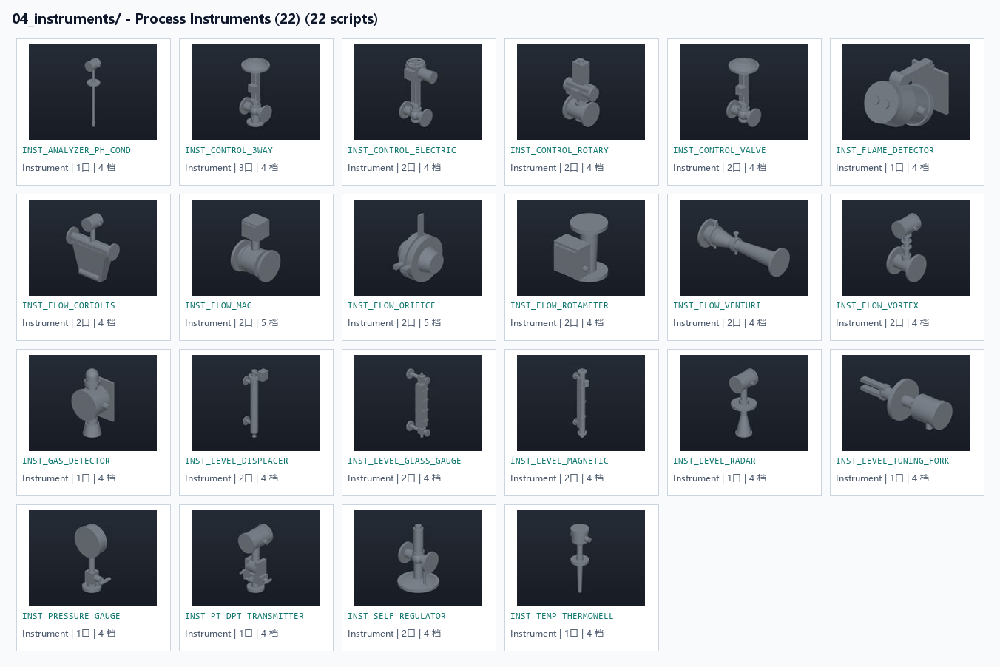

[English](#english) | [简体中文](#简体中文)

---

## English

### Chemical Industry 170-Script AutoCAD Plant 3D Standard Component Report

- **Total Components**: `170` scripts (100% PASS in `plant3d_occ` geometry/port check and Plant 3D `inspect_script`)
- **Total Spec Rows**: `1,876` rows (`1,431` rows verified line-by-line against published standards)
- **Ready-to-Use 2026 Bundle**: [Plant 3D 2026 Installation & Usage Guide](../../docs/%E4%BD%BF%E7%94%A8%E8%AF%B4%E6%98%8E(AutoCAD%20Plant%203D%202026).md) | [Release v1.1.0](https://github.com/zly258/P3dPyPad/releases/tag/v1.1.0)
- **Online 3D Workbench & Report**: [https://zly258.github.io/P3dPyPad/](https://zly258.github.io/P3dPyPad/)
- **Full CSV Index**: [CATALOG_INDEX.csv](./CATALOG_INDEX.csv)

#### Category Overview

| Directory | Category | Scripts | Spec Rows | Verified Standard Rows | Ports | Status |
|---|---|---:|---:|---|---:|---|
| `01_flanges/` | Flanges, Blinds & Gaskets | 22 | 367 | 325 rows | 42 | 100% PASS |
| `02_pipe_fittings/` | Pipe Fittings & Olets | 28 | 872 | 847 rows | 62 | 100% PASS |
| `03_valves/` | Industrial Valves | 27 | 336 | 259 rows | 54 | 100% PASS |
| `04_instruments/` | Process Instruments | 22 | 90 | Engineering reference | 37 | 100% PASS |
| `05_supports/` | Pipe Supports & Hangers | 19 | 95 | Engineering reference | 19 | 100% PASS |
| `06_equipment/` | Process Equipment | 29 | 29 | 1-row default template | 91 | 100% PASS |
| `07_specialty/` | Specialty Piping Items | 23 | 87 | Engineering reference | 37 | 100% PASS |

#### Flanges, Blinds & Gaskets (22)

| # | Component | Script | Spec Summary | Standard / Source |
|---:|---|---|---|---|
| 1 | 8字盲板 (HG/T 21547 PN16 RF) | [`BLIND_FIGURE8_HGT21547.py`](./01_flanges/BLIND_FIGURE8_HGT21547.py) | Blind · 2口 · 40 档 | 核实标准表:ASME B16.48 CL150 |
| 2 | 插板盲板 (ASME B16.48 Paddle Blind) | [`BLIND_PADDLE_B1648.py`](./01_flanges/BLIND_PADDLE_B1648.py) | Blind · 2口 · 40 档 | 核实标准表:ASME B16.48 CL150(Wermac) |
| 3 | 卫生级 Tri-Clamp 快装卡箍法兰接头 (ISO 2852) | [`CLAMP_TRICLAMP_ISO.py`](./01_flanges/CLAMP_TRICLAMP_ISO.py) | Flange · 2口 · 5 档 | 核实标准表:ISO 2852/DIN 32676(卡箍环外廓为工程参考) |
| 4 | 法兰盖/盲法兰 (HG/T 20592 BL PN16 RF) | [`FLANGE_BL_HGT20592.py`](./01_flanges/FLANGE_BL_HGT20592.py) | Blind · 1口 · 38 档 | 核实标准表:HG/T 20592-2009(ghfitting) |
| 5 | 压力容器长颈对焊法兰 (NB/T 47023 DN400~1200) | [`FLANGE_EQ_NBT47023.py`](./01_flanges/FLANGE_EQ_NBT47023.py) | Flange · 2口 · 5 档 | 标准参考:NB/T 47023-2012(甲型平焊设备法兰) |
| 6 | 绝缘法兰总成 (Insulating Flange Kit) | [`FLANGE_INSULATING_KIT.py`](./01_flanges/FLANGE_INSULATING_KIT.py) | Flange · 2口 · 4 档 | 工程参考模板(需按厂标校核) |
| 7 | 对焊环松套法兰 (HG/T 20592 PJ/SE PN16) | [`FLANGE_LJ_HGT20592.py`](./01_flanges/FLANGE_LJ_HGT20592.py) | Flange · 2口 · 5 档 | 标准参考:HG/T 20592-2009(松套法兰) |
| 8 | 长焊颈法兰 (ASME LWN Class150/300) | [`FLANGE_LWN_ASME.py`](./01_flanges/FLANGE_LWN_ASME.py) | Flange · 2口 · 5 档 | 核实标准表:ASME B16.5/Wermac(长颈长度L为工程系列) |
| 9 | 美标长颈对焊设备接管法兰 (ASME B16.5 LWN RF) | [`FLANGE_LWN_RF_B165.py`](./01_flanges/FLANGE_LWN_RF_B165.py) | Flange · 2口 · 6 档 | 核实标准表:ASME B16.5/Wermac(长颈长度L为工程系列) |
| 10 | 孔板法兰单件 (ASME B16.36 Class300/600 RF) | [`FLANGE_ORIFICE_B1636.py`](./01_flanges/FLANGE_ORIFICE_B1636.py) | Flange · 2口 · 4 档 | 标准参考:ASME B16.36(CL300孔板法兰) |
| 11 | 板式平焊法兰 (HG/T 20592 PL PN16 RF) | [`FLANGE_PL_HGT20592.py`](./01_flanges/FLANGE_PL_HGT20592.py) | Flange · 2口 · 5 档 | 核实标准表:HG/T 20592-2009(PL接口/B1内径) |
| 12 | 快开盲板 (Quick Opening Closure) | [`FLANGE_QUICK_CLOSURE.py`](./01_flanges/FLANGE_QUICK_CLOSURE.py) | Blind · 1口 · 4 档 | 工程参考模板(需按厂标校核) |
| 13 | 异径带颈法兰 (HG/T 20592 Reducing RF) | [`FLANGE_RED_HGT20592.py`](./01_flanges/FLANGE_RED_HGT20592.py) | Flange · 2口 · 5 档 | 标准参考:HG/T 20592-2009(异径法兰) |
| 14 | 带颈平焊法兰 (HG/T 20592 SO PN16 RF) | [`FLANGE_SO_HGT20592.py`](./01_flanges/FLANGE_SO_HGT20592.py) | Flange · 2口 · 38 档 | 核实标准表:HG/T 20592-2009(ghfitting) |
| 15 | 承插焊法兰 (HG/T 20592 SW PN40 RF) | [`FLANGE_SW_HGT20592.py`](./01_flanges/FLANGE_SW_HGT20592.py) | Flange · 2口 · 5 档 | 标准参考:HG/T 20592-2009(SW PN40) |
| 16 | 螺纹法兰 (HG/T 20592 Th PN16 RF) | [`FLANGE_TH_HGT20592.py`](./01_flanges/FLANGE_TH_HGT20592.py) | Flange · 2口 · 5 档 | 标准参考:HG/T 20592-2009(TH PN16) |
| 17 | 美标带颈对焊法兰 (ASME B16.5 WN RF) | [`FLANGE_WN_ASME_B165.py`](./01_flanges/FLANGE_WN_ASME_B165.py) | Flange · 2口 · 48 档 | 核实标准表:ASME B16.5(Wermac) |
| 18 | 大直径带颈对焊法兰 (ASME B16.47 Series A/B) | [`FLANGE_WN_B1647.py`](./01_flanges/FLANGE_WN_B1647.py) | Flange · 2口 · 5 档 | 核实标准表:ASME B16.47/Wermac |
| 19 | 国标带颈对焊法兰 (HG/T 20592 WN PN16 RF) | [`FLANGE_WN_HGT20592.py`](./01_flanges/FLANGE_WN_HGT20592.py) | Flange · 2口 · 38 档 | 核实标准表:HG/T 20592-2009(ghfitting) |
| 20 | 非金属聚四氟乙烯平垫片 (HG/T 20606 PTFE RF/FF) | [`GASKET_PTFE_FLAT.py`](./01_flanges/GASKET_PTFE_FLAT.py) | Flange · 2口 · 5 档 | 标准参考:HG/T 20606-2009(PTFE平垫片) |
| 21 | 金属八角环垫 RTJ (ASME B16.20 R型) | [`GASKET_RTJ_OCTAGONAL.py`](./01_flanges/GASKET_RTJ_OCTAGONAL.py) | Flange · 2口 · 19 档 | 核实标准表:ASME B16.20 RTJ(Wermac) |
| 22 | 金属缠绕垫片 (HG/T 20610 D型 PN16 RF) | [`GASKET_SPIRAL_HGT20610.py`](./01_flanges/GASKET_SPIRAL_HGT20610.py) | Flange · 2口 · 38 档 | 核实标准表:ASME B16.20 CL150(Wermac) |

#### Pipe Fittings & Olets (28)

| # | Component | Script | Spec Summary | Standard / Source |
|---:|---|---|---|---|
| 1 | 3D/5D大半径煨制弯管 90° (SH/T 3408) | [`BEND_3D_5D_SHT3408.py`](./02_pipe_fittings/BEND_3D_5D_SHT3408.py) | Elbow · 2口 · 20 档 | 核实标准表:ASME B16.9(3D半径)+直管段工程系列 |
| 2 | 锻钢六角内外丝补芯 Hex Bushing | [`BUSHING_HEX_TH.py`](./02_pipe_fittings/BUSHING_HEX_TH.py) | Reducer · 2口 · 16 档 | 核实标准表:ASME B16.11(Wermac) |
| 3 | 对焊椭圆形管帽 (GB/T 12459) | [`CAP_BW_GBT12459.py`](./02_pipe_fittings/CAP_BW_GBT12459.py) | Cap · 1口 · 42 档 | 核实标准表:ASME B16.9/B36.10M(Wermac) |
| 4 | 锻钢承插焊管帽 (GB/T 14383) | [`CAP_SW_GBT14383.py`](./02_pipe_fittings/CAP_SW_GBT14383.py) | Cap · 1口 · 15 档 | 核实标准表:ASME B16.11(Wermac) |
| 5 | 对焊等径四通 (GB/T 12459) | [`CROSS_BW_GBT12459.py`](./02_pipe_fittings/CROSS_BW_GBT12459.py) | Cross · 4口 · 42 档 | 核实标准表:ASME B16.9/B36.10M(Wermac) |
| 6 | 对焊异径四通 (GB/T 12459) | [`CROSS_RED_GBT12459.py`](./02_pipe_fittings/CROSS_RED_GBT12459.py) | Cross · 4口 · 86 档 | 核实标准表:ASME B16.9/B36.10M(Wermac) |
| 7 | 180°对焊回弯头 (GB/T 12459) | [`ELBOW_180_GBT12459.py`](./02_pipe_fittings/ELBOW_180_GBT12459.py) | Elbow · 2口 · 42 档 | 核实标准表:ASME B16.9/B36.10M(Wermac) |
| 8 | 45°长半径对焊弯头 (GB/T 12459) | [`ELBOW_45_LR_GBT12459.py`](./02_pipe_fittings/ELBOW_45_LR_GBT12459.py) | Elbow · 2口 · 42 档 | 核实标准表:ASME B16.9/B36.10M(Wermac) |
| 9 | 锻钢承插焊45°弯头 (GB/T 14383) | [`ELBOW_45_SW_GBT14383.py`](./02_pipe_fittings/ELBOW_45_SW_GBT14383.py) | Elbow · 2口 · 15 档 | 核实标准表:ASME B16.11(Wermac) |
| 10 | 90°长半径对焊弯头 1.5D (GB/T 12459) | [`ELBOW_90_LR_GBT12459.py`](./02_pipe_fittings/ELBOW_90_LR_GBT12459.py) | Elbow · 2口 · 42 档 | 核实标准表:ASME B16.9/B36.10M(Wermac) |
| 11 | 90°短半径对焊弯头 1.0D (GB/T 12459) | [`ELBOW_90_SR_GBT12459.py`](./02_pipe_fittings/ELBOW_90_SR_GBT12459.py) | Elbow · 2口 · 38 档 | 核实标准表:ASME B16.9/B36.10M(Wermac) |
| 12 | 90°多节虾米腰弯头 (Miter Elbow) | [`ELBOW_MITER_SEG.py`](./02_pipe_fittings/ELBOW_MITER_SEG.py) | Elbow · 2口 · 5 档 | 工程参考模板(需按项目图校核) |
| 13 | 90°变径对焊弯头 (Reducing Elbow) | [`ELBOW_RED_90_BW.py`](./02_pipe_fittings/ELBOW_RED_90_BW.py) | Elbow · 2口 · 5 档 | 工程参考模板(R按GB/T12459 1.5D) |
| 14 | 衬氟/衬胶防腐 90°法兰弯头 | [`FITTING_LINED_PTFE_ELBOW.py`](./02_pipe_fittings/FITTING_LINED_PTFE_ELBOW.py) | Elbow · 2口 · 19 档 | 核实标准表:HG/T 20592 PN16+ASME B16.9(衬里厚按工程标准) |
| 15 | 锻钢承插焊90°弯头 (GB/T 14383) | [`FITTING_SW_GBT14383.py`](./02_pipe_fittings/FITTING_SW_GBT14383.py) | Elbow · 2口 · 15 档 | 核实标准表:ASME B16.11(Wermac) |
| 16 | 锻钢内螺纹管箍 Coupling (GB/T 14383) | [`FITTING_TH_GBT14383.py`](./02_pipe_fittings/FITTING_TH_GBT14383.py) | Pipe · 2口 · 18 档 | 核实标准表:ASME B16.11(Wermac) |
| 17 | 锻制对焊支管台 Weldolet (GB/T 19326) | [`OLET_GBT19326.py`](./02_pipe_fittings/OLET_GBT19326.py) | Tee · 2口 · 30 档 | 核实标准表:MSS SP-97(STD) |
| 18 | 45°斜支管台 Latrolet (GB/T 19326) | [`OLET_LATROLET_45.py`](./02_pipe_fittings/OLET_LATROLET_45.py) | Tee · 2口 · 9 档 | 核实标准表:MSS SP-97(Latrolet BW) |
| 19 | 锻钢六角丝堵 Hex Plug | [`PLUG_HEX_TH.py`](./02_pipe_fittings/PLUG_HEX_TH.py) | Cap · 1口 · 9 档 | 核实标准表:ASME B16.11(Wermac) |
| 20 | 对焊同心大小头 (GB/T 12459) | [`REDUCER_CON_GBT12459.py`](./02_pipe_fittings/REDUCER_CON_GBT12459.py) | Reducer · 2口 · 98 档 | 核实标准表:ASME B16.9/B36.10M(Wermac) |
| 21 | 对焊偏心大小头 (GB/T 12459) | [`REDUCER_ECC_GBT12459.py`](./02_pipe_fittings/REDUCER_ECC_GBT12459.py) | Reducer · 2口 · 98 档 | 核实标准表:ASME B16.9/B36.10M(Wermac) |
| 22 | 同心异径短节 Swage Nipple (MSS SP-95) | [`SWAGE_NIPPLE_CON.py`](./02_pipe_fittings/SWAGE_NIPPLE_CON.py) | Reducer · 2口 · 5 档 | 工程参考模板(需按项目图校核) |
| 23 | 对焊等径三通 (GB/T 12459) | [`TEE_EQ_GBT12459.py`](./02_pipe_fittings/TEE_EQ_GBT12459.py) | Tee · 3口 · 42 档 | 核实标准表:ASME B16.9/B36.10M(Wermac) |
| 24 | 45°斜三通 (Lateral Tee) | [`TEE_LATERAL_45.py`](./02_pipe_fittings/TEE_LATERAL_45.py) | Tee · 3口 · 5 档 | 工程参考模板(需按项目图校核) |
| 25 | 对焊异径三通 (GB/T 12459) | [`TEE_RED_GBT12459.py`](./02_pipe_fittings/TEE_RED_GBT12459.py) | Tee · 3口 · 86 档 | 核实标准表:ASME B16.9/B36.10M(Wermac) |
| 26 | 锻钢承插焊三通 (GB/T 14383) | [`TEE_SW_GBT14383.py`](./02_pipe_fittings/TEE_SW_GBT14383.py) | Tee · 3口 · 15 档 | 核实标准表:ASME B16.11(Wermac) |
| 27 | 45°异径斜三通 (Reducing Lateral Tee) | [`TEE_WYE_45_RED.py`](./02_pipe_fittings/TEE_WYE_45_RED.py) | Tee · 3口 · 5 档 | 工程参考模板(需按项目图校核) |
| 28 | 锻钢承插焊活接头 Union (GB/T 14383) | [`UNION_SW_GBT14383.py`](./02_pipe_fittings/UNION_SW_GBT14383.py) | Pipe · 2口 · 8 档 | 核实标准表:MSS SP-83(CL3000) |

#### Industrial Valves (27)

| # | Component | Script | Spec Summary | Standard / Source |
|---:|---|---|---|---|
| 1 | 多回转电动执行机构 (ISO 5210) | [`ACTUATOR_ELECTRIC_MULTI.py`](./03_valves/ACTUATOR_ELECTRIC_MULTI.py) | Valve · 1口 · 4 档 | 工程参考包络(需按采购样本校核) |
| 2 | 90度角式截止阀 / 放料阀 | [`VALVE_ANGLE_GLOBE.py`](./03_valves/VALVE_ANGLE_GLOBE.py) | Valve · 2口 · 4 档 | 工程参考包络(需按采购样本校核) |
| 3 | 三通法兰球阀 (T型) | [`VALVE_BALL_3WAY.py`](./03_valves/VALVE_BALL_3WAY.py) | Valve · 3口 · 4 档 | 工程参考包络(需按采购样本校核) |
| 4 | 低温长颈法兰球阀 (BS 6364) | [`VALVE_BALL_CRYO_EXT.py`](./03_valves/VALVE_BALL_CRYO_EXT.py) | Valve · 2口 · 4 档 | 结构长度核实(GB/T 12221/B16.10)+手轮/外廓待按厂标校核 |
| 5 | 法兰钢制球阀 (GB/T 12237) | [`VALVE_BALL_GBT12237.py`](./03_valves/VALVE_BALL_GBT12237.py) | Valve · 2口 · 48 档 | 核实标准表:ASME B16.10结构长度+ASME B16.5法兰(外廓为工程比例) |
| 6 | 夹套保温法兰球阀 | [`VALVE_BALL_JACKETED.py`](./03_valves/VALVE_BALL_JACKETED.py) | Valve · 2口 · 4 档 | 工程参考包络(需按采购样本校核) |
| 7 | 气动紧急切断球阀 XV/SDV | [`VALVE_BALL_PNEU_SDV.py`](./03_valves/VALVE_BALL_PNEU_SDV.py) | Valve · 2口 · 32 档 | 核实标准表:ASME B16.10结构长度+ASME B16.5法兰(外廓为工程比例) |
| 8 | 双法兰偏心蝶阀 (蜗轮传动) | [`VALVE_BUTTERFLY_FLANGED.py`](./03_valves/VALVE_BUTTERFLY_FLANGED.py) | Valve · 2口 · 4 档 | 工程参考包络(需按采购样本校核) |
| 9 | 气动对夹蝶阀 (带气缸执行器) | [`VALVE_BUTTERFLY_PNEU.py`](./03_valves/VALVE_BUTTERFLY_PNEU.py) | Valve · 2口 · 14 档 | 核实标准表:API 609 Cat A/ASME B16.10(执行机构按工程比例) |
| 10 | 对夹式蝶阀 (API 609 / GB/T 12238) | [`VALVE_BUTTERFLY_WAFER.py`](./03_valves/VALVE_BUTTERFLY_WAFER.py) | Valve · 2口 · 14 档 | 核实标准表:API 609 Cat A/ASME B16.10(手柄按工程比例) |
| 11 | 法兰升降式止回阀 (GB/T 12235) | [`VALVE_CHECK_LIFT.py`](./03_valves/VALVE_CHECK_LIFT.py) | Valve · 2口 · 4 档 | 结构长度核实(GB/T 12221/B16.10)+手轮/外廓待按厂标校核 |
| 12 | 法兰旋启式止回阀 (GB/T 12236) | [`VALVE_CHECK_SWING.py`](./03_valves/VALVE_CHECK_SWING.py) | Valve · 2口 · 46 档 | 核实标准表:ASME B16.10结构长度+ASME B16.5法兰(外廓为工程比例) |
| 13 | 对夹双瓣止回阀 (API 594) | [`VALVE_CHECK_WAFER.py`](./03_valves/VALVE_CHECK_WAFER.py) | Valve · 2口 · 4 档 | 工程参考包络(需按采购样本校核) |
| 14 | 双阻塞与泄放阀 (DBB) | [`VALVE_DBB_DOUBLE_BLOCK.py`](./03_valves/VALVE_DBB_DOUBLE_BLOCK.py) | Valve · 2口 · 4 档 | 工程参考包络(需按采购样本校核) |
| 15 | 法兰堰式衬氟隔膜阀 (GB/T 12239) | [`VALVE_DIAPHRAGM_PLUG.py`](./03_valves/VALVE_DIAPHRAGM_PLUG.py) | Valve · 2口 · 4 档 | 工程参考包络(需按采购样本校核) |
| 16 | 低温长颈闸阀 (BS 6364) | [`VALVE_GATE_CRYO_EXT.py`](./03_valves/VALVE_GATE_CRYO_EXT.py) | Valve · 2口 · 4 档 | 结构长度核实(GB/T 12221/B16.10)+手轮/外廓待按厂标校核 |
| 17 | 锻钢承插焊小闸阀 (API 602) | [`VALVE_GATE_FORGED_API602.py`](./03_valves/VALVE_GATE_FORGED_API602.py) | Valve · 2口 · 5 档 | 工程参考包络(需按采购样本校核) |
| 18 | 法兰明杆楔式闸阀 (GB/T 12221) | [`VALVE_GATE_GBT12221.py`](./03_valves/VALVE_GATE_GBT12221.py) | Valve · 2口 · 48 档 | 核实标准表:ASME B16.10结构长度+ASME B16.5法兰(外廓为工程比例) |
| 19 | 波纹管密封截止阀 (GB/T 12235) | [`VALVE_GLOBE_BELLOWS.py`](./03_valves/VALVE_GLOBE_BELLOWS.py) | Valve · 2口 · 22 档 | 核实标准表:ASME B16.10结构长度+ASME B16.5法兰(外廓为工程比例) |
| 20 | 法兰直流式截止阀 (GB/T 12235) | [`VALVE_GLOBE_GBT12235.py`](./03_valves/VALVE_GLOBE_GBT12235.py) | Valve · 2口 · 35 档 | 核实标准表:ASME B16.10结构长度+ASME B16.5法兰(外廓为工程比例) |
| 21 | Y型直流斜杆截止阀 | [`VALVE_GLOBE_Y_TYPE.py`](./03_valves/VALVE_GLOBE_Y_TYPE.py) | Valve · 2口 · 4 档 | 结构长度核实(GB/T 12221/B16.10)+手轮/外廓待按厂标校核 |
| 22 | 对夹刀闸阀 / 料浆阀 (MSS SP-81) | [`VALVE_KNIFE_GATE.py`](./03_valves/VALVE_KNIFE_GATE.py) | Valve · 2口 · 4 档 | 工程参考包络(需按采购样本校核) |
| 23 | 法兰夹管阀 (胶管阀) | [`VALVE_PINCH_FLANGED.py`](./03_valves/VALVE_PINCH_FLANGED.py) | Valve · 2口 · 4 档 | 工程参考包络(需按采购样本校核) |
| 24 | 先导活塞式蒸汽减压阀 (Y43H) | [`VALVE_PRV_PILOT.py`](./03_valves/VALVE_PRV_PILOT.py) | Valve · 2口 · 4 档 | 工程参考包络(需按采购样本校核) |
| 25 | 先导式安全阀 (API 526) | [`VALVE_SAFETY_PILOT.py`](./03_valves/VALVE_SAFETY_PILOT.py) | Valve · 2口 · 4 档 | 工程参考包络(需按采购样本校核) |
| 26 | 弹簧全启式安全阀 (API 526) | [`VALVE_SAFETY_PSV.py`](./03_valves/VALVE_SAFETY_PSV.py) | Valve · 2口 · 4 档 | 工程参考包络(需按采购样本校核) |
| 27 | 法兰蒸汽疏水阀 (倒吊桶/浮球式) | [`VALVE_STEAM_TRAP.py`](./03_valves/VALVE_STEAM_TRAP.py) | Valve · 2口 · 4 档 | 工程参考包络(需按采购样本校核) |

#### Process Instruments (22)

| # | Component | Script | Spec Summary | Standard / Source |
|---:|---|---|---|---|
| 1 | 在线 pH/电导率过程分析仪总成 (HG/T 20592) | [`INST_ANALYZER_PH_COND.py`](./04_instruments/INST_ANALYZER_PH_COND.py) | Instrument · 1口 · 4 档 | 接口核实(HG/T 20592)+表头外廓为工程包络(需按仪表厂样本替换) |
| 2 | 气动薄膜三通调节阀 (GB/T 4213) | [`INST_CONTROL_3WAY.py`](./04_instruments/INST_CONTROL_3WAY.py) | Instrument · 3口 · 4 档 | 接口核实(HG/T 20592)+表头外廓为工程包络(需按仪表厂样本替换) |
| 3 | 电动单座调节阀 (GB/T 4213) | [`INST_CONTROL_ELECTRIC.py`](./04_instruments/INST_CONTROL_ELECTRIC.py) | Instrument · 2口 · 4 档 | 接口核实(HG/T 20592)+表头外廓为工程包络(需按仪表厂样本替换) |
| 4 | 气动V型球阀/偏心旋转调节阀 (ISO 5211) | [`INST_CONTROL_ROTARY.py`](./04_instruments/INST_CONTROL_ROTARY.py) | Instrument · 2口 · 4 档 | 接口核实(HG/T 20592)+表头外廓为工程包络(需按仪表厂样本替换) |
| 5 | 气动薄膜单座调节阀 (GB/T 4213) | [`INST_CONTROL_VALVE.py`](./04_instruments/INST_CONTROL_VALVE.py) | Instrument · 2口 · 4 档 | 接口核实(HG/T 20592)+表头外廓为工程包络(需按仪表厂样本替换) |
| 6 | 防爆紫外/红外火焰探测器 (GB/T 50493) | [`INST_FLAME_DETECTOR.py`](./04_instruments/INST_FLAME_DETECTOR.py) | Instrument · 1口 · 4 档 | 非工艺法兰仪表+表壳与支架为工程包络(需按仪表厂样本替换) |
| 7 | 科里奥利质量流量计 (GB/T 31130) | [`INST_FLOW_CORIOLIS.py`](./04_instruments/INST_FLOW_CORIOLIS.py) | Instrument · 2口 · 4 档 | 接口核实(HG/T 20592)+表头外廓为工程包络(需按仪表厂样本替换) |
| 8 | 法兰式电磁流量计 (JB/T 9248) | [`INST_FLOW_MAG.py`](./04_instruments/INST_FLOW_MAG.py) | Instrument · 2口 · 5 档 | 接口核实(HG/T 20592)+表头外廓为工程包络(需按仪表厂样本替换) |
| 9 | 孔板流量计法兰组 (GB/T 2624 / ASME B16.36) | [`INST_FLOW_ORIFICE.py`](./04_instruments/INST_FLOW_ORIFICE.py) | Instrument · 2口 · 5 档 | 接口核实(ASME B16.36)+表头外廓为工程包络(需按仪表厂样本替换) |
| 10 | 金属管浮子/转子流量计 (JB/T 6844) | [`INST_FLOW_ROTAMETER.py`](./04_instruments/INST_FLOW_ROTAMETER.py) | Instrument · 2口 · 4 档 | 接口核实(HG/T 20592)+表头外廓为工程包络(需按仪表厂样本替换) |
| 11 | 经典文丘里流量计 (GB/T 2624.4 / ISO 5167) | [`INST_FLOW_VENTURI.py`](./04_instruments/INST_FLOW_VENTURI.py) | Instrument · 2口 · 4 档 | 接口核实(HG/T 20592)+表头外廓为工程包络(需按仪表厂样本替换) |
| 12 | 法兰式涡街流量计 (JB/T 9249) | [`INST_FLOW_VORTEX.py`](./04_instruments/INST_FLOW_VORTEX.py) | Instrument · 2口 · 4 档 | 接口核实(HG/T 20592)+表头外廓为工程包络(需按仪表厂样本替换) |
| 13 | 防爆可燃/有毒气体探测器 (GB/T 50493) | [`INST_GAS_DETECTOR.py`](./04_instruments/INST_GAS_DETECTOR.py) | Instrument · 1口 · 4 档 | 非工艺法兰仪表+表壳与支架为工程包络(需按仪表厂样本替换) |
| 14 | 外浮筒液位变送器 (JB/T 9242) | [`INST_LEVEL_DISPLACER.py`](./04_instruments/INST_LEVEL_DISPLACER.py) | Instrument · 2口 · 4 档 | 接口核实(HG/T 20592)+表头外廓为工程包络(需按仪表厂样本替换) |
| 15 | 玻璃板液位计 (HG/T 21592) | [`INST_LEVEL_GLASS_GAUGE.py`](./04_instruments/INST_LEVEL_GLASS_GAUGE.py) | Instrument · 2口 · 4 档 | 接口核实(HG/T 20592)+表头外廓为工程包络(需按仪表厂样本替换) |
| 16 | 侧装双法兰磁翻板液位计 (HG/T 21584) | [`INST_LEVEL_MAGNETIC.py`](./04_instruments/INST_LEVEL_MAGNETIC.py) | Instrument · 2口 · 4 档 | 接口核实(HG/T 20592)+表头外廓为工程包络(需按仪表厂样本替换) |
| 17 | 顶装法兰雷达液位计 (GB/T 20729) | [`INST_LEVEL_RADAR.py`](./04_instruments/INST_LEVEL_RADAR.py) | Instrument · 1口 · 4 档 | 接口核实(HG/T 20592)+表头外廓为工程包络(需按仪表厂样本替换) |
| 18 | 侧装法兰音叉液位开关 (GB/T 34041) | [`INST_LEVEL_TUNING_FORK.py`](./04_instruments/INST_LEVEL_TUNING_FORK.py) | Instrument · 1口 · 4 档 | 接口核实(HG/T 20592)+表头外廓为工程包络(需按仪表厂样本替换) |
| 19 | 压力表总成含根部阀 (GB/T 1226) | [`INST_PRESSURE_GAUGE.py`](./04_instruments/INST_PRESSURE_GAUGE.py) | Instrument · 1口 · 4 档 | 接口核实(HG/T 20592)+表头外廓为工程包络(需按仪表厂样本替换) |
| 20 | 压力/差压变送器含三阀组 (IEC 61518) | [`INST_PT_DPT_TRANSMITTER.py`](./04_instruments/INST_PT_DPT_TRANSMITTER.py) | Instrument · 1口 · 4 档 | 接口核实(HG/T 20592)+表头外廓为工程包络(需按仪表厂样本替换) |
| 21 | 自力式压力调节阀/氮封阀 (GB/T 12244) | [`INST_SELF_REGULATOR.py`](./04_instruments/INST_SELF_REGULATOR.py) | Instrument · 2口 · 4 档 | 接口核实(HG/T 20592)+表头外廓为工程包络(需按仪表厂样本替换) |
| 22 | 法兰式热电偶/温度计含锥形套管 (ASME PTC 19.3) | [`INST_TEMP_THERMOWELL.py`](./04_instruments/INST_TEMP_THERMOWELL.py) | Instrument · 1口 · 4 档 | 接口核实(HG/T 20592)+表头外廓为工程包络(需按仪表厂样本替换) |

#### Pipe Supports & Hangers (19)

| # | Component | Script | Spec Summary | Standard / Source |
|---:|---|---|---|---|
| 1 | 刚性单吊杆吊架 (HG/T 21629 H1) | [`HANGER_RIGID_ROD.py`](./05_supports/HANGER_RIGID_ROD.py) | Support · 1口 · 5 档 | 管径I系列已核实+管架型钢尺寸为工程参考值(需对照HG/T 21629-2021正版图集校核) |
| 2 | 可变弹簧吊架 (NB/T 47039 VS) | [`HANGER_VAR_SPRING.py`](./05_supports/HANGER_VAR_SPRING.py) | Support · 1口 · 5 档 | 管径I系列已核实+管架型钢尺寸为工程参考值(需对照HG/T 21629-2021正版图集校核) |
| 3 | 管夹式滑动管托 (HG/T 21629 A4) | [`SHOE_CLAMP_HGT21629.py`](./05_supports/SHOE_CLAMP_HGT21629.py) | Support · 1口 · 5 档 | 管径I系列已核实+管架型钢尺寸为工程参考值(需对照HG/T 21629-2021正版图集校核) |
| 4 | 高密度绝热保冷管托 (HG/T 21629 C1) | [`SHOE_CRYOGENIC_INSUL.py`](./05_supports/SHOE_CRYOGENIC_INSUL.py) | Support · 1口 · 5 档 | 管径I系列已核实+管架型钢尺寸为工程参考值(需对照HG/T 21629-2021正版图集校核) |
| 5 | 双立板重型焊接滑动管托 (HG/T 21629 A2) | [`SHOE_DOUBLE_WEB_HEAVY.py`](./05_supports/SHOE_DOUBLE_WEB_HEAVY.py) | Support · 1口 · 5 档 | 管径I系列已核实+管架型钢尺寸为工程参考值(需对照HG/T 21629-2021正版图集校核) |
| 6 | 大管径弧形鞍式管托 (120° 护板) | [`SHOE_SADDLE_LARGE.py`](./05_supports/SHOE_SADDLE_LARGE.py) | Support · 1口 · 5 档 | 管径I系列已核实+管架型钢尺寸为工程参考值(需对照HG/T 21629-2021正版图集校核) |
| 7 | T型焊接滑动管托 (HG/T 21629 A1) | [`SHOE_T_SLIDE_HGT21629.py`](./05_supports/SHOE_T_SLIDE_HGT21629.py) | Support · 1口 · 5 档 | 管径I系列已核实+管架型钢尺寸为工程参考值(需对照HG/T 21629-2021正版图集校核) |
| 8 | 四向固定管架 (HG/T 21629 D1) | [`SUPPORT_ANCHOR_HGT21629.py`](./05_supports/SUPPORT_ANCHOR_HGT21629.py) | Support · 1口 · 5 档 | 管径I系列已核实+管架型钢尺寸为工程参考值(需对照HG/T 21629-2021正版图集校核) |
| 9 | 角钢三角形牛腿支架 | [`SUPPORT_BRACKET_KNEE.py`](./05_supports/SUPPORT_BRACKET_KNEE.py) | Support · 1口 · 5 档 | 管径I系列已核实+管架型钢尺寸为工程参考值(需对照HG/T 21629-2021正版图集校核) |
| 10 | 恒力弹簧支吊架 (NB/T 47038 CS) | [`SUPPORT_CONST_SPRING.py`](./05_supports/SUPPORT_CONST_SPRING.py) | Support · 1口 · 5 档 | 管径I系列已核实+管架型钢尺寸为工程参考值(需对照HG/T 21629-2021正版图集校核) |
| 11 | 槽钢落地门式管架 (HG/T 21629 L1) | [`SUPPORT_GOALPOST_FRAME.py`](./05_supports/SUPPORT_GOALPOST_FRAME.py) | Support · 1口 · 5 档 | 管径I系列已核实+管架型钢尺寸为工程参考值(需对照HG/T 21629-2021正版图集校核) |
| 12 | 导向管托 (HG/T 21629 B1) | [`SUPPORT_GUIDE_HGT21629.py`](./05_supports/SUPPORT_GUIDE_HGT21629.py) | Support · 1口 · 5 档 | 管径I系列已核实+管架型钢尺寸为工程参考值(需对照HG/T 21629-2021正版图集校核) |
| 13 | 立管承重双耳抱箍支架 (HG/T 21629 G1) | [`SUPPORT_RISER_CLAMP.py`](./05_supports/SUPPORT_RISER_CLAMP.py) | Support · 1口 · 5 档 | 管径I系列已核实+管架型钢尺寸为工程参考值(需对照HG/T 21629-2021正版图集校核) |
| 14 | 单滚轮滑动支座 (HG/T 21629 E1) | [`SUPPORT_ROLLER_SINGLE.py`](./05_supports/SUPPORT_ROLLER_SINGLE.py) | Support · 1口 · 5 档 | 管径I系列已核实+管架型钢尺寸为工程参考值(需对照HG/T 21629-2021正版图集校核) |
| 15 | 刚性拉撑杆/液压阻尼器 (SNUBBER) | [`SUPPORT_SNUBBER_STRUT.py`](./05_supports/SUPPORT_SNUBBER_STRUT.py) | Support · 1口 · 5 档 | 管径I系列已核实+管架型钢尺寸为工程参考值(需对照HG/T 21629-2021正版图集校核) |
| 16 | 门式双吊杆横担架 (HG/T 21629 H3) | [`SUPPORT_TRAPEZE_FRAME.py`](./05_supports/SUPPORT_TRAPEZE_FRAME.py) | Support · 1口 · 5 档 | 管径I系列已核实+管架型钢尺寸为工程参考值(需对照HG/T 21629-2021正版图集校核) |
| 17 | 弯头假管支腿/耳轴支座 (HG/T 21629 F1) | [`SUPPORT_TRUNNION_ELBOW.py`](./05_supports/SUPPORT_TRUNNION_ELBOW.py) | Support · 1口 · 5 档 | 管径I系列已核实+管架型钢尺寸为工程参考值(需对照HG/T 21629-2021正版图集校核) |
| 18 | U型螺栓管卡 (HG/T 21629 J1) | [`SUPPORT_UBOLT_HGT21629.py`](./05_supports/SUPPORT_UBOLT_HGT21629.py) | Support · 1口 · 5 档 | 管径I系列已核实+管架型钢尺寸为工程参考值(需对照HG/T 21629-2021正版图集校核) |
| 19 | 穿墙/穿楼板防水套管 (02S404) | [`SUPPORT_WALL_SLEEVE.py`](./05_supports/SUPPORT_WALL_SLEEVE.py) | Support · 1口 · 5 档 | 管径I系列已核实+管架型钢尺寸为工程参考值(需对照HG/T 21629-2021正版图集校核) |

#### Process Equipment (29)

| # | Component | Script | Spec Summary | Standard / Source |
|---:|---|---|---|---|
| 1 | 干式翅片管空冷器 (API 661) | [`EQ_AIR_COOLER_FIN.py`](./06_equipment/EQ_AIR_COOLER_FIN.py) | Equipment · 2口 · 1 档 | 非标设备默认外形模板(不含系列数据;按项目条件图输入) |
| 2 | 卧螺沉降离心机 | [`EQ_CENTRIFUGE_DECANTER.py`](./06_equipment/EQ_CENTRIFUGE_DECANTER.py) | Equipment · 3口 · 1 档 | 非标设备默认外形模板(不含系列数据;按项目条件图输入) |
| 3 | 螺杆式冷冻机组撬块 | [`EQ_CHILLER_SCREW_SKID.py`](./06_equipment/EQ_CHILLER_SCREW_SKID.py) | Equipment · 4口 · 1 档 | 非标设备默认外形模板(不含系列数据;按项目条件图输入) |
| 4 | 往复式活塞压缩机撬块 | [`EQ_COMPRESSOR_RECIP.py`](./06_equipment/EQ_COMPRESSOR_RECIP.py) | Equipment · 2口 · 1 档 | 非标设备默认外形模板(不含系列数据;按项目条件图输入) |
| 5 | 离心压缩机/鼓风机撬块 (API 617) | [`EQ_COMPRESSOR_SKID.py`](./06_equipment/EQ_COMPRESSOR_SKID.py) | Equipment · 2口 · 1 档 | 非标设备默认外形模板(不含系列数据;按项目条件图输入) |
| 6 | 旋风分离器 (切向矩形入口) | [`EQ_CYCLONE_SEPARATOR.py`](./06_equipment/EQ_CYCLONE_SEPARATOR.py) | Equipment · 3口 · 1 档 | 非标设备默认外形模板(不含系列数据;按项目条件图输入) |
| 7 | 套管式换热器 (双层U形) | [`EQ_DOUBLE_PIPE_HX.py`](./06_equipment/EQ_DOUBLE_PIPE_HX.py) | Equipment · 4口 · 1 档 | 非标设备默认外形模板(不含系列数据;按项目条件图输入) |
| 8 | 多袋式过滤器压力容器 | [`EQ_FILTER_BAG_VESSEL.py`](./06_equipment/EQ_FILTER_BAG_VESSEL.py) | Equipment · 2口 · 1 档 | 非标设备默认外形模板(不含系列数据;按项目条件图输入) |
| 9 | 厢式/板框压滤机 | [`EQ_FILTER_PRESS_PLATE.py`](./06_equipment/EQ_FILTER_PRESS_PLATE.py) | Equipment · 2口 · 1 档 | 非标设备默认外形模板(不含系列数据;按项目条件图输入) |
| 10 | 浮头式列管换热器 (GB/T 151 AES) | [`EQ_HEAT_EXCHANGER_AES.py`](./06_equipment/EQ_HEAT_EXCHANGER_AES.py) | Equipment · 4口 · 1 档 | 非标设备默认外形模板(不含系列数据;按项目条件图输入) |
| 11 | 固定管板列管换热器 (GB/T 151 BEM) | [`EQ_HEAT_EXCHANGER_BEM.py`](./06_equipment/EQ_HEAT_EXCHANGER_BEM.py) | Equipment · 4口 · 1 档 | 非标设备默认外形模板(不含系列数据;按项目条件图输入) |
| 12 | 卧式储罐/分离器 (NB/T 47042) | [`EQ_HORIZONTAL_VESSEL.py`](./06_equipment/EQ_HORIZONTAL_VESSEL.py) | Equipment · 5口 · 1 档 | 非标设备默认外形模板(不含系列数据;按项目条件图输入) |
| 13 | BKU 釜式重沸器 (GB/T 151) | [`EQ_KETTLE_REBOILER_BKU.py`](./06_equipment/EQ_KETTLE_REBOILER_BKU.py) | Equipment · 4口 · 1 档 | 非标设备默认外形模板(不含系列数据;按项目条件图输入) |
| 14 | 钢制回转盖人孔组件 (HG/T 21515) | [`EQ_MANHOLE_HGT21515.py`](./06_equipment/EQ_MANHOLE_HGT21515.py) | Equipment · 1口 · 1 档 | 非标设备默认外形模板(不含系列数据;按项目条件图输入) |
| 15 | 平盖搅拌配料槽 | [`EQ_MIXING_TANK_OPEN.py`](./06_equipment/EQ_MIXING_TANK_OPEN.py) | Equipment · 3口 · 1 档 | 非标设备默认外形模板(不含系列数据;按项目条件图输入) |
| 16 | 板式换热器 (NB/T 47004) | [`EQ_PHE_FRAME.py`](./06_equipment/EQ_PHE_FRAME.py) | Equipment · 4口 · 1 档 | 非标设备默认外形模板(不含系列数据;按项目条件图输入) |
| 17 | 卧式单级离心泵总成 (GB/T 5662 / ISO 2858) | [`EQ_PUMP_CENTRIFUGAL_H.py`](./06_equipment/EQ_PUMP_CENTRIFUGAL_H.py) | Equipment · 2口 · 1 档 | 非标设备默认外形模板(不含系列数据;按项目条件图输入) |
| 18 | 立式管道离心泵 (In-line) | [`EQ_PUMP_INLINE_V.py`](./06_equipment/EQ_PUMP_INLINE_V.py) | Equipment · 2口 · 1 档 | 非标设备默认外形模板(不含系列数据;按项目条件图输入) |
| 19 | 计量泵/隔膜泵总成 | [`EQ_PUMP_METERING.py`](./06_equipment/EQ_PUMP_METERING.py) | Equipment · 2口 · 1 档 | 非标设备默认外形模板(不含系列数据;按项目条件图输入) |
| 20 | 卧式多级离心泵总成 | [`EQ_PUMP_MULTISTAGE.py`](./06_equipment/EQ_PUMP_MULTISTAGE.py) | Equipment · 2口 · 1 档 | 非标设备默认外形模板(不含系列数据;按项目条件图输入) |
| 21 | 夹套搅拌反应釜 (GB/T 150) | [`EQ_REACTOR_AGITATED.py`](./06_equipment/EQ_REACTOR_AGITATED.py) | Equipment · 6口 · 1 档 | 非标设备默认外形模板(不含系列数据;按项目条件图输入) |
| 22 | 球形储罐 (GB/T 12337) | [`EQ_SPHERICAL_TANK.py`](./06_equipment/EQ_SPHERICAL_TANK.py) | Equipment · 3口 · 1 档 | 非标设备默认外形模板(不含系列数据;按项目条件图输入) |
| 23 | 螺旋板换热器 (GB/T 28712) | [`EQ_SPIRAL_PLATE_HX.py`](./06_equipment/EQ_SPIRAL_PLATE_HX.py) | Equipment · 4口 · 1 档 | 非标设备默认外形模板(不含系列数据;按项目条件图输入) |
| 24 | 常压锥顶立式储罐 (NB/T 47003.1) | [`EQ_STORAGE_TANK_CONE.py`](./06_equipment/EQ_STORAGE_TANK_CONE.py) | Equipment · 4口 · 1 档 | 非标设备默认外形模板(不含系列数据;按项目条件图输入) |
| 25 | 容器标准鞍式支座组件 (NB/T 47065.1) | [`EQ_SUPPORT_SADDLE_LUG.py`](./06_equipment/EQ_SUPPORT_SADDLE_LUG.py) | Equipment · 1口 · 1 档 | 非标设备默认外形模板(不含系列数据;按项目条件图输入) |
| 26 | 储罐/塔器盘梯及顶部平台 (HG/T 21541) | [`EQ_TANK_STAIR_PLATFORM.py`](./06_equipment/EQ_TANK_STAIR_PLATFORM.py) | Equipment · 1口 · 1 档 | 非标设备默认外形模板(不含系列数据;按项目条件图输入) |
| 27 | 精馏塔/吸收塔 (NB/T 47041) | [`EQ_TOWER_COLUMN.py`](./06_equipment/EQ_TOWER_COLUMN.py) | Equipment · 6口 · 1 档 | 非标设备默认外形模板(不含系列数据;按项目条件图输入) |
| 28 | 立式热虹吸再沸器/冷凝器 (GB/T 151) | [`EQ_VERT_EXCHANGER.py`](./06_equipment/EQ_VERT_EXCHANGER.py) | Equipment · 4口 · 1 档 | 非标设备默认外形模板(不含系列数据;按项目条件图输入) |
| 29 | 立式夹套缓冲/储罐 | [`EQ_VESSEL_JACKETED_V.py`](./06_equipment/EQ_VESSEL_JACKETED_V.py) | Equipment · 5口 · 1 档 | 非标设备默认外形模板(不含系列数据;按项目条件图输入) |

#### Specialty Piping Items (23)

| # | Component | Script | Spec Summary | Standard / Source |
|---:|---|---|---|---|
| 1 | 紧急泄压呼吸人孔 (SY/T 0511) | [`SPEC_BREATHER_MANHOLE.py`](./07_specialty/SPEC_BREATHER_MANHOLE.py) | Valve · 1口 · 4 档 | 接口法兰已核实(HG/T 20592)+附件外廓为工程包络(需按采购样本校核) |
| 2 | 储罐阻火呼吸阀 (SY/T 0511) | [`SPEC_BREATHER_VALVE.py`](./07_specialty/SPEC_BREATHER_VALVE.py) | Valve · 1口 · 4 档 | 接口法兰已核实(HG/T 20592)+附件外廓为工程包络(需按采购样本校核) |
| 3 | 轴向金属波纹膨胀节 (GB/T 12777) | [`SPEC_EXPANSION_JOINT.py`](./07_specialty/SPEC_EXPANSION_JOINT.py) | Pipe · 2口 · 4 档 | 接口法兰已核实(HG/T 20592)+附件外廓为工程包络(需按采购样本校核) |
| 4 | 管道阻火器 (GB/T 13347) | [`SPEC_FLAME_ARRESTER.py`](./07_specialty/SPEC_FLAME_ARRESTER.py) | Valve · 2口 · 4 档 | 接口法兰已核实(HG/T 20592)+附件外廓为工程包络(需按采购样本校核) |
| 5 | 法兰金属软管总成 (GB/T 14525) | [`SPEC_FLEX_HOSE.py`](./07_specialty/SPEC_FLEX_HOSE.py) | Pipe · 2口 · 4 档 | 接口法兰已核实(HG/T 20592)+附件外廓为工程包络(需按采购样本校核) |
| 6 | 防爆工业地漏 (HG/T 20570) | [`SPEC_FLOOR_DRAIN.py`](./07_specialty/SPEC_FLOOR_DRAIN.py) | Cap · 1口 · 3 档 | 接口法兰已核实(HG/T 20592)+附件外廓为工程包络(需按采购样本校核) |
| 7 | 鹅颈放空管 (HG/T 21574) | [`SPEC_GOOSENECK_VENT.py`](./07_specialty/SPEC_GOOSENECK_VENT.py) | Cap · 1口 · 4 档 | 接口法兰已核实(HG/T 20592)+附件外廓为工程包络(需按采购样本校核) |
| 8 | 鹤管装车臂 (HG/T 21608) | [`SPEC_LOADING_ARM.py`](./07_specialty/SPEC_LOADING_ARM.py) | Pipe · 1口 · 3 档 | 接口法兰已核实(HG/T 20592)+附件外廓为工程包络(需按采购样本校核) |
| 9 | 管道在线动态混合器 | [`SPEC_MIXER_DYNAMIC_LINE.py`](./07_specialty/SPEC_MIXER_DYNAMIC_LINE.py) | Pipe · 2口 · 4 档 | 接口法兰已核实(HG/T 20592)+附件外廓为工程包络(需按采购样本校核) |
| 10 | 夹持式爆破片安全装置 (GB/T 567) | [`SPEC_RUPTURE_DISC.py`](./07_specialty/SPEC_RUPTURE_DISC.py) | Valve · 2口 · 4 档 | 接口法兰已核实(HG/T 20592)+附件外廓为工程包络(需按采购样本校核) |
| 11 | 紧急冲淋洗眼器 (ANSI Z358.1) | [`SPEC_SAFETY_SHOWER.py`](./07_specialty/SPEC_SAFETY_SHOWER.py) | Instrument · 1口 · 3 档 | 接口法兰已核实(HG/T 20592)+附件外廓为工程包络(需按采购样本校核) |
| 12 | 高压取样冷却器 (SH/T 3104) | [`SPEC_SAMPLE_COOLER.py`](./07_specialty/SPEC_SAMPLE_COOLER.py) | Valve · 2口 · 4 档 | 接口法兰已核实(HG/T 20592)+附件外廓为工程包络(需按采购样本校核) |
| 13 | 直通法兰管道视镜 (HG/T 21619) | [`SPEC_SIGHT_GLASS.py`](./07_specialty/SPEC_SIGHT_GLASS.py) | Instrument · 2口 · 4 档 | 接口法兰已核实(HG/T 20592)+附件外廓为工程包络(需按采购样本校核) |
| 14 | 放空消声器 | [`SPEC_SILENCER_VENT.py`](./07_specialty/SPEC_SILENCER_VENT.py) | Cap · 1口 · 4 档 | 接口法兰已核实(HG/T 20592)+附件外廓为工程包络(需按采购样本校核) |
| 15 | 管式法兰静态混合器 | [`SPEC_STATIC_MIXER.py`](./07_specialty/SPEC_STATIC_MIXER.py) | Pipe · 2口 · 4 档 | 接口法兰已核实(HG/T 20592)+附件外廓为工程包络(需按采购样本校核) |
| 16 | 蒸汽喷射器/混合器 (HG/T 20592) | [`SPEC_STEAM_EJECTOR.py`](./07_specialty/SPEC_STEAM_EJECTOR.py) | Pipe · 3口 · 4 档 | 接口法兰已核实(HG/T 20592)+附件外廓为工程包络(需按采购样本校核) |
| 17 | 法兰篮式过滤器 (HG/T 21637) | [`SPEC_STRAINER_BASKET.py`](./07_specialty/SPEC_STRAINER_BASKET.py) | Valve · 2口 · 4 档 | 接口法兰已核实(HG/T 20592)+附件外廓为工程包络(需按采购样本校核) |
| 18 | 锥形临时过滤器 (HG/T 21637) | [`SPEC_STRAINER_CONE.py`](./07_specialty/SPEC_STRAINER_CONE.py) | Valve · 2口 · 4 档 | 接口法兰已核实(HG/T 20592)+附件外廓为工程包络(需按采购样本校核) |
| 19 | T 型管道过滤器 (HG/T 21637) | [`SPEC_STRAINER_T_TYPE.py`](./07_specialty/SPEC_STRAINER_T_TYPE.py) | Valve · 2口 · 4 档 | 接口法兰已核实(HG/T 20592)+附件外廓为工程包络(需按采购样本校核) |
| 20 | 法兰 Y 型过滤器 (HG/T 21637) | [`SPEC_STRAINER_Y.py`](./07_specialty/SPEC_STRAINER_Y.py) | Valve · 2口 · 4 档 | 接口法兰已核实(HG/T 20592)+附件外廓为工程包络(需按采购样本校核) |
| 21 | 自动排气阀 / 空气消除器 | [`SPEC_TRAP_AIR_ELIMINATOR.py`](./07_specialty/SPEC_TRAP_AIR_ELIMINATOR.py) | Valve · 1口 · 3 档 | 接口法兰已核实(HG/T 20592)+附件外廓为工程包络(需按采购样本校核) |
| 22 | 公用工程软管站 (HG/T 20570) | [`SPEC_UTILITY_STATION.py`](./07_specialty/SPEC_UTILITY_STATION.py) | Pipe · 1口 · 3 档 | 接口法兰已核实(HG/T 20592)+附件外廓为工程包络(需按采购样本校核) |
| 23 | 罐顶真空破坏阀 | [`SPEC_VACUUM_BREAKER.py`](./07_specialty/SPEC_VACUUM_BREAKER.py) | Valve · 1口 · 4 档 | 接口法兰已核实(HG/T 20592)+附件外廓为工程包络(需按采购样本校核) |

#### Standards & AutoCAD Plant 3D Import Notes

Verified dimensions are sourced line-by-line from `ASME B36.10M`, `ASME B16.9`, `ASME B16.11`, `MSS SP-83`, `MSS SP-97`, `HG/T 20592 PN16 / PN40`, `ASME B16.5`, `ASME B16.48`, `ASME B16.20`, `ASME B16.10`, and `API 609`. Copy `.py` and `.csv` files into `CPak Common\CustomScripts` and publish via `P3dPyPad` or run `PLANTREGISTERCUSTOMSCRIPTS`. Note that 90-degree valves (`VALVE_ANGLE_GLOBE`, `VALVE_SAFETY_PSV`, `VALVE_SAFETY_PILOT`) must connect at pipe endpoints or nozzles rather than mid-pipe.

---

## 简体中文

### 化工 170 套 AutoCAD Plant 3D 原生规范元件库报告

- **构件总数**：`170` 套（全部通过 `plant3d_occ` 几何/端口校验 `170/170 PASS`，并通过 Plant 3D `inspect_script` 验证）
- **总规格行数**：`1,876` 档（其中逐行核实标准原表 `1,431` 档）
- **Plant 3D 2026 成品包与使用说明**：[使用说明(AutoCAD Plant 3D 2026).md](../../docs/%E4%BD%BF%E7%94%A8%E8%AF%B4%E6%98%8E(AutoCAD%20Plant%203D%202026).md) | [Release v1.1.0 下载](https://github.com/zly258/P3dPyPad/releases/tag/v1.1.0)
- **在线三维工作台 / 报告地址**：[https://zly258.github.io/P3dPyPad/](https://zly258.github.io/P3dPyPad/)
- **全量索引表**：[CATALOG_INDEX.csv](./CATALOG_INDEX.csv)

#### 七大专业分类规格覆盖与 Plant 3D 校验总览

| 分类目录 | 专业类别 | 构件套数 | Plant 3D 规格数 | 真实标准原表行数 | 端口总数 | 校验状态 |
|---|---|---:|---:|---|---:|---|
| `01_flanges/` | 法兰、盲板与垫片（全口径多压级扩充） | 22 | 367 | 325 档 | 42 | 100% PASS |
| `02_pipe_fittings/` | 管道管件（全口径扩充） | 28 | 872 | 847 档 | 62 | 100% PASS |
| `03_valves/` | 工业阀门（ASME B16.10/API 609 扩充） | 27 | 336 | 259 档 | 54 | 100% PASS |
| `04_instruments/` | 自控仪表 | 22 | 90 | 工程参考系列 | 37 | 100% PASS |
| `05_supports/` | 管道支吊架 | 19 | 95 | 工程参考系列 | 19 | 100% PASS |
| `06_equipment/` | 化工静/动设备（仅单行默认模板） | 29 | 29 | 仅 1 行默认模板 | 91 | 100% PASS |
| `07_specialty/` | 管道特殊件 | 23 | 87 | 工程参考系列 | 37 | 100% PASS |

#### 法兰、盲板与垫片（全口径多压级扩充）（22 套）

| 序号 | 构件名称 | 脚本文件 | 规格摘要 | 标准来源 |
|---:|---|---|---|---|
| 1 | 8字盲板 (HG/T 21547 PN16 RF) | [`BLIND_FIGURE8_HGT21547.py`](./01_flanges/BLIND_FIGURE8_HGT21547.py) | Blind · 2口 · 40 档 | 核实标准表:ASME B16.48 CL150 |
| 2 | 插板盲板 (ASME B16.48 Paddle Blind) | [`BLIND_PADDLE_B1648.py`](./01_flanges/BLIND_PADDLE_B1648.py) | Blind · 2口 · 40 档 | 核实标准表:ASME B16.48 CL150(Wermac) |
| 3 | 卫生级 Tri-Clamp 快装卡箍法兰接头 (ISO 2852) | [`CLAMP_TRICLAMP_ISO.py`](./01_flanges/CLAMP_TRICLAMP_ISO.py) | Flange · 2口 · 5 档 | 核实标准表:ISO 2852/DIN 32676(卡箍环外廓为工程参考) |
| 4 | 法兰盖/盲法兰 (HG/T 20592 BL PN16 RF) | [`FLANGE_BL_HGT20592.py`](./01_flanges/FLANGE_BL_HGT20592.py) | Blind · 1口 · 38 档 | 核实标准表:HG/T 20592-2009(ghfitting) |
| 5 | 压力容器长颈对焊法兰 (NB/T 47023 DN400~1200) | [`FLANGE_EQ_NBT47023.py`](./01_flanges/FLANGE_EQ_NBT47023.py) | Flange · 2口 · 5 档 | 标准参考:NB/T 47023-2012(甲型平焊设备法兰) |
| 6 | 绝缘法兰总成 (Insulating Flange Kit) | [`FLANGE_INSULATING_KIT.py`](./01_flanges/FLANGE_INSULATING_KIT.py) | Flange · 2口 · 4 档 | 工程参考模板(需按厂标校核) |
| 7 | 对焊环松套法兰 (HG/T 20592 PJ/SE PN16) | [`FLANGE_LJ_HGT20592.py`](./01_flanges/FLANGE_LJ_HGT20592.py) | Flange · 2口 · 5 档 | 标准参考:HG/T 20592-2009(松套法兰) |
| 8 | 长焊颈法兰 (ASME LWN Class150/300) | [`FLANGE_LWN_ASME.py`](./01_flanges/FLANGE_LWN_ASME.py) | Flange · 2口 · 5 档 | 核实标准表:ASME B16.5/Wermac(长颈长度L为工程系列) |
| 9 | 美标长颈对焊设备接管法兰 (ASME B16.5 LWN RF) | [`FLANGE_LWN_RF_B165.py`](./01_flanges/FLANGE_LWN_RF_B165.py) | Flange · 2口 · 6 档 | 核实标准表:ASME B16.5/Wermac(长颈长度L为工程系列) |
| 10 | 孔板法兰单件 (ASME B16.36 Class300/600 RF) | [`FLANGE_ORIFICE_B1636.py`](./01_flanges/FLANGE_ORIFICE_B1636.py) | Flange · 2口 · 4 档 | 标准参考:ASME B16.36(CL300孔板法兰) |
| 11 | 板式平焊法兰 (HG/T 20592 PL PN16 RF) | [`FLANGE_PL_HGT20592.py`](./01_flanges/FLANGE_PL_HGT20592.py) | Flange · 2口 · 5 档 | 核实标准表:HG/T 20592-2009(PL接口/B1内径) |
| 12 | 快开盲板 (Quick Opening Closure) | [`FLANGE_QUICK_CLOSURE.py`](./01_flanges/FLANGE_QUICK_CLOSURE.py) | Blind · 1口 · 4 档 | 工程参考模板(需按厂标校核) |
| 13 | 异径带颈法兰 (HG/T 20592 Reducing RF) | [`FLANGE_RED_HGT20592.py`](./01_flanges/FLANGE_RED_HGT20592.py) | Flange · 2口 · 5 档 | 标准参考:HG/T 20592-2009(异径法兰) |
| 14 | 带颈平焊法兰 (HG/T 20592 SO PN16 RF) | [`FLANGE_SO_HGT20592.py`](./01_flanges/FLANGE_SO_HGT20592.py) | Flange · 2口 · 38 档 | 核实标准表:HG/T 20592-2009(ghfitting) |
| 15 | 承插焊法兰 (HG/T 20592 SW PN40 RF) | [`FLANGE_SW_HGT20592.py`](./01_flanges/FLANGE_SW_HGT20592.py) | Flange · 2口 · 5 档 | 标准参考:HG/T 20592-2009(SW PN40) |
| 16 | 螺纹法兰 (HG/T 20592 Th PN16 RF) | [`FLANGE_TH_HGT20592.py`](./01_flanges/FLANGE_TH_HGT20592.py) | Flange · 2口 · 5 档 | 标准参考:HG/T 20592-2009(TH PN16) |
| 17 | 美标带颈对焊法兰 (ASME B16.5 WN RF) | [`FLANGE_WN_ASME_B165.py`](./01_flanges/FLANGE_WN_ASME_B165.py) | Flange · 2口 · 48 档 | 核实标准表:ASME B16.5(Wermac) |
| 18 | 大直径带颈对焊法兰 (ASME B16.47 Series A/B) | [`FLANGE_WN_B1647.py`](./01_flanges/FLANGE_WN_B1647.py) | Flange · 2口 · 5 档 | 核实标准表:ASME B16.47/Wermac |
| 19 | 国标带颈对焊法兰 (HG/T 20592 WN PN16 RF) | [`FLANGE_WN_HGT20592.py`](./01_flanges/FLANGE_WN_HGT20592.py) | Flange · 2口 · 38 档 | 核实标准表:HG/T 20592-2009(ghfitting) |
| 20 | 非金属聚四氟乙烯平垫片 (HG/T 20606 PTFE RF/FF) | [`GASKET_PTFE_FLAT.py`](./01_flanges/GASKET_PTFE_FLAT.py) | Flange · 2口 · 5 档 | 标准参考:HG/T 20606-2009(PTFE平垫片) |
| 21 | 金属八角环垫 RTJ (ASME B16.20 R型) | [`GASKET_RTJ_OCTAGONAL.py`](./01_flanges/GASKET_RTJ_OCTAGONAL.py) | Flange · 2口 · 19 档 | 核实标准表:ASME B16.20 RTJ(Wermac) |
| 22 | 金属缠绕垫片 (HG/T 20610 D型 PN16 RF) | [`GASKET_SPIRAL_HGT20610.py`](./01_flanges/GASKET_SPIRAL_HGT20610.py) | Flange · 2口 · 38 档 | 核实标准表:ASME B16.20 CL150(Wermac) |

#### 管道管件（全口径扩充）（28 套）

| 序号 | 构件名称 | 脚本文件 | 规格摘要 | 标准来源 |
|---:|---|---|---|---|
| 1 | 3D/5D大半径煨制弯管 90° (SH/T 3408) | [`BEND_3D_5D_SHT3408.py`](./02_pipe_fittings/BEND_3D_5D_SHT3408.py) | Elbow · 2口 · 20 档 | 核实标准表:ASME B16.9(3D半径)+直管段工程系列 |
| 2 | 锻钢六角内外丝补芯 Hex Bushing | [`BUSHING_HEX_TH.py`](./02_pipe_fittings/BUSHING_HEX_TH.py) | Reducer · 2口 · 16 档 | 核实标准表:ASME B16.11(Wermac) |
| 3 | 对焊椭圆形管帽 (GB/T 12459) | [`CAP_BW_GBT12459.py`](./02_pipe_fittings/CAP_BW_GBT12459.py) | Cap · 1口 · 42 档 | 核实标准表:ASME B16.9/B36.10M(Wermac) |
| 4 | 锻钢承插焊管帽 (GB/T 14383) | [`CAP_SW_GBT14383.py`](./02_pipe_fittings/CAP_SW_GBT14383.py) | Cap · 1口 · 15 档 | 核实标准表:ASME B16.11(Wermac) |
| 5 | 对焊等径四通 (GB/T 12459) | [`CROSS_BW_GBT12459.py`](./02_pipe_fittings/CROSS_BW_GBT12459.py) | Cross · 4口 · 42 档 | 核实标准表:ASME B16.9/B36.10M(Wermac) |
| 6 | 对焊异径四通 (GB/T 12459) | [`CROSS_RED_GBT12459.py`](./02_pipe_fittings/CROSS_RED_GBT12459.py) | Cross · 4口 · 86 档 | 核实标准表:ASME B16.9/B36.10M(Wermac) |
| 7 | 180°对焊回弯头 (GB/T 12459) | [`ELBOW_180_GBT12459.py`](./02_pipe_fittings/ELBOW_180_GBT12459.py) | Elbow · 2口 · 42 档 | 核实标准表:ASME B16.9/B36.10M(Wermac) |
| 8 | 45°长半径对焊弯头 (GB/T 12459) | [`ELBOW_45_LR_GBT12459.py`](./02_pipe_fittings/ELBOW_45_LR_GBT12459.py) | Elbow · 2口 · 42 档 | 核实标准表:ASME B16.9/B36.10M(Wermac) |
| 9 | 锻钢承插焊45°弯头 (GB/T 14383) | [`ELBOW_45_SW_GBT14383.py`](./02_pipe_fittings/ELBOW_45_SW_GBT14383.py) | Elbow · 2口 · 15 档 | 核实标准表:ASME B16.11(Wermac) |
| 10 | 90°长半径对焊弯头 1.5D (GB/T 12459) | [`ELBOW_90_LR_GBT12459.py`](./02_pipe_fittings/ELBOW_90_LR_GBT12459.py) | Elbow · 2口 · 42 档 | 核实标准表:ASME B16.9/B36.10M(Wermac) |
| 11 | 90°短半径对焊弯头 1.0D (GB/T 12459) | [`ELBOW_90_SR_GBT12459.py`](./02_pipe_fittings/ELBOW_90_SR_GBT12459.py) | Elbow · 2口 · 38 档 | 核实标准表:ASME B16.9/B36.10M(Wermac) |
| 12 | 90°多节虾米腰弯头 (Miter Elbow) | [`ELBOW_MITER_SEG.py`](./02_pipe_fittings/ELBOW_MITER_SEG.py) | Elbow · 2口 · 5 档 | 工程参考模板(需按项目图校核) |
| 13 | 90°变径对焊弯头 (Reducing Elbow) | [`ELBOW_RED_90_BW.py`](./02_pipe_fittings/ELBOW_RED_90_BW.py) | Elbow · 2口 · 5 档 | 工程参考模板(R按GB/T12459 1.5D) |
| 14 | 衬氟/衬胶防腐 90°法兰弯头 | [`FITTING_LINED_PTFE_ELBOW.py`](./02_pipe_fittings/FITTING_LINED_PTFE_ELBOW.py) | Elbow · 2口 · 19 档 | 核实标准表:HG/T 20592 PN16+ASME B16.9(衬里厚按工程标准) |
| 15 | 锻钢承插焊90°弯头 (GB/T 14383) | [`FITTING_SW_GBT14383.py`](./02_pipe_fittings/FITTING_SW_GBT14383.py) | Elbow · 2口 · 15 档 | 核实标准表:ASME B16.11(Wermac) |
| 16 | 锻钢内螺纹管箍 Coupling (GB/T 14383) | [`FITTING_TH_GBT14383.py`](./02_pipe_fittings/FITTING_TH_GBT14383.py) | Pipe · 2口 · 18 档 | 核实标准表:ASME B16.11(Wermac) |
| 17 | 锻制对焊支管台 Weldolet (GB/T 19326) | [`OLET_GBT19326.py`](./02_pipe_fittings/OLET_GBT19326.py) | Tee · 2口 · 30 档 | 核实标准表:MSS SP-97(STD) |
| 18 | 45°斜支管台 Latrolet (GB/T 19326) | [`OLET_LATROLET_45.py`](./02_pipe_fittings/OLET_LATROLET_45.py) | Tee · 2口 · 9 档 | 核实标准表:MSS SP-97(Latrolet BW) |
| 19 | 锻钢六角丝堵 Hex Plug | [`PLUG_HEX_TH.py`](./02_pipe_fittings/PLUG_HEX_TH.py) | Cap · 1口 · 9 档 | 核实标准表:ASME B16.11(Wermac) |
| 20 | 对焊同心大小头 (GB/T 12459) | [`REDUCER_CON_GBT12459.py`](./02_pipe_fittings/REDUCER_CON_GBT12459.py) | Reducer · 2口 · 98 档 | 核实标准表:ASME B16.9/B36.10M(Wermac) |
| 21 | 对焊偏心大小头 (GB/T 12459) | [`REDUCER_ECC_GBT12459.py`](./02_pipe_fittings/REDUCER_ECC_GBT12459.py) | Reducer · 2口 · 98 档 | 核实标准表:ASME B16.9/B36.10M(Wermac) |
| 22 | 同心异径短节 Swage Nipple (MSS SP-95) | [`SWAGE_NIPPLE_CON.py`](./02_pipe_fittings/SWAGE_NIPPLE_CON.py) | Reducer · 2口 · 5 档 | 工程参考模板(需按项目图校核) |
| 23 | 对焊等径三通 (GB/T 12459) | [`TEE_EQ_GBT12459.py`](./02_pipe_fittings/TEE_EQ_GBT12459.py) | Tee · 3口 · 42 档 | 核实标准表:ASME B16.9/B36.10M(Wermac) |
| 24 | 45°斜三通 (Lateral Tee) | [`TEE_LATERAL_45.py`](./02_pipe_fittings/TEE_LATERAL_45.py) | Tee · 3口 · 5 档 | 工程参考模板(需按项目图校核) |
| 25 | 对焊异径三通 (GB/T 12459) | [`TEE_RED_GBT12459.py`](./02_pipe_fittings/TEE_RED_GBT12459.py) | Tee · 3口 · 86 档 | 核实标准表:ASME B16.9/B36.10M(Wermac) |
| 26 | 锻钢承插焊三通 (GB/T 14383) | [`TEE_SW_GBT14383.py`](./02_pipe_fittings/TEE_SW_GBT14383.py) | Tee · 3口 · 15 档 | 核实标准表:ASME B16.11(Wermac) |
| 27 | 45°异径斜三通 (Reducing Lateral Tee) | [`TEE_WYE_45_RED.py`](./02_pipe_fittings/TEE_WYE_45_RED.py) | Tee · 3口 · 5 档 | 工程参考模板(需按项目图校核) |
| 28 | 锻钢承插焊活接头 Union (GB/T 14383) | [`UNION_SW_GBT14383.py`](./02_pipe_fittings/UNION_SW_GBT14383.py) | Pipe · 2口 · 8 档 | 核实标准表:MSS SP-83(CL3000) |

#### 工业阀门（ASME B16.10 / API 609 扩充）（27 套）

| 序号 | 构件名称 | 脚本文件 | 规格摘要 | 标准来源 |
|---:|---|---|---|---|
| 1 | 多回转电动执行机构 (ISO 5210) | [`ACTUATOR_ELECTRIC_MULTI.py`](./03_valves/ACTUATOR_ELECTRIC_MULTI.py) | Valve · 1口 · 4 档 | 工程参考包络(需按采购样本校核) |
| 2 | 90度角式截止阀 / 放料阀 | [`VALVE_ANGLE_GLOBE.py`](./03_valves/VALVE_ANGLE_GLOBE.py) | Valve · 2口 · 4 档 | 工程参考包络(需按采购样本校核) |
| 3 | 三通法兰球阀 (T型) | [`VALVE_BALL_3WAY.py`](./03_valves/VALVE_BALL_3WAY.py) | Valve · 3口 · 4 档 | 工程参考包络(需按采购样本校核) |
| 4 | 低温长颈法兰球阀 (BS 6364) | [`VALVE_BALL_CRYO_EXT.py`](./03_valves/VALVE_BALL_CRYO_EXT.py) | Valve · 2口 · 4 档 | 结构长度核实(GB/T 12221/B16.10)+手轮/外廓待按厂标校核 |
| 5 | 法兰钢制球阀 (GB/T 12237) | [`VALVE_BALL_GBT12237.py`](./03_valves/VALVE_BALL_GBT12237.py) | Valve · 2口 · 48 档 | 核实标准表:ASME B16.10结构长度+ASME B16.5法兰(外廓为工程比例) |
| 6 | 夹套保温法兰球阀 | [`VALVE_BALL_JACKETED.py`](./03_valves/VALVE_BALL_JACKETED.py) | Valve · 2口 · 4 档 | 工程参考包络(需按采购样本校核) |
| 7 | 气动紧急切断球阀 XV/SDV | [`VALVE_BALL_PNEU_SDV.py`](./03_valves/VALVE_BALL_PNEU_SDV.py) | Valve · 2口 · 32 档 | 核实标准表:ASME B16.10结构长度+ASME B16.5法兰(外廓为工程比例) |
| 8 | 双法兰偏心蝶阀 (蜗轮传动) | [`VALVE_BUTTERFLY_FLANGED.py`](./03_valves/VALVE_BUTTERFLY_FLANGED.py) | Valve · 2口 · 4 档 | 工程参考包络(需按采购样本校核) |
| 9 | 气动对夹蝶阀 (带气缸执行器) | [`VALVE_BUTTERFLY_PNEU.py`](./03_valves/VALVE_BUTTERFLY_PNEU.py) | Valve · 2口 · 14 档 | 核实标准表:API 609 Cat A/ASME B16.10(执行机构按工程比例) |
| 10 | 对夹式蝶阀 (API 609 / GB/T 12238) | [`VALVE_BUTTERFLY_WAFER.py`](./03_valves/VALVE_BUTTERFLY_WAFER.py) | Valve · 2口 · 14 档 | 核实标准表:API 609 Cat A/ASME B16.10(手柄按工程比例) |
| 11 | 法兰升降式止回阀 (GB/T 12235) | [`VALVE_CHECK_LIFT.py`](./03_valves/VALVE_CHECK_LIFT.py) | Valve · 2口 · 4 档 | 结构长度核实(GB/T 12221/B16.10)+手轮/外廓待按厂标校核 |
| 12 | 法兰旋启式止回阀 (GB/T 12236) | [`VALVE_CHECK_SWING.py`](./03_valves/VALVE_CHECK_SWING.py) | Valve · 2口 · 46 档 | 核实标准表:ASME B16.10结构长度+ASME B16.5法兰(外廓为工程比例) |
| 13 | 对夹双瓣止回阀 (API 594) | [`VALVE_CHECK_WAFER.py`](./03_valves/VALVE_CHECK_WAFER.py) | Valve · 2口 · 4 档 | 工程参考包络(需按采购样本校核) |
| 14 | 双阻塞与泄放阀 (DBB) | [`VALVE_DBB_DOUBLE_BLOCK.py`](./03_valves/VALVE_DBB_DOUBLE_BLOCK.py) | Valve · 2口 · 4 档 | 工程参考包络(需按采购样本校核) |
| 15 | 法兰堰式衬氟隔膜阀 (GB/T 12239) | [`VALVE_DIAPHRAGM_PLUG.py`](./03_valves/VALVE_DIAPHRAGM_PLUG.py) | Valve · 2口 · 4 档 | 工程参考包络(需按采购样本校核) |
| 16 | 低温长颈闸阀 (BS 6364) | [`VALVE_GATE_CRYO_EXT.py`](./03_valves/VALVE_GATE_CRYO_EXT.py) | Valve · 2口 · 4 档 | 结构长度核实(GB/T 12221/B16.10)+手轮/外廓待按厂标校核 |
| 17 | 锻钢承插焊小闸阀 (API 602) | [`VALVE_GATE_FORGED_API602.py`](./03_valves/VALVE_GATE_FORGED_API602.py) | Valve · 2口 · 5 档 | 工程参考包络(需按采购样本校核) |
| 18 | 法兰明杆楔式闸阀 (GB/T 12221) | [`VALVE_GATE_GBT12221.py`](./03_valves/VALVE_GATE_GBT12221.py) | Valve · 2口 · 48 档 | 核实标准表:ASME B16.10结构长度+ASME B16.5法兰(外廓为工程比例) |
| 19 | 波纹管密封截止阀 (GB/T 12235) | [`VALVE_GLOBE_BELLOWS.py`](./03_valves/VALVE_GLOBE_BELLOWS.py) | Valve · 2口 · 22 档 | 核实标准表:ASME B16.10结构长度+ASME B16.5法兰(外廓为工程比例) |
| 20 | 法兰直流式截止阀 (GB/T 12235) | [`VALVE_GLOBE_GBT12235.py`](./03_valves/VALVE_GLOBE_GBT12235.py) | Valve · 2口 · 35 档 | 核实标准表:ASME B16.10结构长度+ASME B16.5法兰(外廓为工程比例) |
| 21 | Y型直流斜杆截止阀 | [`VALVE_GLOBE_Y_TYPE.py`](./03_valves/VALVE_GLOBE_Y_TYPE.py) | Valve · 2口 · 4 档 | 结构长度核实(GB/T 12221/B16.10)+手轮/外廓待按厂标校核 |
| 22 | 对夹刀闸阀 / 料浆阀 (MSS SP-81) | [`VALVE_KNIFE_GATE.py`](./03_valves/VALVE_KNIFE_GATE.py) | Valve · 2口 · 4 档 | 工程参考包络(需按采购样本校核) |
| 23 | 法兰夹管阀 (胶管阀) | [`VALVE_PINCH_FLANGED.py`](./03_valves/VALVE_PINCH_FLANGED.py) | Valve · 2口 · 4 档 | 工程参考包络(需按采购样本校核) |
| 24 | 先导活塞式蒸汽减压阀 (Y43H) | [`VALVE_PRV_PILOT.py`](./03_valves/VALVE_PRV_PILOT.py) | Valve · 2口 · 4 档 | 工程参考包络(需按采购样本校核) |
| 25 | 先导式安全阀 (API 526) | [`VALVE_SAFETY_PILOT.py`](./03_valves/VALVE_SAFETY_PILOT.py) | Valve · 2口 · 4 档 | 工程参考包络(需按采购样本校核) |
| 26 | 弹簧全启式安全阀 (API 526) | [`VALVE_SAFETY_PSV.py`](./03_valves/VALVE_SAFETY_PSV.py) | Valve · 2口 · 4 档 | 工程参考包络(需按采购样本校核) |
| 27 | 法兰蒸汽疏水阀 (倒吊桶/浮球式) | [`VALVE_STEAM_TRAP.py`](./03_valves/VALVE_STEAM_TRAP.py) | Valve · 2口 · 4 档 | 工程参考包络(需按采购样本校核) |

#### 自控仪表（22 套）

| 序号 | 构件名称 | 脚本文件 | 规格摘要 | 标准来源 |
|---:|---|---|---|---|
| 1 | 在线 pH/电导率过程分析仪总成 (HG/T 20592) | [`INST_ANALYZER_PH_COND.py`](./04_instruments/INST_ANALYZER_PH_COND.py) | Instrument · 1口 · 4 档 | 接口核实(HG/T 20592)+表头外廓为工程包络(需按仪表厂样本替换) |
| 2 | 气动薄膜三通调节阀 (GB/T 4213) | [`INST_CONTROL_3WAY.py`](./04_instruments/INST_CONTROL_3WAY.py) | Instrument · 3口 · 4 档 | 接口核实(HG/T 20592)+表头外廓为工程包络(需按仪表厂样本替换) |
| 3 | 电动单座调节阀 (GB/T 4213) | [`INST_CONTROL_ELECTRIC.py`](./04_instruments/INST_CONTROL_ELECTRIC.py) | Instrument · 2口 · 4 档 | 接口核实(HG/T 20592)+表头外廓为工程包络(需按仪表厂样本替换) |
| 4 | 气动V型球阀/偏心旋转调节阀 (ISO 5211) | [`INST_CONTROL_ROTARY.py`](./04_instruments/INST_CONTROL_ROTARY.py) | Instrument · 2口 · 4 档 | 接口核实(HG/T 20592)+表头外廓为工程包络(需按仪表厂样本替换) |
| 5 | 气动薄膜单座调节阀 (GB/T 4213) | [`INST_CONTROL_VALVE.py`](./04_instruments/INST_CONTROL_VALVE.py) | Instrument · 2口 · 4 档 | 接口核实(HG/T 20592)+表头外廓为工程包络(需按仪表厂样本替换) |
| 6 | 防爆紫外/红外火焰探测器 (GB/T 50493) | [`INST_FLAME_DETECTOR.py`](./04_instruments/INST_FLAME_DETECTOR.py) | Instrument · 1口 · 4 档 | 非工艺法兰仪表+表壳与支架为工程包络(需按仪表厂样本替换) |
| 7 | 科里奥利质量流量计 (GB/T 31130) | [`INST_FLOW_CORIOLIS.py`](./04_instruments/INST_FLOW_CORIOLIS.py) | Instrument · 2口 · 4 档 | 接口核实(HG/T 20592)+表头外廓为工程包络(需按仪表厂样本替换) |
| 8 | 法兰式电磁流量计 (JB/T 9248) | [`INST_FLOW_MAG.py`](./04_instruments/INST_FLOW_MAG.py) | Instrument · 2口 · 5 档 | 接口核实(HG/T 20592)+表头外廓为工程包络(需按仪表厂样本替换) |
| 9 | 孔板流量计法兰组 (GB/T 2624 / ASME B16.36) | [`INST_FLOW_ORIFICE.py`](./04_instruments/INST_FLOW_ORIFICE.py) | Instrument · 2口 · 5 档 | 接口核实(ASME B16.36)+表头外廓为工程包络(需按仪表厂样本替换) |
| 10 | 金属管浮子/转子流量计 (JB/T 6844) | [`INST_FLOW_ROTAMETER.py`](./04_instruments/INST_FLOW_ROTAMETER.py) | Instrument · 2口 · 4 档 | 接口核实(HG/T 20592)+表头外廓为工程包络(需按仪表厂样本替换) |
| 11 | 经典文丘里流量计 (GB/T 2624.4 / ISO 5167) | [`INST_FLOW_VENTURI.py`](./04_instruments/INST_FLOW_VENTURI.py) | Instrument · 2口 · 4 档 | 接口核实(HG/T 20592)+表头外廓为工程包络(需按仪表厂样本替换) |
| 12 | 法兰式涡街流量计 (JB/T 9249) | [`INST_FLOW_VORTEX.py`](./04_instruments/INST_FLOW_VORTEX.py) | Instrument · 2口 · 4 档 | 接口核实(HG/T 20592)+表头外廓为工程包络(需按仪表厂样本替换) |
| 13 | 防爆可燃/有毒气体探测器 (GB/T 50493) | [`INST_GAS_DETECTOR.py`](./04_instruments/INST_GAS_DETECTOR.py) | Instrument · 1口 · 4 档 | 非工艺法兰仪表+表壳与支架为工程包络(需按仪表厂样本替换) |
| 14 | 外浮筒液位变送器 (JB/T 9242) | [`INST_LEVEL_DISPLACER.py`](./04_instruments/INST_LEVEL_DISPLACER.py) | Instrument · 2口 · 4 档 | 接口核实(HG/T 20592)+表头外廓为工程包络(需按仪表厂样本替换) |
| 15 | 玻璃板液位计 (HG/T 21592) | [`INST_LEVEL_GLASS_GAUGE.py`](./04_instruments/INST_LEVEL_GLASS_GAUGE.py) | Instrument · 2口 · 4 档 | 接口核实(HG/T 20592)+表头外廓为工程包络(需按仪表厂样本替换) |
| 16 | 侧装双法兰磁翻板液位计 (HG/T 21584) | [`INST_LEVEL_MAGNETIC.py`](./04_instruments/INST_LEVEL_MAGNETIC.py) | Instrument · 2口 · 4 档 | 接口核实(HG/T 20592)+表头外廓为工程包络(需按仪表厂样本替换) |
| 17 | 顶装法兰雷达液位计 (GB/T 20729) | [`INST_LEVEL_RADAR.py`](./04_instruments/INST_LEVEL_RADAR.py) | Instrument · 1口 · 4 档 | 接口核实(HG/T 20592)+表头外廓为工程包络(需按仪表厂样本替换) |
| 18 | 侧装法兰音叉液位开关 (GB/T 34041) | [`INST_LEVEL_TUNING_FORK.py`](./04_instruments/INST_LEVEL_TUNING_FORK.py) | Instrument · 1口 · 4 档 | 接口核实(HG/T 20592)+表头外廓为工程包络(需按仪表厂样本替换) |
| 19 | 压力表总成含根部阀 (GB/T 1226) | [`INST_PRESSURE_GAUGE.py`](./04_instruments/INST_PRESSURE_GAUGE.py) | Instrument · 1口 · 4 档 | 接口核实(HG/T 20592)+表头外廓为工程包络(需按仪表厂样本替换) |
| 20 | 压力/差压变送器含三阀组 (IEC 61518) | [`INST_PT_DPT_TRANSMITTER.py`](./04_instruments/INST_PT_DPT_TRANSMITTER.py) | Instrument · 1口 · 4 档 | 接口核实(HG/T 20592)+表头外廓为工程包络(需按仪表厂样本替换) |
| 21 | 自力式压力调节阀/氮封阀 (GB/T 12244) | [`INST_SELF_REGULATOR.py`](./04_instruments/INST_SELF_REGULATOR.py) | Instrument · 2口 · 4 档 | 接口核实(HG/T 20592)+表头外廓为工程包络(需按仪表厂样本替换) |
| 22 | 法兰式热电偶/温度计含锥形套管 (ASME PTC 19.3) | [`INST_TEMP_THERMOWELL.py`](./04_instruments/INST_TEMP_THERMOWELL.py) | Instrument · 1口 · 4 档 | 接口核实(HG/T 20592)+表头外廓为工程包络(需按仪表厂样本替换) |

#### 管道支吊架（19 套）

| 序号 | 构件名称 | 脚本文件 | 规格摘要 | 标准来源 |
|---:|---|---|---|---|
| 1 | 刚性单吊杆吊架 (HG/T 21629 H1) | [`HANGER_RIGID_ROD.py`](./05_supports/HANGER_RIGID_ROD.py) | Support · 1口 · 5 档 | 管径I系列已核实+管架型钢尺寸为工程参考值(需对照HG/T 21629-2021正版图集校核) |
| 2 | 可变弹簧吊架 (NB/T 47039 VS) | [`HANGER_VAR_SPRING.py`](./05_supports/HANGER_VAR_SPRING.py) | Support · 1口 · 5 档 | 管径I系列已核实+管架型钢尺寸为工程参考值(需对照HG/T 21629-2021正版图集校核) |
| 3 | 管夹式滑动管托 (HG/T 21629 A4) | [`SHOE_CLAMP_HGT21629.py`](./05_supports/SHOE_CLAMP_HGT21629.py) | Support · 1口 · 5 档 | 管径I系列已核实+管架型钢尺寸为工程参考值(需对照HG/T 21629-2021正版图集校核) |
| 4 | 高密度绝热保冷管托 (HG/T 21629 C1) | [`SHOE_CRYOGENIC_INSUL.py`](./05_supports/SHOE_CRYOGENIC_INSUL.py) | Support · 1口 · 5 档 | 管径I系列已核实+管架型钢尺寸为工程参考值(需对照HG/T 21629-2021正版图集校核) |
| 5 | 双立板重型焊接滑动管托 (HG/T 21629 A2) | [`SHOE_DOUBLE_WEB_HEAVY.py`](./05_supports/SHOE_DOUBLE_WEB_HEAVY.py) | Support · 1口 · 5 档 | 管径I系列已核实+管架型钢尺寸为工程参考值(需对照HG/T 21629-2021正版图集校核) |
| 6 | 大管径弧形鞍式管托 (120° 护板) | [`SHOE_SADDLE_LARGE.py`](./05_supports/SHOE_SADDLE_LARGE.py) | Support · 1口 · 5 档 | 管径I系列已核实+管架型钢尺寸为工程参考值(需对照HG/T 21629-2021正版图集校核) |
| 7 | T型焊接滑动管托 (HG/T 21629 A1) | [`SHOE_T_SLIDE_HGT21629.py`](./05_supports/SHOE_T_SLIDE_HGT21629.py) | Support · 1口 · 5 档 | 管径I系列已核实+管架型钢尺寸为工程参考值(需对照HG/T 21629-2021正版图集校核) |
| 8 | 四向固定管架 (HG/T 21629 D1) | [`SUPPORT_ANCHOR_HGT21629.py`](./05_supports/SUPPORT_ANCHOR_HGT21629.py) | Support · 1口 · 5 档 | 管径I系列已核实+管架型钢尺寸为工程参考值(需对照HG/T 21629-2021正版图集校核) |
| 9 | 角钢三角形牛腿支架 | [`SUPPORT_BRACKET_KNEE.py`](./05_supports/SUPPORT_BRACKET_KNEE.py) | Support · 1口 · 5 档 | 管径I系列已核实+管架型钢尺寸为工程参考值(需对照HG/T 21629-2021正版图集校核) |
| 10 | 恒力弹簧支吊架 (NB/T 47038 CS) | [`SUPPORT_CONST_SPRING.py`](./05_supports/SUPPORT_CONST_SPRING.py) | Support · 1口 · 5 档 | 管径I系列已核实+管架型钢尺寸为工程参考值(需对照HG/T 21629-2021正版图集校核) |
| 11 | 槽钢落地门式管架 (HG/T 21629 L1) | [`SUPPORT_GOALPOST_FRAME.py`](./05_supports/SUPPORT_GOALPOST_FRAME.py) | Support · 1口 · 5 档 | 管径I系列已核实+管架型钢尺寸为工程参考值(需对照HG/T 21629-2021正版图集校核) |
| 12 | 导向管托 (HG/T 21629 B1) | [`SUPPORT_GUIDE_HGT21629.py`](./05_supports/SUPPORT_GUIDE_HGT21629.py) | Support · 1口 · 5 档 | 管径I系列已核实+管架型钢尺寸为工程参考值(需对照HG/T 21629-2021正版图集校核) |
| 13 | 立管承重双耳抱箍支架 (HG/T 21629 G1) | [`SUPPORT_RISER_CLAMP.py`](./05_supports/SUPPORT_RISER_CLAMP.py) | Support · 1口 · 5 档 | 管径I系列已核实+管架型钢尺寸为工程参考值(需对照HG/T 21629-2021正版图集校核) |
| 14 | 单滚轮滑动支座 (HG/T 21629 E1) | [`SUPPORT_ROLLER_SINGLE.py`](./05_supports/SUPPORT_ROLLER_SINGLE.py) | Support · 1口 · 5 档 | 管径I系列已核实+管架型钢尺寸为工程参考值(需对照HG/T 21629-2021正版图集校核) |
| 15 | 刚性拉撑杆/液压阻尼器 (SNUBBER) | [`SUPPORT_SNUBBER_STRUT.py`](./05_supports/SUPPORT_SNUBBER_STRUT.py) | Support · 1口 · 5 档 | 管径I系列已核实+管架型钢尺寸为工程参考值(需对照HG/T 21629-2021正版图集校核) |
| 16 | 门式双吊杆横担架 (HG/T 21629 H3) | [`SUPPORT_TRAPEZE_FRAME.py`](./05_supports/SUPPORT_TRAPEZE_FRAME.py) | Support · 1口 · 5 档 | 管径I系列已核实+管架型钢尺寸为工程参考值(需对照HG/T 21629-2021正版图集校核) |
| 17 | 弯头假管支腿/耳轴支座 (HG/T 21629 F1) | [`SUPPORT_TRUNNION_ELBOW.py`](./05_supports/SUPPORT_TRUNNION_ELBOW.py) | Support · 1口 · 5 档 | 管径I系列已核实+管架型钢尺寸为工程参考值(需对照HG/T 21629-2021正版图集校核) |
| 18 | U型螺栓管卡 (HG/T 21629 J1) | [`SUPPORT_UBOLT_HGT21629.py`](./05_supports/SUPPORT_UBOLT_HGT21629.py) | Support · 1口 · 5 档 | 管径I系列已核实+管架型钢尺寸为工程参考值(需对照HG/T 21629-2021正版图集校核) |
| 19 | 穿墙/穿楼板防水套管 (02S404) | [`SUPPORT_WALL_SLEEVE.py`](./05_supports/SUPPORT_WALL_SLEEVE.py) | Support · 1口 · 5 档 | 管径I系列已核实+管架型钢尺寸为工程参考值(需对照HG/T 21629-2021正版图集校核) |

#### 化工静/动设备（仅单行默认模板）（29 套）

| 序号 | 构件名称 | 脚本文件 | 规格摘要 | 标准来源 |
|---:|---|---|---|---|
| 1 | 干式翅片管空冷器 (API 661) | [`EQ_AIR_COOLER_FIN.py`](./06_equipment/EQ_AIR_COOLER_FIN.py) | Equipment · 2口 · 1 档 | 非标设备默认外形模板(不含系列数据;按项目条件图输入) |
| 2 | 卧螺沉降离心机 | [`EQ_CENTRIFUGE_DECANTER.py`](./06_equipment/EQ_CENTRIFUGE_DECANTER.py) | Equipment · 3口 · 1 档 | 非标设备默认外形模板(不含系列数据;按项目条件图输入) |
| 3 | 螺杆式冷冻机组撬块 | [`EQ_CHILLER_SCREW_SKID.py`](./06_equipment/EQ_CHILLER_SCREW_SKID.py) | Equipment · 4口 · 1 档 | 非标设备默认外形模板(不含系列数据;按项目条件图输入) |
| 4 | 往复式活塞压缩机撬块 | [`EQ_COMPRESSOR_RECIP.py`](./06_equipment/EQ_COMPRESSOR_RECIP.py) | Equipment · 2口 · 1 档 | 非标设备默认外形模板(不含系列数据;按项目条件图输入) |
| 5 | 离心压缩机/鼓风机撬块 (API 617) | [`EQ_COMPRESSOR_SKID.py`](./06_equipment/EQ_COMPRESSOR_SKID.py) | Equipment · 2口 · 1 档 | 非标设备默认外形模板(不含系列数据;按项目条件图输入) |
| 6 | 旋风分离器 (切向矩形入口) | [`EQ_CYCLONE_SEPARATOR.py`](./06_equipment/EQ_CYCLONE_SEPARATOR.py) | Equipment · 3口 · 1 档 | 非标设备默认外形模板(不含系列数据;按项目条件图输入) |
| 7 | 套管式换热器 (双层U形) | [`EQ_DOUBLE_PIPE_HX.py`](./06_equipment/EQ_DOUBLE_PIPE_HX.py) | Equipment · 4口 · 1 档 | 非标设备默认外形模板(不含系列数据;按项目条件图输入) |
| 8 | 多袋式过滤器压力容器 | [`EQ_FILTER_BAG_VESSEL.py`](./06_equipment/EQ_FILTER_BAG_VESSEL.py) | Equipment · 2口 · 1 档 | 非标设备默认外形模板(不含系列数据;按项目条件图输入) |
| 9 | 厢式/板框压滤机 | [`EQ_FILTER_PRESS_PLATE.py`](./06_equipment/EQ_FILTER_PRESS_PLATE.py) | Equipment · 2口 · 1 档 | 非标设备默认外形模板(不含系列数据;按项目条件图输入) |
| 10 | 浮头式列管换热器 (GB/T 151 AES) | [`EQ_HEAT_EXCHANGER_AES.py`](./06_equipment/EQ_HEAT_EXCHANGER_AES.py) | Equipment · 4口 · 1 档 | 非标设备默认外形模板(不含系列数据;按项目条件图输入) |
| 11 | 固定管板列管换热器 (GB/T 151 BEM) | [`EQ_HEAT_EXCHANGER_BEM.py`](./06_equipment/EQ_HEAT_EXCHANGER_BEM.py) | Equipment · 4口 · 1 档 | 非标设备默认外形模板(不含系列数据;按项目条件图输入) |
| 12 | 卧式储罐/分离器 (NB/T 47042) | [`EQ_HORIZONTAL_VESSEL.py`](./06_equipment/EQ_HORIZONTAL_VESSEL.py) | Equipment · 5口 · 1 档 | 非标设备默认外形模板(不含系列数据;按项目条件图输入) |
| 13 | BKU 釜式重沸器 (GB/T 151) | [`EQ_KETTLE_REBOILER_BKU.py`](./06_equipment/EQ_KETTLE_REBOILER_BKU.py) | Equipment · 4口 · 1 档 | 非标设备默认外形模板(不含系列数据;按项目条件图输入) |
| 14 | 钢制回转盖人孔组件 (HG/T 21515) | [`EQ_MANHOLE_HGT21515.py`](./06_equipment/EQ_MANHOLE_HGT21515.py) | Equipment · 1口 · 1 档 | 非标设备默认外形模板(不含系列数据;按项目条件图输入) |
| 15 | 平盖搅拌配料槽 | [`EQ_MIXING_TANK_OPEN.py`](./06_equipment/EQ_MIXING_TANK_OPEN.py) | Equipment · 3口 · 1 档 | 非标设备默认外形模板(不含系列数据;按项目条件图输入) |
| 16 | 板式换热器 (NB/T 47004) | [`EQ_PHE_FRAME.py`](./06_equipment/EQ_PHE_FRAME.py) | Equipment · 4口 · 1 档 | 非标设备默认外形模板(不含系列数据;按项目条件图输入) |
| 17 | 卧式单级离心泵总成 (GB/T 5662 / ISO 2858) | [`EQ_PUMP_CENTRIFUGAL_H.py`](./06_equipment/EQ_PUMP_CENTRIFUGAL_H.py) | Equipment · 2口 · 1 档 | 非标设备默认外形模板(不含系列数据;按项目条件图输入) |
| 18 | 立式管道离心泵 (In-line) | [`EQ_PUMP_INLINE_V.py`](./06_equipment/EQ_PUMP_INLINE_V.py) | Equipment · 2口 · 1 档 | 非标设备默认外形模板(不含系列数据;按项目条件图输入) |
| 19 | 计量泵/隔膜泵总成 | [`EQ_PUMP_METERING.py`](./06_equipment/EQ_PUMP_METERING.py) | Equipment · 2口 · 1 档 | 非标设备默认外形模板(不含系列数据;按项目条件图输入) |
| 20 | 卧式多级离心泵总成 | [`EQ_PUMP_MULTISTAGE.py`](./06_equipment/EQ_PUMP_MULTISTAGE.py) | Equipment · 2口 · 1 档 | 非标设备默认外形模板(不含系列数据;按项目条件图输入) |
| 21 | 夹套搅拌反应釜 (GB/T 150) | [`EQ_REACTOR_AGITATED.py`](./06_equipment/EQ_REACTOR_AGITATED.py) | Equipment · 6口 · 1 档 | 非标设备默认外形模板(不含系列数据;按项目条件图输入) |
| 22 | 球形储罐 (GB/T 12337) | [`EQ_SPHERICAL_TANK.py`](./06_equipment/EQ_SPHERICAL_TANK.py) | Equipment · 3口 · 1 档 | 非标设备默认外形模板(不含系列数据;按项目条件图输入) |
| 23 | 螺旋板换热器 (GB/T 28712) | [`EQ_SPIRAL_PLATE_HX.py`](./06_equipment/EQ_SPIRAL_PLATE_HX.py) | Equipment · 4口 · 1 档 | 非标设备默认外形模板(不含系列数据;按项目条件图输入) |
| 24 | 常压锥顶立式储罐 (NB/T 47003.1) | [`EQ_STORAGE_TANK_CONE.py`](./06_equipment/EQ_STORAGE_TANK_CONE.py) | Equipment · 4口 · 1 档 | 非标设备默认外形模板(不含系列数据;按项目条件图输入) |
| 25 | 容器标准鞍式支座组件 (NB/T 47065.1) | [`EQ_SUPPORT_SADDLE_LUG.py`](./06_equipment/EQ_SUPPORT_SADDLE_LUG.py) | Equipment · 1口 · 1 档 | 非标设备默认外形模板(不含系列数据;按项目条件图输入) |
| 26 | 储罐/塔器盘梯及顶部平台 (HG/T 21541) | [`EQ_TANK_STAIR_PLATFORM.py`](./06_equipment/EQ_TANK_STAIR_PLATFORM.py) | Equipment · 1口 · 1 档 | 非标设备默认外形模板(不含系列数据;按项目条件图输入) |
| 27 | 精馏塔/吸收塔 (NB/T 47041) | [`EQ_TOWER_COLUMN.py`](./06_equipment/EQ_TOWER_COLUMN.py) | Equipment · 6口 · 1 档 | 非标设备默认外形模板(不含系列数据;按项目条件图输入) |
| 28 | 立式热虹吸再沸器/冷凝器 (GB/T 151) | [`EQ_VERT_EXCHANGER.py`](./06_equipment/EQ_VERT_EXCHANGER.py) | Equipment · 4口 · 1 档 | 非标设备默认外形模板(不含系列数据;按项目条件图输入) |
| 29 | 立式夹套缓冲/储罐 | [`EQ_VESSEL_JACKETED_V.py`](./06_equipment/EQ_VESSEL_JACKETED_V.py) | Equipment · 5口 · 1 档 | 非标设备默认外形模板(不含系列数据;按项目条件图输入) |

#### 管道特殊件（23 套）

| 序号 | 构件名称 | 脚本文件 | 规格摘要 | 标准来源 |
|---:|---|---|---|---|
| 1 | 紧急泄压呼吸人孔 (SY/T 0511) | [`SPEC_BREATHER_MANHOLE.py`](./07_specialty/SPEC_BREATHER_MANHOLE.py) | Valve · 1口 · 4 档 | 接口法兰已核实(HG/T 20592)+附件外廓为工程包络(需按采购样本校核) |
| 2 | 储罐阻火呼吸阀 (SY/T 0511) | [`SPEC_BREATHER_VALVE.py`](./07_specialty/SPEC_BREATHER_VALVE.py) | Valve · 1口 · 4 档 | 接口法兰已核实(HG/T 20592)+附件外廓为工程包络(需按采购样本校核) |
| 3 | 轴向金属波纹膨胀节 (GB/T 12777) | [`SPEC_EXPANSION_JOINT.py`](./07_specialty/SPEC_EXPANSION_JOINT.py) | Pipe · 2口 · 4 档 | 接口法兰已核实(HG/T 20592)+附件外廓为工程包络(需按采购样本校核) |
| 4 | 管道阻火器 (GB/T 13347) | [`SPEC_FLAME_ARRESTER.py`](./07_specialty/SPEC_FLAME_ARRESTER.py) | Valve · 2口 · 4 档 | 接口法兰已核实(HG/T 20592)+附件外廓为工程包络(需按采购样本校核) |
| 5 | 法兰金属软管总成 (GB/T 14525) | [`SPEC_FLEX_HOSE.py`](./07_specialty/SPEC_FLEX_HOSE.py) | Pipe · 2口 · 4 档 | 接口法兰已核实(HG/T 20592)+附件外廓为工程包络(需按采购样本校核) |
| 6 | 防爆工业地漏 (HG/T 20570) | [`SPEC_FLOOR_DRAIN.py`](./07_specialty/SPEC_FLOOR_DRAIN.py) | Cap · 1口 · 3 档 | 接口法兰已核实(HG/T 20592)+附件外廓为工程包络(需按采购样本校核) |
| 7 | 鹅颈放空管 (HG/T 21574) | [`SPEC_GOOSENECK_VENT.py`](./07_specialty/SPEC_GOOSENECK_VENT.py) | Cap · 1口 · 4 档 | 接口法兰已核实(HG/T 20592)+附件外廓为工程包络(需按采购样本校核) |
| 8 | 鹤管装车臂 (HG/T 21608) | [`SPEC_LOADING_ARM.py`](./07_specialty/SPEC_LOADING_ARM.py) | Pipe · 1口 · 3 档 | 接口法兰已核实(HG/T 20592)+附件外廓为工程包络(需按采购样本校核) |
| 9 | 管道在线动态混合器 | [`SPEC_MIXER_DYNAMIC_LINE.py`](./07_specialty/SPEC_MIXER_DYNAMIC_LINE.py) | Pipe · 2口 · 4 档 | 接口法兰已核实(HG/T 20592)+附件外廓为工程包络(需按采购样本校核) |
| 10 | 夹持式爆破片安全装置 (GB/T 567) | [`SPEC_RUPTURE_DISC.py`](./07_specialty/SPEC_RUPTURE_DISC.py) | Valve · 2口 · 4 档 | 接口法兰已核实(HG/T 20592)+附件外廓为工程包络(需按采购样本校核) |
| 11 | 紧急冲淋洗眼器 (ANSI Z358.1) | [`SPEC_SAFETY_SHOWER.py`](./07_specialty/SPEC_SAFETY_SHOWER.py) | Instrument · 1口 · 3 档 | 接口法兰已核实(HG/T 20592)+附件外廓为工程包络(需按采购样本校核) |
| 12 | 高压取样冷却器 (SH/T 3104) | [`SPEC_SAMPLE_COOLER.py`](./07_specialty/SPEC_SAMPLE_COOLER.py) | Valve · 2口 · 4 档 | 接口法兰已核实(HG/T 20592)+附件外廓为工程包络(需按采购样本校核) |
| 13 | 直通法兰管道视镜 (HG/T 21619) | [`SPEC_SIGHT_GLASS.py`](./07_specialty/SPEC_SIGHT_GLASS.py) | Instrument · 2口 · 4 档 | 接口法兰已核实(HG/T 20592)+附件外廓为工程包络(需按采购样本校核) |
| 14 | 放空消声器 | [`SPEC_SILENCER_VENT.py`](./07_specialty/SPEC_SILENCER_VENT.py) | Cap · 1口 · 4 档 | 接口法兰已核实(HG/T 20592)+附件外廓为工程包络(需按采购样本校核) |
| 15 | 管式法兰静态混合器 | [`SPEC_STATIC_MIXER.py`](./07_specialty/SPEC_STATIC_MIXER.py) | Pipe · 2口 · 4 档 | 接口法兰已核实(HG/T 20592)+附件外廓为工程包络(需按采购样本校核) |
| 16 | 蒸汽喷射器/混合器 (HG/T 20592) | [`SPEC_STEAM_EJECTOR.py`](./07_specialty/SPEC_STEAM_EJECTOR.py) | Pipe · 3口 · 4 档 | 接口法兰已核实(HG/T 20592)+附件外廓为工程包络(需按采购样本校核) |
| 17 | 法兰篮式过滤器 (HG/T 21637) | [`SPEC_STRAINER_BASKET.py`](./07_specialty/SPEC_STRAINER_BASKET.py) | Valve · 2口 · 4 档 | 接口法兰已核实(HG/T 20592)+附件外廓为工程包络(需按采购样本校核) |
| 18 | 锥形临时过滤器 (HG/T 21637) | [`SPEC_STRAINER_CONE.py`](./07_specialty/SPEC_STRAINER_CONE.py) | Valve · 2口 · 4 档 | 接口法兰已核实(HG/T 20592)+附件外廓为工程包络(需按采购样本校核) |
| 19 | T 型管道过滤器 (HG/T 21637) | [`SPEC_STRAINER_T_TYPE.py`](./07_specialty/SPEC_STRAINER_T_TYPE.py) | Valve · 2口 · 4 档 | 接口法兰已核实(HG/T 20592)+附件外廓为工程包络(需按采购样本校核) |
| 20 | 法兰 Y 型过滤器 (HG/T 21637) | [`SPEC_STRAINER_Y.py`](./07_specialty/SPEC_STRAINER_Y.py) | Valve · 2口 · 4 档 | 接口法兰已核实(HG/T 20592)+附件外廓为工程包络(需按采购样本校核) |
| 21 | 自动排气阀 / 空气消除器 | [`SPEC_TRAP_AIR_ELIMINATOR.py`](./07_specialty/SPEC_TRAP_AIR_ELIMINATOR.py) | Valve · 1口 · 3 档 | 接口法兰已核实(HG/T 20592)+附件外廓为工程包络(需按采购样本校核) |
| 22 | 公用工程软管站 (HG/T 20570) | [`SPEC_UTILITY_STATION.py`](./07_specialty/SPEC_UTILITY_STATION.py) | Pipe · 1口 · 3 档 | 接口法兰已核实(HG/T 20592)+附件外廓为工程包络(需按采购样本校核) |
| 23 | 罐顶真空破坏阀 | [`SPEC_VACUUM_BREAKER.py`](./07_specialty/SPEC_VACUUM_BREAKER.py) | Valve · 1口 · 4 档 | 接口法兰已核实(HG/T 20592)+附件外廓为工程包络(需按采购样本校核) |

#### 标准来源与 AutoCAD Plant 3D 导入说明

全部核实标准尺寸逐行取自公开权威标准原表：`ASME B36.10M`、`ASME B16.9`、`ASME B16.11`、`MSS SP-83`、`MSS SP-97`、`HG/T 20592 PN16 / PN40`、`ASME B16.5`、`ASME B16.48`、`ASME B16.20`、`ASME B16.10` 及 `API 609`。将 `.py` 与同名 `.csv` 放入 `CPak Common\CustomScripts`，通过 `P3dPyPad` 发布或运行 `PLANTREGISTERCUSTOMSCRIPTS` 即可直接写入 Plant 3D 元件库与等级库。注意：90° 角式阀门（`VALVE_ANGLE_GLOBE`、`VALVE_SAFETY_PSV`、`VALVE_SAFETY_PILOT`）需连接在管道开放端点或设备管嘴上，不可直接插入连续直管中间。
