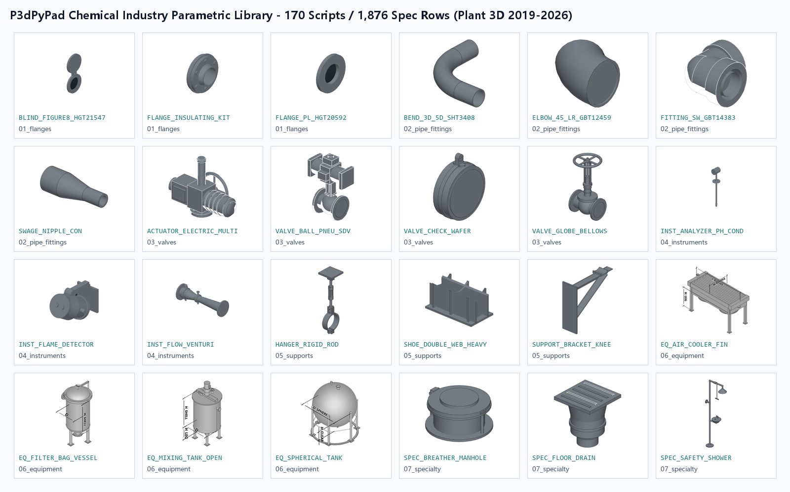
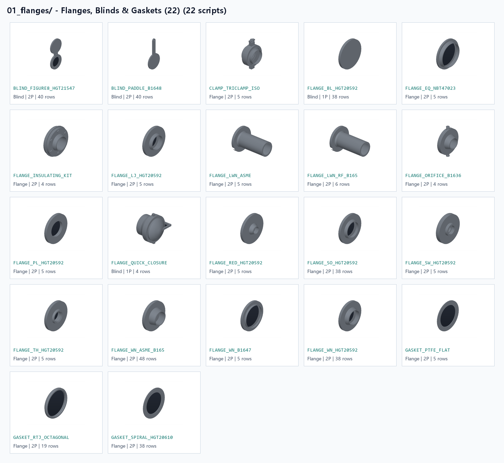
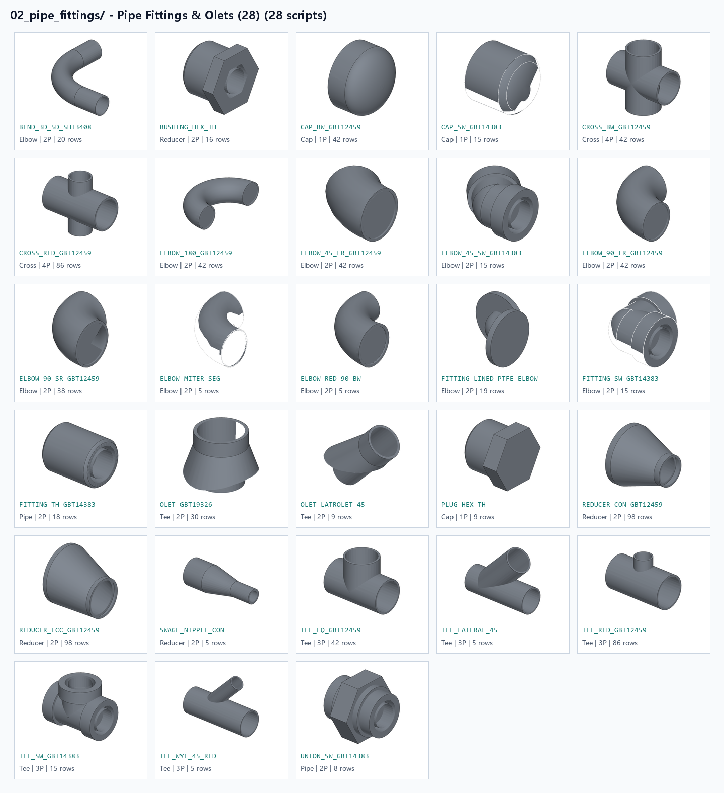
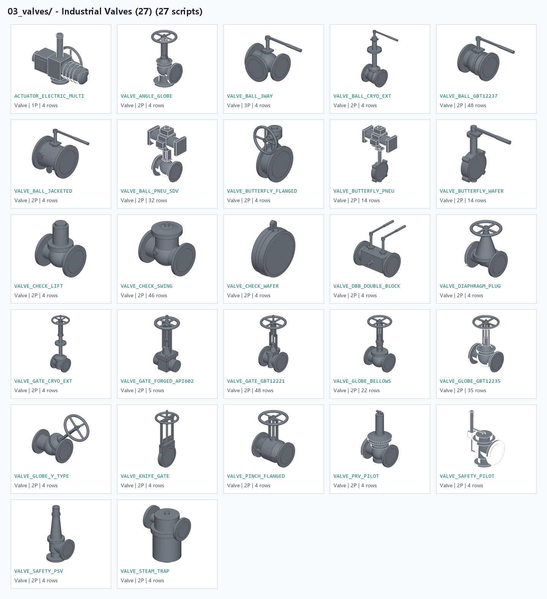
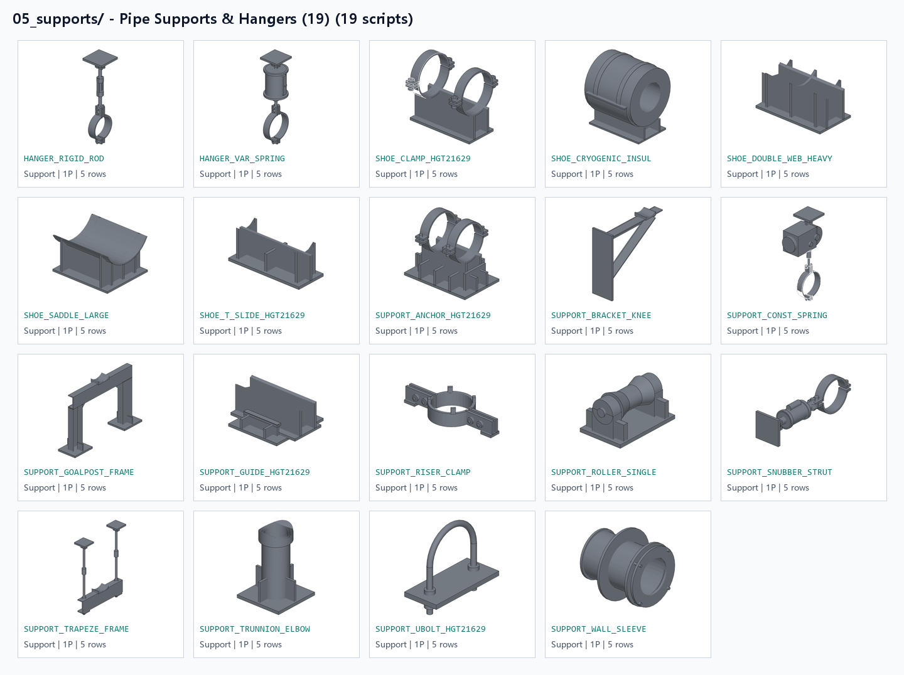
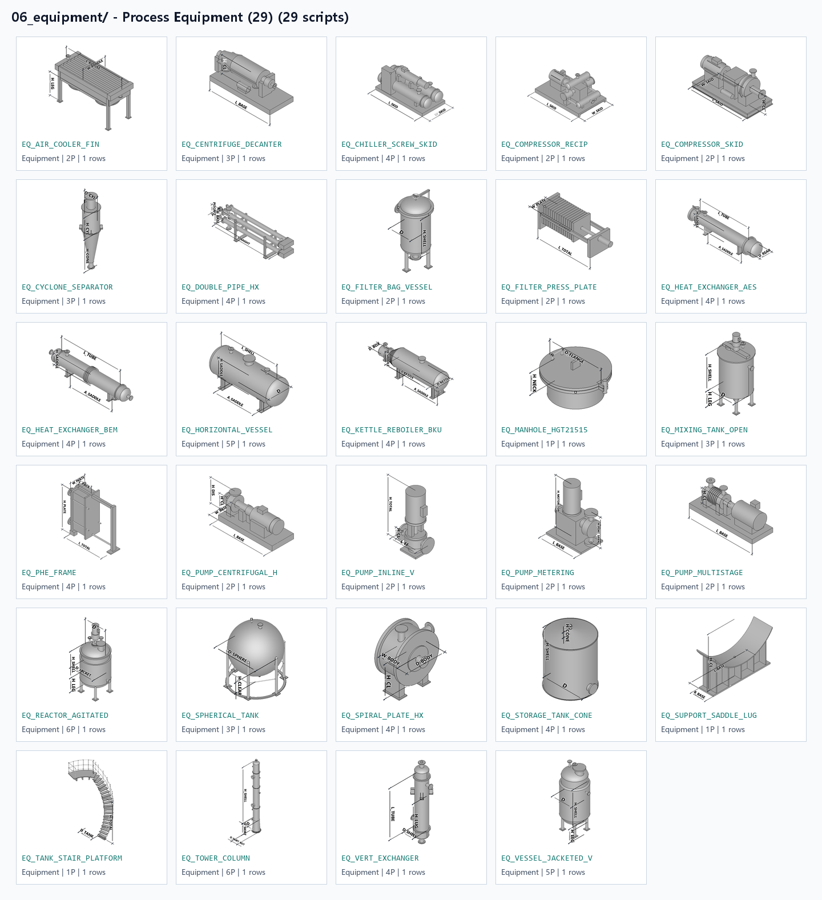
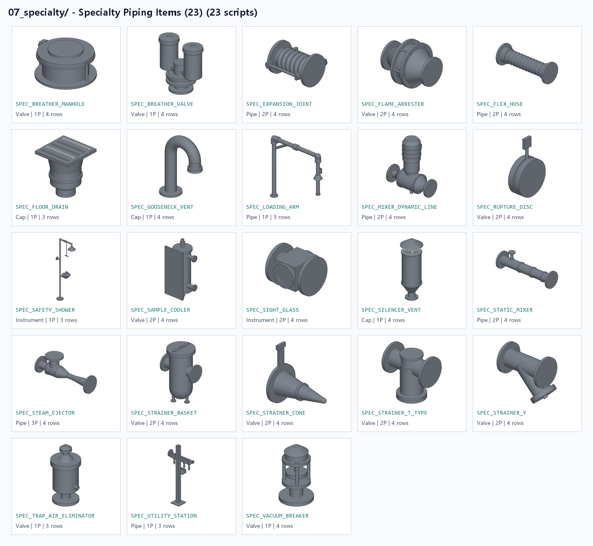

# Chemical Industry 170-Script AutoCAD Plant 3D Standard Component Library

[English](./README.md) | [简体中文](./README.zh-CN.md)

- **Total Components**: `170` scripts (100% PASS in `plant3d_occ` geometry/port validation and Plant 3D `inspect_script`)
- **Total Spec Rows**: `1,876` rows (`1,431` rows verified line-by-line against published standards)
- **Plant 3D 2026 Ready-to-Use Bundle**: [Plant 3D 2026 Installation & Usage Guide](../../docs/%E4%BD%BF%E7%94%A8%E8%AF%B4%E6%98%8E(AutoCAD%20Plant%203D%202026).md) | [Release v1.1.0](https://github.com/zly258/P3dPyPad/releases/tag/v1.1.0)
- **Online 3D Workbench & Report**: [https://zly258.github.io/P3dPyPad/](https://zly258.github.io/P3dPyPad/)
- **Full CSV Index**: [CATALOG_INDEX.csv](./CATALOG_INDEX.csv)

## Category Overview

| Directory | Category | Scripts | Spec Rows | Verified Standard Rows | Ports | Status |
|---|---|---:|---:|---|---:|---|
| `01_flanges/` | Flanges, Blinds & Gaskets | 22 | 367 | 325 rows | 42 | 100% PASS |
| `02_pipe_fittings/` | Pipe Fittings & Olets | 28 | 872 | 847 rows | 62 | 100% PASS |
| `03_valves/` | Industrial Valves | 27 | 336 | 259 rows | 54 | 100% PASS |
| `04_instruments/` | Process Instruments | 22 | 90 | Engineering reference | 37 | 100% PASS |
| `05_supports/` | Pipe Supports & Hangers | 19 | 95 | Engineering reference | 19 | 100% PASS |
| `06_equipment/` | Process Equipment | 29 | 29 | 1-row default template | 91 | 100% PASS |
| `07_specialty/` | Specialty Piping Items | 23 | 87 | Engineering reference | 37 | 100% PASS |

## Flanges, Blinds & Gaskets (22)

| # | Component | Script | Group | Ports | Spec Rows | Standard / Source |
|---:|---|---|---|---:|---:|---|
| 1 | Spectacle Blind (HG/T 21547 PN16 RF) | [`BLIND_FIGURE8_HGT21547.py`](./01_flanges/BLIND_FIGURE8_HGT21547.py) | Blind | 2 | 40 | Verified table: ASME B16.48 CL150 |
| 2 | Paddle Blind (ASME B16.48) | [`BLIND_PADDLE_B1648.py`](./01_flanges/BLIND_PADDLE_B1648.py) | Blind | 2 | 40 | Verified table: ASME B16.48 CL150(Wermac) |
| 3 | Sanitary Tri-Clamp Ferrule Joint (ISO 2852) | [`CLAMP_TRICLAMP_ISO.py`](./01_flanges/CLAMP_TRICLAMP_ISO.py) | Flange | 2 | 5 | Verified table: ISO 2852/DIN 32676(clamp envelope is engineering ref) |
| 4 | Blind Flange (HG/T 20592 BL PN16 RF) | [`FLANGE_BL_HGT20592.py`](./01_flanges/FLANGE_BL_HGT20592.py) | Blind | 1 | 38 | Verified table: HG/T 20592-2009(ghfitting) |
| 5 | Pressure Vessel Long Weld Neck Flange (NB/T 47023 DN400-1200) | [`FLANGE_EQ_NBT47023.py`](./01_flanges/FLANGE_EQ_NBT47023.py) | Flange | 2 | 5 | Standard ref: NB/T 47023-2012(Type-A slip-on vessel flange) |
| 6 | Insulating Flange Kit Assembly | [`FLANGE_INSULATING_KIT.py`](./01_flanges/FLANGE_INSULATING_KIT.py) | Flange | 2 | 4 | Engineering reference envelope (verify per vendor datasheet) |
| 7 | Lap Joint Flange with Stub End (HG/T 20592 PJ/SE PN16) | [`FLANGE_LJ_HGT20592.py`](./01_flanges/FLANGE_LJ_HGT20592.py) | Flange | 2 | 5 | Standard ref: HG/T 20592-2009(lap joint flange) |
| 8 | Long Weld Neck Flange (ASME LWN Class 150/300) | [`FLANGE_LWN_ASME.py`](./01_flanges/FLANGE_LWN_ASME.py) | Flange | 2 | 5 | Verified table: ASME B16.5/Wermac(neck length L is engineering series) |
| 9 | Long Weld Neck Nozzle Flange (ASME B16.5 LWN RF) | [`FLANGE_LWN_RF_B165.py`](./01_flanges/FLANGE_LWN_RF_B165.py) | Flange | 2 | 6 | Verified table: ASME B16.5/Wermac(neck length L is engineering series) |
| 10 | Orifice Flange Single (ASME B16.36 Class 300/600 RF) | [`FLANGE_ORIFICE_B1636.py`](./01_flanges/FLANGE_ORIFICE_B1636.py) | Flange | 2 | 4 | Standard ref: ASME B16.36(CL300orifice flange) |
| 11 | Plate Flat Welding Flange (HG/T 20592 PL PN16 RF) | [`FLANGE_PL_HGT20592.py`](./01_flanges/FLANGE_PL_HGT20592.py) | Flange | 2 | 5 | Verified table: HG/T 20592-2009(PL interface / B1 bore) |
| 12 | Quick Opening Closure | [`FLANGE_QUICK_CLOSURE.py`](./01_flanges/FLANGE_QUICK_CLOSURE.py) | Blind | 1 | 4 | Engineering reference envelope (verify per vendor datasheet) |
| 13 | Reducing Hubbed Flange (HG/T 20592 Reducing RF) | [`FLANGE_RED_HGT20592.py`](./01_flanges/FLANGE_RED_HGT20592.py) | Flange | 2 | 5 | Standard ref: HG/T 20592-2009(reducing flange) |
| 14 | Slip-On Hubbed Flange (HG/T 20592 SO PN16 RF) | [`FLANGE_SO_HGT20592.py`](./01_flanges/FLANGE_SO_HGT20592.py) | Flange | 2 | 38 | Verified table: HG/T 20592-2009(ghfitting) |
| 15 | Socket Welding Flange (HG/T 20592 SW PN40 RF) | [`FLANGE_SW_HGT20592.py`](./01_flanges/FLANGE_SW_HGT20592.py) | Flange | 2 | 5 | Standard ref: HG/T 20592-2009(SW PN40) |
| 16 | Threaded Flange (HG/T 20592 Th PN16 RF) | [`FLANGE_TH_HGT20592.py`](./01_flanges/FLANGE_TH_HGT20592.py) | Flange | 2 | 5 | Standard ref: HG/T 20592-2009(TH PN16) |
| 17 | Weld Neck Flange (ASME B16.5 WN RF) | [`FLANGE_WN_ASME_B165.py`](./01_flanges/FLANGE_WN_ASME_B165.py) | Flange | 2 | 48 | Verified table: ASME B16.5(Wermac) |
| 18 | Large Diameter Weld Neck Flange (ASME B16.47 Series A/B) | [`FLANGE_WN_B1647.py`](./01_flanges/FLANGE_WN_B1647.py) | Flange | 2 | 5 | Verified table: ASME B16.47/Wermac |
| 19 | Weld Neck Flange (HG/T 20592 WN PN16 RF) | [`FLANGE_WN_HGT20592.py`](./01_flanges/FLANGE_WN_HGT20592.py) | Flange | 2 | 38 | Verified table: HG/T 20592-2009(ghfitting) |
| 20 | PTFE Flat Non-Metallic Gasket (HG/T 20606 RF/FF) | [`GASKET_PTFE_FLAT.py`](./01_flanges/GASKET_PTFE_FLAT.py) | Flange | 2 | 5 | Standard ref: HG/T 20606-2009(PTFEflat gasket) |
| 21 | Octagonal Ring Type Joint Gasket RTJ (ASME B16.20 Type R) | [`GASKET_RTJ_OCTAGONAL.py`](./01_flanges/GASKET_RTJ_OCTAGONAL.py) | Flange | 2 | 19 | Verified table: ASME B16.20 RTJ(Wermac) |
| 22 | Spiral Wound Gasket (HG/T 20610 Type D PN16 RF) | [`GASKET_SPIRAL_HGT20610.py`](./01_flanges/GASKET_SPIRAL_HGT20610.py) | Flange | 2 | 38 | Verified table: ASME B16.20 CL150(Wermac) |

## Pipe Fittings & Olets (28)

| # | Component | Script | Group | Ports | Spec Rows | Standard / Source |
|---:|---|---|---|---:|---:|---|
| 1 | 3D/5D Long-Radius Induction Bend 90 deg (SH/T 3408) | [`BEND_3D_5D_SHT3408.py`](./02_pipe_fittings/BEND_3D_5D_SHT3408.py) | Elbow | 2 | 20 | Verified table: ASME B16.9(3D radius) + tangent engineering series |
| 2 | Forged Steel Hex Thread Bushing | [`BUSHING_HEX_TH.py`](./02_pipe_fittings/BUSHING_HEX_TH.py) | Reducer | 2 | 16 | Verified table: ASME B16.11(Wermac) |
| 3 | Butt-Welding Ellipsoidal Pipe Cap (GB/T 12459) | [`CAP_BW_GBT12459.py`](./02_pipe_fittings/CAP_BW_GBT12459.py) | Cap | 1 | 42 | Verified table: ASME B16.9/B36.10M(Wermac) |
| 4 | Forged Steel Socket-Welding Cap (GB/T 14383) | [`CAP_SW_GBT14383.py`](./02_pipe_fittings/CAP_SW_GBT14383.py) | Cap | 1 | 15 | Verified table: ASME B16.11(Wermac) |
| 5 | Butt-Welding Equal Cross (GB/T 12459) | [`CROSS_BW_GBT12459.py`](./02_pipe_fittings/CROSS_BW_GBT12459.py) | Cross | 4 | 42 | Verified table: ASME B16.9/B36.10M(Wermac) |
| 6 | Butt-Welding Reducing Cross (GB/T 12459) | [`CROSS_RED_GBT12459.py`](./02_pipe_fittings/CROSS_RED_GBT12459.py) | Cross | 4 | 86 | Verified table: ASME B16.9/B36.10M(Wermac) |
| 7 | 180 deg Butt-Welding Return Bend (GB/T 12459) | [`ELBOW_180_GBT12459.py`](./02_pipe_fittings/ELBOW_180_GBT12459.py) | Elbow | 2 | 42 | Verified table: ASME B16.9/B36.10M(Wermac) |
| 8 | 45 deg Long-Radius Butt-Welding Elbow (GB/T 12459) | [`ELBOW_45_LR_GBT12459.py`](./02_pipe_fittings/ELBOW_45_LR_GBT12459.py) | Elbow | 2 | 42 | Verified table: ASME B16.9/B36.10M(Wermac) |
| 9 | Forged Steel Socket-Welding 45 deg Elbow (GB/T 14383) | [`ELBOW_45_SW_GBT14383.py`](./02_pipe_fittings/ELBOW_45_SW_GBT14383.py) | Elbow | 2 | 15 | Verified table: ASME B16.11(Wermac) |
| 10 | 90 deg Long-Radius Butt-Welding Elbow 1.5D (GB/T 12459) | [`ELBOW_90_LR_GBT12459.py`](./02_pipe_fittings/ELBOW_90_LR_GBT12459.py) | Elbow | 2 | 42 | Verified table: ASME B16.9/B36.10M(Wermac) |
| 11 | 90 deg Short-Radius Butt-Welding Elbow 1.0D (GB/T 12459) | [`ELBOW_90_SR_GBT12459.py`](./02_pipe_fittings/ELBOW_90_SR_GBT12459.py) | Elbow | 2 | 38 | Verified table: ASME B16.9/B36.10M(Wermac) |
| 12 | 90 deg Segmented Miter Elbow | [`ELBOW_MITER_SEG.py`](./02_pipe_fittings/ELBOW_MITER_SEG.py) | Elbow | 2 | 5 | Engineering reference envelope (verify per vendor datasheet) |
| 13 | 90 deg Butt-Welding Reducing Elbow | [`ELBOW_RED_90_BW.py`](./02_pipe_fittings/ELBOW_RED_90_BW.py) | Elbow | 2 | 5 | Engineering reference envelope (verify per vendor datasheet) |
| 14 | PTFE/Rubber-Lined Flanged 90 deg Elbow | [`FITTING_LINED_PTFE_ELBOW.py`](./02_pipe_fittings/FITTING_LINED_PTFE_ELBOW.py) | Elbow | 2 | 19 | Verified table: HG/T 20592 PN16+ASME B16.9(lining thickness per engineering std) |
| 15 | Forged Steel Socket-Welding 90 deg Elbow (GB/T 14383) | [`FITTING_SW_GBT14383.py`](./02_pipe_fittings/FITTING_SW_GBT14383.py) | Elbow | 2 | 15 | Verified table: ASME B16.11(Wermac) |
| 16 | Forged Steel Threaded Coupling (GB/T 14383) | [`FITTING_TH_GBT14383.py`](./02_pipe_fittings/FITTING_TH_GBT14383.py) | Pipe | 2 | 18 | Verified table: ASME B16.11(Wermac) |
| 17 | Forged Butt-Welding Weldolet (GB/T 19326) | [`OLET_GBT19326.py`](./02_pipe_fittings/OLET_GBT19326.py) | Tee | 2 | 30 | Verified table: MSS SP-97(STD) |
| 18 | 45 deg Lateral Branch Olet / Latrolet (GB/T 19326) | [`OLET_LATROLET_45.py`](./02_pipe_fittings/OLET_LATROLET_45.py) | Tee | 2 | 9 | Verified table: MSS SP-97(Latrolet BW) |
| 19 | Forged Steel Hex Head Threaded Plug | [`PLUG_HEX_TH.py`](./02_pipe_fittings/PLUG_HEX_TH.py) | Cap | 1 | 9 | Verified table: ASME B16.11(Wermac) |
| 20 | Butt-Welding Concentric Reducer (GB/T 12459) | [`REDUCER_CON_GBT12459.py`](./02_pipe_fittings/REDUCER_CON_GBT12459.py) | Reducer | 2 | 98 | Verified table: ASME B16.9/B36.10M(Wermac) |
| 21 | Butt-Welding Eccentric Reducer (GB/T 12459) | [`REDUCER_ECC_GBT12459.py`](./02_pipe_fittings/REDUCER_ECC_GBT12459.py) | Reducer | 2 | 98 | Verified table: ASME B16.9/B36.10M(Wermac) |
| 22 | Concentric Swage Nipple (MSS SP-95) | [`SWAGE_NIPPLE_CON.py`](./02_pipe_fittings/SWAGE_NIPPLE_CON.py) | Reducer | 2 | 5 | Engineering reference envelope (verify per vendor datasheet) |
| 23 | Butt-Welding Equal Tee (GB/T 12459) | [`TEE_EQ_GBT12459.py`](./02_pipe_fittings/TEE_EQ_GBT12459.py) | Tee | 3 | 42 | Verified table: ASME B16.9/B36.10M(Wermac) |
| 24 | 45 deg Lateral Tee | [`TEE_LATERAL_45.py`](./02_pipe_fittings/TEE_LATERAL_45.py) | Tee | 3 | 5 | Engineering reference envelope (verify per vendor datasheet) |
| 25 | Butt-Welding Reducing Tee (GB/T 12459) | [`TEE_RED_GBT12459.py`](./02_pipe_fittings/TEE_RED_GBT12459.py) | Tee | 3 | 86 | Verified table: ASME B16.9/B36.10M(Wermac) |
| 26 | Forged Steel Socket-Welding Tee (GB/T 14383) | [`TEE_SW_GBT14383.py`](./02_pipe_fittings/TEE_SW_GBT14383.py) | Tee | 3 | 15 | Verified table: ASME B16.11(Wermac) |
| 27 | 45 deg Reducing Lateral Tee | [`TEE_WYE_45_RED.py`](./02_pipe_fittings/TEE_WYE_45_RED.py) | Tee | 3 | 5 | Engineering reference envelope (verify per vendor datasheet) |
| 28 | Forged Steel Socket-Welding Union (GB/T 14383) | [`UNION_SW_GBT14383.py`](./02_pipe_fittings/UNION_SW_GBT14383.py) | Pipe | 2 | 8 | Verified table: MSS SP-83(CL3000) |

## Industrial Valves (27)

| # | Component | Script | Group | Ports | Spec Rows | Standard / Source |
|---:|---|---|---|---:|---:|---|
| 1 | Multi-Turn Electric Actuator (ISO 5210) | [`ACTUATOR_ELECTRIC_MULTI.py`](./03_valves/ACTUATOR_ELECTRIC_MULTI.py) | Valve | 1 | 4 | Engineering reference envelope (verify per vendor datasheet) |
| 2 | 90 deg Angle Globe / Tank Bottom Drain Valve | [`VALVE_ANGLE_GLOBE.py`](./03_valves/VALVE_ANGLE_GLOBE.py) | Valve | 2 | 4 | Engineering reference envelope (verify per vendor datasheet) |
| 3 | 3-Way Flanged Ball Valve (T-Port) | [`VALVE_BALL_3WAY.py`](./03_valves/VALVE_BALL_3WAY.py) | Valve | 3 | 4 | Engineering reference envelope (verify per vendor datasheet) |
| 4 | Cryogenic Extended-Bonnet Flanged Ball Valve (BS 6364) | [`VALVE_BALL_CRYO_EXT.py`](./03_valves/VALVE_BALL_CRYO_EXT.py) | Valve | 2 | 4 | Verified face-to-face (GB/T 12221 / B16.10); handwheel/envelope per vendor |
| 5 | Flanged Steel Ball Valve (GB/T 12237) | [`VALVE_BALL_GBT12237.py`](./03_valves/VALVE_BALL_GBT12237.py) | Valve | 2 | 48 | Verified table: ASME B16.10face-to-face + ASME B16.5 flange (envelope proportional) |
| 6 | Steam-Jacketed Flanged Ball Valve | [`VALVE_BALL_JACKETED.py`](./03_valves/VALVE_BALL_JACKETED.py) | Valve | 2 | 4 | Engineering reference envelope (verify per vendor datasheet) |
| 7 | Pneumatic Emergency Shutdown Ball Valve (XV/SDV) | [`VALVE_BALL_PNEU_SDV.py`](./03_valves/VALVE_BALL_PNEU_SDV.py) | Valve | 2 | 32 | Verified table: ASME B16.10face-to-face + ASME B16.5 flange (envelope proportional) |
| 8 | Double-Flanged Eccentric Butterfly Valve (Worm Gear) | [`VALVE_BUTTERFLY_FLANGED.py`](./03_valves/VALVE_BUTTERFLY_FLANGED.py) | Valve | 2 | 4 | Engineering reference envelope (verify per vendor datasheet) |
| 9 | Pneumatic Wafer Butterfly Valve with Cylinder Actuator | [`VALVE_BUTTERFLY_PNEU.py`](./03_valves/VALVE_BUTTERFLY_PNEU.py) | Valve | 2 | 14 | Verified table: API 609 Cat A/ASME B16.10(actuator proportional) |
| 10 | Wafer Butterfly Valve (API 609 / GB/T 12238) | [`VALVE_BUTTERFLY_WAFER.py`](./03_valves/VALVE_BUTTERFLY_WAFER.py) | Valve | 2 | 14 | Verified table: API 609 Cat A/ASME B16.10(lever proportional) |
| 11 | Flanged Lift Check Valve (GB/T 12235) | [`VALVE_CHECK_LIFT.py`](./03_valves/VALVE_CHECK_LIFT.py) | Valve | 2 | 4 | Verified face-to-face (GB/T 12221 / B16.10); handwheel/envelope per vendor |
| 12 | Flanged Swing Check Valve (GB/T 12236) | [`VALVE_CHECK_SWING.py`](./03_valves/VALVE_CHECK_SWING.py) | Valve | 2 | 46 | Verified table: ASME B16.10face-to-face + ASME B16.5 flange (envelope proportional) |
| 13 | Wafer Dual-Plate Check Valve (API 594) | [`VALVE_CHECK_WAFER.py`](./03_valves/VALVE_CHECK_WAFER.py) | Valve | 2 | 4 | Engineering reference envelope (verify per vendor datasheet) |
| 14 | Double Block and Bleed Valve (DBB) | [`VALVE_DBB_DOUBLE_BLOCK.py`](./03_valves/VALVE_DBB_DOUBLE_BLOCK.py) | Valve | 2 | 4 | Engineering reference envelope (verify per vendor datasheet) |
| 15 | Flanged Weir-Type PTFE-Lined Diaphragm Valve (GB/T 12239) | [`VALVE_DIAPHRAGM_PLUG.py`](./03_valves/VALVE_DIAPHRAGM_PLUG.py) | Valve | 2 | 4 | Engineering reference envelope (verify per vendor datasheet) |
| 16 | Cryogenic Extended-Bonnet Gate Valve (BS 6364) | [`VALVE_GATE_CRYO_EXT.py`](./03_valves/VALVE_GATE_CRYO_EXT.py) | Valve | 2 | 4 | Verified face-to-face (GB/T 12221 / B16.10); handwheel/envelope per vendor |
| 17 | Forged Steel Socket-Welding Gate Valve (API 602) | [`VALVE_GATE_FORGED_API602.py`](./03_valves/VALVE_GATE_FORGED_API602.py) | Valve | 2 | 5 | Engineering reference envelope (verify per vendor datasheet) |
| 18 | Flanged OS&Y Wedge Gate Valve (GB/T 12221) | [`VALVE_GATE_GBT12221.py`](./03_valves/VALVE_GATE_GBT12221.py) | Valve | 2 | 48 | Verified table: ASME B16.10face-to-face + ASME B16.5 flange (envelope proportional) |
| 19 | Bellows-Sealed Globe Valve (GB/T 12235) | [`VALVE_GLOBE_BELLOWS.py`](./03_valves/VALVE_GLOBE_BELLOWS.py) | Valve | 2 | 22 | Verified table: ASME B16.10face-to-face + ASME B16.5 flange (envelope proportional) |
| 20 | Flanged Straight-Pattern Globe Valve (GB/T 12235) | [`VALVE_GLOBE_GBT12235.py`](./03_valves/VALVE_GLOBE_GBT12235.py) | Valve | 2 | 35 | Verified table: ASME B16.10face-to-face + ASME B16.5 flange (envelope proportional) |
| 21 | Y-Pattern Oblique-Stem Globe Valve | [`VALVE_GLOBE_Y_TYPE.py`](./03_valves/VALVE_GLOBE_Y_TYPE.py) | Valve | 2 | 4 | Verified face-to-face (GB/T 12221 / B16.10); handwheel/envelope per vendor |
| 22 | Wafer Knife Gate / Slurry Valve (MSS SP-81) | [`VALVE_KNIFE_GATE.py`](./03_valves/VALVE_KNIFE_GATE.py) | Valve | 2 | 4 | Engineering reference envelope (verify per vendor datasheet) |
| 23 | Flanged Pinch Valve | [`VALVE_PINCH_FLANGED.py`](./03_valves/VALVE_PINCH_FLANGED.py) | Valve | 2 | 4 | Engineering reference envelope (verify per vendor datasheet) |
| 24 | Pilot-Operated Piston Steam Pressure Reducing Valve (Y43H) | [`VALVE_PRV_PILOT.py`](./03_valves/VALVE_PRV_PILOT.py) | Valve | 2 | 4 | Engineering reference envelope (verify per vendor datasheet) |
| 25 | Pilot-Operated Pressure Relief Valve (API 526) | [`VALVE_SAFETY_PILOT.py`](./03_valves/VALVE_SAFETY_PILOT.py) | Valve | 2 | 4 | Engineering reference envelope (verify per vendor datasheet) |
| 26 | Spring-Loaded Full-Lift Safety Relief Valve (API 526) | [`VALVE_SAFETY_PSV.py`](./03_valves/VALVE_SAFETY_PSV.py) | Valve | 2 | 4 | Engineering reference envelope (verify per vendor datasheet) |
| 27 | Flanged Steam Trap (Inverted Bucket / Float) | [`VALVE_STEAM_TRAP.py`](./03_valves/VALVE_STEAM_TRAP.py) | Valve | 2 | 4 | Engineering reference envelope (verify per vendor datasheet) |

## Process Instruments (22)

| # | Component | Script | Group | Ports | Spec Rows | Standard / Source |
|---:|---|---|---|---:|---:|---|
| 1 | Inline pH / Conductivity Process Analyzer Assembly (HG/T 20592) | [`INST_ANALYZER_PH_COND.py`](./04_instruments/INST_ANALYZER_PH_COND.py) | Instrument | 1 | 4 | Verified interface(HG/T 20592) + transmitter envelope (verify per vendor) |
| 2 | Pneumatic Diaphragm 3-Way Control Valve (GB/T 4213) | [`INST_CONTROL_3WAY.py`](./04_instruments/INST_CONTROL_3WAY.py) | Instrument | 3 | 4 | Verified interface(HG/T 20592) + transmitter envelope (verify per vendor) |
| 3 | Electric Single-Seated Control Valve (GB/T 4213) | [`INST_CONTROL_ELECTRIC.py`](./04_instruments/INST_CONTROL_ELECTRIC.py) | Instrument | 2 | 4 | Verified interface(HG/T 20592) + transmitter envelope (verify per vendor) |
| 4 | Pneumatic V-Ball / Eccentric Rotary Control Valve (ISO 5211) | [`INST_CONTROL_ROTARY.py`](./04_instruments/INST_CONTROL_ROTARY.py) | Instrument | 2 | 4 | Verified interface(HG/T 20592) + transmitter envelope (verify per vendor) |
| 5 | Pneumatic Diaphragm Single-Seated Control Valve (GB/T 4213) | [`INST_CONTROL_VALVE.py`](./04_instruments/INST_CONTROL_VALVE.py) | Instrument | 2 | 4 | Verified interface(HG/T 20592) + transmitter envelope (verify per vendor) |
| 6 | Explosion-Proof UV/IR Flame Detector (GB/T 50493) | [`INST_FLAME_DETECTOR.py`](./04_instruments/INST_FLAME_DETECTOR.py) | Instrument | 1 | 4 | Non-flanged field instrument; housing/bracket per vendor |
| 7 | Coriolis Mass Flowmeter (GB/T 31130) | [`INST_FLOW_CORIOLIS.py`](./04_instruments/INST_FLOW_CORIOLIS.py) | Instrument | 2 | 4 | Verified interface(HG/T 20592) + transmitter envelope (verify per vendor) |
| 8 | Flanged Electromagnetic Flowmeter (JB/T 9248) | [`INST_FLOW_MAG.py`](./04_instruments/INST_FLOW_MAG.py) | Instrument | 2 | 5 | Verified interface(HG/T 20592) + transmitter envelope (verify per vendor) |
| 9 | Orifice Plate Flowmeter Flange Assembly (GB/T 2624 / ASME B16.36) | [`INST_FLOW_ORIFICE.py`](./04_instruments/INST_FLOW_ORIFICE.py) | Instrument | 2 | 5 | Verified interface(ASME B16.36) + transmitter envelope (verify per vendor) |
| 10 | Metal-Tube Variable Area Rotameter (JB/T 6844) | [`INST_FLOW_ROTAMETER.py`](./04_instruments/INST_FLOW_ROTAMETER.py) | Instrument | 2 | 4 | Verified interface(HG/T 20592) + transmitter envelope (verify per vendor) |
| 11 | Classical Venturi Tube Flowmeter (GB/T 2624.4 / ISO 5167) | [`INST_FLOW_VENTURI.py`](./04_instruments/INST_FLOW_VENTURI.py) | Instrument | 2 | 4 | Verified interface(HG/T 20592) + transmitter envelope (verify per vendor) |
| 12 | Flanged Vortex Shedding Flowmeter (JB/T 9249) | [`INST_FLOW_VORTEX.py`](./04_instruments/INST_FLOW_VORTEX.py) | Instrument | 2 | 4 | Verified interface(HG/T 20592) + transmitter envelope (verify per vendor) |
| 13 | Explosion-Proof Combustible/Toxic Gas Detector (GB/T 50493) | [`INST_GAS_DETECTOR.py`](./04_instruments/INST_GAS_DETECTOR.py) | Instrument | 1 | 4 | Non-flanged field instrument; housing/bracket per vendor |
| 14 | External-Cage Displacer Level Transmitter (JB/T 9242) | [`INST_LEVEL_DISPLACER.py`](./04_instruments/INST_LEVEL_DISPLACER.py) | Instrument | 2 | 4 | Verified interface(HG/T 20592) + transmitter envelope (verify per vendor) |
| 15 | Reflex / Transparent Glass Level Gauge (HG/T 21592) | [`INST_LEVEL_GLASS_GAUGE.py`](./04_instruments/INST_LEVEL_GLASS_GAUGE.py) | Instrument | 2 | 4 | Verified interface(HG/T 20592) + transmitter envelope (verify per vendor) |
| 16 | Side-Mounted Dual-Flange Magnetic Level Gauge (HG/T 21584) | [`INST_LEVEL_MAGNETIC.py`](./04_instruments/INST_LEVEL_MAGNETIC.py) | Instrument | 2 | 4 | Verified interface(HG/T 20592) + transmitter envelope (verify per vendor) |
| 17 | Top-Mounted Flanged Radar Level Transmitter (GB/T 20729) | [`INST_LEVEL_RADAR.py`](./04_instruments/INST_LEVEL_RADAR.py) | Instrument | 1 | 4 | Verified interface(HG/T 20592) + transmitter envelope (verify per vendor) |
| 18 | Side-Mounted Flanged Tuning-Fork Level Switch (GB/T 34041) | [`INST_LEVEL_TUNING_FORK.py`](./04_instruments/INST_LEVEL_TUNING_FORK.py) | Instrument | 1 | 4 | Verified interface(HG/T 20592) + transmitter envelope (verify per vendor) |
| 19 | Pressure Gauge Assembly with Root Valve (GB/T 1226) | [`INST_PRESSURE_GAUGE.py`](./04_instruments/INST_PRESSURE_GAUGE.py) | Instrument | 1 | 4 | Verified interface(HG/T 20592) + transmitter envelope (verify per vendor) |
| 20 | Pressure / DP Transmitter with 3-Valve Manifold (IEC 61518) | [`INST_PT_DPT_TRANSMITTER.py`](./04_instruments/INST_PT_DPT_TRANSMITTER.py) | Instrument | 1 | 4 | Verified interface(HG/T 20592) + transmitter envelope (verify per vendor) |
| 21 | Self-Actuated Pressure Regulator / Nitrogen Blanketing Valve (GB/T 12244) | [`INST_SELF_REGULATOR.py`](./04_instruments/INST_SELF_REGULATOR.py) | Instrument | 2 | 4 | Verified interface(HG/T 20592) + transmitter envelope (verify per vendor) |
| 22 | Flanged Thermocouple / RTD with Tapered Thermowell (ASME PTC 19.3) | [`INST_TEMP_THERMOWELL.py`](./04_instruments/INST_TEMP_THERMOWELL.py) | Instrument | 1 | 4 | Verified interface(HG/T 20592) + transmitter envelope (verify per vendor) |

## Pipe Supports & Hangers (19)

| # | Component | Script | Group | Ports | Spec Rows | Standard / Source |
|---:|---|---|---|---:|---:|---|
| 1 | Rigid Single-Rod Pipe Hanger (HG/T 21629 H1) | [`HANGER_RIGID_ROD.py`](./05_supports/HANGER_RIGID_ROD.py) | Support | 1 | 5 | Verified pipe OD Series I + structural shapes per HG/T 21629-2021 |
| 2 | Variable Spring Pipe Hanger (NB/T 47039 VS) | [`HANGER_VAR_SPRING.py`](./05_supports/HANGER_VAR_SPRING.py) | Support | 1 | 5 | Verified pipe OD Series I + structural shapes per HG/T 21629-2021 |
| 3 | Clamped Sliding Pipe Shoe (HG/T 21629 A4) | [`SHOE_CLAMP_HGT21629.py`](./05_supports/SHOE_CLAMP_HGT21629.py) | Support | 1 | 5 | Verified pipe OD Series I + structural shapes per HG/T 21629-2021 |
| 4 | High-Density Cryogenic Insulated Pipe Shoe (HG/T 21629 C1) | [`SHOE_CRYOGENIC_INSUL.py`](./05_supports/SHOE_CRYOGENIC_INSUL.py) | Support | 1 | 5 | Verified pipe OD Series I + structural shapes per HG/T 21629-2021 |
| 5 | Double-Web Heavy Welded Sliding Pipe Shoe (HG/T 21629 A2) | [`SHOE_DOUBLE_WEB_HEAVY.py`](./05_supports/SHOE_DOUBLE_WEB_HEAVY.py) | Support | 1 | 5 | Verified pipe OD Series I + structural shapes per HG/T 21629-2021 |
| 6 | Large-Bore Curved Saddle Pipe Shoe (120 deg) | [`SHOE_SADDLE_LARGE.py`](./05_supports/SHOE_SADDLE_LARGE.py) | Support | 1 | 5 | Verified pipe OD Series I + structural shapes per HG/T 21629-2021 |
| 7 | T-Type Welded Sliding Pipe Shoe (HG/T 21629 A1) | [`SHOE_T_SLIDE_HGT21629.py`](./05_supports/SHOE_T_SLIDE_HGT21629.py) | Support | 1 | 5 | Verified pipe OD Series I + structural shapes per HG/T 21629-2021 |
| 8 | 4-Way Anchor Pipe Support (HG/T 21629 D1) | [`SUPPORT_ANCHOR_HGT21629.py`](./05_supports/SUPPORT_ANCHOR_HGT21629.py) | Support | 1 | 5 | Verified pipe OD Series I + structural shapes per HG/T 21629-2021 |
| 9 | Angle-Steel Knee-Braced Cantilever Bracket | [`SUPPORT_BRACKET_KNEE.py`](./05_supports/SUPPORT_BRACKET_KNEE.py) | Support | 1 | 5 | Verified pipe OD Series I + structural shapes per HG/T 21629-2021 |
| 10 | Constant-Effort Spring Hanger / Support (NB/T 47038 CS) | [`SUPPORT_CONST_SPRING.py`](./05_supports/SUPPORT_CONST_SPRING.py) | Support | 1 | 5 | Verified pipe OD Series I + structural shapes per HG/T 21629-2021 |
| 11 | Channel-Steel Floor Goalpost Pipe Frame (HG/T 21629 L1) | [`SUPPORT_GOALPOST_FRAME.py`](./05_supports/SUPPORT_GOALPOST_FRAME.py) | Support | 1 | 5 | Verified pipe OD Series I + structural shapes per HG/T 21629-2021 |
| 12 | Guided Pipe Shoe Support (HG/T 21629 B1) | [`SUPPORT_GUIDE_HGT21629.py`](./05_supports/SUPPORT_GUIDE_HGT21629.py) | Support | 1 | 5 | Verified pipe OD Series I + structural shapes per HG/T 21629-2021 |
| 13 | Vertical Riser Double-Lug Clamp Support (HG/T 21629 G1) | [`SUPPORT_RISER_CLAMP.py`](./05_supports/SUPPORT_RISER_CLAMP.py) | Support | 1 | 5 | Verified pipe OD Series I + structural shapes per HG/T 21629-2021 |
| 14 | Single-Roller Sliding Pipe Support (HG/T 21629 E1) | [`SUPPORT_ROLLER_SINGLE.py`](./05_supports/SUPPORT_ROLLER_SINGLE.py) | Support | 1 | 5 | Verified pipe OD Series I + structural shapes per HG/T 21629-2021 |
| 15 | Rigid Strut / Hydraulic Snubber | [`SUPPORT_SNUBBER_STRUT.py`](./05_supports/SUPPORT_SNUBBER_STRUT.py) | Support | 1 | 5 | Verified pipe OD Series I + structural shapes per HG/T 21629-2021 |
| 16 | Double-Rod Trapeze Pipe Hanger (HG/T 21629 H3) | [`SUPPORT_TRAPEZE_FRAME.py`](./05_supports/SUPPORT_TRAPEZE_FRAME.py) | Support | 1 | 5 | Verified pipe OD Series I + structural shapes per HG/T 21629-2021 |
| 17 | Elbow Dummy-Leg / Trunnion Support (HG/T 21629 F1) | [`SUPPORT_TRUNNION_ELBOW.py`](./05_supports/SUPPORT_TRUNNION_ELBOW.py) | Support | 1 | 5 | Verified pipe OD Series I + structural shapes per HG/T 21629-2021 |
| 18 | U-Bolt Pipe Clamp (HG/T 21629 J1) | [`SUPPORT_UBOLT_HGT21629.py`](./05_supports/SUPPORT_UBOLT_HGT21629.py) | Support | 1 | 5 | Verified pipe OD Series I + structural shapes per HG/T 21629-2021 |
| 19 | Waterproof Wall / Floor Penetration Sleeve (02S404) | [`SUPPORT_WALL_SLEEVE.py`](./05_supports/SUPPORT_WALL_SLEEVE.py) | Support | 1 | 5 | Verified pipe OD Series I + structural shapes per HG/T 21629-2021 |

## Process Equipment (29)

| # | Component | Script | Group | Ports | Spec Rows | Standard / Source |
|---:|---|---|---|---:|---:|---|
| 1 | Forced-Draft Fin-Tube Air Cooler (API 661) | [`EQ_AIR_COOLER_FIN.py`](./06_equipment/EQ_AIR_COOLER_FIN.py) | Equipment | 2 | 1 | Default equipment envelope template (input project datasheet dims) |
| 2 | Horizontal Decanter Centrifuge | [`EQ_CENTRIFUGE_DECANTER.py`](./06_equipment/EQ_CENTRIFUGE_DECANTER.py) | Equipment | 3 | 1 | Default equipment envelope template (input project datasheet dims) |
| 3 | Screw Chiller Skid Package | [`EQ_CHILLER_SCREW_SKID.py`](./06_equipment/EQ_CHILLER_SCREW_SKID.py) | Equipment | 4 | 1 | Default equipment envelope template (input project datasheet dims) |
| 4 | Reciprocating Piston Compressor Skid | [`EQ_COMPRESSOR_RECIP.py`](./06_equipment/EQ_COMPRESSOR_RECIP.py) | Equipment | 2 | 1 | Default equipment envelope template (input project datasheet dims) |
| 5 | Centrifugal Compressor / Blower Skid (API 617) | [`EQ_COMPRESSOR_SKID.py`](./06_equipment/EQ_COMPRESSOR_SKID.py) | Equipment | 2 | 1 | Default equipment envelope template (input project datasheet dims) |
| 6 | Cyclone Separator with Tangential Rectangular Inlet | [`EQ_CYCLONE_SEPARATOR.py`](./06_equipment/EQ_CYCLONE_SEPARATOR.py) | Equipment | 3 | 1 | Default equipment envelope template (input project datasheet dims) |
| 7 | Double-Pipe Hairpin Heat Exchanger | [`EQ_DOUBLE_PIPE_HX.py`](./06_equipment/EQ_DOUBLE_PIPE_HX.py) | Equipment | 4 | 1 | Default equipment envelope template (input project datasheet dims) |
| 8 | Multi-Bag Filter Pressure Vessel | [`EQ_FILTER_BAG_VESSEL.py`](./06_equipment/EQ_FILTER_BAG_VESSEL.py) | Equipment | 2 | 1 | Default equipment envelope template (input project datasheet dims) |
| 9 | Chamber / Plate-and-Frame Filter Press | [`EQ_FILTER_PRESS_PLATE.py`](./06_equipment/EQ_FILTER_PRESS_PLATE.py) | Equipment | 2 | 1 | Default equipment envelope template (input project datasheet dims) |
| 10 | Floating-Head Shell-and-Tube Heat Exchanger (GB/T 151 AES) | [`EQ_HEAT_EXCHANGER_AES.py`](./06_equipment/EQ_HEAT_EXCHANGER_AES.py) | Equipment | 4 | 1 | Default equipment envelope template (input project datasheet dims) |
| 11 | Fixed-Tubesheet Shell-and-Tube Heat Exchanger (GB/T 151 BEM) | [`EQ_HEAT_EXCHANGER_BEM.py`](./06_equipment/EQ_HEAT_EXCHANGER_BEM.py) | Equipment | 4 | 1 | Default equipment envelope template (input project datasheet dims) |
| 12 | Horizontal Storage Drum / Separator (NB/T 47042) | [`EQ_HORIZONTAL_VESSEL.py`](./06_equipment/EQ_HORIZONTAL_VESSEL.py) | Equipment | 5 | 1 | Default equipment envelope template (input project datasheet dims) |
| 13 | BKU Kettle Reboiler (GB/T 151) | [`EQ_KETTLE_REBOILER_BKU.py`](./06_equipment/EQ_KETTLE_REBOILER_BKU.py) | Equipment | 4 | 1 | Default equipment envelope template (input project datasheet dims) |
| 14 | Steel Swing-Cover Manhole Assembly (HG/T 21515) | [`EQ_MANHOLE_HGT21515.py`](./06_equipment/EQ_MANHOLE_HGT21515.py) | Equipment | 1 | 1 | Default equipment envelope template (input project datasheet dims) |
| 15 | Flat-Cover Agitated Mixing Tank | [`EQ_MIXING_TANK_OPEN.py`](./06_equipment/EQ_MIXING_TANK_OPEN.py) | Equipment | 3 | 1 | Default equipment envelope template (input project datasheet dims) |
| 16 | Gasketed Plate Heat Exchanger (NB/T 47004) | [`EQ_PHE_FRAME.py`](./06_equipment/EQ_PHE_FRAME.py) | Equipment | 4 | 1 | Default equipment envelope template (input project datasheet dims) |
| 17 | Horizontal Single-Stage Centrifugal Pump Assembly (GB/T 5662 / ISO 2858) | [`EQ_PUMP_CENTRIFUGAL_H.py`](./06_equipment/EQ_PUMP_CENTRIFUGAL_H.py) | Equipment | 2 | 1 | Default equipment envelope template (input project datasheet dims) |
| 18 | Vertical In-Line Centrifugal Pump | [`EQ_PUMP_INLINE_V.py`](./06_equipment/EQ_PUMP_INLINE_V.py) | Equipment | 2 | 1 | Default equipment envelope template (input project datasheet dims) |
| 19 | Metering / Diaphragm Dosing Pump Assembly | [`EQ_PUMP_METERING.py`](./06_equipment/EQ_PUMP_METERING.py) | Equipment | 2 | 1 | Default equipment envelope template (input project datasheet dims) |
| 20 | Horizontal Multistage Centrifugal Pump Assembly | [`EQ_PUMP_MULTISTAGE.py`](./06_equipment/EQ_PUMP_MULTISTAGE.py) | Equipment | 2 | 1 | Default equipment envelope template (input project datasheet dims) |
| 21 | Jacketed Agitated Chemical Reactor (GB/T 150) | [`EQ_REACTOR_AGITATED.py`](./06_equipment/EQ_REACTOR_AGITATED.py) | Equipment | 6 | 1 | Default equipment envelope template (input project datasheet dims) |
| 22 | Spherical Storage Tank (GB/T 12337) | [`EQ_SPHERICAL_TANK.py`](./06_equipment/EQ_SPHERICAL_TANK.py) | Equipment | 3 | 1 | Default equipment envelope template (input project datasheet dims) |
| 23 | Spiral Plate Heat Exchanger (GB/T 28712) | [`EQ_SPIRAL_PLATE_HX.py`](./06_equipment/EQ_SPIRAL_PLATE_HX.py) | Equipment | 4 | 1 | Default equipment envelope template (input project datasheet dims) |
| 24 | Atmospheric Cone-Roof Vertical Storage Tank (NB/T 47003.1) | [`EQ_STORAGE_TANK_CONE.py`](./06_equipment/EQ_STORAGE_TANK_CONE.py) | Equipment | 4 | 1 | Default equipment envelope template (input project datasheet dims) |
| 25 | Standard Vessel Saddle Support Assembly (NB/T 47065.1) | [`EQ_SUPPORT_SADDLE_LUG.py`](./06_equipment/EQ_SUPPORT_SADDLE_LUG.py) | Equipment | 1 | 1 | Default equipment envelope template (input project datasheet dims) |
| 26 | Tank / Column Spiral Stairway & Top Platform (HG/T 21541) | [`EQ_TANK_STAIR_PLATFORM.py`](./06_equipment/EQ_TANK_STAIR_PLATFORM.py) | Equipment | 1 | 1 | Default equipment envelope template (input project datasheet dims) |
| 27 | Distillation / Absorption Column (NB/T 47041) | [`EQ_TOWER_COLUMN.py`](./06_equipment/EQ_TOWER_COLUMN.py) | Equipment | 6 | 1 | Default equipment envelope template (input project datasheet dims) |
| 28 | Vertical Thermosyphon Reboiler / Condenser (GB/T 151) | [`EQ_VERT_EXCHANGER.py`](./06_equipment/EQ_VERT_EXCHANGER.py) | Equipment | 4 | 1 | Default equipment envelope template (input project datasheet dims) |
| 29 | Vertical Jacketed Buffer / Storage Vessel | [`EQ_VESSEL_JACKETED_V.py`](./06_equipment/EQ_VESSEL_JACKETED_V.py) | Equipment | 5 | 1 | Default equipment envelope template (input project datasheet dims) |

## Specialty Piping Items (23)

| # | Component | Script | Group | Ports | Spec Rows | Standard / Source |
|---:|---|---|---|---:|---:|---|
| 1 | Emergency Pressure Relief Breather Manhole (SY/T 0511) | [`SPEC_BREATHER_MANHOLE.py`](./07_specialty/SPEC_BREATHER_MANHOLE.py) | Valve | 1 | 4 | Verified flange (HG/T 20592) + specialty body envelope |
| 2 | Storage Tank Flame-Arrester Breather Valve (SY/T 0511) | [`SPEC_BREATHER_VALVE.py`](./07_specialty/SPEC_BREATHER_VALVE.py) | Valve | 1 | 4 | Verified flange (HG/T 20592) + specialty body envelope |
| 3 | Axial Metal Bellows Expansion Joint (GB/T 12777) | [`SPEC_EXPANSION_JOINT.py`](./07_specialty/SPEC_EXPANSION_JOINT.py) | Pipe | 2 | 4 | Verified flange (HG/T 20592) + specialty body envelope |
| 4 | In-Line Deflagration / Detonation Flame Arrester (GB/T 13347) | [`SPEC_FLAME_ARRESTER.py`](./07_specialty/SPEC_FLAME_ARRESTER.py) | Valve | 2 | 4 | Verified flange (HG/T 20592) + specialty body envelope |
| 5 | Flanged Corrugated Metal Flexible Hose Assembly (GB/T 14525) | [`SPEC_FLEX_HOSE.py`](./07_specialty/SPEC_FLEX_HOSE.py) | Pipe | 2 | 4 | Verified flange (HG/T 20592) + specialty body envelope |
| 6 | Explosion-Proof Industrial Floor Drain (HG/T 20570) | [`SPEC_FLOOR_DRAIN.py`](./07_specialty/SPEC_FLOOR_DRAIN.py) | Cap | 1 | 3 | Verified flange (HG/T 20592) + specialty body envelope |
| 7 | Gooseneck Atmospheric Vent Pipe (HG/T 21574) | [`SPEC_GOOSENECK_VENT.py`](./07_specialty/SPEC_GOOSENECK_VENT.py) | Cap | 1 | 4 | Verified flange (HG/T 20592) + specialty body envelope |
| 8 | Top/Bottom Tanker Loading Arm (HG/T 21608) | [`SPEC_LOADING_ARM.py`](./07_specialty/SPEC_LOADING_ARM.py) | Pipe | 1 | 3 | Verified flange (HG/T 20592) + specialty body envelope |
| 9 | In-Line Dynamic Pipeline Mixer | [`SPEC_MIXER_DYNAMIC_LINE.py`](./07_specialty/SPEC_MIXER_DYNAMIC_LINE.py) | Pipe | 2 | 4 | Verified flange (HG/T 20592) + specialty body envelope |
| 10 | Wafer Rupture Disc Safety Assembly (GB/T 567) | [`SPEC_RUPTURE_DISC.py`](./07_specialty/SPEC_RUPTURE_DISC.py) | Valve | 2 | 4 | Verified flange (HG/T 20592) + specialty body envelope |
| 11 | Emergency Safety Shower & Eyewash Station (ANSI Z358.1) | [`SPEC_SAFETY_SHOWER.py`](./07_specialty/SPEC_SAFETY_SHOWER.py) | Instrument | 1 | 3 | Verified flange (HG/T 20592) + specialty body envelope |
| 12 | High-Pressure Sample Cooler (SH/T 3104) | [`SPEC_SAMPLE_COOLER.py`](./07_specialty/SPEC_SAMPLE_COOLER.py) | Valve | 2 | 4 | Verified flange (HG/T 20592) + specialty body envelope |
| 13 | Straight-Through Flanged Sight Flow Glass (HG/T 21619) | [`SPEC_SIGHT_GLASS.py`](./07_specialty/SPEC_SIGHT_GLASS.py) | Instrument | 2 | 4 | Verified flange (HG/T 20592) + specialty body envelope |
| 14 | Atmospheric Vent Silencer | [`SPEC_SILENCER_VENT.py`](./07_specialty/SPEC_SILENCER_VENT.py) | Cap | 1 | 4 | Verified flange (HG/T 20592) + specialty body envelope |
| 15 | Flanged Tubular Static Mixer | [`SPEC_STATIC_MIXER.py`](./07_specialty/SPEC_STATIC_MIXER.py) | Pipe | 2 | 4 | Verified flange (HG/T 20592) + specialty body envelope |
| 16 | Steam Jet Ejector / Mixer (HG/T 20592) | [`SPEC_STEAM_EJECTOR.py`](./07_specialty/SPEC_STEAM_EJECTOR.py) | Pipe | 3 | 4 | Verified flange (HG/T 20592) + specialty body envelope |
| 17 | Flanged Basket Strainer (HG/T 21637) | [`SPEC_STRAINER_BASKET.py`](./07_specialty/SPEC_STRAINER_BASKET.py) | Valve | 2 | 4 | Verified flange (HG/T 20592) + specialty body envelope |
| 18 | Temporary Conical Startup Strainer (HG/T 21637) | [`SPEC_STRAINER_CONE.py`](./07_specialty/SPEC_STRAINER_CONE.py) | Valve | 2 | 4 | Verified flange (HG/T 20592) + specialty body envelope |
| 19 | T-Type Pipeline Strainer (HG/T 21637) | [`SPEC_STRAINER_T_TYPE.py`](./07_specialty/SPEC_STRAINER_T_TYPE.py) | Valve | 2 | 4 | Verified flange (HG/T 20592) + specialty body envelope |
| 20 | Flanged Y-Type Strainer (HG/T 21637) | [`SPEC_STRAINER_Y.py`](./07_specialty/SPEC_STRAINER_Y.py) | Valve | 2 | 4 | Verified flange (HG/T 20592) + specialty body envelope |
| 21 | Automatic Air Vent / Air Eliminator | [`SPEC_TRAP_AIR_ELIMINATOR.py`](./07_specialty/SPEC_TRAP_AIR_ELIMINATOR.py) | Valve | 1 | 3 | Verified flange (HG/T 20592) + specialty body envelope |
| 22 | Plant Utility Hose Station (HG/T 20570) | [`SPEC_UTILITY_STATION.py`](./07_specialty/SPEC_UTILITY_STATION.py) | Pipe | 1 | 3 | Verified flange (HG/T 20592) + specialty body envelope |
| 23 | Tank Roof Vacuum Breaker Valve | [`SPEC_VACUUM_BREAKER.py`](./07_specialty/SPEC_VACUUM_BREAKER.py) | Valve | 1 | 4 | Verified flange (HG/T 20592) + specialty body envelope |

## Standards & AutoCAD Plant 3D Import Notes

Verified dimensions are sourced line-by-line from `ASME B36.10M`, `ASME B16.9`, `ASME B16.11`, `MSS SP-83`, `MSS SP-97`, `HG/T 20592 PN16 / PN40`, `ASME B16.5`, `ASME B16.48`, `ASME B16.20`, `ASME B16.10`, and `API 609`. Copy `.py` and `.csv` files into `CPak Common\CustomScripts` and publish via `P3dPyPad` or run `PLANTREGISTERCUSTOMSCRIPTS`. Note that 90-degree valves (`VALVE_ANGLE_GLOBE`, `VALVE_SAFETY_PSV`, `VALVE_SAFETY_PILOT`) must connect at pipe endpoints or nozzles rather than mid-pipe.
